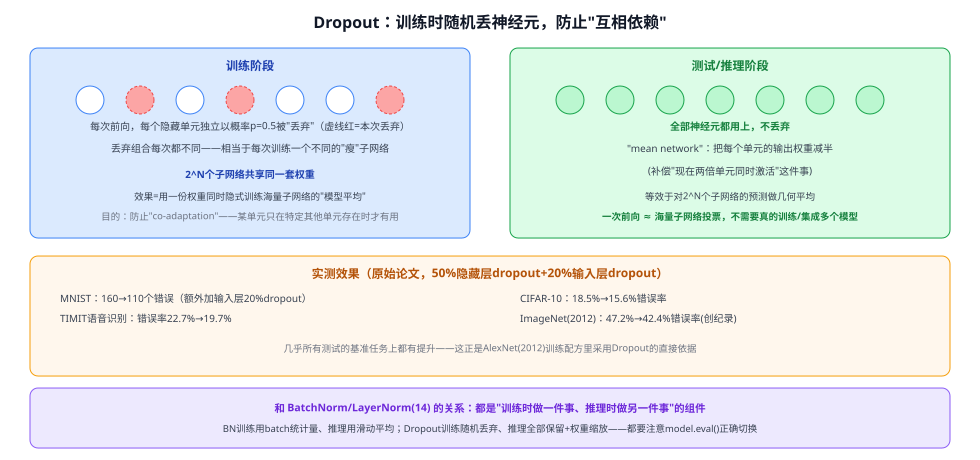

# 14b Dropout

> 定位：**最经典的神经网络正则化技巧**——训练时随机丢弃一部分神经元，防止过拟合。和 14 BatchNorm/LayerNorm、14a Adam 一样，是几乎每个深度学习训练配方都会用到、却常被当作"理所当然"、很少真正讲清楚原理的基础组件。06 AlexNet 的训练配方里明确用了 Dropout。
> 作者：Hinton, Srivastava, Krizhevsky, Sutskever, Salakhutdinov（多伦多大学），arXiv:1207.0580（2012 预印本；完整版 *Dropout: A Simple Way to Prevent Neural Networks from Overfitting* 发表于 JMLR 2014）。
> 前置：无（训练技巧，不依赖具体网络架构）。
> **输入 / 输出**：某层的激活值 → 训练时随机置零一部分 / 推理时全部保留（权重按比例缩放）

---



> 📥📤 **输入/输出实例**：**训练阶段**——某一层的每个隐藏单元，在每次前向传播时都**独立地**以概率 $p$（论文默认 0.5）被临时"丢弃"（输出直接置零），且每次前向的丢弃组合都不同，相当于每次训练一个略有不同的"瘦"子网络，但所有子网络**共享同一套权重**。**推理阶段**——不再丢弃任何单元，而是用"平均网络"（mean network）：把每个单元的输出权重减半（或等价地，训练时用 inverted dropout 提前除以 $(1-p)$ 缩放，推理时就不用再改），用一次前向近似海量子网络预测的几何平均。


## 一、提出背景

大型前馈网络在小训练集上很容易**过拟合**：网络能找到很多套不同的权重把训练集拟合得很好，但这些权重大多是"特征探测器之间形成了复杂的相互依赖（co-adaptation）"——某个神经元只有在另外几个特定神经元也被激活的情况下才有用，这种"抱团"让网络对训练数据的细节过拟合，泛化到测试集时表现变差。减少过拟合最直接的办法是**训练很多个独立的网络、再把它们的预测做平均**（模型集成），但这样做训练和推理都极其昂贵。本文的目标是：**能不能只用一个网络、一套权重，就近似达到"海量网络集成平均"的效果**？

## 二、核心方法 ⭐

### 2.1 训练：随机丢弃 + 打破共适应

每次训练样本前向传播时，每个隐藏单元都独立地以概率 $p=0.5$ 被临时丢弃（该单元这一次的输出直接置零，反向传播时它也不参与梯度更新）。因为丢弃的组合每次都不一样，**每个训练样本实际上都在训练一个不同的"瘦"子网络**——但这些子网络的权重都来自同一套共享参数。这直接打破了"某单元依赖其他特定单元才有用"的共适应：既然搭档随时可能消失，每个神经元被迫学会**独立地**对最终判断有贡献，而不是依赖特定的队友组合。

### 2.2 推理：mean network——一次前向近似海量网络的几何平均

如果训练阶段有 $N$ 个可丢弃的隐藏单元，理论上一共训练了 $2^N$ 种不同的子网络。真的要做"模型平均"，需要对全部 $2^N$ 个子网络的预测取平均，这显然不可行。论文给出一个优雅的近似：推理时**用上全部神经元**，但把每个单元的输出权重**减半**（补偿"现在是两倍数量的单元同时在起作用"这件事）。可以证明：对于单隐藏层+softmax 输出的网络，这个"mean network"的预测**恰好等价于**对全部 $2^N$ 个子网络输出的类别概率分布取**几何平均**——用一次前向计算，近似了海量网络集成的效果。

### 2.3 训练细节：权重约束替代权重惩罚

论文没有用常规的 L2 惩罚项约束权重整体大小，而是给每个隐藏单元输入权重的 L2 范数设一个**硬性上限**（超过就按比例缩放拉回），这让训练可以用较大的初始学习率（之后衰减），做更充分的权重空间搜索。

---

## 三、关键结论

- **几乎所有测试的基准任务都有提升**：MNIST（错误数 160→110）、TIMIT 语音识别（错误率 22.7%→19.7%）、CIFAR-10（18.5%→15.6%）、ImageNet 2012（47.2%→42.4%，当年创纪录）、文本分类 Reuters（31.05%→29.62%）。
- **可与其他技术叠加**：和生成式预训练（deep belief net）结合，微调时用 Dropout 效果依然进一步提升，说明它解决的是一个和"特征学得好不好"正交的问题（过拟合/泛化）。
- **原理可理解为隐式的模型集成（ensemble）**：不需要真的训练和保存多个模型，用一套权重就近似达到了大规模模型平均的效果，计算和存储代价极低。
- **默认概率 $p=0.5$ 效果最稳健**：论文测试了多种丢弃概率，隐藏层全用 $p=0.5$ 综合表现最好；输入层可以用更温和的丢弃率（如 0.2）。

---

## 四、与本项目的关系

本项目 YOLOv8/CLIP 等现代训练配方里，Dropout 已被 BatchNorm、数据增强（Mosaic/ControlNet 合成）、权重衰减等手段部分取代（现代 CNN 骨干很少在卷积层用 Dropout），但在**分类头/全连接层**仍然常见（如 CLIP 的投影层、检测头的分类分支）。理解 Dropout"训练随机丢弃、推理全保留+缩放"这套"训练-推理行为不一致"的机制，一方面有助于排查训练时验证集表现异常（比如忘记 `model.eval()` 切换模式导致推理时仍在随机丢弃），另一方面也是理解 BatchNorm 同类"训练/推理两套行为"设计思路的一个更早、更简单的先例。

---

## 五、技术谱系

```
无正则化的大型前馈网络（容易过拟合，尤其小数据集）
  │
  └─→ Dropout（本文）：训练随机丢弃+推理权重缩放，隐式模型集成
        │
        ├─→ DropConnect（2013）：丢的是权重连接而非整个神经元
        ├─→ Spatial Dropout / DropBlock：CNN 里改丢连续的通道/区域块（逐像素丢对卷积网络效果有限）
        └─→ Stochastic Depth（2016）：ResNet 里随机跳过整个残差块，是 Dropout 思想在"层"这一粒度上的延伸
```

---

## ✏️ 具体实例（走一遍）

**例：一个 4 神经元隐藏层，某次训练的丢弃过程**
```
① 该层原本输出：[h1, h2, h3, h4]
② 本次前向独立采样：h2、h4 被丢弃（各自50%概率）→ 实际参与计算的是 [h1, 0, h3, 0]
③ 反向传播时，h2、h4 对应的权重这一步不更新（因为输出是0，梯度也是0）
④ 下一个训练样本，重新独立采样——这次可能是 h1、h3 被丢弃
⑤ 训练完成后推理：全部4个神经元都用上，但每个的输出权重减半
   → [h1, h2, h3, h4] 各自贡献减半，近似海量种"丢2个"组合的平均效果
```
**关键**：没有任何一次训练样本见过"全部4个神经元都在"的完整网络——推理时的"全员在场+权重减半"网络，是对训练过程中见过的所有"残缺网络"的一种高效近似平均。

---

## 六、参考文献

- Hinton G E, Srivastava N, Krizhevsky A, et al. *Improving neural networks by preventing co-adaptation of feature detectors.* 2012.（arXiv:1207.0580）
- Srivastava N, Hinton G, Krizhevsky A, et al. *Dropout: A Simple Way to Prevent Neural Networks from Overfitting.* JMLR 2014.（完整版，含更多实验与理论分析）
- Huang G, et al. *Deep Networks with Stochastic Depth.* ECCV 2016.（Dropout 思想延伸到"层"粒度）
