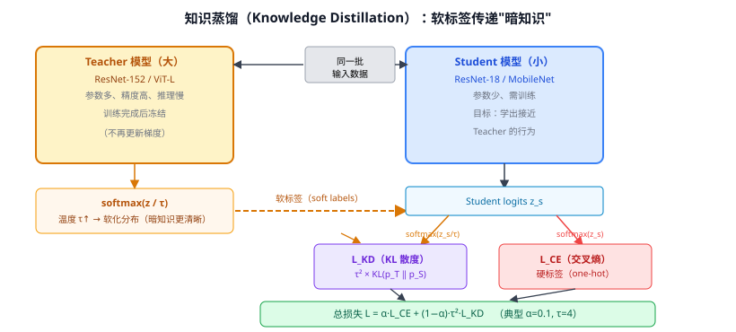

# 14c 知识蒸馏（Knowledge Distillation）

> 定位：让小模型（Student）通过学习大模型（Teacher）输出的**软标签**，获得接近大模型的能力——模型压缩与迁移学习的经典范式。
> 作者：Hinton, Vinyals, Dean，Google，NIPS 2014 Deep Learning Workshop。
> 效果：ResNet-18 用 KD 训练可逼近 ResNet-50 精度；DeiT 用 KD 在 ImageNet 无额外数据下达到 ViT 的精度。
> **输入 / 输出**：Teacher 软标签 + 原始数据 → 训练 Student → Student 推理效率接近小模型，精度接近大模型

---

## 一、提出背景

大模型精度高但推理慢；直接训练小模型精度低；**直接用大模型的输出概率分布作为训练信号**，比 one-hot 标签携带更多信息——这个想法是 KD 的核心。

Hinton 的论文标题就是"Distilling the Knowledge in a Neural Network"——大模型里有"暗知识"（dark knowledge）：比如分类猫时，"虎"的概率是 0.04，"狗"是 0.01，这些非目标类的相对概率关系携带了类别间相似性信息，比 one-hot [0,0,1,0,…] 更丰富。

---

## 二、核心机制

### 2.1 软化 Softmax（温度参数 τ）

标准 softmax（$\tau=1$）在高置信度时分布极尖（近似 one-hot），暗知识几乎为 0。用温度 $\tau$ 软化：

$$p_i = \frac{\exp(z_i/\tau)}{\sum_j \exp(z_j/\tau)}$$

$\tau$ 越大，分布越均匀，非目标类的概率关系越清晰。典型 $\tau = 3 \sim 7$。

**数值示例**（分类"猫"，logits $z = [3.0, 1.0, 0.5]$ 对应[猫, 虎, 狗]）：

| $\tau$ | p_猫 | p_虎 | p_狗 |
|--------|------|------|------|
| 1（标准）| 0.893 | 0.078 | 0.029 |
| 4（软化）| 0.588 | 0.274 | 0.138 |

$\tau=4$ 时"虎"和"狗"的概率关系清晰可见（虎比狗更像猫，2:1）——这是小模型用 one-hot 学不到的信息。

### 2.2 训练目标

Student 同时最小化两个损失：

$$\mathcal{L} = \alpha \cdot \mathcal{L}_{\text{CE}}(y, p_S) + (1-\alpha) \cdot \tau^2 \cdot \mathcal{L}_{\text{KL}}(p_T \| p_S)$$

- $\mathcal{L}_{\text{CE}}$：交叉熵（one-hot 真标签，正常 $\tau=1$）
- $\mathcal{L}_{\text{KL}}$：KL 散度（Teacher 软标签 vs Student 软标签，同用温度 $\tau$）
- $\tau^2$：补偿梯度在高温时被 $\tau^2$ 缩放（论文推导）
- 典型：$\alpha = 0.1$，$\tau = 4$

### 2.3 中间层蒸馏（扩展）

原版 KD 只蒸馏最后输出层。扩展方向：
- **FitNets**：蒸馏中间层 feature map。
- **Attention Transfer**：蒸馏注意力图。
- **CRD**：对比蒸馏，把 KD 改写为对比学习目标。

---

## 三、典型应用案例

| 场景 | Teacher | Student | 效果 |
|------|---------|---------|------|
| 分类 | ResNet-152 | ResNet-18 | Student 精度 +3~5% |
| ViT 训练（DeiT）| RegNet + 老师 token | ViT-Small | 无大数据下 Top-1 80.9% |
| YOLOv8 训练 | 大版本（YOLOv8x） | 小版本（YOLOv8n） | mAP + ~1.5% |
| CLIP SigLIP | 大 ViT-L CLIP | 小 ViT-B | 保留大部分零样本精度 |

---

## 四、优点与局限

**优点**：
- 无需改变 Student 架构，只换训练目标。
- 对目标检测/分割同样适用（蒸馏检测头输出分布）。
- 软标签提供类别间结构信息（隐含度量学习效果）。

**局限**：
- Teacher 推理也需计算，训练成本翻倍。
- Teacher 越强，Student 学到的上限越高，但 Teacher 与 Student 差距过大时效果下降（能力代差问题）。
- 超参（$\tau, \alpha$）需调试。

---

## 五、历史地位

知识蒸馏是模型压缩的开山工作，影响极广：

- **轻量化模型训练**：MobileNet、EfficientNet 的 "知识增强训练" 都用 KD。
- **DeiT**（31d）：用 KD + teacher token 在不依赖 JFT-300M 下训出 ViT，将 ViT 带入"普通人也能训"的时代。
- **YOLOv8 官方训练**：Ultralytics 提供 KD 训练接口，用大版本蒸馏小版本（见 25d）。
- **LLM 压缩**：Llama 蒸馏成 Phi-2 等小模型，CoT 蒸馏到 student。

---

## 六、与本项目的关系

- **间接相关**：如果实验中 YOLOv8n 基线精度不够，可用 KD 从 YOLOv8m 蒸馏，第三章可作补充实验提一句。
- **论文写作**：DeiT 中的 KD 与 CLIP ViT 编码器有关（相关工作 ViT 一节可引用 DeiT，进而提及 KD 的作用）。
- **CLIP 零样本语境**：soft label 分布与 CLIP 的余弦相似度概率分布同源，都是从"soft distribution"中学习类间关系。

---

## 参考文献

- Hinton G, Vinyals O, Dean J. *Distilling the Knowledge in a Neural Network.* NIPS 2014 DL Workshop.
- Romero A, et al. *FitNets: Hints for Thin Deep Nets.* ICLR 2015.
- Touvron H, et al. *Training Data-Efficient Image Transformers & Distillation through Attention.* ICML 2021.（DeiT，见 31d）
