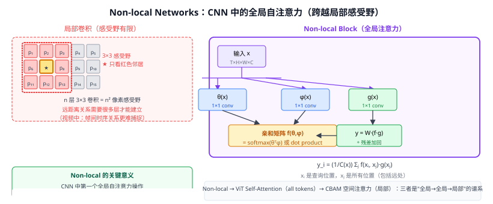

# 17b Non-local Networks（非局部均值网络）

> 定位：在 **CNN 骨干网络中插入全局自注意力**，使任意位置的特征可以直接聚合远距离位置的信息，突破 3×3 卷积的局部感受野瓶颈。
> 作者：Wang et al.，CVPR 2018，Facebook AI Research。
> 效果：在 Kinetics 动作识别上，ResNet-50 + 5 个 Non-local Block 提升 Top-1 +2.7%；目标检测 COCO 上 +1.2 AP。
> **输入 / 输出**：特征图 $x \in \mathbb{R}^{T \times H \times W \times C}$ → 同形状特征图 $z$（自注意力后残差加回）

---



## 一、提出背景

卷积神经网络通过堆叠 3×3 卷积层扩大感受野，但这是**渐进的、局部的**过程：
- 第 $l$ 层的感受野仅能覆盖 $(2l+1) \times (2l+1)$ 像素；
- 跨帧时序关系（如视频中一个物体从左移到右）需要更多层才能建立联系；
- 长距离依赖在浅层特征中几乎不可能捕捉到。

LSTM / GRU 是另一种全局建模方案，但计算串行、训练慢；Transformer（28）虽已提出，但 NLP 背景，尚未引入计算机视觉主流。

Non-local Networks 借鉴了**非局部均值去噪**（Buades et al., 2005）的思想：图像去噪时，不只看周围像素，而是全图找相似块加权平均；将此思想推广到特征图的通道聚合。

---

## 二、核心公式

### 2.1 Non-local 操作

$$y_i = \frac{1}{\mathcal{C}(x)} \sum_{\forall j} f(x_i, x_j) \cdot g(x_j)$$

- $i$：查询位置（时空坐标）
- $j$：所有位置（全图/全帧）
- $f(x_i, x_j)$：亲和度函数（计算 $i$ 和 $j$ 的相关性）
- $g(x_j)$：$j$ 位置的表示（线性变换后的值）
- $\mathcal{C}(x)$：归一化因子

### 2.2 亲和度函数 $f$ 的四种选择

| 方式 | 公式 | 说明 |
|------|------|------|
| **Gaussian** | $\exp(x_i^T x_j)$ | 未归一化点积 |
| **Embedded Gaussian** | $\exp(\theta(x_i)^T \phi(x_j))$ | 1×1 conv 投影后点积 |
| **Dot product** | $\theta(x_i)^T \phi(x_j)$ | 不经 softmax，效果接近 |
| **Concatenation** | $w^T[x_i; x_j]$ | 拼接后线性，较少用 |

论文实验中 **Embedded Gaussian** 效果最好，也与 Transformer 的 Scaled Dot-Product Attention 最接近。

### 2.3 Non-local Block（完整结构）

```python
# 伪代码（以 Embedded Gaussian 为例）
class NonLocalBlock(nn.Module):
    def __init__(self, C):
        # 三个 1×1 卷积（对应 θ, φ, g）
        self.theta = nn.Conv2d(C, C//2, 1)
        self.phi   = nn.Conv2d(C, C//2, 1)
        self.g     = nn.Conv2d(C, C//2, 1)
        # 输出投影 Wz 恢复通道数
        self.Wz    = nn.Conv2d(C//2, C, 1)
        self.bn    = nn.BatchNorm2d(C)

    def forward(self, x):
        B, C, H, W = x.shape
        N = H * W

        theta = self.theta(x).view(B, C//2, N).permute(0, 2, 1)  # BxNxC/2
        phi   = self.phi(x).view(B, C//2, N)                      # BxC/2xN
        g     = self.g(x).view(B, C//2, N).permute(0, 2, 1)       # BxNxC/2

        attn = torch.softmax(theta @ phi, dim=-1)     # BxNxN
        y    = (attn @ g).permute(0, 2, 1).view(B, C//2, H, W)
        z    = x + self.bn(self.Wz(y))               # 残差连接
        return z
```

**关键数字**：
- 1×1 conv 把通道降为 $C/2$（减少计算量约 4×）
- 输出 $y$ 经 $W_z$ 恢复 $C$ 维，再通过 BN + 残差加回
- 亲和矩阵 $N \times N$ 在空间维度展平后计算（类比 Transformer 的注意力矩阵）

---

## 三、插入位置与计算开销

论文建议插在 **ResNet 的 res4 阶段**（特征图 14×14 或 16×16），此时 $N = H \times W$ 较小（196），亲和矩阵 $196 \times 196$ 可接受。

对于视频（$T$ 帧）：$N = T \times H \times W$，直接计算全局注意力开销为 $O(T^2 H^2 W^2)$，实践中通常对 $T$ 做降采样或限制窗口。

---

## 四、与 Transformer 自注意力的关系

| 概念 | Non-local Block | Transformer Self-Attention |
|------|----------------|-----------------------------|
| 查询 Q | $\theta(x_i)$ | $W_Q x$ |
| 键 K | $\phi(x_j)$ | $W_K x$ |
| 值 V | $g(x_j)$ | $W_V x$ |
| 亲和矩阵 | $\text{softmax}(\theta^T \phi)$ | $\text{softmax}(QK^T/\sqrt{d})$ |
| 输出 | $\text{attn} \cdot g + x$ | $\text{attn} \cdot V$ + 残差 |

本质上 Non-local Block 就是 **单头自注意力 + 残差连接**，比 ViT 早了 3 年出现在 CNN 中。

---

## 五、历史地位

```
Non-local（2018）
    ↓ 将自注意力移植到 CNN（video 骨干）
ViT（2020）—— 全面替换 conv，只用 SA
    ↓ 分割 / 检测
CBAM（通道+空间注意力，2018）
    ↓ 轻量级局部注意力（SE→CBAM→SimAM）
本项目 CBAM 注意力模块（创新点1辅助）
```

Non-local Networks 是**从 CNN 时代迈向 Transformer 时代的关键桥梁**之一。

---

## 六、与本项目的关系

- **背景知识**：本项目 CBAM（SENet 系列）是轻量级通道+空间注意力，Non-local Block 是重量级全局注意力，两者构成"注意力机制"一节的完整光谱。
- **相关工作**：第二章"注意力机制演进"小节可以 Non-local Networks 为里程碑，串联 SE → CBAM → Non-local → ViT Self-Attention 的发展脉络。
- **不在当前实验中使用**：本项目用 CBAM（轻量），Non-local 计算开销偏大，不适合路面检测实时推理目标（<100ms）。

---

## 参考文献

- Wang X, et al. *Non-local Means in Deep Neural Networks for Video Classification.* CVPR 2018.
- Buades A, et al. *A Non-local Algorithm for Image Denoising.* CVPR 2005.（原始非局部均值思想）
