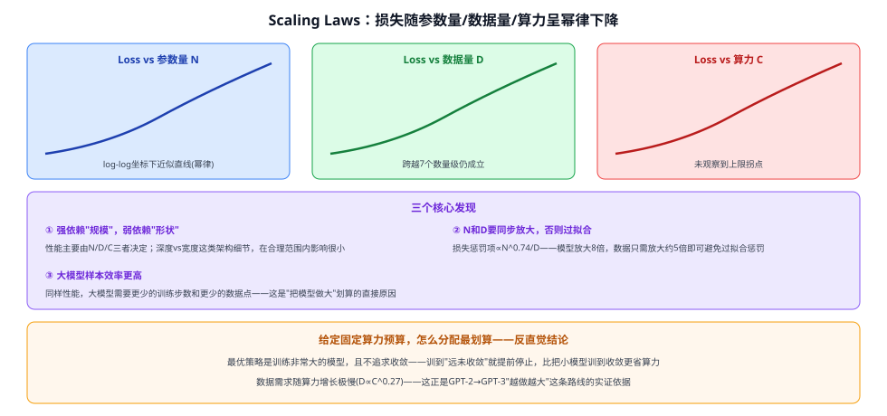
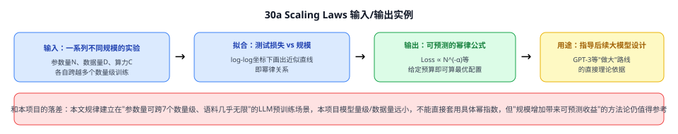

# 30b Scaling Laws

> 定位：**"为什么把语言模型做大就会变强"的实证理论依据**——用大量实验证明测试损失和参数量/数据量/算力之间存在稳定的幂律（power-law）关系。是理解 GPT 系列 从 GPT-2 走到 GPT-3、GPT-4 这条"越做越大"路线为何成立的关键文献,也是本类目"大模型时代"其余三篇（LoRA、Chain-of-Thought、InstructGPT/RLHF）共同的时代背景。
> 作者：Kaplan, McCandlish 等（OpenAI），arXiv:2001.08361（2020）。
> 前置：28 Transformer、30 GPT 系列。
> **输入 / 输出**：一系列不同规模（参数量 N / 数据量 D / 算力 C）的语言模型训练实验 → 测试损失与三者的幂律关系式，可外推预测更大规模下的性能

---



> 📥📤 **输入/输出实例**：在跨越七个数量级的参数规模上训练大量 Transformer 语言模型，各自控制/变化参数量 $N$、数据量 $D$、训练算力 $C$，记录测试集交叉熵损失——把损失和这三个变量分别画在 **log-log 坐标**下，发现几乎是**直线**（即幂律关系：$Loss\propto N^{-\alpha}$ 这类形式），且在观测范围内没有看到这个趋势拐弯变差的迹象。这套关系式可以用来**外推**：给定一个计划投入的算力预算，反推出"应该把模型做多大、用多少数据训"最划算。



## 一、提出背景

深度学习模型的性能显然和"模型多大""数据多少""训多久"有关，但在本文之前，这种关系大多是经验性的、零散的"越大越好"式直觉，没有人系统地测量过：**这种关系具体是什么形状？是线性提升，还是边际收益递减，还是别的？给定一笔固定的算力预算，到底应该把钱花在"更大的模型"还是"更多的数据"上？** 本文的目标就是通过大规模系统实验，把这些问题的答案定量地找出来——语言建模（用海量文本自监督训练）是研究这个问题的理想场景，因为可以低成本地把规模跨越七个数量级来做对照实验。

## 二、核心方法 ⭐

### 2.1 三个核心发现

| 发现 | 内容 |
|---|---|
| **强依赖"规模"，弱依赖"形状"** | 性能几乎只取决于三个规模变量——参数量 $N$（不含 embedding）、数据量 $D$、训练算力 $C$；在合理范围内，网络具体是"更深"还是"更宽"这类架构形状细节，对最终性能影响很小 |
| **三者都是幂律关系** | 当其中两个变量不构成瓶颈时，损失和第三个变量之间近似满足幂律 $Loss\propto x^{-\alpha}$（在 log-log 图上是直线），且**观测范围内（跨七个数量级）没有看到饱和/拐点** |
| **$N$ 和 $D$ 必须同步放大** | 只放大参数量、不放大数据（或反之），会进入收益递减的过拟合区；论文给出具体比例——**模型放大 8 倍，数据大约只需放大 5 倍**就能避免过拟合惩罚（惩罚项 $\propto N^{0.74}/D$） |

### 2.2 反直觉结论：大模型更"划算"，且不需要训到收敛

- **样本效率**：达到同样的损失水平，**大模型需要的训练步数和数据点都更少**——大模型不仅"天花板更高"，学得还更快。
- **给定固定算力预算，最优策略是训一个很大的模型、且远未收敛就提前停止训练**，而不是把一个小模型训练到完全收敛。数据需求随算力增长得很慢（$D\propto C^{0.27}$），意味着"用大模型 + 相对不那么多的数据 + 不追求收敛"是最省算力的组合——这个结论直接挑战了"模型要训到收敛才算训好"的直觉。

---

## 三、关键结论

- **给"做大模型"这条路线提供了第一份定量的、可预测的理论依据**：不是"大力出奇迹"的模糊直觉，而是可以按幂律公式**预先估算**出"给定这么多算力，应该做多大的模型、配多少数据"。
- **这正是 GPT-2→GPT-3 这条路线敢下重注的关键支撑**：OpenAI 内部正是基于这套 scaling law 的外推，判断"继续加大参数量和数据量，性能还会按可预测的规律继续提升"，才有了 GPT-3（1750 亿参数）这样的投入。
- **局限**：本文的幂律关系是在"数据/算力几乎不受限"的语言模型预训练场景下测得的，后续研究（如 Chinchilla，2022）进一步修正了 $N$ 与 $D$ 的最优配比，发现更早的 GPT-3 一代模型其实"数据喂少了"（相对参数量而言）——scaling law 本身也在持续被修正，不是一成不变的定律。

---

## 四、与本项目的关系

本项目模型规模（YOLOv8s + CLIP ViT-B/32）和数据量（训练集 3679 张标注图）与本文实验的规模（参数量、语料跨七个数量级的语言模型预训练）完全不在一个量级，**不能直接套用本文给出的具体幂指数**。但其方法论仍有参考价值：① 判断"要不要加大骨干网络/加大数据集"时，可以用"小规模先做几组对照实验、观察性能随规模变化的趋势"这一思路，而不是凭直觉一步放大；② 理解本项目引用的预训练大模型（CLIP、BERT/GPT 系列作为背景知识）为什么会选择当前的参数规模，背后正是这套 scaling law 方法论指导的结果。

---

## 五、技术谱系

```
经验性"越大越好"直觉（无定量依据）
  │
  └─→ Scaling Laws（本文，2020）：损失-规模的幂律关系，可预测外推
        │
        ├─→ GPT-3（2020）：基于本文外推，敢于训练 1750 亿参数模型
        └─→ Chinchilla（2022，DeepMind）：修正 N/D 最优配比，发现早期模型"数据喂少了"
```

---

## ✏️ 具体实例（走一遍）

**例：给定一笔算力预算，怎么用 scaling law 决策**
```
① 已知：预算能支撑 C = 100 PF-days 的训练算力
② 查 scaling law 拟合出的"最优算力分配"曲线（对应本文图3）
③ 得到建议：应该训练一个参数量约为 X 的大模型
④ 数据量按 D ∝ C^0.27 估算，不需要成比例地增加很多
⑤ 训练时不追求把这个大模型训到完全收敛，在预算耗尽前提前停止
   （比把一个小十倍的模型训练到收敛，最终损失更低）
```
**关键**：这套决策方式把"模型该多大"从"拍脑袋"变成了"查公式"，是 GPT 系列敢于持续加大规模的实证底气。

---

## 六、参考文献

- Kaplan J, McCandlish S, Henighan T, et al. *Scaling Laws for Neural Language Models.* 2020.（arXiv:2001.08361）
- Hoffmann J, et al. *Training Compute-Optimal Large Language Models (Chinchilla).* 2022.（修正 N/D 最优配比）
- Brown T, et al. *Language Models are Few-Shot Learners (GPT-3).* NeurIPS 2020.（本文 scaling law 外推的直接产物，见 30 GPT 系列）
