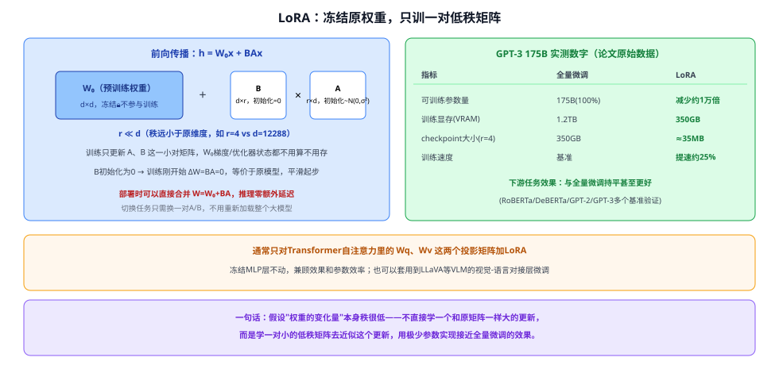

# 30c LoRA

> 定位：**现代大模型参数高效微调（PEFT）的标配方法**——冻结预训练模型的全部权重，只在旁边插入一对很小的低秩矩阵去学习"需要改变的部分"。是"大模型时代"绕不开的工程基础，几乎所有开源 LLM/VLM 微调（包括 LLaVA 这类视觉语言模型的下游适配）都会用到它或它的变体（QLoRA 等）。
> 作者：Hu 等（微软），ICLR 2022（arXiv:2106.09685）。
> 前置：28 Transformer（LoRA 通常加在自注意力的 $W_q,W_v$ 投影矩阵上）、30 GPT 系列（论文主要实验对象）。
> **输入 / 输出**：预训练大模型的权重（冻结）+ 下游任务数据 → 一对很小的低秩矩阵 $A,B$（几 MB～几十 MB），部署时可直接合并回原模型、零额外推理延迟

---



> 📥📤 **输入/输出实例**：对预训练权重矩阵 $W_0\in\mathbb{R}^{d\times d}$（比如 Transformer 自注意力里的 $W_q$），**完全冻结**、不参与训练；在旁边插入两个小矩阵 $B\in\mathbb{R}^{d\times r}, A\in\mathbb{R}^{r\times d}$（$r\ll d$，比如 $r=4$、$d=12288$），前向传播变成 $h=W_0x+BAx$。训练时只更新 $A,B$ 这一小撮参数（$A$ 用高斯随机初始化，$B$ 初始化为 **0**，保证训练刚开始 $\Delta W=BA=0$、等价于原模型）。训练完成后，部署时可以直接把 $W_0+BA$ **合并**成一个新的权重矩阵，推理阶段不需要额外计算，也没有任何额外延迟。


## 一、提出背景

大模型时代的一个现实困境：预训练+微调这套范式效果很好，但**全量微调**（fine-tuning，更新模型全部参数）代价越来越难以承受——用 GPT-3（1750 亿参数）举例，每个下游任务微调一份独立的全量模型，存储和部署的开销都极其昂贵。此前已有一些"部分参数适配"的思路（如插入额外的 adapter 层、或优化输入端的 prompt/prefix），但普遍存在两个问题：**引入额外的推理延迟**（adapter 层加深了网络）或**效果明显不如全量微调**（prompt/prefix 类方法在难任务上表现打折扣）。LoRA 的出发点是一个此前已被观察到的现象：**预训练大模型本身具有很低的"内在维度"**（模型虽然参数很多，但真正需要调整以适配新任务的"有效自由度"很小）——那么，模型适配新任务时，**权重的变化量 $\Delta W$ 会不会也具有很低的"内在秩"**？

## 二、核心方法 ⭐

### 2.1 用低秩分解表示权重的变化量

不直接学习一个和 $W_0$ 同样大小的更新矩阵 $\Delta W$，而是把它约束成两个小矩阵的乘积：
$$W_0 + \Delta W = W_0 + BA,\quad B\in\mathbb{R}^{d\times r},\ A\in\mathbb{R}^{r\times k},\ r\ll\min(d,k)$$
训练时 $W_0$ **冻结不动**，只优化 $A,B$——可训练参数量从 $d\times k$ 骤降到 $r\times(d+k)$，当 $r$ 很小（论文实验里 $r=1,2,4,8$ 就足够）时，参数量减少几个数量级。

### 2.2 三个关键设计

| 设计 | 做法 | 为什么 |
|---|---|---|
| **初始化：$A$ 随机、$B$ 为零** | $A\sim\mathcal N(0,\sigma^2)$，$B=0$ | 保证训练最开始 $\Delta W=BA=0$，模型行为和原始预训练模型完全一致，训练从"零改动"平滑起步，不会因为随机初始化的新参数一开始就扰乱模型 |
| **缩放因子 $\alpha/r$** | 输出 $\Delta Wx$ 额外乘上常数 $\alpha/r$ | 调 $\alpha$ 的效果近似于调学习率，论文发现固定 $\alpha$、只调 $r$，超参搜索成本更低 |
| **只加在部分权重上（通常是 $W_q,W_v$）** | 只对自注意力的 Query/Value 投影矩阵加 LoRA，冻结 FFN/MLP 层 | 兼顾参数效率和效果，论文验证只调注意力权重已经足够 |

### 2.3 部署时可以"无缝合并"，零推理延迟

因为 $W_0$ 和 $BA$ 维度完全相同、且都是线性变换，部署时可以直接计算 $W=W_0+BA$ 存成一个新权重矩阵，推理时就是普通的矩阵乘法——**不会像 adapter 类方法那样增加网络深度、带来额外推理延迟**。切换到另一个下游任务时，只需要减掉当前的 $BA$、换上另一对训练好的 $A',B'$，开销很小，不需要重新加载整个大模型。

---

## 三、关键结论（GPT-3 175B 上的实测数字）

| 指标 | 全量微调 | LoRA |
|---|---|---|
| 可训练参数量 | 175B（100%） | 减少约 **1 万倍** |
| 训练显存（VRAM） | 1.2 TB | **350 GB** |
| checkpoint 大小（$r=4$，仅调 $W_q,W_v$） | 350 GB | **约 35 MB** |
| 训练速度 | 基准 | 提速约 **25%**（无需为绝大多数参数算梯度、维护优化器状态） |
| 下游任务效果 | 基准 | **持平甚至更好**（RoBERTa/DeBERTa/GPT-2/GPT-3 多个基准验证） |

- **效果不打折**：在多个自然语言理解/生成基准上，LoRA 的下游任务表现和全量微调持平甚至略优，同时可训练参数量少了几个数量级。
- **秩不需要很大**：即便预训练权重矩阵维度高达 12288，实验发现 $r=1,2$ 这么低的秩就已经够用，验证了"权重变化量的内在秩很低"这个核心假设。
- **正交、可组合**：LoRA 和其他效率方法（如 prefix-tuning）不冲突，可以叠加使用。

---

## 四、与本项目的关系

本项目当前对 CLIP 主要用其**零样本能力**（不微调，直接用文本模板做相似度匹配），暂无全量微调 CLIP 的计划。但如果后续需要在本项目数据上进一步适配 CLIP（比如让它更贴合路面场景的图文分布），LoRA 是一个比全量微调更合适的备选方案：① 本项目训练数据规模不大（3679 张标注），全量微调大模型很容易过拟合、也容易"灾难性遗忘"CLIP 原有的零样本泛化能力；LoRA 冻结原权重、只调很小一部分参数，天然对小数据集更友好、更不容易破坏原有能力；② 训练/存储成本低，适合在算力有限的实验环境里做多组消融对比。

---

## 五、技术谱系

```
全量微调（更新全部参数，效果最好但存储/部署成本随模型增大而爆炸）
  │
  ├─→ Adapter（插入额外网络层）——效果好但增加推理延迟
  ├─→ Prefix/Prompt Tuning（只调输入端的可学习向量）——效率高但效果打折、占用有效序列长度
  └─→ LoRA（本文）：低秩分解权重变化量——效果持平全量微调 + 无额外推理延迟 + 参数量减少几个数量级
        │
        └─→ QLoRA（2023）：LoRA + 4-bit 量化冻结权重，进一步降低微调大模型所需显存
```

---

## ✏️ 具体实例（走一遍）

**例：用 LoRA 微调一个大模型做摘要任务**
```
① 拿到预训练好的 GPT 模型，所有权重 W₀ 全部冻结
② 在每一层自注意力的 Wq、Wv 旁边，各插入一对 (A, B)，秩 r=8
③ 只用摘要任务的训练数据，反向传播只更新这些 A、B（W₀梯度不算、优化器状态不存）
④ 训练完，得到的 A、B 加起来只有几十MB，而不是重新存一份175B参数的完整模型
⑤ 部署时，把 W₀+BA 合并成新权重，直接推理，和全量微调后的模型推理延迟完全一样
⑥ 如果还想在同一个基座模型上做问答任务，另训一套 (A', B')，随时切换，不用换基座模型
```
**关键**：整个过程"大模型本身"从未被改动或重新存储，改动的只是一组"补丁"矩阵——这是 LoRA 能让大模型微调变得便宜、灵活的根本原因。

---

## 六、参考文献

- Hu E J, Shen Y, Wallis P, et al. *LoRA: Low-Rank Adaptation of Large Language Models.* ICLR 2022.（arXiv:2106.09685）
- Aghajanyan A, et al. *Intrinsic Dimensionality Explains the Effectiveness of Language Model Fine-Tuning.* 2020.（LoRA"低内在秩"假设的灵感来源）
- Dettmers T, et al. *QLoRA: Efficient Finetuning of Quantized LLMs.* 2023.（LoRA + 量化的后续工作）
