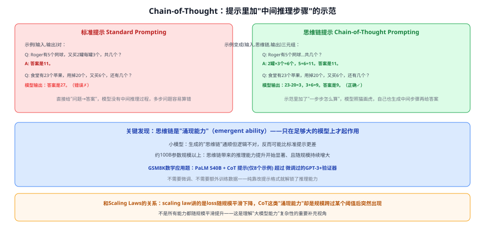
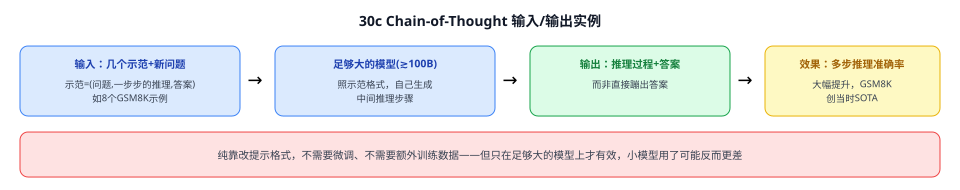

# 30d Chain-of-Thought（思维链提示）

> 定位：**现代大语言模型"推理能力"的基础范式**——不改模型、不训练，只是在提示（prompt）的示范里加入"一步步怎么算"的中间推理过程，就能大幅提升大模型解决多步推理问题的能力。是理解"为什么问 ChatGPT 复杂数学题时它会先'一步步分析'再给答案"这一行为的直接理论来源。
> 作者：Wei, Wang 等（Google Research），NeurIPS 2022（arXiv:2201.11903）。
> 前置：30 GPT 系列（少样本上下文学习 in-context learning 是本文的技术基础）、30b Scaling Laws（本文的核心发现——"涌现能力"——正是对 scaling law"平滑提升"假设的一个重要补充/反例）。
> **输入 / 输出**：几个"问题+中间推理步骤+答案"的示范 + 新问题 → 模型自己生成中间推理步骤 + 最终答案（而非直接蹦出答案）

---



> 📥📤 **输入/输出实例**：**标准提示**只给模型看"问题→答案"的示范，模型学到的是"直接蹦答案"这个格式，遇到需要多步计算的题容易在中间某一步出错、得到错误答案。**思维链提示**把示范换成"问题→**一步步的推理过程**→答案"的三元组，模型照葫芦画瓢，自己在生成答案前也会先写出中间推理步骤——同一个模型、同一个任务，只是把提示里的示范格式换了一下，正确率就能大幅提升。全程**不需要额外训练或微调**，纯粹是提示工程（prompting）层面的改动。



## 一、提出背景

大模型靠"少样本提示"（在输入里给几个示范，不用微调）就能处理很多简单任务，但在算术、常识推理、符号推理这类**需要多个步骤才能得出答案**的问题上表现一直不好——即便持续加大模型规模，单纯"扩大模型"本身也不足以解决这类推理任务。此前有两条路：① 训练模型生成自然语言的解题过程（需要大量高质量的"过程标注"数据，成本很高）；② 少样本提示（简单，但推理类任务效果差、且加大模型规模也没什么改善）。本文把这两条路的优点结合：**不需要专门训练生成解题过程的模型，只需要在少样本提示的示范里，把"过程"也写进去**。

## 二、核心方法 ⭐

### 2.1 从"⟨输入,输出⟩"到"⟨输入,思维链,输出⟩"

标准少样本提示的示范是"问题→答案"这样的二元组；思维链提示把每个示范换成"问题→**一系列连贯的中间推理步骤**→答案"的三元组。这模拟了人解多步题时的思考过程——把问题拆解成中间步骤、逐步解决、最后给出答案，而不是直接"看一眼就报答案"。

### 2.2 思维链提示的几个优点

| 优点 | 说明 |
|---|---|
| **按需分配计算** | 步骤更多的难题，模型会自然生成更长的推理链，相当于把更多"计算"分配给了更难的问题 |
| **可解释、可调试** | 中间推理步骤是自然语言，人可以读出模型"哪一步想错了"，比黑箱直接输出答案更透明 |
| **通用性强** | 数学应用题、常识推理、符号操作等多种任务上都适用，原则上适用于任何"人能通过语言一步步想清楚"的任务 |
| **无需微调即可触发** | 只需要在提示的示范里包含思维链的例子，现成的大模型立刻就能用（前提是模型足够大，见下） |

### 2.3 关键发现 ⭐：思维链是"涌现能力"（emergent ability），只在足够大的模型上才起作用

论文一个非常重要的发现：思维链提示带来的推理能力提升**不是随模型增大平滑出现的**——在小规模模型上，模型生成的"思维链"读起来通顺、但逻辑经常是错的，思维链提示甚至可能比标准提示效果**更差**；只有当模型规模达到大约 **1000 亿参数**左右，思维链带来的推理提升才开始显著，且随规模进一步增大而持续增强。这种"规模跨过某个阈值后能力突然出现"的现象，论文称为**涌现能力**——和 Scaling Laws 里"损失随规模平滑下降"的幂律关系不是一回事：损失这种指标是平滑变化的，但由损失平滑下降"解锁"出来的具体能力（比如"能正确做多步算术"），表现为不连续的、跨过某个规模阈值才涌现的台阶式变化。

---

## 三、关键结论

- **GSM8K 数学应用题基准**：用 **PaLM 540B** 模型，只给 8 个思维链示范（不需要任何微调），准确率超过了**微调过的 GPT-3 175B + 专门验证器**这套更复杂、更依赖任务专属训练的方案，刷新当时的 SOTA。
- **不需要额外训练数据、不需要修改模型**：整套方法只是改变了提示（prompt）的写法，这意味着**同一个模型 checkpoint 就能通过更换提示服务许多不同的推理任务**，不必为每个任务单独训练/微调一个模型。
- **局限**：效果强依赖模型规模（小模型用了可能反而更差），且思维链的质量依赖人工设计的示范是否恰当；后续工作（如 Zero-shot-CoT，仅需在提示末尾加一句"Let's think step by step"）进一步简化了触发方式，不再需要手写完整的思维链示范。

---

## 四、与本项目的关系

本项目当前不直接依赖大语言模型做多步推理，CLIP 的零样本分类是"一步到位"的相似度匹配，不涉及链式推理。但理解思维链有助于理解本类目其它三篇（Scaling Laws/LoRA/InstructGPT）共同勾勒的"现代大模型工具箱"全貌——如果未来项目涉及用大语言模型辅助生成检测结果的自然语言解释（比如"为什么这个区域被判定为异常"），思维链提示会是让模型给出可读、可调试的中间推理过程的直接技术选择。

---

## 五、技术谱系

```
少样本提示（in-context learning，见 GPT-3）：只给⟨输入,输出⟩示范，推理类任务效果差
  │
  └─→ Chain-of-Thought（本文）：⟨输入,思维链,输出⟩三元组示范，解锁大模型多步推理能力（涌现于~100B参数规模）
        │
        ├─→ Zero-shot-CoT（2022）：不用写示范，提示末尾加"Let's think step by step"即可触发
        ├─→ Self-Consistency（2022）：多次采样多条思维链、投票选最一致的答案，进一步提升准确率
        └─→ Tree-of-Thought / 更复杂的推理框架（2023—）：把单链推理扩展成可回溯搜索的树状推理
```

---

## ✏️ 具体实例（走一遍）

**例：标准提示 vs 思维链提示，同一道应用题**
```
标准提示示范：
  Q: Roger有5个网球，又买2罐(每罐3个)，现在有几个？
  A: 答案是11。
遇到新题：
  Q: 食堂有23个苹果，用掉20个做午饭，又买了6个，现在有几个？
  模型直接输出：答案是27。（错误——把加减顺序搞混了）

思维链提示示范：
  Q: Roger有5个网球，又买2罐(每罐3个)，现在有几个？
  A: 2罐×3个=6个网球；5+6=11。答案是11。
遇到同一道新题：
  模型输出：23-20=3个（用掉后剩的）；3+6=9个。答案是9。（正确）
```
**关键**：模型的参数、能力都没有变，唯一变化是示范格式里多写了"怎么一步步算"——这足以让模型学会在新问题上也生成同样风格的中间步骤，从而算对。

---

## 六、参考文献

- Wei J, Wang X, Schuurmans D, et al. *Chain-of-Thought Prompting Elicits Reasoning in Large Language Models.* NeurIPS 2022.（arXiv:2201.11903）
- Kojima T, et al. *Large Language Models are Zero-Shot Reasoners.* NeurIPS 2022.（"Let's think step by step"，无需手写示范）
- Wang X, et al. *Self-Consistency Improves Chain of Thought Reasoning in Language Models.* ICLR 2023.（多路径投票提升准确率）
