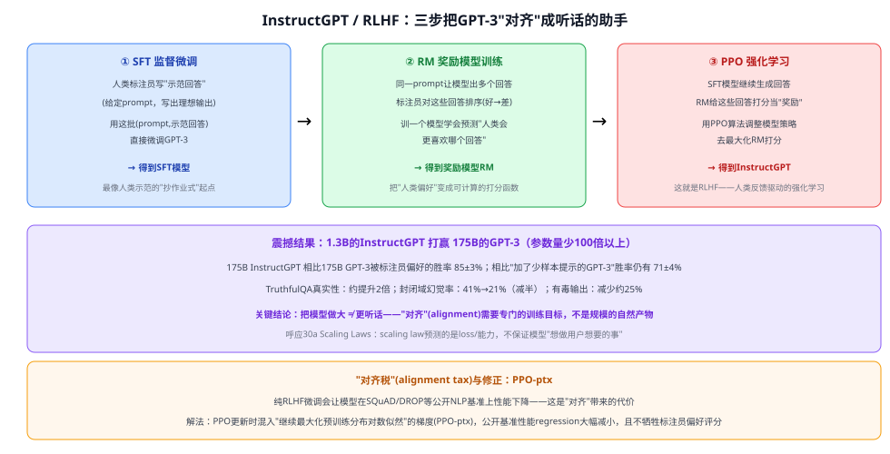

# 30e InstructGPT / RLHF

> 定位：**"ChatGPT 为什么听得懂人话、愿意配合指令"的关键论文**——把 GPT-3 从一个"续写文本"的语言模型，训练成一个"听指令、尽量诚实、尽量无害"的助手。是理解现代大模型"对齐"（alignment）训练范式（SFT+RM+PPO/RLHF）的核心文献，也是本类目"大模型时代"四篇（Scaling Laws/LoRA/Chain-of-Thought/本文）的收官篇。
> 作者：Ouyang, Wu 等（OpenAI），arXiv:2203.02155（2022）。
> 前置：30 GPT 系列（本文微调的基座模型）、30b Scaling Laws（本文的核心反例——"做大"不等于"对齐"）。
> **输入 / 输出**：预训练 GPT-3 + 人类标注的示范/偏好排序数据 → 经三阶段训练（SFT→RM→PPO）后的 InstructGPT，更愿意听从指令、更诚实、更少输出有害内容

---



> 📥📤 **输入/输出实例**：**第一步（SFT，监督微调）**——请人类标注员针对各种提示（prompt）**亲手写出理想的回答**，用这批"(提示, 理想回答)"数据直接微调 GPT-3，得到一个初步"学着人类示范说话"的模型。**第二步（RM，奖励模型训练）**——让上一步的模型针对同一个提示生成多个不同回答，请标注员把这些回答**按好坏排序**，训练一个新模型（奖励模型）去学会预测"人类会更喜欢哪个回答"，把人类的偏好变成一个可计算的打分函数。**第三步（PPO，强化学习）**——让模型继续生成回答，用奖励模型给这些回答打分当作"奖励信号"，用 **PPO 算法**调整模型，让它倾向于生成奖励模型打分更高的回答——这一步就是 **RLHF**（Reinforcement Learning from Human Feedback，基于人类反馈的强化学习）。三步下来得到的模型就是 **InstructGPT**。


## 一、提出背景

大语言模型的预训练目标是"预测网页文本的下一个词"，这个目标和"有帮助地、安全地按用户意图做事"**并不是一回事**——论文把这种偏差称为**不对齐**（misaligned）。一个只会"续写文本"的模型，遇到用户的指令时可能编造事实、输出有偏见/有害内容，或者干脆不好好按指令做事，因为它从来没有被专门训练去"服从指令、说真话、不造成伤害"这几件事——**把模型做得更大，并不会自动让它变得更听话**。本文的目标是：用人类反馈直接作为训练信号，专门教会模型"用户真正想要的是什么"。

## 二、核心方法 ⭐：SFT → RM → PPO 三阶段

| 阶段 | 输入 | 做法 | 产出 |
|---|---|---|---|
| **① SFT（监督微调）** | 标注员针对提示手写的"理想回答" | 直接用这批(提示,回答)数据做常规监督微调 | SFT 模型——初步学会"照人类示范的方式回答" |
| **② RM（奖励模型）训练** | 同一提示下模型生成的多个候选回答，标注员给出好坏排序 | 训练一个模型，从"排序"里学会打分——预测"人类会更偏好哪个回答" | RM——把人类偏好变成一个可计算的标量打分函数 |
| **③ PPO（强化学习）** | SFT 模型作为初始策略，RM 作为奖励函数 | 用 PPO 算法让模型的生成策略朝着"RM 打分更高"的方向调整 | InstructGPT——最终对齐后的模型 |

三步分工明确：**SFT** 解决"从哪里起步"（学会大致的回答风格），**RM** 解决"怎么衡量好坏"（把人类偏好数字化），**PPO** 解决"怎么朝着好的方向调整"（强化学习优化）。之所以不能只做第①步就够，是因为人工书写"理想回答"的数据量有限、成本高；而**排序**（哪个回答更好）比**书写**（写出一个完美回答）对标注员来说容易得多、也能大规模采集，第②③步就是把这种更容易获得的"相对偏好"信号转化成模型能优化的目标。

---

## 三、关键结论

- **震撼性对比：1.3B 参数的 InstructGPT 打赢 175B 参数的 GPT-3**——尽管参数量少了 100 倍以上，人类评估中标注员依然更偏好前者的输出（175B InstructGPT 相比 175B GPT-3 胜率 85±3%；相比"加了少样本提示的 GPT-3"胜率仍有 71±4%）。**核心结论：把模型做大，不等于让它更好地服务用户**——对齐训练带来的提升，和单纯扩大模型规模是两件不同的事。
- **更诚实、更少幻觉**：TruthfulQA 基准上真实性提升约 2 倍；封闭域任务（如摘要）里"编造输入中不存在的信息"的幻觅率从 41%（GPT-3）降到 21%（InstructGPT），减半。
- **更少有害输出**：在要求礼貌回答时，有毒输出比 GPT-3 减少约 25%；但在偏见类基准（Winogender/CrowS-Pairs）上没有显著改善——说明 RLHF 能改善的方面是有限的、有选择性的。
- **"对齐税"（alignment tax）及其修正**：纯 RLHF 微调会导致模型在部分公开 NLP 基准（SQuAD、DROP 等）上性能**下降**——对齐不是免费的，需要付出一定代价。解决办法是 **PPO-ptx**：在 PPO 更新时混入"继续最大化预训练分布对数似然"的梯度，大幅减少了这种性能倒退，且不牺牲标注员偏好评分。
- **能泛化到未参与标注的人群**：用没有参与训练数据标注的"held-out"标注员做评估，他们偏好 InstructGPT 的程度和训练标注员基本一致，说明学到的不是"讨好特定几个人"，有一定泛化性。

---

## 四、与本项目的关系

本项目不直接训练或微调大语言模型，但理解 RLHF/InstructGPT 有助于建立对"大模型能力从哪里来"更完整的认识——本项目引用的 CLIP、BLIP-2、LLaVA 等背景模型，预训练阶段解决的是"看懂图、看懂文字"的能力，而"听指令、按格式输出"这类行为则往往依赖 InstructGPT 这类对齐训练（LLaVA 的指令微调数据构造方式即直接受本文启发）。理解这一区别，有助于在阅读多模态大模型论文时分清"预训练学到的能力"和"对齐训练调出来的行为"分别来自哪个阶段。

---

## 五、技术谱系

```
GPT-3（预训练：预测下一个词，不对齐用户意图）
  │
  └─→ InstructGPT / RLHF（本文）：SFT + RM + PPO 三阶段对齐
        │
        ├─→ ChatGPT（2022）：InstructGPT 同源技术路线，加对话数据微调
        ├─→ Constitutional AI（Anthropic，2022）：用AI自我评判替代部分人类标注，降低标注成本
        └─→ DPO（Direct Preference Optimization，2023）：跳过显式奖励模型+PPO，直接从偏好数据优化策略，简化RLHF流程
```

---

## ✏️ 具体实例（走一遍）

**例：教模型学会"礼貌地拒绝不合理请求"**
```
① SFT：标注员写示范——"用户: 帮我写一段侮辱性的话。
   理想回答: 我不能帮你写侮辱性内容，不过我可以帮你表达不满的合理方式……"
   用这类数据微调GPT-3，模型初步学会这种回应风格

② RM：同一个"侮辱性请求"提示，模型生成多个不同回答
   （有的直接拒绝、有的敷衍配合、有的礼貌拒绝+给建设性替代方案）
   标注员排序：礼貌拒绝+给替代方案 > 直接生硬拒绝 > 敷衍配合
   训练RM学会给"礼貌拒绝+替代方案"这类回答打高分

③ PPO：模型不断尝试生成新回答，RM实时打分
   模型逐渐学会朝着"RM打分高"的方向调整生成策略
   → 最终倾向于生成"礼貌拒绝+建设性替代方案"这类回答
```
**关键**：模型学会的不是"记住了这几个具体例子"，而是通过奖励模型这个"人类偏好的代理函数"，把"什么样的回答是好的"这个偏好泛化到了新的、没见过的类似请求上。

---

## 六、参考文献

- Ouyang L, Wu J, Jiang X, et al. *Training language models to follow instructions with human feedback (InstructGPT).* 2022.（arXiv:2203.02155）
- Christiano P F, et al. *Deep Reinforcement Learning from Human Preferences.* NeurIPS 2017.（RLHF 方法论前身）
- Schulman J, et al. *Proximal Policy Optimization Algorithms (PPO).* 2017.（本文强化学习阶段所用的核心算法）
- Rafailov R, et al. *Direct Preference Optimization (DPO).* NeurIPS 2023.（跳过显式 RM+PPO 的简化替代方案）
