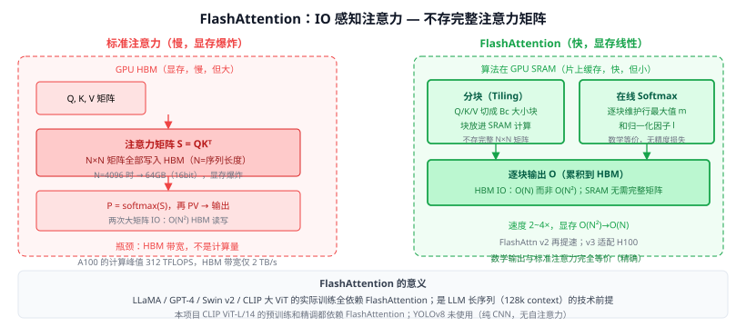

# 30f FlashAttention（IO 感知高效注意力）

> 定位：将 Transformer 的注意力计算**从 IO 瓶颈转移到计算层面**——通过分块（tiling）+ 在线 Softmax，避免将 $N \times N$ 注意力矩阵写入慢速显存（HBM），速度提升 2-4×，显存从 $O(N^2)$ 降为 $O(N)$，数学上完全等价。
> 作者：Dao et al.，Stanford，NeurIPS 2022；FlashAttention-2（NeurIPS 2023）；FlashAttention-3（2024）。
> 效果：BERT 训练 15%↑速度，GPT-2 训练 3×↑；LLaMA-2 70B 及几乎所有 2022 年后的 LLM 训练都用 FlashAttention。
> **输入 / 输出**：Q, K, V 矩阵 → 输出与标准注意力完全相同，只是计算方式不同（对用户透明）

---



## 一、提出背景

标准自注意力的瓶颈不在计算量（FLOPS），而在**显存 IO 带宽**：

```
S = QKᵀ  →  存入 HBM（N×N 矩阵）
P = softmax(S)  →  再存入 HBM
O = PV  →  从 HBM 读 P，写 O
```

A100 GPU 的算力峰值 312 TFLOPS，但 HBM 带宽只有 2 TB/s。对 $N=4096$，注意力矩阵 $S$ 就需要 16 × 4096² × 2 bytes ≈ 512 MB——每次 forward 都要大量 HBM 读写，导致"显卡在等显存"，算力严重浪费。

---

## 二、核心算法

### 2.1 关键思想：不存完整注意力矩阵

FlashAttention 把 Q、K、V 切成大小为 $B_r \times B_c$ 的块（块能装入 SRAM，约 20-40 MB）：

```
for i in range(0, N, Br):          # 遍历 Q 的块
    Qi = Q[i:i+Br]                 # 从 HBM 读一块 Q
    Oi, li, mi = 0, 0, -∞         # 输出、归一化因子、最大值初始化
    for j in range(0, N, Bc):      # 遍历 K,V 的块
        Kj = K[j:j+Bc]            # 从 HBM 读一块 K, V
        Vj = V[j:j+Bc]
        Sij = Qi @ Kj.T           # 在 SRAM 内计算局部注意力得分
        mi_new = max(mi, row_max(Sij))
        Pij = exp(Sij - mi_new)
        li = exp(mi - mi_new) * li + row_sum(Pij)
        Oi = (Oi * exp(mi - mi_new) + Pij @ Vj)  # 累积输出
        mi = mi_new
    Oi = Oi / li                   # 最终归一化
    写 Oi 到 HBM                   # 只写一次输出
```

**关键**：整个过程只写 $O$ 到 HBM（$O(N)$），不写 $S$（$O(N^2)$）。

### 2.2 在线 Softmax（Online Softmax）

Softmax 通常需要看到所有分母再归一化。FlashAttention 用**在线算法**维护全局最大值 $m$ 和归一化因子 $l$，在遍历 K 块的同时逐步更新：

$$m_{\text{new}} = \max(m_{\text{old}}, \text{rowmax}(S_{ij}))$$
$$l_{\text{new}} = e^{m_{\text{old}} - m_{\text{new}}} \cdot l_{\text{old}} + \text{rowsum}(e^{S_{ij} - m_{\text{new}}})$$

等效于看过所有 K 后做 softmax，数学上完全等价。

### 2.3 复杂度对比

| | 标准注意力 | FlashAttention |
|--|-----------|---------------|
| HBM IO（读写） | $O(N^2)$ | $O(N)$ |
| SRAM 使用 | — | $O(B_r \cdot B_c)$（常数） |
| 额外显存（注意力矩阵）| $O(N^2)$ | $O(N)$ |
| 计算量 | $O(N^2 d)$ | $O(N^2 d)$（相同）|

速度提升来自减少 HBM IO，而非减少计算量。

---

## 三、FlashAttention v2 / v3 的改进

- **v2**（2023）：改进并行策略，将线程块分配改为按序列长度分而非批次/头数分，GPU 利用率从 v1 的 25% 提升到 73%。速度再提 2×。
- **v3**（2024）：针对 H100 的 FP8 精度和 TMA（异步内存复制）优化，速度再提 1.5-2×。
- **FlashDecoding**：专门为推理阶段（短 query，长 KV cache）优化，用于 vLLM 等推理框架。

---

## 四、历史地位

FlashAttention 是一个**系统创新**而非架构创新，但其影响极为深远：

- 使得长上下文（16k → 128k token）在 A100 上成为可能，直接支撑了 Claude 100k / GPT-4 32k / LLaMA-3 128k。
- 成为 PyTorch 2.0+ `F.scaled_dot_product_attention` 的底层实现（自动启用）。
- CLIP ViT-L 的大规模预训练、32 Swin Transformer v2、33 CLIP 的高分辨率版本都依赖 FlashAttention。
- 48 DiT（扩散 Transformer）的长序列 patch 建模也依赖此优化。

---

## 五、与本项目的关系

- **本项目 CLIP 模块**使用的 ViT 骨干（如 ViT-B/32、ViT-L/14）在 OpenAI 原始训练中均使用了等价的优化注意力；若未来做骨干精调，应在环境中安装 `flash-attn`。
- **相关工作写作**：第二章 Transformer 效率一节或 VLM 工程基础一节可一句话提及 FlashAttention；或在实现细节中提"训练使用 FlashAttention-2 加速"。
- 对 YOLOv8（纯 CNN + 极少注意力）影响较小；主要影响 CLIP 侧。

---

## 参考文献

- Dao T, Fu D Y, Ermon S, Rudra A, Ré C. *FlashAttention: Fast and Memory-Efficient Exact Attention with IO-Awareness.* NeurIPS 2022.
- Dao T. *FlashAttention-2: Faster Attention with Better Parallelism and Work Partitioning.* ICLR 2024.
