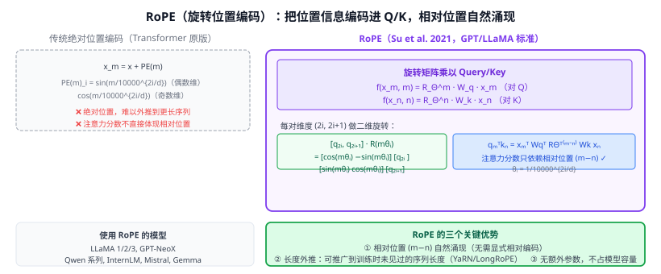

# 30g RoPE（旋转位置编码）

> 定位：用**旋转矩阵**将绝对位置信息编码进 Query 和 Key，使得注意力分数中**相对位置关系自然涌现**，且对训练时未见过的序列长度有更强外推能力。
> 作者：Su et al.，2021（arXiv 2104.09864）；正式发表 Neurocomputing 2024。
> 效果：LLaMA 1/2/3、GPT-NeoX、Qwen、InternLM、Mistral、Gemma 等几乎所有主流开源 LLM 都采用 RoPE。
> **输入 / 输出**：Query/Key 向量 + 位置索引 → 旋转变换后的 Q'/K'（维度不变，后续 softmax(Q'K'ᵀ/√d)V 不变）

---



## 一、提出背景

Transformer（28）原版用正弦绝对位置编码 PE(m)，直接加到嵌入上。问题：

1. **绝对位置**：模型只知道"我在第 m 个位置"，而不直接知道"我和第 n 个位置差了多少"——相对位置需要通过多层注意力间接学习。
2. **外推差**：训练在 2048 长度，推理 4096 时精度下降（正弦波频率固定，不适配新位置）。

已有相对位置编码（如 T5 的相对偏置、ALiBi）能解决问题①，但需要修改注意力矩阵，与 FlashAttention 等优化兼容性差。

RoPE 的优雅之处：**不修改注意力矩阵计算，只在 Q/K 上乘旋转矩阵**，就能让注意力分数只含相对位置。

---

## 二、核心思想

### 2.1 直觉：旋转角度编码位置

把每对维度 $(q_{2i}, q_{2i+1})$ 看作二维复数，对应位置 $m$ 时旋转 $m \cdot \theta_i$ 角度：

$$\begin{pmatrix} q'_{2i} \\ q'_{2i+1} \end{pmatrix} = \begin{pmatrix} \cos(m\theta_i) & -\sin(m\theta_i) \\ \sin(m\theta_i) & \cos(m\theta_i) \end{pmatrix} \begin{pmatrix} q_{2i} \\ q_{2i+1} \end{pmatrix}$$

其中基频 $\theta_i = 1/10000^{2i/d}$（与正弦 PE 相同的频率设计）。

对 $d$ 维向量，共 $d/2$ 对，每对用不同 $\theta_i$（低频到高频）。

### 2.2 相对位置自然涌现

位置 $m$ 的 Q 与位置 $n$ 的 K 的点积：

$$q_m^{\prime \top} k_n^{\prime} = \text{Re}\left[(R_\Theta^m W_q x_m)^* (R_\Theta^n W_k x_n)\right] = f(x_m, x_n, m-n)$$

结果只依赖 $m-n$（相对位置），与绝对位置 $m, n$ 无关。这意味着即使在推理时遇到训练时没见过的绝对位置，只要相对位置模式在训练中出现过，模型就能处理。

### 2.3 长度外推

训练时最长序列 $L_{train}$，推理时可能 $L_{inference} > L_{train}$。

**扩展方法**：
- **YaRN**（Yet another RoPE extensioN，2023）：对不同频率维度用不同缩放；如 LLaMA-2 从 4k 扩展到 128k。
- **LongRoPE**（2024）：非均匀缩放，进一步提升 2M token 范围的外推能力。
- **Position Interpolation**（PI，Meta 2023）：把新位置压缩到 $[0, L_{train}]$ 范围再做 RoPE，简单但有效。

---

## 三、实现（代码层面）

RoPE 的实现非常高效，不需要额外参数，在 self-attention 的 Q/K 乘以 $W_q/W_k$ 之后立即应用：

```python
# 预计算 cos/sin 表（只算一次）
inv_freq = 1.0 / (10000 ** (torch.arange(0, d, 2) / d))  # d/2 个频率
t = torch.arange(max_seq_len)
freqs = torch.outer(t, inv_freq)  # [max_seq_len, d/2]
cos_emb = freqs.cos()             # [max_seq_len, d/2]
sin_emb = freqs.sin()

# 对 Q/K 做旋转（每次 forward 时）
def rotate_half(x):
    x1, x2 = x[..., :d//2], x[..., d//2:]
    return torch.cat([-x2, x1], dim=-1)

q_rot = q * cos_emb + rotate_half(q) * sin_emb
k_rot = k * cos_emb + rotate_half(k) * sin_emb
```

与 FlashAttention 完全兼容（在 QK 送入 FlashAttention 前做旋转）。

---

## 四、与其他位置编码对比

| 方法 | 绝对/相对 | 长度外推 | 与 FA 兼容 | 额外参数 |
|------|---------|---------|-----------|---------|
| 正弦 PE（原 Transformer） | 绝对 | 差 | ✓ | 无 |
| 可学习 PE（BERT） | 绝对 | 差（截断） | ✓ | 有（$L_{max} \times d$）|
| 相对 PE 偏置（T5） | 相对 | 一般 | ✗ | 有（头数 × bucket）|
| ALiBi | 相对 | 好 | ✓ | 无 |
| **RoPE** | 混合（Q/K 旋转→相对涌现） | 好（+YaRN/PI） | ✓ | **无** |

---

## 五、历史地位与影响

RoPE 几乎已成为 **2022 年后开源 LLM 的标配位置编码**：
- Meta LLaMA（1/2/3）、Mistral-7B、Gemma、Qwen-2、InternLM-2 全部采用 RoPE。
- GPT-4/Claude 等闭源模型未披露，但推测也使用类似方案。
- 多模态扩展：2D-RoPE（对 ViT patch 的行列两个维度各做一套 RoPE）在 InternVL-2、Qwen2-VL 等中用于视觉 token。

---

## 六、与本项目的关系

- **间接相关**：本项目 CLIP 文本编码器基于 GPT 架构（33 CLIP），原版 CLIP 用绝对 PE；后续 SigLIP、InternVL 等改进版用 RoPE。若未来升级到 InternVL 等开放词汇检测模型，RoPE 是必须了解的基础。
- **论文写作**：第二章大模型基础一节（或附录）可一句话介绍 RoPE——"现代 LLM 普遍采用旋转位置编码（RoPE）以提升长序列外推能力"。
- **实验无直接用**：本项目 CLIP 模型直接使用 OpenAI 发布的预训练权重，无需改动位置编码。

---

## 参考文献

- Su J, Lu Y, Pan S, Murtadha A, Wen B, Liu Y. *RoFormer: Enhanced Transformer with Rotary Position Embedding.* Neurocomputing 2024.（arXiv 2021）
- Peng B, et al. *YaRN: Efficient Context Window Extension of Large Language Models.* ICLR 2024.
