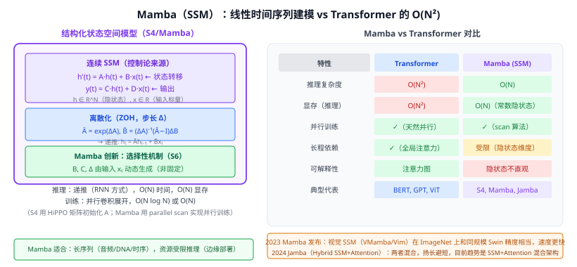

# 30h Mamba（状态空间模型）

> 定位：基于**结构化状态空间模型（SSM）**的序列建模方法，推理时复杂度为 $O(N)$（vs Transformer 的 $O(N^2)$），通过**选择性状态空间（S6）**赋予 SSM 内容感知能力，在语言/音频/基因序列上媲美 Transformer。
> 作者：Gu & Dao，Princeton + Stanford，arXiv 2312.00752，2023。
> 效果：Mamba 2.8B 在语言建模上超过 Transformer 同规模模型；推理速度 5× 于 GPT-NeoX，显存 $O(N)$。
> **输入 / 输出**：序列 $x_{1:N}$ → 序列 $y_{1:N}$（与 Transformer 接口相同，但时间/空间复杂度更优）

---



## 一、提出背景

Transformer（28）的自注意力虽然强大，但**二次复杂度 $O(N^2)$** 在长序列场景成为瓶颈（视频帧、DNA 序列、音频波形、长文档）。尽管有 30f FlashAttention 等 IO 优化，但根本的 $O(N^2)$ 复杂度无法改变。

状态空间模型（SSM）是控制论的经典工具（与 LSTM 类似，但更数学化）。2021-2023 年的 S4、H3、S5 系列工作表明 SSM 可以在并行训练下实现长程依赖建模。**Mamba** 是这条路线的突破性一步：引入"选择性机制"，让 SSM 具备内容感知能力（类似注意力的门控），在语言任务上首次追平 Transformer。

---

## 二、核心机制

### 2.1 连续状态空间模型（基础）

经典线性 SSM（连续时间）：

$$h'(t) = Ah(t) + Bx(t)$$
$$y(t) = Ch(t) + Dx(t)$$

- $h(t) \in \mathbb{R}^N$：隐状态（"记忆"）
- $A \in \mathbb{R}^{N\times N}$：状态转移矩阵
- $B, C \in \mathbb{R}^{N}$：输入/输出投影
- $D$：直通（skip connection）

### 2.2 离散化（ZOH 方法）

将连续 SSM 离散化为可计算的递推：

$$\bar{A} = \exp(\Delta A),\quad \bar{B} = (\Delta A)^{-1}(\bar{A} - I)\Delta B$$
$$h_t = \bar{A} h_{t-1} + \bar{B} x_t$$
$$y_t = C h_t + D x_t$$

步长 $\Delta$（离散化粒度）是超参数；S4 中 $A$ 用 **HiPPO 矩阵**初始化（在理论上能最优保留历史信息）。

### 2.3 Mamba 的核心：选择性机制（S6）

传统 SSM 的 $B, C, \Delta$ 是**固定的**（与输入无关）——这导致 SSM 不能选择性地"忽略不相关信息"，在语言任务上效果差于 Transformer。

Mamba 将 $B, C, \Delta$ 改为**从输入 $x_t$ 动态生成**（线性投影）：

$$B_t = \text{Linear}_B(x_t),\quad C_t = \text{Linear}_C(x_t),\quad \Delta_t = \text{Softplus}(\text{Linear}_\Delta(x_t))$$

$A$ 仍然是全局固定的（HIPPO 初始化）。这相当于让 SSM 在每步**决定保留哪些历史信息**，类似 LSTM 的门控机制，但更高效。

### 2.4 并行训练（Parallel Scan）

SSM 的递推 $h_t = \bar{A}_t h_{t-1} + \bar{B}_t x_t$ 看起来是串行的，但可以用**并行前缀扫描**（parallel prefix scan）将 $N$ 步递推展开为 $O(\log N)$ 轮并行操作，使得训练和 Transformer 一样高效。

实现关键：序列前缀乘积 $h_N = \prod_{i=1}^N \bar{A}_i \cdot h_0 + \sum_{j=1}^N (\prod_{k=j+1}^N \bar{A}_k) \bar{B}_j x_j$ 可并行化。

### 2.5 Mamba 块结构

```
输入 x
  ├─ Linear → SSM（S6）→ SiLU
  └─ Linear → SiLU
  ⊗ 两路相乘（门控）
  → 输出投影
```

与 Transformer 块对比：Mamba 块没有显式注意力矩阵，整体计算量 $O(N)$，显存 $O(N)$（推理时只需维护固定大小隐状态）。

---

## 三、视觉 SSM（VMamba / Vim）

将 Mamba 应用到图像需要解决"二维扫描"问题：

- **Vim**（2024）：把图像 patch 展平为 1D 序列，用双向 Mamba（前向+后向扫描）。
- **VMamba**（2024）：4 方向扫描（横/竖/对角）覆盖空间关系。
- 精度与 Swin-T 相当，速度快 20-30%；长序列（4K 分辨率）优势更明显。

---

## 四、现状与展望（2024）

| 进展 | 说明 |
|------|------|
| **Jamba**（AI21 Labs）| SSM + Transformer 混合层，兼顾两者优势 |
| **Mamba-2**（Gu & Dao）| 将 S6 改为 SSD（结构状态对偶），进一步加速 |
| **Falcon Mamba 7B** | 首个完全替换 Attention 的 7B 模型，媲美 Mistral-7B |

目前共识：**纯 Mamba 在短中序列（<10k token）不如 Transformer，但在超长序列（>100k token）有明显优势**；混合架构（少量注意力层 + 多数 SSM 层）可能是未来主流。

---

## 五、与本项目的关系

- **远期工程选项**：若本项目路面检测场景扩展到长视频流分析（多帧时序推理），SSM 比 Video Transformer 更高效；可作"未来工作"提及。
- **相关工作背景**：第二章提到 Transformer 的 $O(N^2)$ 复杂度时，可顺带提 Mamba 代表的 SSM 方向，展示对学术前沿的了解。
- **不在当前实验中使用**：YOLOv8 和 CLIP 都基于 CNN/Transformer，当前不需替换为 SSM。

---

## 参考文献

- Gu A, Dao T. *Mamba: Linear-Time Sequence Modeling with Selective State Spaces.* ICLR 2024.
- Gu A, et al. *Efficiently Modeling Long Sequences with Structured State Spaces (S4).* ICLR 2022.
- Liu Y, et al. *VMamba: Visual State Space Model.* NeurIPS 2024.
