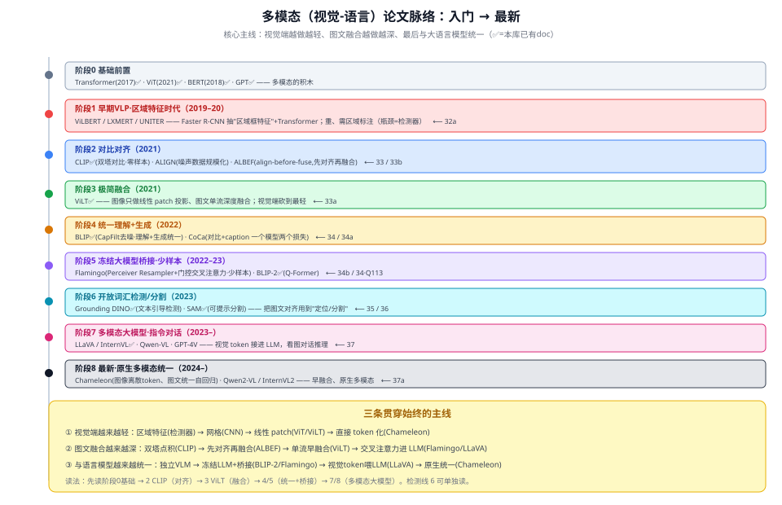

# 多模态（视觉-语言）论文脉络地图

> 本文是多模态方向的**阅读路线图**：把代表性经典按"入门 → 最新"串成一条线，标出本库**已有 doc**（✅）和**待补**。
> 配合各单篇文章阅读；单篇是"站点深读"，本文是"线路总览"。
> 约定：这些论文多与本课题（路面抛洒物检测）关系不大，各单篇按"纯模型学习"写，不强写项目关系。

---

## 一、三条贯穿始终的主线

看多模态的演进，抓住三条线就不乱：

1. **视觉端越来越轻**：区域特征（跑目标检测抽框）→ 网格特征（CNN）→ 线性 patch（ViT/ViLT）→ 直接 token 化（Chameleon）。
2. **图文融合越来越深**：双塔点积（CLIP）→ 先对齐再融合（ALBEF）→ 单流早融合（ViLT）→ 交叉注意力进 LLM（Flamingo/LLaVA）。
3. **与语言模型越来越统一**：独立 VLM → 冻结 LLM + 桥接（BLIP-2/Flamingo）→ 视觉 token 喂 LLM（LLaVA）→ 原生统一（Chameleon）。

---

## 二、分阶段脉络（代表作 + 状态）

| 阶段 | 时期 | 代表作（经典） | 一句话 | 本库 |
|---|---|---|---|---|
| **0 基础前置** | — | Transformer、ViT、BERT、GPT | 多模态的积木 | ✅ |
| **1 区域特征 VLP** | 2019–20 | ViLBERT / LXMERT / UNITER | 目标检测抽区域特征 + Transformer；重、需区域标注 | 32a |
| **2 对比对齐** | 2021 | CLIP、ALIGN、ALBEF | 图文对比对齐、零样本；ALBEF 先对齐再融合 | ✅ / 33b |
| **3 极简融合** | 2021 | ViLT | 图像仅线性 patch、图文单流深度融合 | ✅ |
| **4 统一理解+生成** | 2022 | BLIP、CoCa | 理解与生成一体；CoCa=对比+caption | ✅ / 34a |
| **5 冻结大模型桥接·少样本** | 2022–23 | Flamingo、BLIP-2 | 冻结 LLM + 桥接器；Flamingo 少样本 | 34b / ✅ |
| **6 开放词汇检测/分割** | 2023 | Grounding DINO、SAM | 图文对齐用到"定位/分割" | ✅ |
| **7 多模态大模型·指令** | 2023– | LLaVA/InternVL、Qwen-VL、GPT-4V | 视觉 token 接进 LLM，看图对话 | ✅ |
| **8 最新·原生多模态统一** | 2024– | Chameleon、Qwen2-VL、InternVL2 | 早融合、图文统一自回归 | 37a |

---

## 三、推荐阅读顺序

**入门线（先建立主干）**：
Transformer → ViT → **CLIP（对齐）** → ViLT（融合）→ BLIP（理解+生成）→ LLaVA/InternVL（多模态大模型）。

**深挖线（补齐脉络）**：
32a 区域特征 VLP（看清"之前多重"）→ 33b ALBEF（对齐与融合的桥）→ 34a CoCa（对比+生成合一）→ 34b Flamingo（冻结 LLM+少样本）→ 37a 原生多模态（最新统一范式）。

**检测/分割线（可单独读）**：
Grounding DINO（开放词汇检测）、SAM（可提示分割）。

---

## 四、一句话记住每一步"解决了什么"

- **区域 VLP**：证明"图文一起预训练"有效，但视觉端太重（瓶颈=检测器）。
- **CLIP**：用 4 亿图文对做对比对齐，开启零样本；但融合浅（只点积）。
- **ALBEF**：先对比对齐、再交叉注意力融合，兼顾检索与推理。
- **ViLT**：把视觉端砍到只剩线性投影，算力全给图文交互。
- **BLIP / CoCa**：把"理解"和"生成"统一进一个模型。
- **BLIP-2 / Flamingo**：两头大模型冻结、只训中间桥接器，省算力还强。
- **LLaVA / InternVL**：视觉 token 直接喂 LLM，看图对话推理。
- **Chameleon / Qwen2-VL**：图像也 token 化，图文在一个词表里原生统一。
