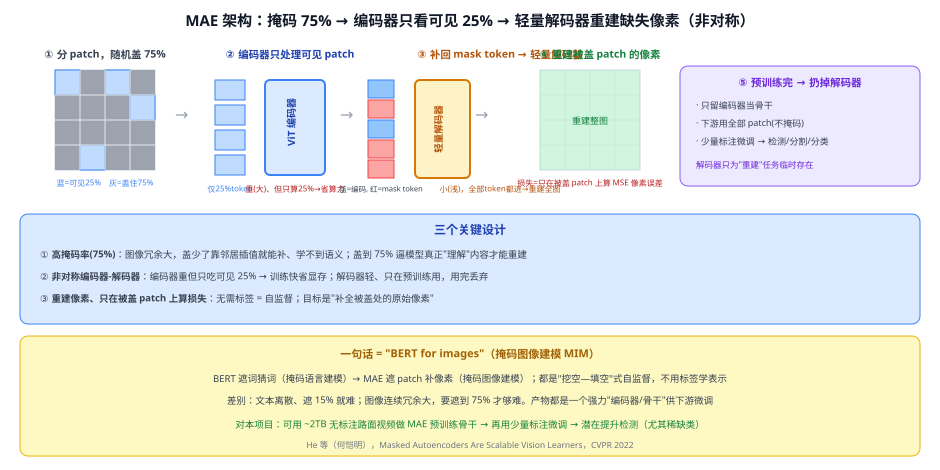
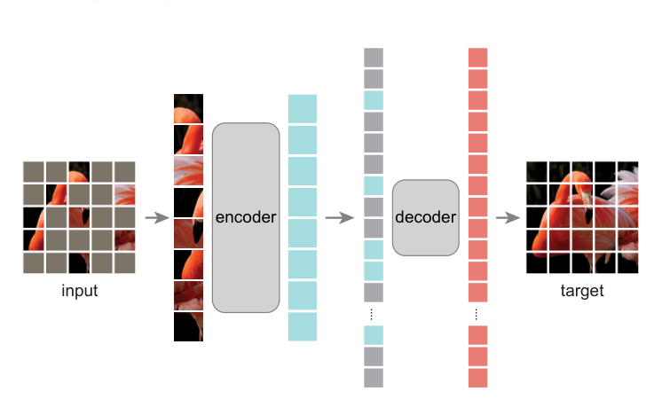
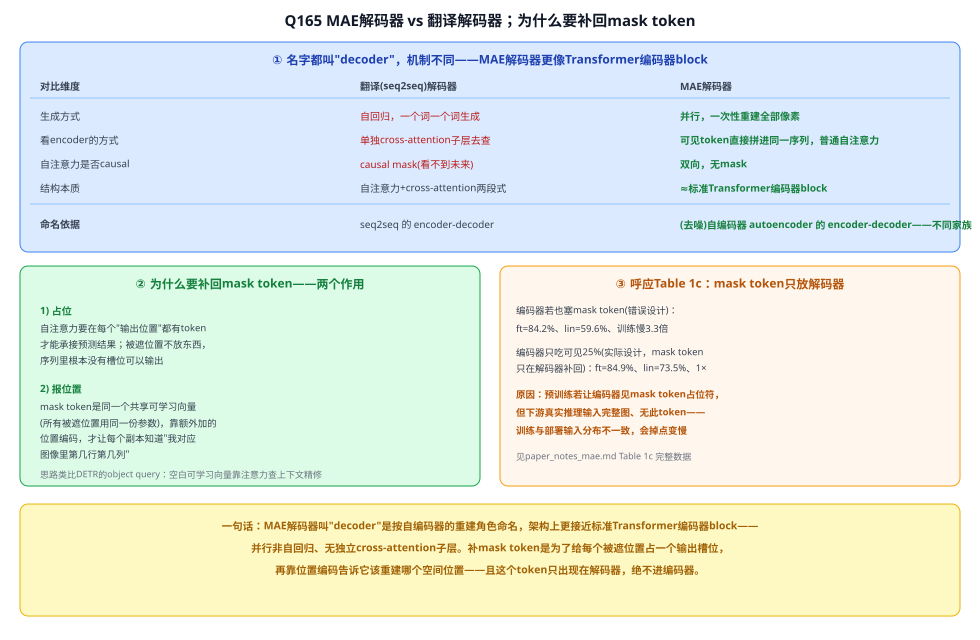
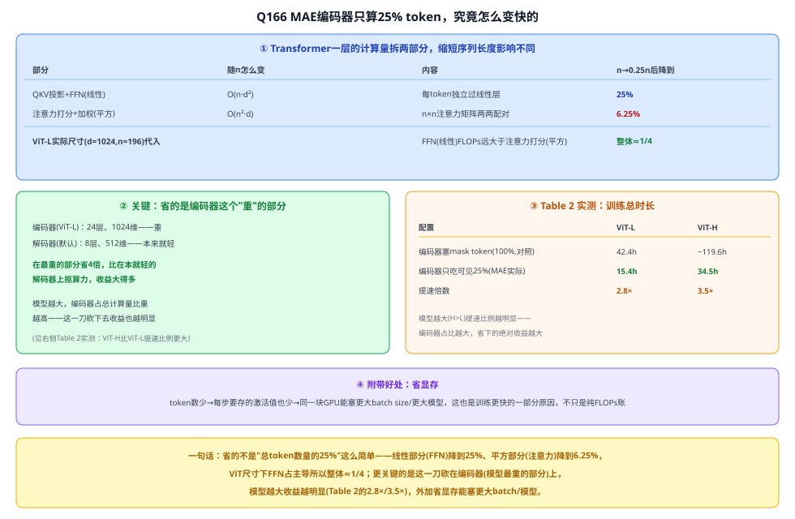
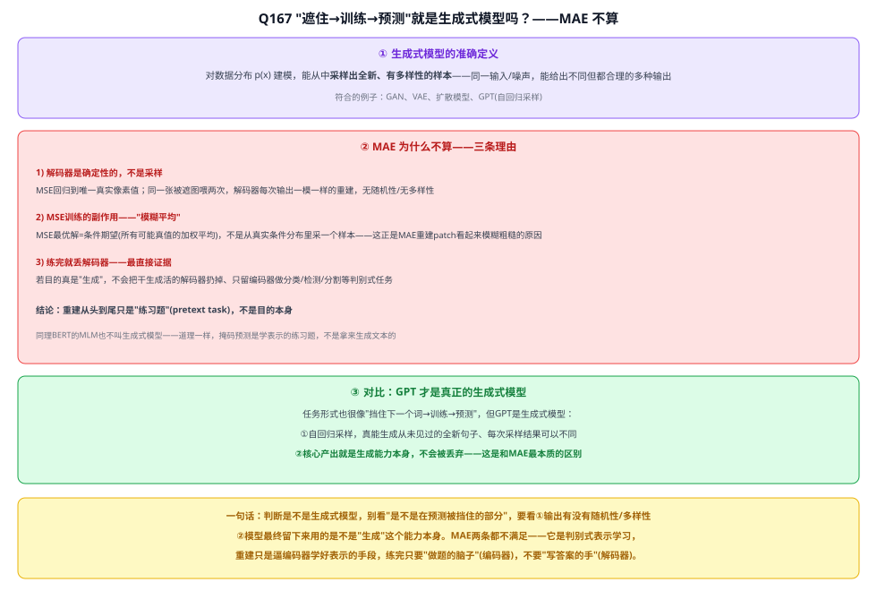

# 31a MAE（Masked Autoencoders）

> 定位：ViT 的**自监督预训练**方法——"BERT for images"（掩码图像建模 MIM）。用海量**无标注**图像学到强视觉表示，再少量标注微调。对本项目有真实价值：可利用 ~2TB **无标注路面视频**自监督预训练骨干。
> 作者：He 等（何恺明，Facebook AI Research / Meta），*Masked Autoencoders Are Scalable Vision Learners*，CVPR 2022（arXiv:2111.06377）。
> 前置：31 ViT（骨干）、29 BERT（掩码建模思想来源）。
> **输入 / 输出**：（预训练）掩码图 → 重建被盖像素（无标签）；（下游）完整图 + 少量标注 → 任务结果

---



> 📥📤 **输入/输出实例**：**预训练**——输入一张路面帧，切 patch 后随机盖 **75%**，只把可见 **25%** 送 ViT 编码器 → 轻量解码器重建被盖 patch 的**原始像素**，损失 = 被盖处像素 MSE（**不用任何标签**）；产物是一个学到强表示的 ViT 编码器（解码器丢弃）。**下游**——用完整图（不掩码）+ 少量标注，把编码器当骨干接检测/分割/分类头微调。这就是"**挖空—填空**"式自监督：与 BERT 遮词猜词一脉相承（掩码语言建模 → 掩码图像建模）。


> 📄 **论文原图对照**（图源：He et al., *Masked Autoencoders Are Scalable Vision Learners*, [arXiv:2111.06377](https://arxiv.org/abs/2111.06377) Figure 1，原文 [PDF](../papers/31a_MAE_2111.06377.pdf)；仅笔记内学习引用，论文写作须自绘）：



> 非对称自编码：75% patch 遮掉、编码器只吃可见的 25%，轻量解码器拿掩码 token 重建像素——训练完丢解码器只留编码器。

## 一、提出背景

BERT 早已证明"遮住一部分、让模型补全"（掩码语言建模 MLM）是极强的**自监督**预训练范式——不用标签就能学到通用语言表示。自然的问题是：**图像能不能照做**？把图切成 patch、遮住一部分、让模型补——这就是**掩码图像建模（Masked Image Modeling, MIM）**。

但把 BERT 直接搬到图像有三个障碍，MAE 逐一解决：
1. **架构**：过去 CNN 难做"遮 token 再补"；ViT 把图变成 patch token 后，这个障碍消失。
2. **信息密度**：语言是人造的、高度浓缩，遮 15% 词就很难；图像**空间冗余大**，遮少了靠邻居插值就能补、学不到语义 → MAE 用**极高掩码率 75%**。
3. **重建目标**：语言重建的是"词"（语义丰富）；图像若重建"语义标签"没意义 → MAE 直接**重建原始像素**，简单有效。

---

## 二、核心方法 ⭐

### 2.1 非对称编码器-解码器（MAE 的精髓）

```
图 → 切 patch → 随机盖 75%
        │  只保留可见 25% patch
        ▼
   ViT 编码器（重、大）  ← 只处理 25% token → 训练快、省显存
        │  编码后的可见 token
        ▼
   补回 mask token（可学习占位符）+ 位置编码 → 全部 token
        │
   轻量解码器（浅、小）  ← 处理 100% token，重建全图
        │
   只在【被盖 patch】上算像素 MSE 损失
```

- **编码器**：标准 ViT，但**只吃可见的 25% patch**（被盖的根本不进编码器）→ 计算量骤降，可训练更大模型、更快。
- **解码器**：**轻量**（层数/宽度远小于编码器），把"编码后的可见 token + mask token 占位符"一起还原成全图。它**只在预训练时存在**，微调时丢弃。
- **非对称**指编码器重、解码器轻，且两者看到的 token 数不同（25% vs 100%）——这是 MAE 又快又好的关键。

### 2.2 三个关键设计

| 设计 | 做法 | 为什么 |
|---|---|---|
| **高掩码率 75%** | 随机盖住四分之三 patch | 图像冗余大，盖少了靠插值就能补、学不到语义；盖到 75% 逼模型真正"理解"内容 |
| **非对称结构** | 编码器只算 25%、解码器轻且用完丢 | 训练快省显存；表示能力集中在编码器 |
| **重建像素、只算被盖处** | 目标是被盖 patch 的原始像素、MSE | 无需标签 = 自监督；简单、可扩展 |

### 2.3 训练与使用两阶段
1. **自监督预训练**：海量无标注图 → 学好编码器（无标签）。
2. **下游微调**：丢掉解码器、用完整图（不掩码）+ 少量标注，编码器接任务头微调。

---

## 三、关键结论

- **ImageNet-1K 上自监督预训练 + 微调**：ViT-Huge 达 **87.8%** top-1，超过同期有监督/自监督方法，且**预训练比有监督更快**（编码器只算 25% token）。
- **可扩展性强**：模型越大、数据越多，收益越明显（"Scalable Vision Learners"）。
- **迁移好**：预训练表示在检测、分割等下游任务上普遍涨点。
- **意义**：把 BERT 式自监督成功搬到视觉，成为**视觉自监督预训练**的标杆之一（与对比学习路线 MoCo/DINO 并列）。

---

## 四、与本项目的关系 ⭐（真实的数据利用抓手）

- **核心价值——利用无标注数据**：本项目自采了 **~2TB 无标注路面监控视频**（CLAUDE.md 记）。这些数据目前只有极少量被标注（训练 3679 / 验证 735）。**MAE 正好能吃无标注数据**：
  1. 在海量无标注路面帧上做 MAE 自监督预训练骨干（学到路面场景的通用视觉表示）；
  2. 再用现有少量标注**微调** YOLO/ViT 骨干；
  3. → 有望提升检测精度，尤其可能改善小目标和低对比度目标的表示；当前真正稀缺的是 **GL/RU/ST**，但 GL/RU 被留作零样本评估，不能用于主检测器的监督微调。
- **写进论文的位置**：作为**"未来工作 / 数据增强的另一条路"**——与 ControlNet 合成数据（39 扩散模型）并列，前者"造数据"、后者"用无标注真数据"，都是补稀缺类的手段。
- **可行性与取舍**：MAE 预训练需要一定算力（RTX 3090 可训小 ViT，Huge 吃力），且引入自监督会增加实验复杂度。当前主线（EXP-001~004）**先不纳入**，作为**开题后可选的增强实验**（若时间/算力允许，跑一版"MAE 预训练骨干 vs ImageNet 预训练骨干"的对比，是很好的加分点）。
- **注意**：本项目主检测器是 CNN 式 YOLOv8，MAE 预训练的是 **ViT** 骨干；若要用在 YOLO 上，需换 ViT 骨干（或用 MAE 思想的卷积变体如 SparK/ConvNeXt-MAE）。这点要在方案里说清，别直接嫁接。

---

## 五、技术谱系

```
[29 BERT] 掩码语言建模(遮词补词) ──┐
                                  ├─→ 掩码图像建模 MIM = MAE(遮 patch 补像素)
[31 ViT] 图像→patch token ────────┘
                                  与对比学习自监督(MoCo/DINO/CLIP)并列两条路线
```

- 同类自监督：对比学习路线（MoCo、DINO、33 CLIP 的图文对比）——MAE 走"重建"路线、它们走"对比"路线。
- 后续：BEiT、SimMIM（同为 MIM）、SparK / ConvNeXt-V2（把 MIM 用回卷积骨干）。

---

## ✏️ 具体实例（走一遍）

**例：MAE 怎么自监督预训练**
```
① 一张路面帧 → 切成 14×14=196 个 patch
② 随机盖住 75%（约 147 个），只留 49 个可见 patch
③ 49 个可见 patch → ViT 编码器 → 49 个编码向量
④ 补回 147 个 mask token（可学习占位）+ 位置编码 → 196 个 token → 轻量解码器
⑤ 解码器重建 196 个 patch 的像素；只在被盖的 147 个上算 MSE 损失
⑥ 反复训练（无标签）→ 编码器学会"看懂"路面图像
```
**关键**：整个过程**没用一个标注**，却逼编码器学到强表示——因为要补出被盖的 75%，必须真正理解场景结构（对比 BERT 遮词猜词）。

**例：与本项目怎么接**
用 2TB 无标注路面视频抽帧 → MAE 预训练 ViT 骨干 → 用现有标注训练集微调检测头 → 对比"MAE 预训练 vs ImageNet 预训练"的 mAP，并按目标尺寸分层分析。这是一个自然的"未来工作"实验；正式实施时仍须保持 GL/RU 零样本留出协议。

---

## 六、参考文献

- He K, Chen X, Xie S, et al. *Masked Autoencoders Are Scalable Vision Learners.* CVPR 2022.（arXiv:2111.06377）
- Bao H, et al. *BEiT: BERT Pre-Training of Image Transformers.* ICLR 2022.（同为 MIM 路线）
- Woo S, et al. *ConvNeXt V2: Co-designing and Scaling ConvNets with Masked Autoencoders.* CVPR 2023.（把 MAE 用回卷积骨干）

**延伸阅读**：
- 架构师带你玩转AI，《神经网络算法 - 一文搞懂MAE（掩码自编码器）》，火山引擎开发者社区，2024。<https://developer.volcengine.com/articles/7389112594453250102>（科普向速览；仅作扩展链接存档，未转载原文——其"应用"一节把 MAE 归为超分辨率/去噪/风格迁移等图像重建任务，这与原论文的真实定位不同：MAE 的下游价值是**丢弃解码器、只用编码器做识别类任务**（分类/检测/分割微调），本身不是拿来做图像修复的，阅读时以本文 §三/四 和 paper_notes_mae.md 为准）

---

## 📋 模型答疑（来自模型详解问答）

> 专属本模型的问答集中在此；跨模型的通用问答见答疑总目录。深度消融/逐段精读见 paper_notes_mae.md。

---

## Q165. MAE 的解码器是不是类似翻译的解码器？为什么要补回 mask token？

**简答**：不完全类似。翻译解码器自回归生成+靠专门的cross-attention查编码器；MAE解码器并行一次性重建、可见token和mask token直接拼一起用普通自注意力算，架构上更接近标准Transformer编码器block，只是按自编码器"重建"的功能角色叫它decoder。补mask token是为了：①给每个被遮位置占一个输出槽位；②靠位置编码告诉它该重建哪个空间位置。且这个token只在解码器出现，编码器绝不能有（消融证明会掉点变慢）。



---

## Q166. MAE 编码器只算 25% token，具体是如何变快的？

**简答**：不是简单省了"75%的token"。Transformer一层里线性部分(FFN)随n线性变化、降到25%；平方部分(注意力打分)随n²变化、降到6.25%；ViT尺寸下FFN占主导，所以整体降幅≈1/4。更关键的是这一刀砍在编码器(模型最重的部分，24层vs解码器8层)上，模型越大收益越明显(Table 2实测ViT-L提速2.8×、ViT-H提速3.5×)，外加省显存能塞更大batch/模型。



---

## Q167. 所谓"生成式模型"，大体就是遮住了、训练完再预测就是"生成"，MAE 是这样吗？

**简答**：不完全是。判断是不是生成式模型，别看"是不是在预测被挡住的部分"，要看①输出有没有随机性/多样性（采样 vs 回归到唯一确定值）②模型最终留下来用的是不是"生成"这个能力本身。MAE 两条都不满足——解码器确定性回归、模糊平均，练完还被整个丢弃——它是**判别式表示学习**，重建只是逼编码器学好表示的手段，练完只要"做题的脑子"(编码器)，不要"写答案的手"(解码器)。GPT 才是真正的生成式模型：自回归采样+核心产出就是生成本身。



---
