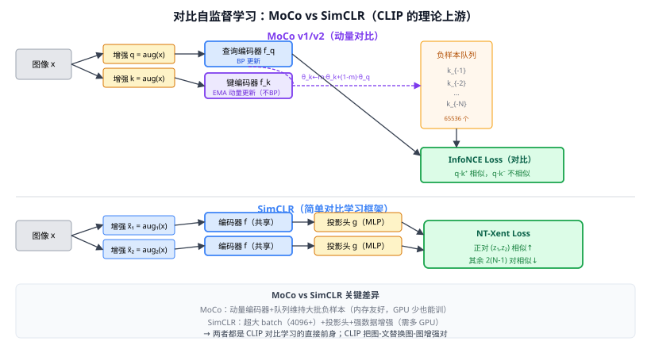

# 31b MoCo / SimCLR（对比自监督学习）

> 定位：通过对同一图像的不同数据增强版本（正样本对）做**对比学习**，无监督地学出高质量视觉表征——CLIP 图文对比学习的直接理论基础。
> 作者：MoCo — He et al.（FAIR），CVPR 2020；SimCLR — Chen et al.（Google Brain），ICML 2020。
> 效果：仅用无标注 ImageNet，在 100-epoch 线性探针下 Top-1 均超 60%，接近监督 ResNet-50 的 76%。
> **输入 / 输出**：无标注图像 → 对比训练 → 图像编码器（backbone），下游任务微调

---



## 一、提出背景

监督学习需要大量人工标注。自监督学习的核心思路：**把数据增强当作"免费的监督信号"**——同一图像的两个增强版本应在特征空间中靠近（正样本），不同图像应相互远离（负样本）。2020 年的 MoCo 和 SimCLR 是这一路线的两个标志性实现，精度首次逼近监督学习。

---

## 二、核心思想：InfoNCE 对比损失

两者都使用 InfoNCE（Noise Contrastive Estimation）损失变体，核心公式：

$$\mathcal{L} = -\log \frac{\exp(\mathbf{q}\cdot\mathbf{k}^+/\tau)}{\exp(\mathbf{q}\cdot\mathbf{k}^+/\tau) + \sum_{i=1}^{K}\exp(\mathbf{q}\cdot\mathbf{k}_i^-/\tau)}$$

- $\mathbf{q}$：query 图像的编码向量
- $\mathbf{k}^+$：同一图像另一增强的编码（正样本）
- $\mathbf{k}_i^-$：其他图像的编码（负样本）
- $\tau$：温度（默认 0.07），越小分布越尖锐

**直觉**：让模型把"同一图像的不同看法"拉近，把"不同图像"推远——无需任何标注。

---

## 三、MoCo（Momentum Contrast）

### 3.1 两个关键设计

**① 动量编码器（Momentum Encoder）**：
```
θ_k ← m·θ_k + (1-m)·θ_q   （m=0.999，θ_k 几乎不动）
```
- Query 编码器 $f_q$ 正常 BP 更新。
- Key 编码器 $f_k$ 是 $f_q$ 的指数移动平均（EMA），更新极慢 → 保持队列特征的一致性。

**② 负样本队列**：
- 维护一个大队列（65536 个负样本 key），FIFO 替换。
- 每次 forward 只需计算 query 和 key 各一次，负样本从队列里取。
- **好处**：无需超大 batch，单卡 8GB 也能训。

MoCo v2 加了投影头（MLP）和更强增强，性能大幅提升。

### 3.2 直观类比

学生（query 编码器）从书上做题（增强图像），老师（key 编码器）打分——但老师更新很慢（经验丰富、稳定），这样正负样本的"参考答案"不会因为学生进步太快而剧烈波动。

---

## 四、SimCLR（Simple Framework for Contrastive Learning）

### 4.1 三个关键设计

**① 强数据增强组合**（论文详细消融）：
```
random crop + color jitter + grayscale + gaussian blur → 两个独立增强
```
数据增强的选择比架构更重要——这是 SimCLR 的核心发现。

**② 投影头（Projection Head）**：
```
Encoder → h（2048d）→ MLP → z（128d）
```
在投影后的 $z$ 上做对比学习（而非直接在 $h$ 上），下游微调时只用 $h$。
投影头让对比任务和表征空间解耦，精度提升约 10%。

**③ 超大 Batch（4096~8192）**：
Batch 内其他图像作负样本，批越大负样本越多，信息越丰富——但需要 32~128 GPU。MoCo 的队列解决了这个问题。

### 4.2 NT-Xent 损失

$$\mathcal{L}_{i,j} = -\log\frac{\exp(\text{sim}(z_i,z_j)/\tau)}{\sum_{k\ne i}\exp(\text{sim}(z_i,z_k)/\tau)}$$

对 batch 内所有 $2N$ 个样本，每个正对各算一次损失，取平均。

---

## 五、两者对比与后续发展

| | MoCo | SimCLR |
|--|------|--------|
| 负样本来源 | 队列（65536 个） | 同 Batch（4096+） |
| Key 编码器 | 动量 EMA（不 BP） | 同一编码器（共享权重） |
| 硬件需求 | 单卡友好 | 多卡必须 |
| 核心贡献 | 队列+动量保证负样本质量 | 投影头+增强组合 |

**后续演进**：
- **BYOL**（Bootstrap Your Own Latent，2020）：完全不用负样本，只靠在线/目标网络的"动量+预测头"。
- **DINO**（31c）：把 BYOL 的思想用在 ViT 上，Teacher 用 EMA，出现显著的对象感知特征。
- **CLIP**（33）：把图像正样本改为配对文本，InfoNCE 在图-文对上做对比——从视觉自监督扩展到视觉-语言对齐。

---

## 六、与本项目的关系

- **理论来源**：本项目的核心模块 CLIP 的对比学习机制，直接建立在 InfoNCE + 动量编码器/投影头 的基础上——理解 MoCo/SimCLR 是理解 CLIP "为什么这么做"的必要前提。
- **相关工作写作**：第二章 VLM 一节，应从"纯视觉对比自监督（MoCo/SimCLR）→ 图文对比（CLIP）→ 开放词汇检测（GroundingDINO）"叙述演进脉络。
- 不在实验中使用；作相关工作引用。

---

## 参考文献

- He K, Fan H, Wu Y, Xie S, Girshick R. *Momentum Contrast for Unsupervised Visual Representation Learning.* CVPR 2020.
- Chen T, Kornblith S, Norouzi M, Hinton G. *A Simple Framework for Contrastive Learning of Visual Representations.* ICML 2020.
- Chen X, He K. *Exploring Simple Siamese Representation Learning.* CVPR 2021.（SimSiam，无负样本简化版）
