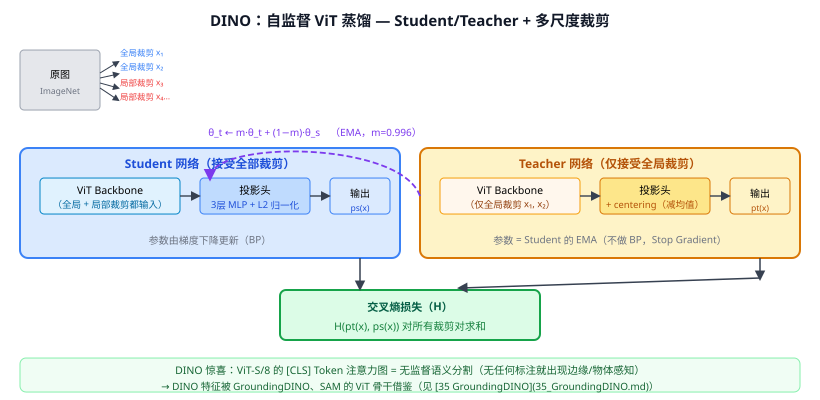

# 31c DINO（自监督 Vision Transformer）

> 定位：用"Self-Distillation with No Labels"训练 ViT，Teacher 是 Student 的指数移动平均（EMA），无需负样本也无需标注；ViT 特征自发展现出显著的语义分割能力。
> 作者：Caron et al.，Facebook AI Research，ICCV 2021（Oral）。
> 效果：ViT-S/8 在 ImageNet 线性探针 Top-1 达 79.1%；其注意力图无监督即可分割出目标前景，惊艳学界。
> **输入 / 输出**：无标注图像 → 自监督训练 → ViT 骨干（可用于下游 zero-shot 分割/检测）

---

## 一、提出背景

31b MoCo/SimCLR 用负样本做对比学习，但构建大量负样本代价高；BYOL（2020）证明"没有负样本也能自监督学习"，关键是避免模型坍塌（全输出相同向量）。

DINO 把 BYOL 的思路搬到 ViT：Teacher 是 Student 的 EMA，Student 学习在不同裁剪下预测与 Teacher 相同的分布。意外惊喜是：**训练出来的 ViT 注意力图直接对应视觉语义**，不加任何监督就能"看"到物体边界。

---

## 二、核心机制

### 2.1 框架：自蒸馏（Self-Distillation）

两个网络结构完全相同（ViT + 投影头），参数不同：

| | Student | Teacher |
|--|---------|---------|
| 输入 | 全局 + 局部裁剪（全部） | 仅全局裁剪（2 个大裁剪） |
| 更新 | 梯度 BP 正常更新 | EMA（不 BP） |
| 特殊处理 | — | 输出 centering（减历史均值，防坍塌） |

EMA 更新：$\theta_t \leftarrow m \cdot \theta_t + (1-m) \cdot \theta_s$，其中 $m$ 从 0.996 余弦退火到 1.0。

### 2.2 多裁剪策略（Multi-Crop）

- **2 个全局裁剪**（覆盖图像 >50%）→ 同时输入 Student 和 Teacher
- **K 个局部裁剪**（覆盖图像 <50%，如 6 个 96×96）→ 仅输入 Student

全局裁剪有上下文全貌，局部裁剪是"细节"。Student 要从任何视角预测 Teacher 的全局分布 → 强迫学到全局语义一致性。

### 2.3 损失函数

$$\mathcal{L} = -\sum_{x \in \{x_1, x_2\}} \sum_{\substack{x' \in \text{all crops} \\ x' \ne x}} p_t(x) \log p_s(x')$$

其中：
- $p_t(x) = \text{softmax}((g_t(x) - C)/\tau_t)$（teacher，有 centering $C$ 和低温 $\tau_t=0.04$）
- $p_s(x) = \text{softmax}(g_s(x)/\tau_s)$（student，较高温 $\tau_s=0.1$）
- Centering（$C$ 是 teacher 输出的历史 EMA）防止所有输出坍塌到同一维度

### 2.4 防坍塌的两个机制

| 机制 | 作用 |
|------|------|
| **Centering** | 减去 teacher 输出的移动均值；阻止某维度支配 |
| **Sharpening** | Teacher 用低温 τ（尖分布），student 用高温（平分布）；迫使 student 学习 teacher 的尖锐模式 |

两者互补：centering 防"单维坍塌"，sharpening 防"均匀分布坍塌"。

---

## 三、DINO 的神奇特性

训练完成后，直接可视化 [CLS] token 对每个 patch 的注意力分数（不加任何监督）：

- **ViT-S/8**：能清晰勾勒出图像中物体的边界——狗、椅子、人等。
- **ViT-B/8**：注意力图对语义分割帮助极大，K-NN 检索 ImageNet 准确率 78.3%。

这说明 ViT 在无监督训练下就能学到"什么是前景、什么是背景"，这与 CNN 的纹理偏差形成对比。

---

## 四、历史地位与后续影响

DINO 是 ViT 自监督学习里程碑，且直接影响了多个后续系统：

- **DINOv2**（Meta，2023）：扩大数据+增加蒸馏，ViT 特征成为通用视觉骨干（SAM、LLaVA 等用）。
- **GroundingDINO**（35）：名字中的 DINO 正来自这里（检测 DINO 架构 + 文本条件）。
- **SAM**（36）：骨干 ViT-H 用 MAE + DINO 预训练。
- **CLIP + DINO**：SigLIP 等 CLIP 改进版探索把 DINO 的训练方式引入图文对比。

---

## 五、与本项目的关系

- **核心创新 2 的基础**：本项目 CLIP 零样本识别的底层 ViT 特征，与 DINO 系列 ViT 预训练同源。第二章相关工作"自监督 ViT 预训练"一节应引用 DINO。
- **路面预训练选项**：若 CLIP ViT 迁移到路面场景效果不足，可考虑在无标注路面视频上用 MAE（31a）或 DINO 方式预训练 ViT 骨干——论文可作"未来工作"提及。
- **消融扩展**：可消融"CLIP ViT 骨干换为 DINOv2 预训练骨干"对零样本识别率的影响（EXP-003 扩展实验）。

---

## 参考文献

- Caron M, et al. *Emerging Properties in Self-Supervised Vision Transformers.* ICCV 2021.
- Oquab M, et al. *DINOv2: Learning Robust Visual Features without Supervision.* TMLR 2024.
- （相关）Grill J B, et al. *Bootstrap Your Own Latent (BYOL).* NeurIPS 2020.（无负样本先驱）
