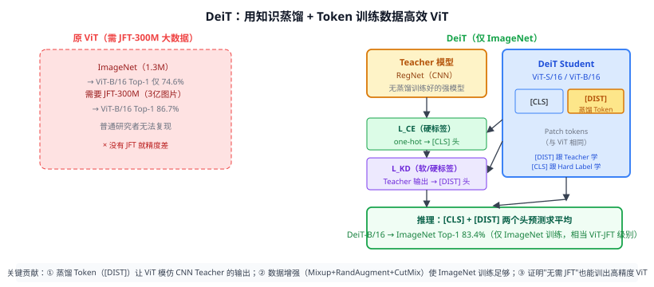

# 31d DeiT（数据高效图像 Transformer）

> 定位：通过**蒸馏 Token（Distillation Token）**让 ViT 模仿 CNN Teacher，仅用 ImageNet-1k（不依赖私有 JFT-300M）即可训出高精度 ViT，降低了 ViT 的数据门槛。
> 作者：Touvron et al.，Facebook AI Research + Sorbonne，ICML 2021。
> 效果：DeiT-B/16 在纯 ImageNet 训练下 Top-1 83.4%，持平用 JFT 训出的 ViT-B；DeiT-S 速度比 EfficientNet-B4 快，精度相当。
> **输入 / 输出**：图像 → 分类概率（与 ViT 相同接口）

---



## 一、提出背景

31 ViT 在 ImageNet-1k 上单独训练精度只有 74.6%，需要 Google 内部 JFT-300M（3 亿图片）才能达到 86.7%——普通研究者根本复现不了。

DeiT 的核心问题：**能否只用公开的 ImageNet-1k，让 ViT 达到同等精度？**

答案：引入知识蒸馏（借 CNN Teacher 的归纳偏置），加上强数据增强，ViT 的数据效率大幅提升。

---

## 二、核心创新

### 2.1 蒸馏 Token（Distillation Token）

原 ViT 只有 `[CLS]` token。DeiT 新增一个 `[DIST]` token（可学习嵌入向量），与 patch tokens 和 `[CLS]` 一起进入 Transformer：

```
输入序列：[CLS] + patch₁ + patch₂ + … + patchN + [DIST]
```

- `[CLS]` 头（线性分类）：用 one-hot 真标签训练（标准交叉熵）
- `[DIST]` 头（线性分类）：用 Teacher 的输出（软或硬标签）训练

总损失：$\mathcal{L} = \frac{1}{2}(\mathcal{L}_{CE}(y, p_{cls}) + \mathcal{L}_{KD}(p_t, p_{dist}))$

**推理**：两个头的 Softmax 输出求平均，性能比单头更好（类似 ensemble）。

### 2.2 Teacher 选择：CNN 优于 ViT

论文实验发现：用 **CNN Teacher**（RegNetY-16GF，Top-1 82.9%）做蒸馏比用 ViT Teacher 效果更好。

原因：CNN 天生具有归纳偏置（平移不变性、局部性），而这些正是 ViT 从 ImageNet-1k 学不好的东西。蒸馏 CNN Teacher 相当于把 CNN 的归纳偏置隐式传给 ViT。

### 2.3 强数据增强（关键配方）

DeiT 的训练数据增强比 ViT 复杂很多：
- **Mixup**（14d）
- **CutMix**（14d）
- **RandAugment**（自动增强策略）
- **Random Erasing**（随机擦除）

这些增强大幅扩充了 ImageNet-1k 的有效样本多样性，弥补了数据量不足。

---

## 三、DeiT 性能总结

| 模型 | 参数量 | ImageNet Top-1 | 训练数据 |
|------|--------|---------------|---------|
| ViT-B/16 | 86M | 74.6% | ImageNet-1k |
| ViT-B/16 | 86M | 86.7% | JFT-300M |
| **DeiT-B/16** | **86M** | **83.4%** | **ImageNet-1k** |
| DeiT-S/16 | 22M | 79.8% | ImageNet-1k |
| RegNetY-16GF (Teacher) | 84M | 82.9% | ImageNet-1k |

---

## 四、优点与局限

**优点**：
- 无需私有大数据，仅 ImageNet-1k 可复现。
- 蒸馏 Token 设计优雅，推理时直接 ensemble 两头。
- 开源权重质量高，成为后续研究的常用 baseline。

**局限**：
- 仍需强 CNN Teacher（限制了"纯 ViT 端到端"的吸引力）。
- 在纯 ViT 自监督（如 31c DINO、31a MAE）兴起后，KD 方案逐渐被自监督取代。
- Token 设计对位置编码敏感，迁移到其他分辨率需调整。

---

## 五、历史地位

DeiT 是 ViT 工业化应用的起点：

- 让普通实验室也能复现 ViT 级精度，推动 ViT 在检测/分割骨干上的大规模采用（32 Swin Transformer 直接建立在 ViT 社区基础上）。
- DeiT-S/B 成为大量后续论文的对比基线（包括 Swin、BEiT、MAE 等）。
- 验证了"CNN 的归纳偏置可以通过蒸馏传给 Transformer"，为 CLIP、BLIP 等 VLM 使用预训练 ViT 骨干奠定了可行性基础。

---

## 六、与本项目的关系

- **本项目 CLIP 的 ViT 骨干**（如 ViT-B/32）与 DeiT 框架密切相关——CLIP 的 ViT 用类似的强增强 + 大数据训练，DeiT 证明了相关技术路线。
- **相关工作写作**：ViT 应用一节，应写"ViT 原始版依赖大数据→DeiT 降低数据门槛→MAE 进一步降低→Swin 引入层级"，这条脉络直接说明本项目用 CLIP ViT 的合理性。
- 不直接在实验中使用 DeiT；作相关工作引用。

---

## 参考文献

- Touvron H, Cord M, Douze M, Massa F, Sablayrolles A, Jégou H. *Training Data-Efficient Image Transformers & Distillation through Attention.* ICML 2021.
