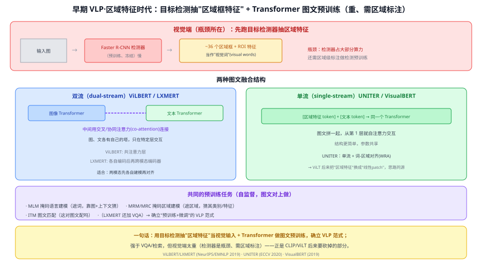
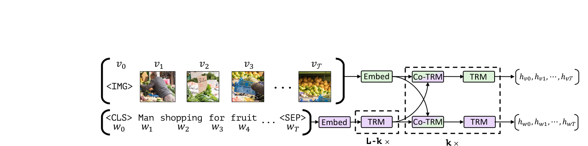
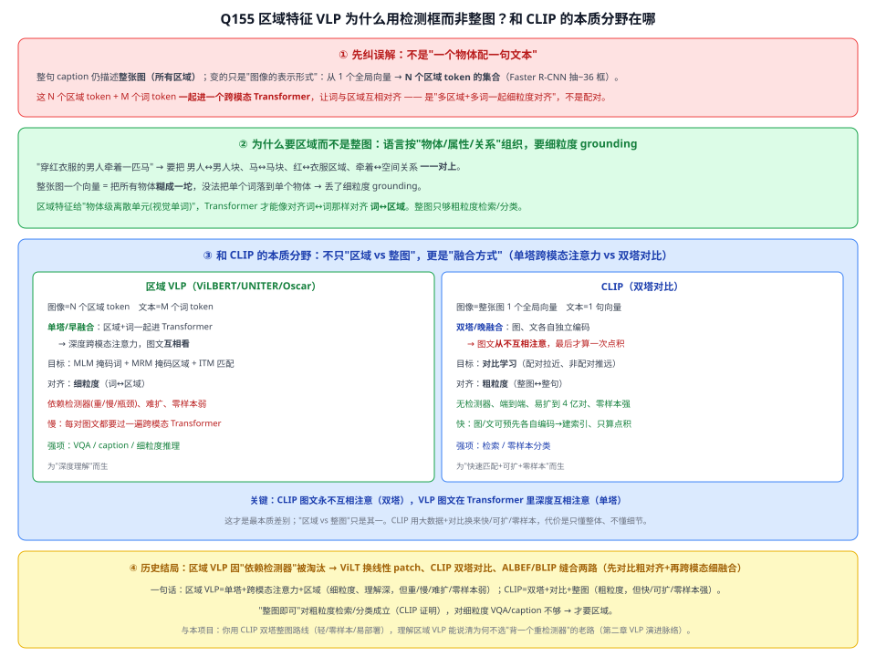
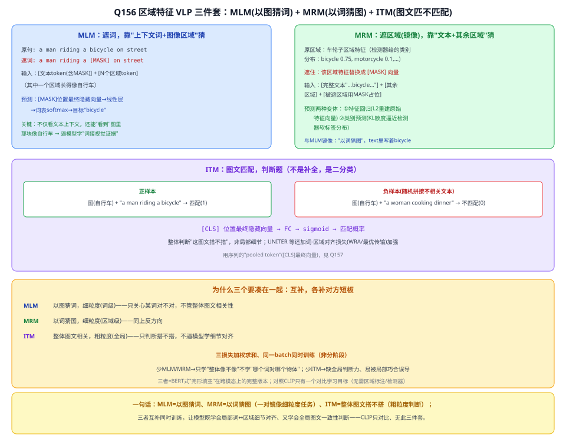
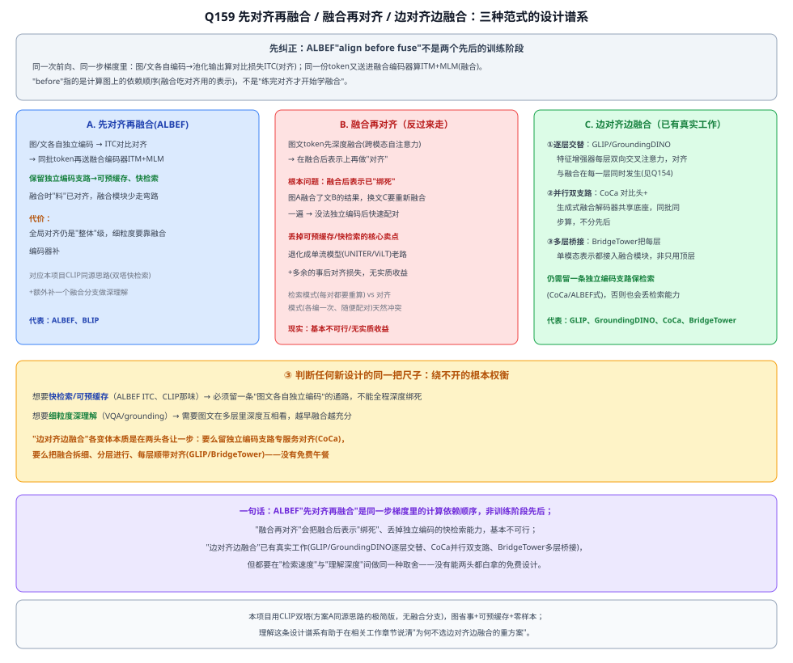

# 32a 区域特征 VLP（ViLBERT / LXMERT / UNITER）

> 定位：**多模态脉络的起点**——早期视觉-语言预训练（VLP）时代。用目标检测器抽"区域框特征"当视觉输入 + Transformer 做图文预训练，确立了"预训练→微调"的 VLP 范式。视觉端很重（检测器是瓶颈），正是后来 CLIP/ViLT 要简化的部分。
> 代表作：ViLBERT（NeurIPS 2019）、LXMERT（EMNLP 2019）、UNITER（ECCV 2020）、VisualBERT（2019）。
> 前置：28 Transformer、20 Faster R-CNN（区域特征来源）、29 BERT（预训练范式）。
> 阅读路线见 多模态脉络地图（阶段 1）。
> **输入 / 输出**：图像（→区域特征）+ 文本 → 图文匹配 / VQA 答案 / 掩码填空

---



> 📥📤 **输入/输出实例**：一张图先过 **Faster R-CNN** 抽出约 36 个"区域框 + ROI 特征"当**视觉词**，文本切词 → 送进 Transformer（单流或双流）→ 输出图文匹配分、VQA 答案或掩码词。关键：视觉输入不是像素/patch，而是**检测器抽好的区域特征**。

> 📄 **论文原图对照**（图源：Lu et al., *ViLBERT*, [arXiv:1908.02265](https://arxiv.org/abs/1908.02265) Figure 1，原文 [PDF](../papers/32a_ViLBERT_1908.02265.pdf)（UNITER 原文 [PDF](../papers/32a_UNITER_1909.11740.pdf)）；仅笔记内学习引用，论文写作须自绘）：



> 双流架构：图（Faster R-CNN 区域特征）与文各自编码后靠 co-attention 交互——区域特征 VLP 时代的代表作。

## 一、提出背景

2019 年，BERT 的"预训练→微调"横扫 NLP。自然的想法：**图文能不能也这样预训练**？难点是"图像怎么变成 Transformer 能吃的 token"。当时的答案借用成熟的目标检测：用预训练的 **Faster R-CNN**（20）抽出图里若干**区域框 + 每个框的 ROI 特征**，把这些区域特征当成"**视觉词**"，和文本词一起送进 Transformer。于是诞生了第一批 VLP 模型。

## 二、核心方法

### 2.1 视觉端：区域特征（瓶颈所在）
图 → Faster R-CNN → **~36 个区域框 + ROI 特征**（每个框有位置 + 特征向量）。这一步：
- **重**：目标检测器占了大部分算力（后来测出是主要延迟来源）；
- **需区域标注**：检测器本身要用带框标注的数据（如 Visual Genome）预训练。

### 2.2 两种融合结构

| | 双流（dual-stream） | 单流（single-stream） |
|---|---|---|
| 代表 | **ViLBERT、LXMERT** | **UNITER、VisualBERT** |
| 结构 | 图、文各有 Transformer，中间用**协同/交叉注意力**连接 | 区域特征 token + 文本 token **拼一起进同一个 Transformer** |
| 特点 | 两模态先各自建模、再对齐 | 更简单、参数共享，从第 1 层就交互 |
| 备注 | LXMERT：各自编码后再接跨模态编码器 | UNITER：单流 + 词-区域对齐（WRA） |

> 这里的"单流 vs 双流"之分，一直贯穿到后来的 ViLT（单流）和 CLIP（可看作双塔的极端）。

### 2.3 预训练任务（自监督）
在海量图文对上做：
- **MLM**（掩码语言建模）：遮词，靠图 + 上下文猜；
- **MRM / MRC**（掩码区域建模/分类）：遮住某区域，猜它的类别/特征；
- **ITM**（图文匹配）：判断"这对图文配不配"；
- LXMERT 额外加 VQA 预训练。

## 三、关键结论

- **确立 VLP 范式**：证明"图文一起预训练 + 下游微调"有效，在 VQA、图文检索、视觉推理（NLVR2）等任务上大幅领先当时的专用模型。
- **单/双流之争**：两种结构各有拥趸，效果接近；单流更简洁成为后续主流之一。
- **硬伤 = 视觉端太重**：依赖目标检测器 → 慢、需区域标注、区域特征还可能漏掉框之外的信息。**这正是下一代（CLIP、ViLT）要解决的**：把视觉端从"检测器区域特征"换成"轻量的对比编码 / 线性 patch"。

## 四、技术谱系

```
[20 Faster R-CNN] 区域特征 ──┐
[29 BERT] 预训练+掩码建模 ────┼─→ 区域特征 VLP（ViLBERT/LXMERT/UNITER）
[28 Transformer] 自注意力 ────┘
        │  视觉端太重（检测器瓶颈）→ 后人简化：
        ├─→ [33 CLIP]  双塔对比，丢掉检测器
        └─→ [33a ViLT] 线性 patch，丢掉检测器 + 卷积
```

承上：Faster R-CNN + BERT；启下：CLIP（对比对齐）、ViLT（极简融合）都在"把视觉端做轻"。

## 五、具体实例（走一遍）

**例：单流模型做 VQA**
```
① 图 → Faster R-CNN → 36 个区域特征 token（+位置）
② 问题 "what color is the bus?" → 词 token
③ [区域token…] + [词token…] 拼接 → 单个 Transformer（图文自注意力）
④ 取 pooled 表示 → 分类头 → 答案 "red"
```
**关键**：视觉输入是"检测器抽好的区域"，不是原始像素——好处是自带物体级语义，坏处是慢且受限于检测器能框到什么。

## 六、参考文献

- Lu J, et al. *ViLBERT: Pretraining Task-Agnostic Visiolinguistic Representations for Vision-and-Language Tasks.* NeurIPS 2019.
- Tan H, Bansal M. *LXMERT: Learning Cross-Modality Encoder Representations from Transformers.* EMNLP 2019.
- Chen Y-C, et al. *UNITER: UNiversal Image-TExt Representation Learning.* ECCV 2020.

---

## 📋 模型答疑（来自模型详解问答）

> 专属本模型的问答集中在此；跨模型的通用问答见答疑总目录。

---

## Q155. 区域特征 VLP 为什么用目标检测抽的框、而不是整张图？这样和 CLIP 有什么区别？

**简答**：不是"一物一句"。区域特征只是把图像从"一个全局向量"换成"N 个物体级 token"，好让 Transformer 做**词↔区域**的细粒度对齐（语言是按物体/关系组织的，整图向量会把物体糊成一坨）。和 CLIP 的根本区别在融合方式：区域 VLP 是**单塔**——图文 token 一起进 Transformer 深度互相注意力；CLIP 是**双塔**——图文各编各的、从不互相注意、最后只算点积。前者细粒度但重/慢/依赖检测器，后者粗粒度但轻/可扩/零样本强。

**展开**：

**① 纠误解：不是"一个物体对一个文本"**
整句 caption 描述整张图。检测框改变的是**图像的表示粒度**：全局向量 → N 个区域 token 的集合。N 个区域 + M 个词一起进跨模态 Transformer，靠注意力做词↔区域对齐——是"多对多细粒度对齐"，不是"一区域配一句"。

**② 为什么用区域（细粒度 grounding）**
语言按物体/属性/关系组织。"穿红衣服的男人牵着一匹马"需要把每个词落到对应区域/关系上。整张图一个向量把所有物体压成一个点，无法定位单个词 → 丢失细粒度对齐能力。区域特征提供"物体级离散单元"，Transformer 才能像对齐词与词那样对齐词与区域。**对粗粒度任务（整图检索/分类）整图确实够用（CLIP 证明），细粒度任务（VQA/caption/指代）才必须用区域。**

**③ 和 CLIP 的本质区别**

| | 区域 VLP（ViLBERT/UNITER/Oscar） | CLIP |
|---|---|---|
| 图像表示 | N 个区域 token | 整图 1 个全局向量 |
| **融合方式** | **单塔/早融合**：图文一起进 Transformer、**深度互相注意** | **双塔/晚融合**：各编各的、**从不互相注意**、最后点积 |
| 对齐粒度 | 细粒度（词↔区域） | 粗粒度（整图↔整句） |
| 训练目标 | MLM+MRM+ITM（重建+匹配） | 对比学习 |
| 依赖检测器 | 是（重/慢/瓶颈） | 否（端到端） |
| 数据规模/零样本 | 中等/弱 | 超大 4 亿对/强 |
| 推理速度 | 慢（每对过一遍跨模态 Transformer） | 快（可预编码建索引、只算点积） |

**最本质一句**：CLIP 图文**永不互相注意**（双塔），VLP 图文在 Transformer 里**深度互相注意**（单塔）。"区域 vs 整图"只是其一，"单塔跨模态注意 vs 双塔对比"才是根本。

**④ 历史结局 + 与本项目**
区域 VLP 因"依赖检测器（重/慢/瓶颈）"被淘汰（[§三硬伤](#三关键结论)）：ViLT（33a）换线性 patch 丢检测器、CLIP（33）双塔对比丢检测器、ALBEF/BLIP（34）缝合两路（先对比粗对齐 + 再跨模态细融合）。本项目用 CLIP 的"双塔整图"路线（轻、可零样本、易部署，契合两阶段 YOLO+CLIP），理解区域 VLP 能说清**为何不选"背一个重检测器"的老路**——写进第二章相关工作的 VLP 演进脉络。



---

## Q156. 详细说下 MLM+MRM+ITM（重建+匹配）

**简答**：MLM=遮词猜词（靠文本上下文+图像区域，跨模态版完形填空）；MRM=遮图像区域猜区域（MLM 的镜像，靠文本+其余区域，因为区域是连续向量所以用回归或类别预测代替 softmax）；ITM=判断一图一文是不是真的一对（二分类，取 pooled token 判断）。三者加权同时训练，MLM/MRM 管细粒度词↔区域对齐，ITM 管全局图文一致性，互补缺一不可。

**展开**：

**① MLM：文本侧完形填空，多了图像这条线索**
```
原句: "a man riding a bicycle on the street"
遮词: "a man riding a [MASK] on the street"
输入: [文本token(含MASK)] + [N个区域token(其中一个像自行车)]
预测: [MASK]位置最终隐藏向量 → 线性层 → 词表softmax → "bicycle"
```
和普通 BERT MLM 的区别：模型不仅能看"riding a ___ on the street"这样的文本上下文，还能看到图里那块长得像自行车的区域——纯文本也能蒙个大概（交通工具），但加了图像后准确率明显更高，这个"高出来的部分"就是模型学到跨模态对齐的证据。

**② MRM：图像侧的镜像任务，反过来靠文本猜图**
```
原区域: [车轮子的区域特征向量]（检测器给的类别分布: bicycle 0.75, motorcycle 0.1, ...）
遮住: 该区域特征替换成 [MASK] 向量
输入: [完整文本"...bicycle..."] + [其余区域] + [被遮区域用MASK占位]
预测: 该位置隐藏向量 → 线性层 → 类别分布 → 与检测器软标签算KL散度
```
两种变体：**① 特征回归**——直接用小 FC 层重建原始连续特征向量（L2 损失）；**② 类别预测**——不重建特征，而是预测该区域检测器给的类别概率分布（KL 散度）。巧妙之处：文本里明明写着"bicycle"，模型可以从文本读出线索猜图像里缺的那块是什么——和 MLM 反过来，逼模型学会"把视觉证据接到词的语义上"。**MLM 和 MRM 是一对镜像任务，分别练"以图猜词"和"以词猜图"两个方向**。

**③ ITM：不补全，是判断题**
```
正样本: 图(自行车) + "a man riding a bicycle" → 匹配(1)
负样本: 图(自行车) + "a woman cooking dinner"（随机拼不相关文本）→ 不匹配(0)
[CLS] 位置最终隐藏向量（即 pooled token，见 33a ViLT Q157）→ FC → sigmoid → 匹配概率
```
有些模型（如 UNITER）还加了词-区域对齐损失（WRA，用最优传输在细粒度上再对一次词和区域），作为 ITM 的加强版，但核心思想还是"整体上这图和这句话搭不搭"。

**④ 为什么三个要凑在一起**

| 任务 | 练什么 | 单独存在的问题 |
|------|--------|---------------|
| MLM | 以图猜词（细粒度，词级别） | 只关心某个词对不对，不管整体图文是否相关 |
| MRM | 以词猜图（细粒度，区域级别） | 同上反方向 |
| ITM | 整体图文是否相关（粗粒度，全局） | 只判断"搭不搭"，不逼模型学细节对齐 |

三个损失**加权求和，同一 batch 里三个任务同时算 loss 反向传播**（不是分阶段训练）。少了 MLM/MRM，模型可能只学会"看整体像不像"而学不到具体哪个词对应哪个物体；少了 ITM，模型缺乏"这图文到底搭不搭"的全局判断力，容易被局部巧合误导。**三个任务互补，构成 BERT 式"完形填空"在跨模态上的完整版本**。

**⑤ 和 CLIP 的对照（接 [Q155](#q155-区域特征-vlp-为什么用目标检测抽的框而不是整张图这样和-clip-有什么区别)）**
MLM+MRM+ITM 全部要求图文 token 在 Transformer 里**深度互相看**（单塔），训练目标是"重建"（MLM/MRM 猜缺的东西）+"匹配"（ITM 判断对不对）。CLIP 只有一个目标：**对比学习**（拉近配对、推远非配对），没有完形填空、也不需要区域标注做 MRM——这是它能丢掉检测器、用海量弱标注数据训练的原因。



---

## Q159. ALBEF 是"先对齐再融合"，能否反过来"先融合再对齐"、或"边对齐边融合"？

**简答**：ALBEF 的"先对齐再融合"是一次前向里的计算顺序，不是两阶段训练。"融合再对齐"很难走通——图文一旦先深度融合，表示就绑死在具体的那一对上，没法独立编码快速检索，等于丢了对比学习的核心好处。"边对齐边融合"确实存在，比如 Grounding DINO 的特征增强器每层交替做对齐和融合，或者 CoCa 让对齐、融合两条支路并行同步训练——但不管怎么设计，都得在"能不能快速检索"和"理解够不够深"之间做取舍。

**展开**：

**① 先纠正误解：ALBEF 不是两阶段训练**
```
图 → ViT 编码 ─┐
                ├─ 各自池化输出 → 对比损失 ITC(对齐)
文 → BERT 编码 ─┘
                └─ 同样这两组 token → 送进跨模态融合编码器 → ITM+MLM(融合)
```
"align before fuse" 说的是**计算图上的依赖顺序**（对齐用的表示，是融合模块的输入，所以在计算图上"在前面"），ITC 和 ITM/MLM 是**同一个 batch、同一步梯度**里一起算的，不是"练完对齐才开始学融合"两个先后的训练阶段。

**② 为什么"融合再对齐"基本不可行**
对比学习（对齐）之所以有用，前提是**图和文能各自独立编码成一个向量，不需要"凑一对"才能算**——这样才能把海量图片、海量文本各自预先编码好存起来，检索时只算点积（[Q155](#q155-区域特征-vlp-为什么用目标检测抽的框而不是整张图这样和-clip-有什么区别) 讲的双塔可预缓存）。一旦先融合，图和文已经**深度绑在一起**算出来——没法把"图A融合了文本B"的表示拿去跟"文本C"配对比较，换个文本就要重新融合一遍。**融合是"每一对都要重新算"、对齐是"各自算一次、之后随便配对"**，两者计算模式天然冲突。先融合再对齐，等于把"能快速检索"的优势阉割了，退化回单流模型（UNITER/ViLT，[Q156](#q156-详细说下-mlmmrmitm重建匹配)）的老路，只是多了一个没有实质收益的事后对齐损失。

**③ "边对齐边融合"：已有三类真实做法**

- **逐层交替（Grounding DINO 特征增强器，Q154）**：图像编码器和文本编码器不是各自编完、最后才交互一次，而是在**每一层**都做一次双向交叉注意力（image→text、text→image），堆叠约 6 层，每层都在"对齐"（算图文相似度、加权吸取对方信息）的**同时**"融合"（把对方信息写进自己的表示）——字面意义上的"边对齐边融合"。
- **并行双支路（CoCa）**：同一模型里，一条支路走对比损失（图文全局向量对齐，ALBEF/CLIP 式），另一条支路走**生成式**跨模态解码器（交叉注意力融合、做 captioning），两个损失**同一步梯度一起算**，是并行的两个头共享底座，而非流水线式的先后。
- **多层桥接（BridgeTower）**：ALBEF/单流模型的融合模块通常只吃图文编码器**最后一层**输出去融合，中间层的语义信息（浅层纹理、中层局部结构）被浪费。这类工作把**每一层**单模态表示都"搭桥"接进融合模块，融合不是"编完再融"一锤子买卖，而是跨越多个深度、逐层参与。

**④ 判断任何新设计的同一把尺子：绕不开的根本权衡**
- 想要**快检索/可预缓存**（ALBEF ITC、CLIP 那味）→ 必须留一条"图文各自独立编码"的通路，不能全程深度绑死；
- 想要**细粒度深理解**（VQA、grounding）→ 需要图文在多层里深度互相看，越早融合越充分。

**"边对齐边融合"的各种变体本质都是在这两头各让一步**：要么留一条独立编码支路专门服务对齐/检索（CoCa），要么把融合拆细、分层进行、每层顺带对齐（GLIP/Grounding DINO、BridgeTower）。**没有免费午餐**——这条思路是对的，现有工作恰好证明了这条路可行，只是必须想清楚"要不要保留能快速检索的独立编码支路"这个取舍。



**⑤ 与本项目的关系**：本项目用 CLIP 的双塔路线（方案 A 同源思路的极简版，无融合分支），图省事+可预缓存+零样本，契合两阶段 YOLO+CLIP 的轻量部署目标。理解这条"对齐-融合"设计谱系，能在第二章相关工作里说清**为何不选"边对齐边融合"的重方案**（GLIP/Grounding DINO 那种）。

---
