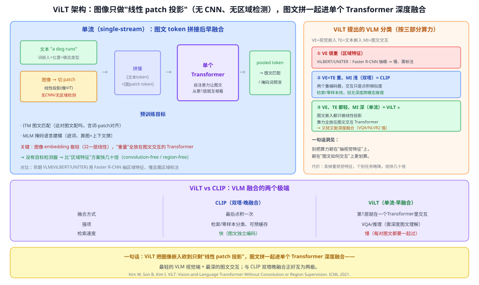
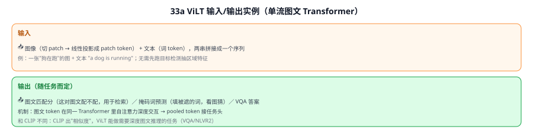
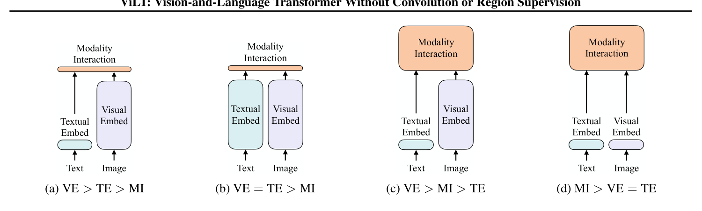
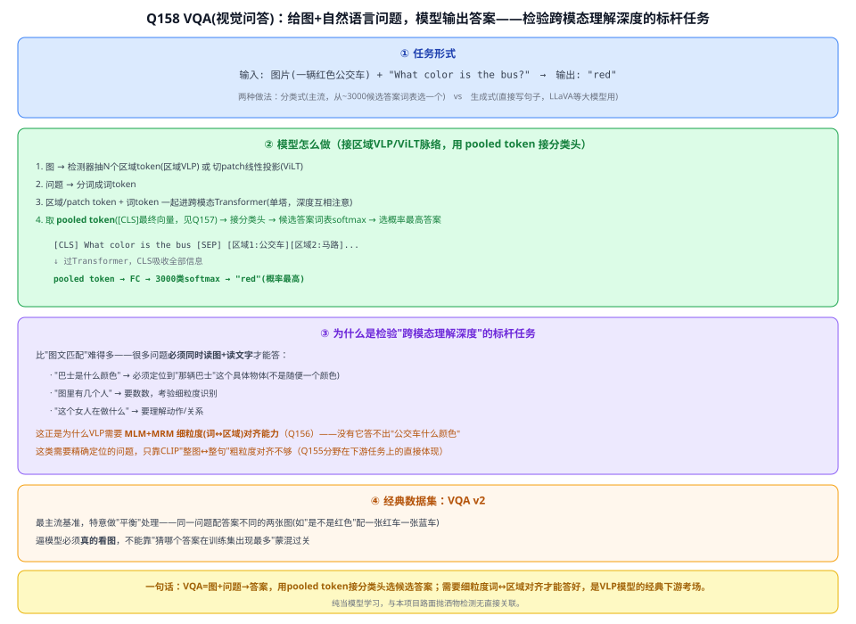

# 33a ViLT（Vision-and-Language Transformer）

> 定位：**最精简的视觉-语言模型**——图像不用 CNN、不用目标检测抽区域特征，只做"线性 patch 投影"，图文拼一起进**单个 Transformer** 深度融合。与 CLIP 的"双塔晚融合"正好是两个极端，是理解 VLM 融合范式的好对照。
> 作者：Kim 等（NAVER AI），*ViLT: Vision-and-Language Transformer Without Convolution or Region Supervision*，ICML 2021（arXiv:2102.03334）。
> 前置：31 ViT（patch 线性投影）、28 Transformer、33 CLIP（对照）。
> **输入 / 输出**：图像 patch token + 文本 token（拼接）→ 图文匹配分 / 掩码词预测 / VQA 答案

---



> 📥📤 **输入/输出实例**：把图像切 patch 做**线性投影**成 patch token、文本切词做 token，两串**拼成一个序列**送进**单个 Transformer**；图文 token 从第 1 层就靠自注意力互相看（早融合）→ pooled token 接任务头，输出**图文匹配分**（检索）、**掩码词预测**（看图填空）或 **VQA 答案**。和 CLIP 出"相似度"不同，ViLT 能做需要**深度图文推理**的任务（VQA/NLVR2）。



> 📄 **论文原图对照**（图源：Kim et al., *ViLT*, [arXiv:2102.03334](https://arxiv.org/abs/2102.03334) Figure 2，原文 [PDF](../papers/33a_ViLT_2102.03334.pdf)；仅笔记内学习引用，论文写作须自绘）：



> 图文都用最简嵌入（patch 投影/词嵌入）后直接进同一个 Transformer——把"模态交互"做重、"单模态编码"做轻，砍掉目标检测器。

## 一、提出背景

在 ViLT 之前，视觉-语言预训练（VLP）模型的**视觉端普遍很重**，有两条老路：
1. **区域特征**（ViLBERT、LXMERT、UNITER 等）：先用 Faster R-CNN 之类的**目标检测器**抽出一堆"区域框特征"再送进模型。问题：目标检测本身**极慢**、还需要区域级标注（region supervision），成为整个流程的瓶颈。
2. **网格特征**（grid features）：用 CNN 输出的网格特征，省掉检测器，但**CNN 仍然重**。

ViLT 的反问：**视觉端非得这么重吗？** ViT 已经证明"图像切 patch + 一层线性投影"就能当 Transformer 的输入。那不如把**视觉嵌入砍到和文本嵌入一样轻**（都只做一层投影），把算力**全部让给"图文如何交互"的 Transformer**。这就是 ViLT——**convolution-free（无卷积）+ region-free（无区域监督）**的极简 VLM。

---

## 二、核心方法 ⭐

### 2.1 单流（single-stream）架构

```
文本 "a dog runs" → 词嵌入 + 位置 + 模态类型嵌入 ──┐
                                                    ├─ 拼接 → 单个 Transformer → pooled token → 任务头
图像 → 切 patch → 线性投影 + 位置 + 模态类型嵌入 ──┘        （图文 token 从第1层就自注意力互相看 = 早/深融合）
```

- **图像嵌入极轻**：切成 patch，**一层线性投影**（和 ViT 的 patch embedding 一样），**没有 CNN、没有目标检测**；
- **文本嵌入**：标准词嵌入；
- **模态类型嵌入**：给每个 token 标注"我是图 / 我是文"，帮 Transformer 区分两种模态；
- **单流融合**：图文 token **拼成一条序列**，进**同一个 Transformer**，靠自注意力从第 1 层就深度交互（对比 CLIP 是两个独立塔、最后才点积）。

### 2.2 预训练目标
- **ITM（图文匹配）**：判断"这对图文配不配"（含词-patch 对齐，衡量文本词与图像 patch 的对应）；
- **MLM（掩码语言建模）**：遮住部分词，靠**图像 + 上下文**一起猜（比纯文本 BERT 多了图像线索）；
- 训练技巧：整词掩码、图像端 RandAugment 增强等。

### 2.3 一句话洞见：算力该花在哪
ViLT 论文按三部分算力（**VE 视觉嵌入 / TE 文本嵌入 / MI 图文交互**）把 VLM 分类，核心主张是：**别把算力砸在"抽视觉特征"上，砸在"图文如何交互"上更划算**。ViLT = "VE、TE 都轻、MI 深"这一档。

---

## 三、关键结论

- **快**：没有目标检测器/重 CNN，推理比"区域特征"方案**快几十倍**（视觉端从"几百毫秒抽框"降到"一层线性投影"）。
- **competitive**：在 VQA、NLVR2、图文检索等任务上，用远小的视觉端开销取得**有竞争力**的效果。
- **代价**：丢掉重视觉特征，个别任务精度略降；且**单流要求图文成对一起过**——不像 CLIP 能把图、文各自独立编码后缓存，所以**检索场景 ViLT 比 CLIP 慢**（每个图文对都要重新一起前向）。
- **意义**：证明"视觉端可以极简"，把 VLM 的重心从"视觉特征工程"转到"模态交互"，是后续轻量 VLM 与"patch-as-token"多模态融合的重要一步。

---

## 四、和 CLIP / 区域方案的对比（理解 VLM 融合范式）

| | 区域特征（ViLBERT/UNITER） | **CLIP**（双塔·晚融合） | **ViLT**（单流·早融合） |
|---|---|---|---|
| 视觉端 | 重（目标检测抽框） | 重（ViT/ResNet 独立塔） | **极轻**（线性 patch 投影） |
| 图文融合 | 深（送进交互模型） | **浅**（最后点积一次） | **深**（同一 Transformer 自注意力） |
| 强项 | VQA 等推理（但慢） | **检索/零样本分类**（可预缓存） | VQA/NLVR2 等**深度推理** |
| 检索速度 | 慢 | **快**（图文独立编码、缓存） | 慢（每对图文一起过） |
| 需要区域标注 | **要** | 不要 | 不要 |

**记忆钩子**：**CLIP 双塔晚融合**（各编码各的，最后比相似度）↔ **ViLT 单流早融合**（拼一起从头交互）——一个为**检索/零样本**优化、一个为**图文推理**优化，是 VLM 融合的两个极端。理解这对照，就理解了为什么本项目用 CLIP 的双塔做"裁剪框比文本模板"又快又能预缓存文本（见 Q104）。

---

## 五、技术谱系

```
[31 ViT] 图像→patch 线性投影 ──┐
                               ├─→ ViLT（图文 patch/词 token 拼进单个 Transformer）
[28 Transformer] 自注意力 ──────┘
             对照：[33 CLIP] 双塔晚融合；后续 [34 BLIP] 兼顾理解+生成、Q-Former 桥接
```

- 同期对照：CLIP（2021，双塔对比学习）；
- 后续：BLIP（34）统一理解与生成、BLIP-2 用 Q-Former 桥接冻结大模型（见 Q113）；
- 更远：LLaVA/InternVL（37）把视觉 token 接进 LLM（见 Q110）——都在回答"图文 token 怎么融合"这个问题。

---

## ✏️ 具体实例（走一遍）

**例：ViLT 怎么做图文匹配 / VQA**
```
① 图像 → 切成 patch → 每个 patch 拉平 → 一层线性投影 → patch token（+位置+模态类型）
② 文本 "is the dog running?" → 词 token（+位置+模态类型）
③ [patch token …] + [词 token …] 拼成一条序列 → 单个 Transformer（图文自注意力深度交互）
④ 取 pooled token → 任务头：图文匹配分 / VQA 答案 "yes"
```
**关键**：没有目标检测、没有 CNN——视觉端只有"③里的一层线性投影"，模型的"智力"全在图文交互的 Transformer 里。

**例：为什么检索场景 CLIP 比 ViLT 快**
检索要拿 1 张图和 1 万条文本比。CLIP：图编码 1 次 + 文本预先各编码好缓存 → 1 万次点积（极快）。ViLT：单流要求"图 + 每条文本"**拼一起各过一遍 Transformer** → 1 万次完整前向（慢）。这就是"晚融合可缓存 vs 早融合不可缓存"的取舍。

---

## 六、参考文献

- Kim W, Son B, Kim I. *ViLT: Vision-and-Language Transformer Without Convolution or Region Supervision.* ICML 2021.（arXiv:2102.03334）
- Radford A, et al. *Learning Transferable Visual Models From Natural Language Supervision (CLIP).* ICML 2021.（对照）
- Dosovitskiy A, et al. *An Image is Worth 16x16 Words (ViT).* ICLR 2021.（patch 线性投影来源）

---

## 📋 模型答疑（来自模型详解问答）

> 专属本模型的问答集中在此；跨模型的通用问答见答疑总目录。

---

## Q157. pooled token 是什么？

**简答**：pooled token 就是 `[CLS]` 位置最后一层的隐藏向量。因为自注意力让每个位置都能吸收全序列的信息，`[CLS]` 这个本来空的占位符，经过层层 Transformer 后就变成了整条序列（ViLT 里是文本+图像 patch）的浓缩摘要，专门喂给需要"整体判断"的任务头（分类/匹配）。

**展开**：

**① 为什么需要一个"代表全局"的向量**
Transformer 输出的是每个位置各自一个向量，ViLT 里输入是 `[CLS] + 文本token们 + [SEP] + 图像patch token们`，输出形状是`(序列长度×d)`，每个 token（每个词、每个 patch）都各有一个 d 维向量。但很多下游任务（VQA 分类"这题答案是什么"、ITM 判断"图文匹不匹配"）要的是**一个**向量去接分类头。

**② 怎么"池化"：取 `[CLS]` 位置，不是取平均**
1. 序列最前面人为插入特殊 token `[CLS]`（纯占位符，不代表真实词/图像块）；
2. 序列过完所有 Transformer 层后，`[CLS]` 位置最终的隐藏向量被拿来当 pooled 表示；
3. 自注意力机制让每个位置都能"看到"序列里所有其他位置（27 注意力机制），所以 `[CLS]` 虽然自己不携带原始语义，但经过层层自注意力后，已经**汇聚吸收了整个序列的信息**——相当于全序列信息的一个"浓缩摘要"。
```
输入序列: [CLS] a man riding [SEP] [patch1][patch2]...[patch196]
                ↓ 过12层Transformer(自注意力让CLS吸收所有token信息)
输出: [CLS的向量] [a的向量] [man的向量]...[patch1的向量]...
       └────┬────┘
       这个就是 "pooled token"/"pooled output"
```
通常还会再过一个小的 FC+tanh 激活（BERT 论文里叫"pooler"），把 `[CLS]` 的最后隐藏向量再变换一下，得到最终的 pooled 向量。

**③ 在 ViLT 里具体怎么用**
ViLT 的输入序列是文本 token+图像 patch token 拼在一起过**同一个** Transformer（单塔，呼应 Q155 单塔 vs 双塔的区别），所以 `[CLS]` 这次吸收的是**跨模态**信息——文本说了什么+图像长什么样，两边都被自注意力揉进这一个向量。下游用法：
- **ITM（图文匹配）**：pooled token→FC→sigmoid→匹配/不匹配；
- **VQA 分类**：pooled token→FC→候选答案词表 softmax→选答案（详见 [Q158](#q158-简单说下-vqavisual-question-answer)）；
- **MLM/MRM（掩码预测，见 Q156）**：这两个反而**不用**pooled token，是用**被遮那个具体位置**的隐藏向量去预测——猜某个词/区域要用那个位置自己的向量，而不是全局摘要向量。

**一句话**：pooled token = `[CLS]` 位置的最终向量，靠自注意力"顺便"吸收了整条序列的信息，被当成一个浓缩摘要喂给需要"整体判断"的下游任务头，区别于那些需要"某个具体位置"信息的任务（如 MLM/MRM）。

![pooled token：[CLS]如何吸收全序列信息成为浓缩摘要](../figures/Q157_pooled_token.svg)

---

## Q158. 简单说下 VQA（Visual Question Answering）

**简答**：VQA=图+自然语言问题→答案。主流做法是把答案当分类问题：图文一起过跨模态 Transformer，取 pooled token 接分类头，在候选答案词表上 softmax 选答案。它比图文匹配难，因为很多问题需要精确定位到具体物体/数量/动作才能回答，这正是检验 VLP 模型细粒度（词↔区域）对齐能力的标杆任务。

**展开**：

**① 任务形式**
```
输入: 图片 + "What color is the bus?"
输出: "red"
```
- **分类式（主流）**：候选答案词表（如 3000 个高频答案），VQA 变成"从候选里选一个"的多分类问题——不是生成式写句子，是挑一个词/短语；
- **生成式**：像问答一样直接生成一句话答案（更灵活但更难训、更难评估），近年 LLaVA 这类大模型多用这个。

**② 模型怎么做（接区域 VLP/ViLT 脉络）**
1. 图→检测器抽 N 个区域 token（区域 VLP）或切 patch 线性投影（ViLT）；
2. 问题→分词成词 token；
3. 区域/patch token+词 token 一起进跨模态 Transformer（单塔，深度互相注意）；
4. 取 **pooled token**（`[CLS]` 位置最终向量，[Q157](#q157-pooled-token-是什么)）→接一个分类头→在候选答案词表上 softmax→选概率最高的答案。
```
[CLS] What color is the bus [SEP] [区域1:公交车][区域2:马路]...
        ↓ 过Transformer,CLS吸收全部信息
   pooled token → FC → 3000类softmax → "red"(概率最高)
```

**③ 为什么它是检验"跨模态理解深度"的标杆任务**
VQA 比"图文匹配"难得多，因为很多问题**必须同时读图+读文字**才能答：
- "巴士是什么颜色"→必须定位到"那辆巴士"这个具体物体（不是随便一个颜色）；
- "图里有几个人"→要数数，考验细粒度识别；
- "这个女人在做什么"→要理解动作/关系。

这正是为什么 VLP 需要 **MLM+MRM 这种细粒度（词↔区域）对齐能力**（Q156）——没有这种细粒度对齐，模型答不出"公交车是什么颜色"这类需要精确定位的问题，只靠 CLIP 那种"整图↔整句"粗粒度对齐是不够的（Q155 讲的分野在下游任务上的直接体现）。

**④ 经典数据集：VQA v2**
最主流的基准，特意做了"平衡"处理——对同一个问题配上答案不同的两张图（比如"是不是红色"对一张红车一张蓝车），逼模型必须**真的看图**，不能靠"猜哪个答案在训练集里出现最多"蒙混过关。



**⑤ 与本项目的关系**：VQA 本身和路面抛洒物检测没有直接关联，纯当模型学习——若未来想让系统"回答关于检测结果的问题"（如"这堆抛洒物是什么材质"），才会用到 VQA 式分类头设计思路，目前仅了解概念。

---
