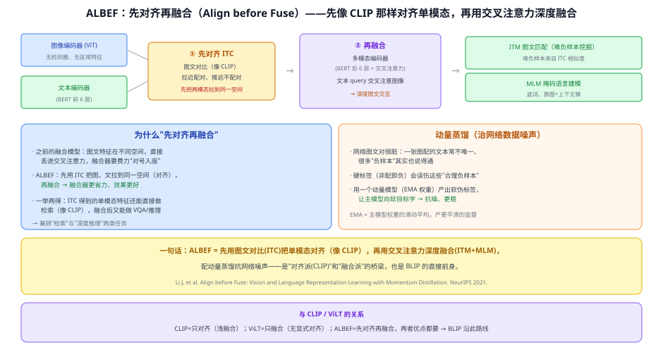
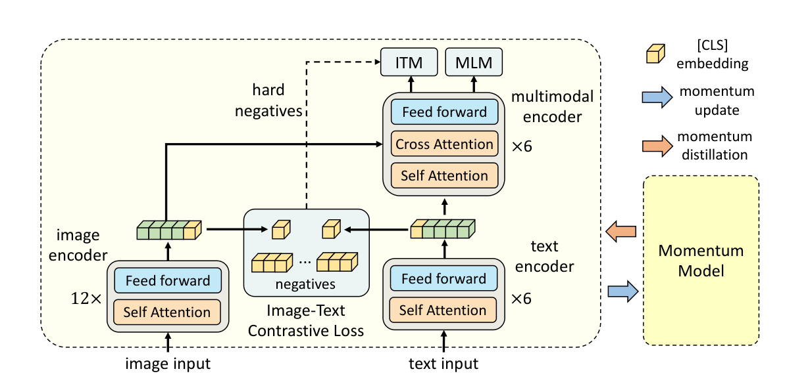

# 33b ALBEF（Align before Fuse）

> 定位：**"对齐派（CLIP）"与"融合派"的桥梁**，也是 BLIP 的直接前身。核心主张：**先用图文对比把单模态对齐，再用交叉注意力深度融合**——既能做检索、又能做深度推理。
> 作者：Li 等（Salesforce），*Align before Fuse: Vision and Language Representation Learning with Momentum Distillation*，NeurIPS 2021（arXiv:2107.07651）。
> 前置：33 CLIP（对比对齐）、31 ViT、29 BERT。
> 阅读路线见 多模态脉络地图（阶段 2）。
> **输入 / 输出**：图像 + 文本 → 图文匹配 / 检索相似度 / VQA / 掩码填空

---



> 📥📤 **输入/输出实例**：图像过 ViT、文本过 BERT 前半 → 先做**图文对比（ITC）**把两者对齐到同一空间（此时就能像 CLIP 一样做检索）→ 再送**多模态编码器**（BERT 后半 + 交叉注意力）深度融合 → 做 **ITM 图文匹配** 与 **MLM 掩码填空**（也可下游微调 VQA）。

> 📄 **论文原图对照**（图源：Li et al., *ALBEF*, [arXiv:2107.07651](https://arxiv.org/abs/2107.07651) Figure 1，原文 [PDF](../papers/33b_ALBEF_2107.07651.pdf)；仅笔记内学习引用，论文写作须自绘）：



> 先对齐再融合：双塔 ITC 对比对齐后，多模态编码器做 ITM/MLM 深度融合 + 动量蒸馏抗噪——CLIP 双塔与融合派的合流点。

## 一、提出背景

到 2021 年，多模态有两条路：
- **对齐派**（CLIP）：图文各编码、只在最后比相似度。**擅长检索/零样本**，但融合浅、做不了需要深度推理的任务（VQA）。
- **融合派**（早期 区域 VLP、ViLT）：图文直接进一个模型深度交互。**擅长推理**，但把"没对齐的"图文特征硬丢进融合器，融合器要费力"对号入座"。

ALBEF 的洞见：**为什么不先对齐、再融合？** 先把图、文拉到同一空间，融合就轻松了。既拿到对齐派的检索能力、又拿到融合派的推理能力。

## 二、核心方法 ⭐

### 2.1 三个模块 + 两步走
- **图像编码器**（ViT）+ **文本编码器**（BERT 前 6 层）：两个**单模态**编码器（注意：**无检测器、无区域特征**）。
- **多模态编码器**（BERT 后 6 层 + 交叉注意力）：做融合。

**① 先对齐（ITC，Image-Text Contrastive）**：像 CLIP 一样对图、文单模态特征做对比学习，拉近配对、推远不配对 → **把两模态拉到同一空间**。
**② 再融合**：文本作 query，通过**交叉注意力**去注意图像特征 → 深度交互，做：
- **ITM**（图文匹配）：判断配不配，**难负样本**从 ITC 的相似度里挑（相似但不配的最难）；
- **MLM**（掩码语言建模）：遮词，靠图 + 上下文猜。

### 2.2 动量蒸馏（治网络数据噪声）⭐
网络爬的图文对很脏：一张图能配很多说得通的文本，硬标签"非配即负"会**误伤这些合理负样本**。ALBEF 用一个**动量模型**（主模型权重的 EMA 滑动平均）产出**软伪标签**，让主模型向软目标学 → 抗噪、训练更稳。

## 三、关键结论

- **兼顾两类任务**：ITC 出的单模态特征直接做检索（像 CLIP）；融合后做 VQA/视觉推理/NLVR2，都强。
- **无需目标检测器**：视觉端用 ViT，摆脱了区域特征的瓶颈。
- **"先对齐再融合"成为范式**：直接启发 BLIP（同作者，加 CapFilt 数据自举）。
- **动量蒸馏**：为"用海量噪声网络数据训练"提供了一个实用的抗噪手段。

## 四、技术谱系

```
[33 CLIP] 对齐（浅融合）──┐
                          ├─→ ALBEF：先对齐(ITC) + 再融合(交叉注意力) + 动量蒸馏
[33a ViLT] 融合（无显式对齐）┘
        └─→ [34 BLIP]（同作者，+CapFilt 数据去噪，统一理解与生成）
```

一句话定位：**CLIP 只对齐、ViLT 只融合、ALBEF 先对齐再融合**——取两者之长，是通往 BLIP 的关键一步。

## 五、具体实例（走一遍）

**例：ALBEF 怎么同时会"检索"和"VQA"**
```
检索：图→ViT→图向量；文→BERT前半→文向量 → 直接算相似度（用的是①对齐后的单模态特征）
VQA ：图向量 + 文（问题）→ ②多模态编码器交叉注意力融合 → 分类头出答案
```
**关键**：同一个模型，①对齐后的特征拿去检索、②融合后的表示拿去推理——这就是"先对齐再融合"带来的双重能力。

## 六、参考文献

- Li J, Selvaraju R, et al. *Align before Fuse: Vision and Language Representation Learning with Momentum Distillation.* NeurIPS 2021.（arXiv:2107.07651）
- Radford A, et al. *CLIP.* ICML 2021.（对齐派对照）
- Li J, et al. *BLIP.* ICML 2022.（后继）
