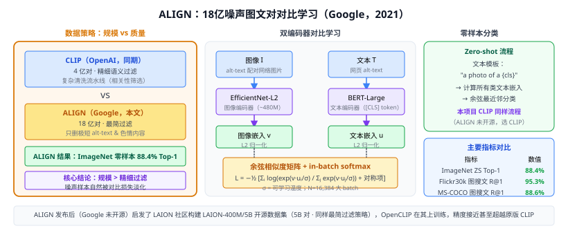

# 33c ALIGN（噪声对标签图像文本对比学习）

> 定位：Google Brain 提出的**大规模噪声图像-文本对比学习**框架，与 CLIP（33b）几乎同期发表，用**更大、更嘈杂的数据集**（18 亿图文对）以最简单的对比目标训练，验证"数据量可以弥补标注质量"假设。
> 作者：Jia et al.，ICML 2021，Google Brain。
> 效果：ImageNet Top-1 零样本 88.4%（比 CLIP 高 5%）；跨模态检索 Flickr30k R@1 图搜文 95.3%。
> **输入 / 输出**：图像 + alt-text 网络文本对 → 双编码器对齐嵌入空间

---



## 一、提出背景

**CLIP**（OpenAI，2021）用 4 亿**经过过滤**的图文对训练，需要复杂的文本清洗流水线。ALIGN 的核心问题是：**如果我们不做细致的数据清洗，只用原始的 alt-text 网络图文对，靠规模是否能达到相当甚至更好的效果？**

答案是肯定的：ALIGN 用约 **18 亿**图文对（未经精细过滤，只做最简单的去重和长度过滤），用 EfficientNet（图像）+ BERT（文本）双编码器，取得了超过 CLIP 的零样本分类精度。

---

## 二、数据集构建

### 2.1 原始数据

从网络爬取图片及其 alt-text 属性（HTML 的 `` 字段）：
- 爬取：~18 亿图文对（原始）
- 过滤规则（极简）：
  - 删除 alt-text 太短（< 3 token）或太长（> 100 token）的；
  - 删除重复图片；
  - 删除色情内容（SafeSearch filter）；
  - **不做语义相关性过滤**（这是与 CLIP 的关键区别）

过滤后保留约 **18 亿对**（CLIP 原版 4 亿，经过语义相关性筛选）。

### 2.2 "噪声"的含义

alt-text 通常是：
- 图片说明（可能是目标的文字描述）
- 图片文件名（`DSC_0042.jpg` → 无语义）
- 广告文案（"Buy now! 50% off!"）
- 不相关的页面标题

ALIGN 选择不过滤这些噪声，让模型在对比学习中自己学会忽略不一致的对（因为从大量噪声中学习更鲁棒的对齐实际上是一种隐式数据清洗）。

---

## 三、模型架构

### 3.1 图像编码器

**EfficientNet-L2**（Tan & Le, 2019）：
- 比 CLIP 的 ViT-B/32 参数量更大（~480M）；
- 输出全局平均池化后的 640-D 特征，经线性层投影到嵌入空间；
- 不微调骨干（端到端 vs 仅微调投影头）。

### 3.2 文本编码器

**BERT-Large**（Devlin et al., 2019）：
- 输出 [CLS] token 的 768-D 特征，经线性层投影；
- 直接拿预训练 BERT，进一步对比微调（语言端不从头训练）。

### 3.3 对比损失（与 CLIP 相同）

归一化后的余弦相似度 + in-batch softmax：

$$\mathcal{L} = -\frac{1}{2N}\sum_{i=1}^N\left[\log\frac{\exp(s(v_i, u_i)/\sigma)}{\sum_{j=1}^N\exp(s(v_i, u_j)/\sigma)} + \log\frac{\exp(s(v_i, u_i)/\sigma)}{\sum_{j=1}^N\exp(s(v_j, u_i)/\sigma)}\right]$$

- $v_i$：图像嵌入（归一化后）
- $u_i$：文本嵌入（归一化后）
- $\sigma$：可学习温度参数
- $N$：batch 大小（ALIGN 用 large batch = 16,384）

---

## 四、ALIGN vs CLIP 对比

| 维度 | CLIP | ALIGN |
|------|------|-------|
| 训练数据量 | 4 亿对 | **18 亿对** |
| 数据质量 | 精细过滤（语义相关） | **最简过滤（接受噪声）** |
| 图像编码器 | ViT-B/32 或 ResNet-50x64 | EfficientNet-L2 |
| 文本编码器 | GPT-2 类 Transformer | BERT-Large |
| ImageNet 零样本 Top-1 | 76.2%（ViT-B/32） | **88.4%** |
| 训练机构 | OpenAI | Google Brain |
| 核心结论 | 4 亿对高质量数据足够 | **18 亿噪声对 > 4 亿干净对** |

---

## 五、核心论点："规模 > 清洗"

ALIGN 最重要的结论不是精度数字，而是**方法论层面的启示**：

> 当训练数据足够大时，对比学习目标本身会倒逼模型学会忽略噪声——错误的图文对在特征空间中因缺乏一致信号而对损失贡献接近零，不影响最终对齐质量。

这与 GPT-3（"规模就是学习"）的思想一脉相承，也启发了后来的 LAION-400M/LAION-5B 数据集（更大规模、更少过滤）。

---

## 六、Zero-shot 零样本分类流程

与 CLIP 完全相同：

```
目标类别文本模板：
  "a photo of a {class_name}"

推理：
  1. 计算所有类别文本嵌入 {u_c}
  2. 计算图像嵌入 v
  3. 预测类别 = argmax_c cos(v, u_c)
```

ALIGN 的文本编码器（BERT）在短 prompt 上有时比 CLIP 的 GPT 类编码器更好（BERT 擅长理解短句，GPT 更擅长生成长文本）。

---

## 七、历史地位

```
对比预训练（2020-2021）：
  MoCo v1/v2 (2020，Facebook) — 无监督 [31b]
  SimCLR (2020，Google) — 无监督 [31b]
  CLIP (2021-01，OpenAI) — 图文对比
  ALIGN (2021-02，Google) — 图文对比，噪声数据
    ↓ 二者同月发布，互相印证
  Florence / CoCa (2022) — 更大规模双塔模型
  LAION-5B (2022) — 5B 开源数据集（受 ALIGN 启发）
```

ALIGN 与 CLIP 共同奠定了**大规模图文对比预训练**的范式，区别在于 Google 走"更大数据、更少过滤"路线，OpenAI 走"过滤质量优先"路线，两条路都成功了。

---

## 八、与本项目的关系

- **CLIP 使用背景**：本项目用 CLIP 的图文对比嵌入空间做开放类识别；ALIGN 与 CLIP 精度接近（ALIGN 略高），但 CLIP 开源（权重公开），ALIGN 未开源，因此选择 CLIP。
- **相关工作写作**：第二章"视觉语言预训练"一节，可以"CLIP 和 ALIGN 几乎同时提出大规模对比预训练"并列介绍，说明该方向的成熟性。
- **学术价值**：ALIGN 的"数据规模 vs 质量"结论，可在论文中用一句话说明本项目选 CLIP 而非 ALIGN 的工程原因（开源可用）。

---

## 参考文献

- Jia C, et al. *Scaling Up Visual and Vision-Language Representation Learning With Noisy Text Supervision.* ICML 2021.
- Radford A, et al. *Learning Transferable Visual Models From Natural Language Supervision (CLIP).* ICML 2021.
