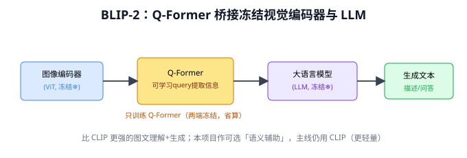
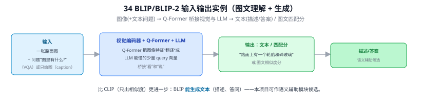
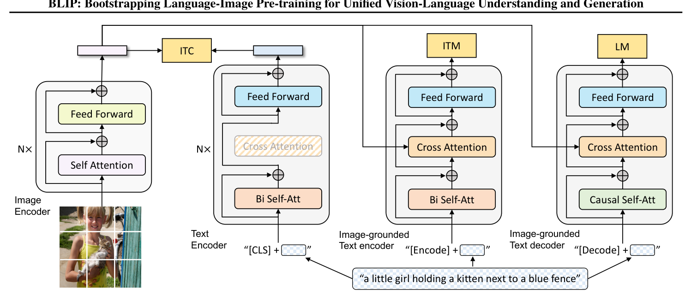
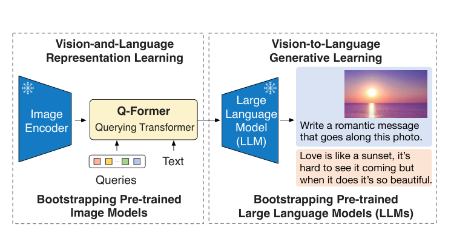
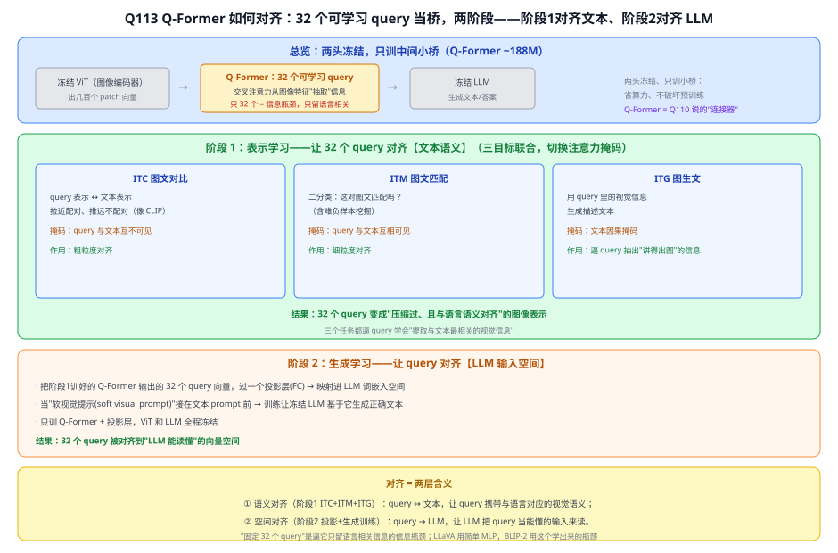
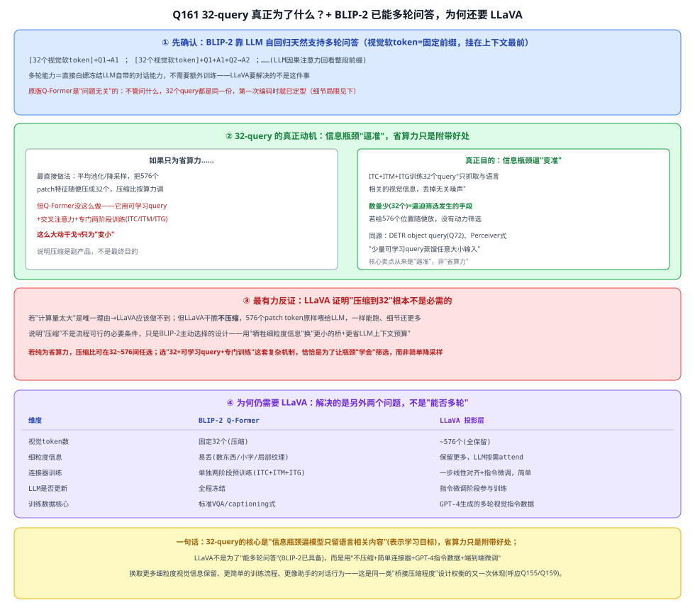

# 34 BLIP / BLIP-2

> 定位：比 CLIP 更强的图文理解与生成模型，能做图像描述（captioning）、视觉问答（VQA）。本项目语义辅助模块的候选。
> 作者：Li 等（Salesforce），BLIP（ICML 2022）、BLIP-2（ICML 2023）。
> **输入 / 输出**：图像（+文本问题）→ 文本（描述 / 答案）/ 图文匹配分

---



> 📥📤 **输入/输出实例（看一组具体数值）**：输入一张路面图（+ 问题"图里有什么?"，VQA；或只给图做 caption）→ 视觉编码器 + **Q-Former**（把图像特征"翻译"成 LLM 能懂的少量 query 向量，桥接"看"和"说"）+ LLM → 输出**文本**"路面上有一个轮胎和碎玻璃"，或图文**匹配分**。比 CLIP（只出相似度）更进一步：BLIP **能生成文本**（描述、答问），是本项目语义辅助模块的候选。



> 📄 **论文原图对照**（图源：Li et al., [arXiv:2201.12086](https://arxiv.org/abs/2201.12086) Figure 2（[PDF](../papers/34_BLIP_2201.12086.pdf)）；[arXiv:2301.12597](https://arxiv.org/abs/2301.12597) Figure 1（[PDF](../papers/34_BLIP2_2301.12597.pdf)）；仅笔记内学习引用，论文写作须自绘）：





> 上=BLIP 的 MED：一套网络三种模式（对比/匹配/生成）；下=BLIP-2 两阶段：Q-Former 先对齐冻结 ViT 再接冻结 LLM（Q113）。

## 一、提出背景

CLIP（33）很强，但它只会**匹配**（判断图文是否对应），不会**生成**（给图写一句描述）。很多任务需要生成式理解：给抛洒物生成自然语言描述、回答"这是什么材质"。BLIP 系列要做的是**统一图文理解与生成**，并解决两个痛点：网络图文对噪声大、视觉-语言对齐昂贵。

---

## 二、BLIP（2022）

### 2.1 统一框架
BLIP 用一个多模态混合编码-解码架构，同时支持三种功能：
- 图文对比（像 CLIP）
- 图文匹配（更细粒度判断）
- 图像描述生成（image captioning）

### 2.2 CapFilt：数据自举去噪 ⭐
网络爬来的图文对噪声大。BLIP 用模型自己**生成**更干净的描述（Captioner），再用另一个模型**过滤**掉不匹配的（Filter），自动清洗训练数据。这是 BLIP 的一大贡献——用模型改善自己的训练数据。

---

## 三、BLIP-2（2023）⭐

BLIP-2 的核心创新是**高效桥接冻结的视觉编码器和冻结的大语言模型**，避免端到端训练昂贵的大模型。

### Q-Former（Querying Transformer）⭐
```
冻结的图像编码器(ViT) ──► 图像特征
                            │
            Q-Former（一组可学习 query 向量）
            用交叉注意力从图像特征里"提取"最相关信息
                            │
                    压缩成少量 token ──► 喂给冻结的 LLM
                            │
                    LLM 生成文本（描述/答案）
```

- **Q-Former 是关键桥梁**：它是一个轻量 Transformer，用少量可学习 query 把图像信息"翻译"成 LLM 能理解的形式。
- **两个编码器都冻结**，只训练中间的 Q-Former，大幅降低训练成本——这是 BLIP-2 高效的根源。

---

## 四、CLIP vs BLIP 对比（本项目选型参考）

| 维度 | CLIP | BLIP-2 |
|------|------|--------|
| 能力 | 图文**匹配**/分类 | 图文匹配 + **生成**（描述、问答） |
| 推理开销 | 小（双塔编码 + 点积） | 大（含 LLM 解码） |
| 本项目用途 | **主用**：零样本分类、OOD 打分 | **辅助**：可选的语义描述生成 |
| 部署友好度 | 高（ViT-B/32 即可） | 低（需大显存跑 LLM） |

---

## 五、与本项目的关系

- **主线用 CLIP，不用 BLIP-2 做主要识别**：本项目目标是轻量可部署（推理 < 100ms），BLIP-2 含 LLM、推理重，不适合做主识别器。
- **BLIP-2 作为"语义辅助模块"候选**（CLAUDE.md 中列为辅助模块）：对检测到的抛洒物生成一句自然语言描述（如"a broken plastic bucket lying on the road"），增强检测结果的可解释性/语义标签。但这是可选项，非主要贡献，时间紧可砍。
- **Q-Former 思想的启发**：用少量 query 从大特征里提取关键信息——与注意力、DETR 的 object query 一脉相承，理解它有助于把握 VLM 的设计趋势。

---

## ✏️ 具体实例（动手走一遍）

**例：BLIP-2 用 Q-Former 桥接"冻结的视觉塔"和"冻结的 LLM"**
```
图 → 冻结 ViT → 图像特征（一堆 patch 向量，数量多、与文本不对齐）
       │
       ▼  Q-Former：~32 个可学习 query 通过交叉注意力"抽取"图像信息
   32 个视觉 query 向量（精炼、且对齐到语言空间）
       │ 线性投影
       ▼
   当作"软提示" + 文本问题 → 冻结的 LLM → 生成回答
```
**为什么要 Q-Former**：ViT 输出几百个 patch 向量，直接塞给 LLM 又多又不对齐。Q-Former 用固定数量 query 把图像压成 LLM"读得懂"的少量向量（类比 Q33 里 query 抽取信息）。两端大模型都冻结、只训中间小桥 → 训练便宜。

**例：图像描述（captioning）**
输入抛洒物图 → Q-Former 抽取 → LLM 输出 "a piece of plastic debris on the road"。这种"看图说话"能力可作本项目语义标签/异常描述的参考（与 CLIP 的"判类"互补：CLIP 判已知模板，BLIP 能生成自由文本）。

---

## 六、参考文献

- Li J, et al. *BLIP: Bootstrapping Language-Image Pre-training for Unified Vision-Language Understanding and Generation.* ICML 2022.
- Li J, et al. *BLIP-2: Bootstrapping Language-Image Pre-training with Frozen Image Encoders and Large Language Models.* ICML 2023.

---

## 📋 模型答疑

> 本小节收录 BLIP / BLIP-2 专属的问答。跨模型/通用问题见答疑总目录。

## Q113. BLIP-2 的 Q-Former 是如何实现对齐的？

**简答**：Q-Former 的 32 个 query 通过**交叉注意力**从冻结 ViT 的图像特征里"抽取"信息，而"只有 32 个"强制它丢掉无关视觉细节。对齐分两步：先用三个图文任务把 query 训成"与文本对齐的视觉表示"（语义对齐），再把 query 投影进 LLM 的词嵌入空间、当软视觉提示训练 LLM 生成（空间对齐）。

**展开**：

**① Q-Former 是什么**
核心是**一组固定数量的可学习 query 向量**（通常 32 个，像 DETR 的 object query）。它靠两样东西对齐：
- **结构**：query 通过**交叉注意力**从冻结图像特征里"抽取"信息；"只有 32 个"是**信息瓶颈**，逼 query 只留**语言相关**的视觉信息。
- **训练**：分两阶段，分别完成"对齐文本"和"对齐 LLM"。

**② 阶段 1：表示学习——让 query 对齐【文本】**
Q-Former 接在冻结 ViT 后，用**三个目标联合训练**（靠不同注意力掩码切换），都逼 32 个 query 学"提取与文本最相关的视觉信息"：

| 目标 | 做什么 | 注意力掩码 | 作用 |
|---|---|---|---|
| **ITC** 图文对比 | query 表示 ↔ 文本表示 拉近(配对)/推远(不配对) | query 与文本**互不可见** | 像 CLIP，粗粒度对齐 |
| **ITM** 图文匹配 | 二分类：这对图文匹配吗？（含难负样本） | query 与文本**互相可见** | 细粒度对齐 |
| **ITG** 图生文 | 用 query 的视觉信息**生成**描述文本 | 文本**因果掩码** | 逼 query 抽出"讲得出图"的信息 |

结果：32 个 query 变成一份**压缩过、且与语言语义对齐**的图像表示。

**③ 阶段 2：生成学习——让 query 对齐【LLM】**
- 把阶段 1 训好的 Q-Former **输出的 32 个 query 向量**过一个**投影层(FC)**，映射进 **LLM 的输入词嵌入空间**，当"**软视觉提示(soft visual prompt)**"接在文本 prompt 前；
- 训练目标：让冻结 LLM 基于这些 query 生成正确文本；
- **只训 Q-Former + 投影层**，ViT 和 LLM 全程**冻结**。
- 结果：32 个 query 被对齐到"LLM 能读懂"的向量空间。

**④ "对齐"的两层含义**
```
冻结 ViT ──交叉注意力──► 32 个可学习 query ──投影──► 冻结 LLM
             │                    │                      │
         抽取视觉信息      阶段1:对齐文本语义      阶段2:对齐LLM输入空间
        (瓶颈=只留语言相关)  (ITC+ITM+ITG)         (投影+生成训练)
```
1. **语义对齐**（阶段 1）：query ↔ 文本，让 query 携带**与语言对应**的视觉语义；
2. **空间对齐**（阶段 2）：query → LLM，让 LLM 把 query 当"能懂的输入"来读。

**⑤ 为什么这么设计（妙处 + 呼应 Q110）**
- **两头都冻结、只训中间小桥**（Q-Former ~188M）：省算力、不破坏预训练好的 ViT/LLM；
- **32 个 query 是信息瓶颈**：强制压缩，只把"语言相关 + LLM 可读"的视觉信息喂过去；
- Q-Former **就是 Q110 说的那个"连接器"** —— LLaVA 用最简单的 **MLP**，BLIP-2 用这个**学出来、带对齐训练的瓶颈**，更精巧但也更重。



**⑥ 与本项目**：本项目**主线用 CLIP、不用 BLIP-2 做主识别**（BLIP-2 含 LLM、推理重，见本文 §四/§五）。但理解 Q-Former 的"少量 query + 交叉注意力抽取 + 两阶段对齐"，能看清 VLM 连接器的设计趋势（与 DETR query、Q110 MLLM 一脉相承）；BLIP-2 仅作可选的"语义描述辅助模块"。

---

## Q161. 32-query 究竟为了什么？既然 BLIP-2 已能多轮问答，为何还需要 LLaVA？

**简答**：32-query 的核心不是压缩省算力，而是一个**刻意设计的信息瓶颈**——用 ITC+ITM+ITG 训练逼这些 query 只留"和语言相关"的视觉信息，数量少恰恰是逼迫这种筛选发生的手段（同源 DETR query、Perceiver）。省算力是附带好处，不是主要理由——LLaVA 证明了不压缩（576 个 token 全保留）也能跑通，只是更贵。至于"BLIP-2 已能多轮问答为何还要 LLaVA"：多轮对话是 LLM 自带的自回归能力，BLIP-2 早就有；LLaVA 要解决的是"32-query 压缩丢细节"和"连接器训练复杂"这两个问题，用不压缩+简单投影+GPT-4 指令数据换更好的细节保留和对话体验。

**展开**：

**① 若纯为省算力，本不需要这么复杂**
如果 32-query 只是"图像 token 太多、算力吃不消"，最直接的解法是**随便用个平均池化或降采样**，把 576 个 patch 特征压成 32 个，压缩比纯按算力预算调。但 Q-Former **没有这么做**——它用可学习 query + 交叉注意力 + 专门的两阶段训练（[Q113](#q113-blip-2-的-q-former-是如何实现对齐的) 讲的 ITC+ITM+ITG）去"学"这 32 个向量该抓什么。这么大动干戈去训练一个压缩器，说明**压缩本身不是最终目的，只是这套机制的副产品**。

**② 真正核心：信息瓶颈，逼模型"变准"而非"变小"**
[Q113](#q113-blip-2-的-q-former-是如何实现对齐的) 里已点出："固定 32 个 query 是逼它只留语言相关信息的信息瓶颈"。关键在于瓶颈的作用是**变准**：ITC/ITM/ITG 三目标训练这 32 个 query 学会"从一堆视觉特征里只抓取和语言/文本语义相关的信息，把不相关的视觉噪声丢掉"——这是一个**表示学习目标**（提炼有用信息），数量少（32 个）恰恰是**逼迫**这种提炼发生的手段：若给 576 个位置随便放，模型没有动力去筛选，什么都往里塞就行。这条思路和 DETR object query、更广的 **Perceiver 式"少量可学习 query 通过交叉注意力从任意大小输入蒸馏出固定大小、信息密集表示"**设计谱系同源——核心卖点从来是"逼准"，不是"数量少所以省算力"。

**③ 反证：LLaVA 证明压缩不是必需的**
LLaVA 干脆**不压缩**，把全部 patch token（如 336×336 图切 14×14 patch → 约 576 个）原样投影喂给 LLM，一样能跑起来、且细节保留更多。这说明"压缩到 32"不是让流程可行的必要条件，只是 BLIP-2 主动选择的设计——拿"牺牲一些细粒度信息"换"更小的桥接模块 + 更省 LLM 上下文预算"。若纯为省算力，压缩比可以在 32~576 之间任选；选"32+可学习 query+专门训练"这套复杂机制，恰恰是为了让瓶颈"学会"筛选，而非简单降采样。

**④ 那为什么 BLIP-2 已能多轮问答，还需要 LLaVA？**
多轮问答的能力来自**冻结 LLM 自身的自回归对话能力**（Q127、Q131）：视觉软 token 挂在上下文最前面，之后每一轮问答都是普通文本自回归生成，LLM 天然能回头看整段前缀——**这不需要专门训练，BLIP-2 早就具备**。LLaVA 要解决的是另外三件事：

| 问题 | BLIP-2 Q-Former | LLaVA 投影层 |
|---|---|---|
| 视觉 token 数 | 固定 32 个（压缩） | ~576 个（全保留） |
| 细粒度信息 | 易丢（数东西/认小字/局部纹理） | 保留更多，LLM 按需 attend |
| 连接器训练 | 单独两阶段预训练（ITC+ITM+ITG） | 一步线性对齐+指令微调，简单 |
| LLM 是否更新 | 全程冻结 | 指令微调阶段参与训练 |
| 训练数据核心 | 标准 VQA/captioning 式 | GPT-4 生成的多轮视觉指令数据 |

- **保留更多细节**：32-query 的信息瓶颈虽然"逼准"，但也会丢细节（数东西、认小字、局部纹理这类任务，32 个向量可能装不下），LLaVA 不压缩，把这个风险直接消除；
- **训练更简单**：不需要 Q-Former 那套专门的两阶段预训练，一个线性层/MLP 对齐+指令微调就够；
- **对话行为更像助手**：LLaVA 用 GPT-4 生成的高质量视觉指令数据（详细描述、复杂推理、多轮对话样例）微调连接器+LLM，教会模型"该怎么围绕图像组织对话"，而不是套用 BLIP-2 那种偏 VQA 基准式的问答模式。

**⑤ 这是你已经见过的同一类设计权衡**
和 Q159（先对齐再融合 vs 边对齐边融合）、Q155（区域VLP重但细粒度 vs CLIP轻但粗粒度）是**同一类矛盾的又一次出现**——"连接器压缩得狠(Q-Former，少 token、训练贵、推理省上下文)" vs "连接器压缩得松(LLaVA，多 token、训练简单、更吃上下文/算力)"，没有免费午餐，只是取舍点换到了"视觉信息保真度 vs token 数量/训练成本"上。



---
