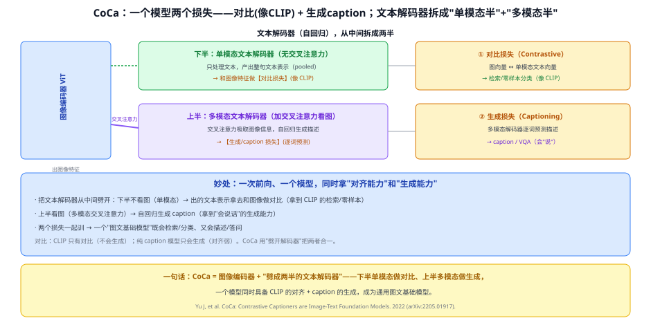
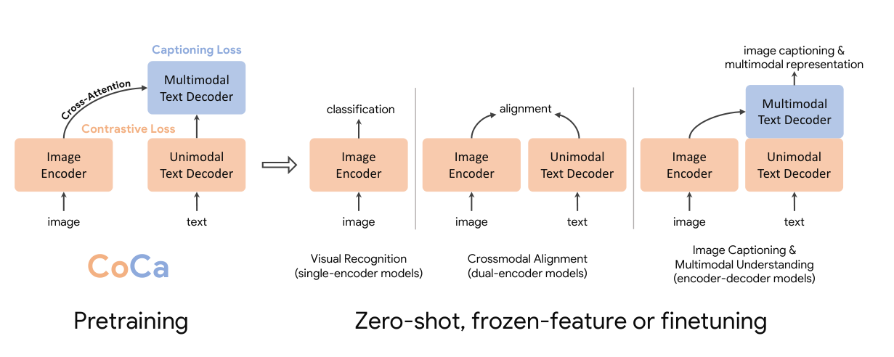
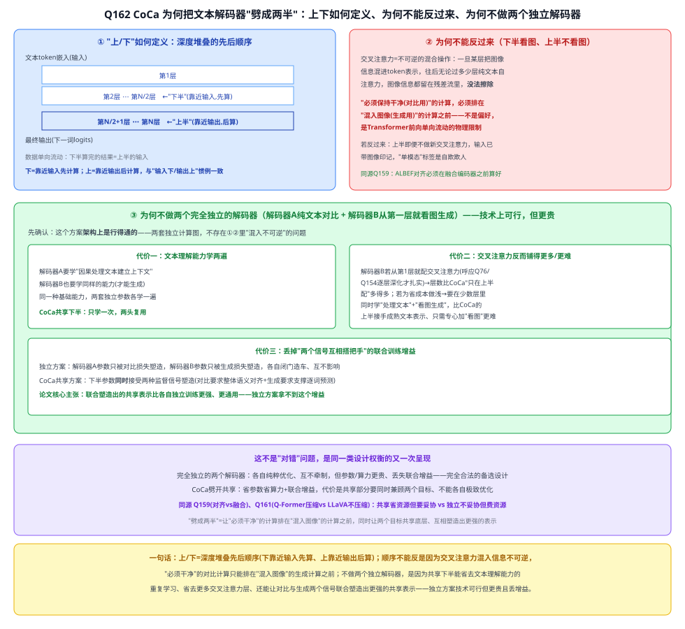

# 34a CoCa（Contrastive Captioners）

> 定位：**一个模型同时会"对比对齐"和"生成描述"**的图文基础模型。做法是把文本解码器从中间劈成两半——下半单模态做**对比**（像 CLIP）、上半多模态做**生成**（caption）。
> 作者：Yu 等（Google），*CoCa: Contrastive Captioners are Image-Text Foundation Models*，2022（arXiv:2205.01917）。
> 前置：33 CLIP（对比）、31 ViT、28 Transformer（解码器/交叉注意力）。
> 阅读路线见 多模态脉络地图（阶段 4）。
> **输入 / 输出**：图像 + 文本 → 检索相似度 / 零样本分类 / 图像描述 / VQA

---



> 📥📤 **输入/输出实例**：图像过 ViT；文本过一个**自回归解码器**，该解码器**从中间劈成两半**——下半只看文本（单模态）→ 出的整句表示和图像做**对比损失**（→检索/零样本，像 CLIP）；上半用**交叉注意力看图**→ 自回归**生成描述**（→caption/VQA）。两个损失一起训。

> 📄 **论文原图对照**（图源：Yu et al., *CoCa: Contrastive Captioners*, [arXiv:2205.01917](https://arxiv.org/abs/2205.01917) Figure 1，原文 [PDF](../papers/34a_CoCa_2205.01917.pdf)；仅笔记内学习引用，论文写作须自绘）：



> 图像编码器+文本解码器：解码器下半只看文本（出对比嵌入）、上半交叉注意力看图（出 caption）——对比+生成双损失一次前向。

## 一、提出背景

到 2022 年，图文模型分成两类各有短板：
- **对比模型**（CLIP）：擅长对齐/检索/零样本，但**不会生成**（写不出描述、答不了开放问题）。
- **生成模型**（image captioning）：会"看图说话"，但对齐能力弱、检索差。

CoCa 的目标：**用一个模型、一次训练，同时拿到两种能力**，成为通用的"图文基础模型"（foundation model），下游既能做分类/检索、又能做描述/VQA。

## 二、核心方法 ⭐

### 2.1 关键设计：把文本解码器"劈成两半"
- **图像编码器**：ViT，输出图像特征。
- **文本解码器**（自回归，带因果掩码）从中间分成：
  - **下半 = 单模态文本解码器**：**不看图**，只处理文本，产出整句文本表示（pooled）→ 和图像特征做**对比损失（Contrastive）**，等价于 CLIP 的对齐；
  - **上半 = 多模态文本解码器**：加**交叉注意力**去看图像特征，**逐词自回归生成**描述 → **生成损失（Captioning）**。

### 2.2 两个损失一起训
$$\mathcal{L} = \lambda_{con}\,\mathcal{L}_{对比} + \lambda_{cap}\,\mathcal{L}_{生成}$$
- **对比损失**：图向量 ↔ 单模态文本向量（拉近配对）→ 给模型"对齐/检索"能力；
- **生成损失**：多模态解码器逐词预测 caption → 给模型"生成/答问"能力。
一次前向、一个模型，两种能力同时长出来。

## 三、关键结论

- **通用图文基础模型**：在图像分类（零样本 + 微调）、图文检索、image captioning、VQA 等一大批任务上都强，一个预训练模型通吃。
- **"对比 + 生成"合一的范式**：证明不必训两个模型——**劈开解码器**就能让"对齐"和"生成"共存。
- **和 CLIP / BLIP 的关系**：CLIP 只有对比、不会生成；BLIP 用多分支 + CapFilt 统一理解与生成；CoCa 用"单模态半 + 多模态半"更简洁地把两者合进一个解码器。

## 四、技术谱系

```
[33 CLIP] 对比对齐（不会生成）──┐
                                ├─→ CoCa：劈开解码器 = 对比(下半) + 生成(上半)，一个模型两种能力
image captioning 生成模型 ──────┘
        并列：[34 BLIP] 也统一"理解+生成"（多分支+CapFilt 数据去噪），路线不同、目标相同
```

## 五、具体实例（走一遍）

**例：CoCa 一个模型三用**
```
零样本分类：图→ViT→图向量；类别名→下半解码器→文本向量 → 比相似度（像 CLIP）
图文检索  ：同上，用对齐后的单模态向量
看图说话  ：图→ViT；上半解码器交叉注意力看图 → 逐词生成 "a dog running on grass"
```
**关键**：同一套权重，走"下半"就是 CLIP 式对齐、走"上半"就是 caption 式生成——这就是"劈开解码器"的价值。

## 六、参考文献

- Yu J, Wang Z, et al. *CoCa: Contrastive Captioners are Image-Text Foundation Models.* 2022.（arXiv:2205.01917）
- Radford A, et al. *CLIP.* ICML 2021.（对比对照）
- Li J, et al. *BLIP.* ICML 2022.（统一理解+生成的并列路线）

---

## 📋 模型答疑（来自模型详解问答）

> 专属本模型的问答集中在此；跨模型的通用问答见答疑总目录。

---

## Q162. 把文本解码器劈成两半的理论根据是什么？上下如何定义？为何不能反过来？为何不做两个独立解码器？

**简答**：劈开的理论根据是对比损失需要"绝对干净不含图像"的文本表示、生成损失需要"含图像"的文本表示，两者互斥必须分层。"上/下"就是深度堆叠里的先后顺序——下靠近输入先算(纯文本)、上靠近输出后算(叠加交叉注意力)。不能反过来是因为交叉注意力混入信息不可逆，干净的计算必须排在混入图像的计算之前。不做两个完全独立的解码器，是因为那样要把"理解文本"的能力学两遍、可能需要更多交叉注意力层、还会丢掉两个目标联合塑造同一份表示带来的增益——独立方案技术上可行，只是更贵、效果可能更差，不是唯一正确答案，是CoCa做的一次效率与增益权衡。

**展开**：

**① "上/下"如何定义：深度堆叠的先后顺序，不是物理空间**
任何堆叠 N 层的 Transformer，数据流动都是单向、依次往上过的：
```
文本 token 嵌入(输入)
      ↓
   第 1 层 ~ 第 N/2 层  ← "下半"（靠近输入，先计算）
      ↓
   第 N/2+1 层 ~ 第 N 层 ← "上半"（靠近输出，后计算）
      ↓
   最终输出(下一词logits)
```
"下"=离输入近、先被算到的层；"上"=离输出近、后被算到的层——这是深度网络的标准约定（输入画在下面、输出画在上面、层数往上叠），不是抽象比喻。下半计算完的结果就是上半的输入。

**② 为什么必须"下半不看图、上半才看图"，不能反过来**
Transformer 里信息只能往前流、没法事后擦除：自注意力/交叉注意力是不可逆的混合操作，一旦某一层用交叉注意力把图像信息揉进了 token 表示，往后无论再过多少层纯文本自注意力，图像信息都会一直带在残差流里，没有机制能把它"忘掉"。所以"绝对不能看图"这件事，只能在"图像信息还从未被混入"的那个点上抽取——这些层天然只能在最下面，因为一旦往上走过一层交叉注意力，纯净状态就被破坏、无法恢复。若反过来，即使上半本身不做新的交叉注意力，它的输入已经是下半混入图像信息之后的产物，"单模态"标签是自欺欺人。这和 Q159（ALBEF 对齐表示必须在融合编码器之前算好）是完全同一条因果律。

**③ 为什么不做两个完全独立的解码器**
设想：解码器 A（纯文本因果自注意力，从头到尾不接触图像，末尾接对比损失）+ 解码器 B（因果自注意力+从第一层就有交叉注意力看图，专做生成/VQA）——两套完全独立的参数，互不共享。**这个方案架构上完全行得通**，不违反②的限制（因为是两套独立计算图，不存在谁污染谁的问题）。但代价是：

- **代价一：文本理解能力学两遍**。解码器 A 要学会"因果处理文本、建立上下文表示"，解码器 B 同样需要这个能力才能生成——这是同一种基础能力，却要在两套独立参数里各自学一遍。CoCa 共享下半，这份能力只学一次、两头用。
- **代价二：交叉注意力反而铺得更多、或每层任务更重**。多模态融合通常越深越扎实（Q76/Q74 DETR 逐层精修、Q154 Grounding DINO 多层交叉注意力都验证过这点）。若解码器 B 从第一层就配交叉注意力、一路配到底，需要的交叉注意力层数比 CoCa"只在上半配"多得多；若为省成本把 B 做浅，就得在很少几层里同时兼顾"理解文本"和"看图生成"两件事，比 CoCa 的上半（接手下半处理好的成熟文本表示，只需专心加"看图"）更难。
- **代价三：丢掉两个信号联合塑造同一份表示的增益**。独立方案里，解码器 A 的参数只被对比损失塑造，解码器 B 的参数只被生成损失塑造，各自闭门造车。CoCa 共享下半，这部分参数同时接受对比损失（要求整体语义对得上图像）和生成损失（间接要求支撑住逐词预测）共同塑造——论文的核心主张是，这样联合训出来的表示比两边独立训练更强、更通用。完全独立的两个解码器天然拿不到这个好处。

**④ 这是同一类设计权衡的又一次呈现**
和 Q159（先对齐再融合 vs 边对齐边融合）、Q161（Q-Former压缩 vs LLaVA不压缩）是同一类矛盾：**共享省资源、有联合增益，但要妥协；独立不妥协、各自纯粹优化，但费资源、丢增益**——没有免费午餐，CoCa 选择了前者。



**⑤ 与本项目的关系**：CoCa 属 VLM"对比+生成合一"路线的代表作，本项目不采用（主线是 YOLOv8+CLIP 两阶段轻量方案），但理解其"共享底层、分层实现互斥目标"的设计思路，有助于在第二章相关工作中对比说明为何选择更轻的两阶段方案而非这类"一个模型通吃"的重型基础模型。

---
