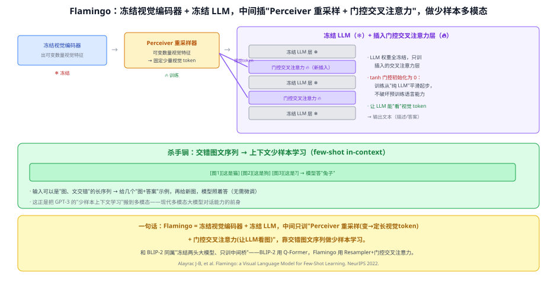
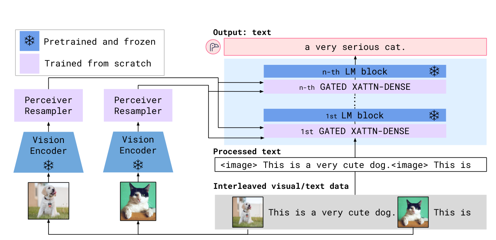
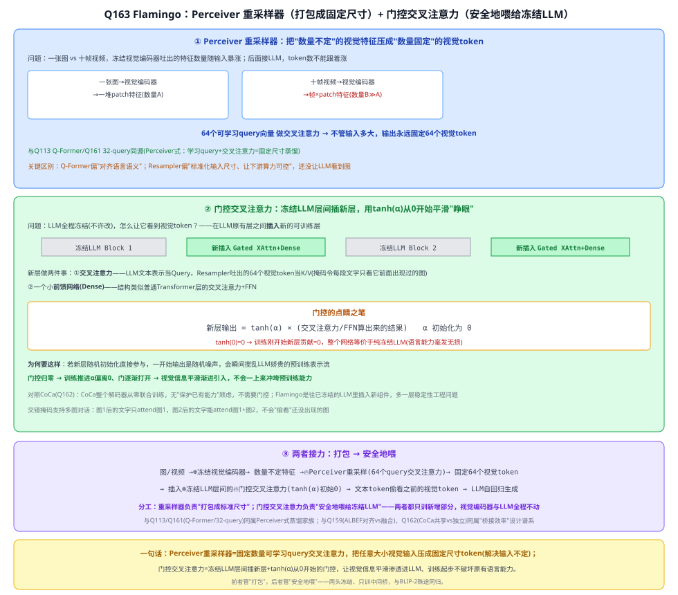

# 34b Flamingo（少样本多模态大模型）

> 定位：**冻结视觉编码器 + 冻结 LLM，中间只训一座桥**，把 GPT-3 式"少样本上下文学习"搬到多模态。与 BLIP-2 同属"冻结两头、只训桥接器"路线，是现代多模态大模型对话能力的前身。
> 作者：Alayrac 等（DeepMind），*Flamingo: a Visual Language Model for Few-Shot Learning*，NeurIPS 2022（arXiv:2204.14198）。
> 前置：28 Transformer、30 GPT 系列（少样本上下文学习）、34 BLIP·Q113（同属桥接路线）。
> 阅读路线见 多模态脉络地图（阶段 5）。
> **输入 / 输出**：交错的图文序列（可含少量示例）→ 文本（描述 / 答案）

---



> 📥📤 **输入/输出实例**：输入一段**图、文交错**的序列——比如 `[图1][这是猫] [图2][这是狗] [图3]这是?` → 冻结视觉编码器抽特征 → **Perceiver 重采样器**压成固定少量视觉 token → 通过插进冻结 LLM 里的**门控交叉注意力**喂给 LLM → 输出文本 "兔子"。给几个示例就能照着答（**少样本、无需微调**）。

> 📄 **论文原图对照**（图源：Alayrac et al., *Flamingo*, [arXiv:2204.14198](https://arxiv.org/abs/2204.14198) Figure 3，原文 [PDF](../papers/34b_Flamingo_2204.14198.pdf)；仅笔记内学习引用，论文写作须自绘）：



> 冻结视觉塔与 LLM，中间插 Perceiver Resampler（把变长视觉特征压成固定 64 个 token）+ 门控交叉注意力层——few-shot 多模态开山。

## 一、提出背景

2022 年，大语言模型（GPT-3）已展示惊人的**少样本上下文学习**：给几个示例，不改权重就能做新任务。能不能把这种能力搬到**多模态**——给几个"图+答案"示例，模型就会看新图作答？

难点：既有的强视觉模型和强 LLM 都很贵，从头联合训练不现实。Flamingo 的答案：**两头大模型都冻结，只训中间一座轻量的桥**，让 LLM"长出眼睛"。

## 二、核心方法 ⭐

### 2.1 三块（两头冻结、中间训练）
- **冻结的视觉编码器**（❄）：抽图像特征（数量随图/帧变化）；
- **Perceiver 重采样器**（🔥 训练）：把**可变数量**的视觉特征压成**固定少量**视觉 token（用一组可学习 query 做交叉注意力，思路类似 Q-Former）；
- **冻结的 LLM**（❄）+ 插入的**门控交叉注意力层**（🔥 训练）：在冻结 LLM 的层之间插入新的交叉注意力层，让语言 token 能"看"视觉 token。

### 2.2 两个关键设计
- **门控（tanh gating）初始化为 0**：新插入的交叉注意力层一开始"门"是关的（输出 ×0），于是训练**从纯 LLM 平滑起步**，不破坏预训练好的语言能力，再逐渐开门引入视觉。
- **交错图文序列 + 逐图掩码**：输入可以是"图、文交错"的长序列，每段文本只注意到它前面的图 → 支持**多图对话**和**上下文少样本**。

### 2.3 训练与使用
- 在大规模交错图文网页数据上训练"下一个词预测"（只更新桥接部分）；
- 用时**给几个示例**（few-shot）就能做描述、VQA、OCR 等，**不需要针对任务微调**。

## 三、关键结论

- **少样本 SOTA**：多个视觉-语言任务上，仅用少量示例就超过当时需要大量微调的专用模型。
- **"冻结 + 桥接"高效范式**：省算力、不破坏两头预训练能力——和 BLIP-2 殊途同归（BLIP-2 用 Q-Former，Flamingo 用 Resampler + 门控交叉注意力）。
- **承前启后**：把 GPT-3 的上下文少样本搬到多模态，直接启发后来的 LLaVA/InternVL 等**多模态大模型**（只是后者多改为"视觉 token 直接拼进 LLM 输入 + 指令微调"）。

## 四、技术谱系

```
[30 GPT-3] 少样本上下文学习 ──┐
[冻结视觉编码器] ─────────────┼─→ Flamingo：Perceiver 重采样 + 门控交叉注意力 → 冻结 LLM 看图
                              │        （与 [34 BLIP-2] Q-Former 同为"冻结两头、只训桥"）
交错图文网页数据 ─────────────┘        └─→ [37 LLaVA/InternVL] 视觉 token 拼进 LLM + 指令微调
```

## 五、具体实例（走一遍）

**例：少样本图像分类（不微调）**
```
输入序列：[图:猫][答:cat]  [图:狗][答:dog]  [图:兔][答:?]
① 每张图 → 冻结视觉编码器 → Perceiver 重采样 → 固定视觉 token
② 交错序列进冻结 LLM，门控交叉注意力让文字 token 看对应的图
③ LLM 自回归续写 → "rabbit"
```
**关键**：全程没改视觉编码器和 LLM 的权重，只靠中间训好的桥 + 上下文示例——这就是"少样本多模态"。

## 六、参考文献

- Alayrac J-B, Donahue J, et al. *Flamingo: a Visual Language Model for Few-Shot Learning.* NeurIPS 2022.（arXiv:2204.14198）
- Li J, et al. *BLIP-2.* ICML 2023.（同为"冻结两头 + 桥接"路线）
- Brown T, et al. *Language Models are Few-Shot Learners (GPT-3).* NeurIPS 2020.（少样本上下文来源）

---

## 📋 模型答疑（来自模型详解问答）

> 专属本模型的问答集中在此；跨模型的通用问答见答疑总目录。

---

## Q163. 何为 Perceiver 重采样器？何为门控交叉注意力？

**简答**：Perceiver 重采样器用固定数量（64 个）的可学习 query 通过交叉注意力，把任意大小的视觉输入（一张图或一段视频）压缩成固定数量的视觉 token，解决"输入尺寸不定"的问题，还没涉及让 LLM"看懂"图。门控交叉注意力是在冻结 LLM 层间插入新的交叉注意力+FFN 层，让文本 token 能看到视觉 token；关键是这些新层的输出乘以一个从 0 开始的门控 tanh(α)，训练起步时新层完全不起作用（网络等价于纯冻结 LLM），随训练推进门逐渐打开、视觉信息平滑引入，避免破坏 LLM 已经预训练好的语言能力。

**展开**：

**① Perceiver 重采样器：把"数量不定"压成"数量固定"**
Flamingo 的输入可能是一张图、也可能是一段视频（几十上百帧）、还可能是图文交错的多张图——冻结视觉编码器吐出的特征数量**随输入变**（一张图一份量，十帧视频就是十倍的量），但后面要接冻结 LLM，token 数不能跟着暴涨，不然算力和上下文长度都扛不住。
```
一张图 → 视觉编码器 → 一堆patch特征(数量A)  ┐
十帧视频 → 视觉编码器 → 帧×patch特征(数量B≫A) ┤→ 64个可学习query做交叉注意力 → 固定64个视觉token
```
具体机制：准备一组固定数量的可学习 query 向量（**64 个**），这些 query 通过交叉注意力去"查"视觉编码器吐出来的那堆特征（不管有多少个），不管输入多大，输出永远是这固定的 64 个向量。

**和 Q-Former 的关键区别**：Q-Former（BLIP-2）主要解决"怎么把视觉信息对齐到语言语义"——32 个 query 靠 ITC+ITM+ITG 专门训练学"只留语言相关的东西"（Q161 讲过的信息瓶颈"逼准"）；Perceiver 重采样器主要解决"输入尺寸不固定"——不管喂一张图还是一段视频，压出来的 token 数永远是常数，让接到 LLM 那边的交叉注意力开销可控、不随输入暴涨，更偏"标准化/压缩"而非"语义对齐"。一句话：**Perceiver 重采样器只负责把视觉特征"打包成固定大小的包裹"，还没让 LLM 看到图**。

**② 门控交叉注意力：让冻结的 LLM 在不被破坏的前提下"长出眼睛"**
LLM 是冻结的（全部预训练权重原封不动，不许改），但又要让它的每一层能"看到"视觉 token——在冻结 LLM 原有的层与层之间，插入全新的、可训练的层，每个新层做两件事：① **交叉注意力**——LLM 当前的文本表示当 Query，Perceiver 重采样器吐出来的 64 个视觉 token 当 Key/Value（靠掩码规则，每段文字只能看它前面出现过的图，支持多图交错对话）；② **一个小的前馈网络(Dense)**，结构类似普通 Transformer 层的交叉注意力+FFN。

**"门控"是点睛之笔**：这两个新插入的子层，输出前都要乘上一个可学习的门控标量 $\tanh(\alpha)$，而 $\alpha$ **初始化为 0**。
```
新层输出 = tanh(α) × (交叉注意力/FFN算出来的结果)
             ↑ α初始=0 → tanh(0)=0 → 新层刚开始输出永远是0
```
**为什么要"门"一开始关着**：如果新插入的交叉注意力层一开始就正常随机初始化、直接参与计算，它一开始还完全没训好，输出的是随机噪声——这份噪声会被加进 LLM 内部本来非常"娇贵"的表示流里，可能瞬间就把冻结 LLM 精心预训练出来的语言能力搅乱。门控成 0 之后，训练刚开始时，这些新层的贡献等于 0——相当于"这些新层压根不存在"，整个网络在训练最初完全等价于原封不动的纯冻结 LLM（语言能力毫发无损）。随着训练推进，$\alpha$ 慢慢偏离 0，门逐渐打开，视觉信息才平滑、渐进地被引入进来——从"纯语言模型"平稳过渡到"能看图的语言模型"，不会一上来就把预训练好的东西冲垮。

**③ 两个概念怎么接力工作**
```
图/视频 → 冻结视觉编码器(❄不训) → 数量不定的视觉特征
                ↓
      Perceiver 重采样器(🔥训练)：64个可学习query交叉注意力抽取
                ↓
           固定64个视觉token
                ↓
冻结LLM的层与层之间插入 门控交叉注意力层(🔥训练，tanh(α)初始0)
                ↓
      文本token通过这些新层"偷看"对应位置之前的视觉token
                ↓
           LLM自回归生成答案
```
分工很清楚：Perceiver 重采样器负责"把视觉特征打包成标准尺寸"；门控交叉注意力负责"在不破坏原有语言能力的前提下，把这份打包好的视觉信息喂给冻结的 LLM"。两者都只训练新增的这一小部分，原有的视觉编码器和 LLM 全程一动不动。

**④ 和 CoCa（Q162）对照**
CoCa 的整个解码器（下半+上半）是**从零联合训练**的，没有"保护已有能力"这个顾虑，所以不需要门控这种平滑过渡机制。Flamingo 是往一个**已经训练好、绝对不能破坏**的冻结 LLM 里**插入**新组件，多了一层"怎么安全地引入新能力、不毁掉旧能力"的工程问题——**门控归零初始化**正是专门为这个场景设计的稳定性技巧，CoCa 那种从头训练的场景用不上。



**⑤ 与本项目的关系**：Flamingo 与 BLIP-2 同属"冻结两头、只训中间桥"路线，本项目不采用（重、慢，不满足 <100ms 实时），但其"Perceiver 式固定尺寸压缩 + 门控渐进引入"的设计思路，与本项目 CLIP 的"轻量高效桥接"理念相通，可作第二章相关工作里"多模态大模型演进"脉络的一环提及。

---
