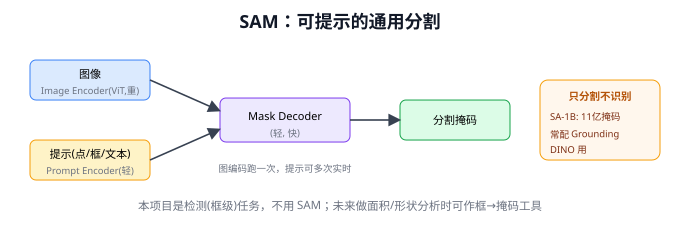
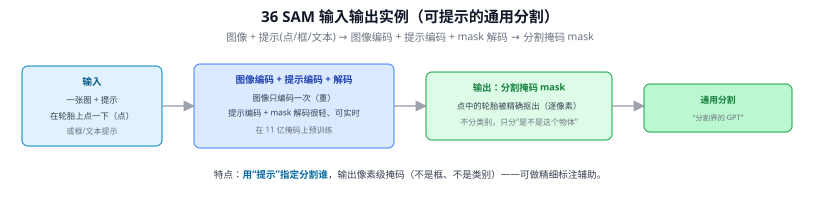
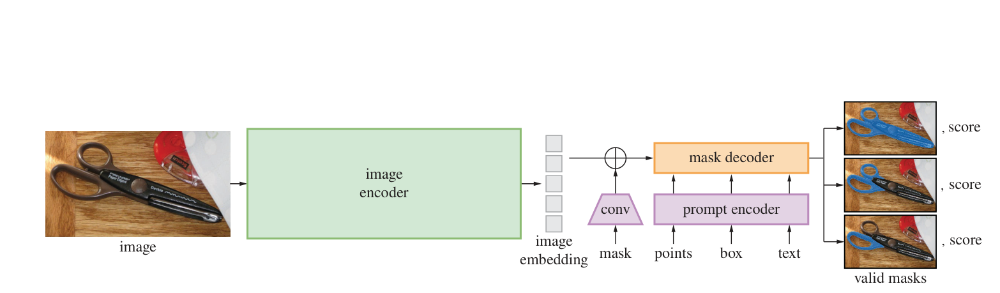
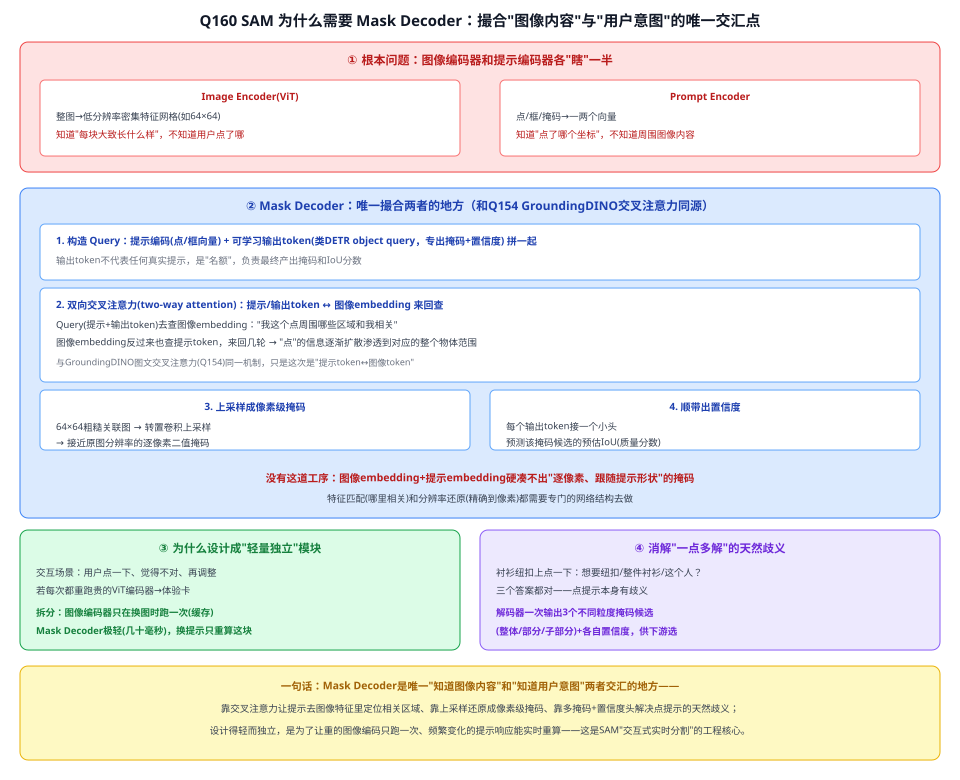
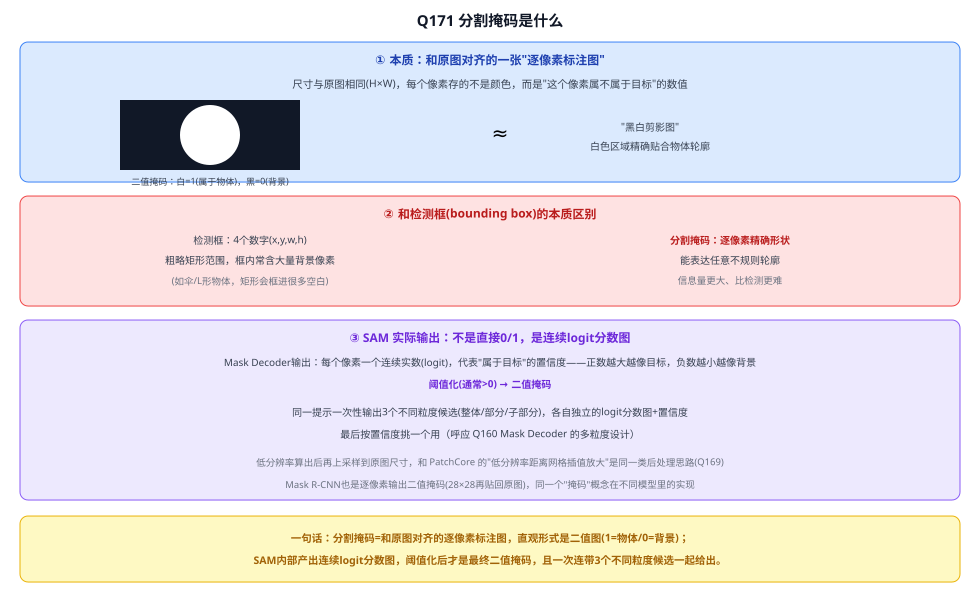

# 36 SAM（Segment Anything Model）

> 定位：可提示的通用图像分割基础模型，"分割界的 GPT"。
> 作者：Kirillov 等（Meta AI），ICCV 2023。
> **输入 / 输出**：图像 + 提示（点 / 框 / 文本）→ 分割掩码 mask

---



> 📥📤 **输入/输出实例（看一组具体数值）**：输入一张图 + **提示**（在轮胎上点一下，或给框/文本）→ 图像编码（只编码一次、较重）+ 提示编码 + mask 解码（很轻、可实时；在 11 亿掩码上预训练）→ 输出**分割掩码 mask**（点中的轮胎被逐像素精确抠出，不分类别、只分"是不是这个物体"）。特点：**用"提示"指定分割谁**，输出像素级掩码（不是框、不是类别），可做精细标注辅助。



> 📄 **论文原图对照**（图源：Kirillov et al., *Segment Anything*, [arXiv:2304.02643](https://arxiv.org/abs/2304.02643) Figure 4，原文 [PDF](../papers/36_SAM_2304.02643.pdf)；仅笔记内学习引用，论文写作须自绘）：



> 重图像编码器一次编码缓存，轻 prompt 编码器（点/框/文本）+轻掩码解码器按提示实时出掩码——"分割一切"的工程结构。

## 一、提出背景

图像分割（精确到像素勾出物体轮廓）历来需要为每个任务/类别专门训练。Meta 想做一个**分割的基础模型**：在海量数据上预训练一次，之后通过"提示（prompt）"就能分割任意物体，零样本迁移到新任务——类比 NLP 的基础模型。

---

## 二、核心方法

### 2.1 可提示分割（Promptable Segmentation）⭐
SAM 接受多种提示，输出对应的分割掩码：
```
提示类型：点（点一下）/ 框（画个框）/ 掩码 / 文本*
   │
图像 ──► Image Encoder（ViT，重，但每图只跑一次）──► 图像 embedding
提示 ──► Prompt Encoder（轻）
   │
   └──► Mask Decoder（轻，快）──► 分割掩码
```

**设计精髓**：图像编码器重但只跑一次，提示编码器和掩码解码器极轻——所以同一张图换不同提示可实时出分割结果（交互式）。

### 2.2 SA-1B 数据集
用"模型标注 + 人工修正"的数据引擎，构建了 **11 亿掩码、1100 万图**的超大分割数据集，这是 SAM 强泛化的基础。

---

## 三、能力与局限

**能力**：零样本分割任意物体，交互式、可提示，泛化极强。

**局限**：
- SAM 本身**只分割、不识别**（给出掩码，但不知道"是什么"）——需配合分类/检测模型才能知道类别
- 模型较大，实时部署需优化（后续有 MobileSAM、FastSAM、SAM 2 等轻量/视频版）

---

## 四、组合用法：Grounded-SAM

SAM 常与 35 Grounding DINO 组合成强大流水线：
```
文本 ──► Grounding DINO ──► 检测框 ──► SAM ──► 精确分割掩码
        （文本→框，知道是什么）      （框→像素级轮廓）
```
这代表了"基础模型组合"在视觉感知上的能力上限。

---

## 五、与本项目的关系

- **不直接使用**：本项目是**检测**（框级）任务，不是分割（像素级）任务，目标是路面抛洒物的框 + 类别 + 异常分，不需要精确轮廓。
- **相关工作/未来工作价值**：
  - SAM 代表"视觉基础模型"的前沿，写第二章绪论或展望时可提及，体现技术视野。
  - **潜在用途**：若未来要做更精细的抛洒物面积估计/形状分析，可用 SAM 对检测框做分割（框 prompt → 掩码），作为"未来工作"提一句。
  - SAM 的"重编码器跑一次 + 轻解码器多次"设计，与本项目 CLIP"文本特征预缓存、图像特征实时算"的效率思路相通。

---

## ✏️ 具体实例（走一遍）

**例：可提示分割（promptable segmentation）**
```
图 → 重型图像编码器(ViT) 编码一次（贵，但同一张图可复用）
然后给"提示"，轻量解码器实时出掩码：
  • 点提示：在抛洒物上点一下 → 输出该物体的分割掩码
  • 框提示：给一个框 → 输出框内主体的精确掩码
  • 一切皆可分：不指定类别，只分"这是一个物体的区域"
```
**关键**：图像编码一次、解码极快，所以能交互式实时出掩码。SAM 只**分割不分类**（不知道"这是塑料"）。

**例：和本项目怎么配合（可选）**
SAM 可把 YOLOv8 的**检测框**升级成**精确掩码**（框→掩码），便于更精细地裁剪抛洒物区域再送 CLIP 判类，减少背景干扰。属"锦上添花"，非主线（本项目以框级检测 + CLIP 为主）。

---

## 六、参考文献

- Kirillov A, et al. *Segment Anything.* ICCV 2023.
- Ren T, et al. *Grounded SAM: Assembling Open-World Models for Diverse Visual Tasks.* 2024.

---

## 📋 模型答疑（来自模型详解问答）

> 专属本模型的问答集中在此；跨模型的通用问答见答疑总目录。

---

## Q160. SAM 为什么需要 Mask Decoder？

**简答**：Mask Decoder 是"图像内容"和"用户意图"唯一交汇的地方。图像编码器只知道每块图像长什么样、不知道用户点了哪；提示编码器只知道坐标、不知道周围内容。Decoder 靠交叉注意力让提示去图像特征里定位相关区域，再上采样还原成像素级掩码，还顺带给出置信度、解决一点多解的歧义。设计得轻量独立，是为了让贵的图像编码只跑一次、频繁变化的提示能实时重算。

**展开**：

**① 根本原因：图像编码器和提示编码器各"瞎"一半**
- **Image Encoder（ViT）**：整图编码成低分辨率密集特征网格（如 1024×1024 图经 ViT 下采样后约 64×64 网格），描述"每个区域大致长什么样"，**和提示完全无关，谁点谁不点它都不知道**。
- **Prompt Encoder**：把一个点/框/掩码编码成一两个向量，知道"用户点了哪个坐标"，但**不知道那个坐标周围的图像内容是什么**。

两组东西各自瞎了一半，必须有模块把它们撮合——让提示这个查询主动去图像特征网格里"捞"出相关区域，这正是 Mask Decoder 干的事。

**② Mask Decoder 内部具体做什么（和 Q154 同源）**
1. **构造 Query**：提示编码（点/框向量）+ 几个可学习的**输出 token**（专门产出最终掩码和置信度，类似 DETR 的 object query）拼在一起当 Query；
2. **双向交叉注意力（two-way attention）**：提示/输出 token 去查图像 embedding（"我这个点周围哪些区域和我相关"）、图像 embedding 也反过来查提示 token，来回几轮，让"点"的信息逐渐扩散渗透到它对应的整个物体范围；
3. **上采样成像素级掩码**：图像编码器出的是低分辨率网格，解码器还要经过几层**转置卷积上采样**，把这个粗糙的关联图还原回接近原图分辨率的逐像素二值掩码；
4. **顺带出置信度**：每个输出 token 还接一个小头，预测这个掩码候选的预估 IoU（质量分数）。

**没有这道工序**，直接拿图像 embedding 和提示 embedding 硬凑，凑不出"逐像素、跟随提示形状"的掩码——特征匹配（哪里相关）和分辨率还原（精确到像素）都需要专门的网络结构去做。

**③ 为什么设计成"轻量独立"的一个模块**
交互式场景里用户可能点一下、觉得不对、再点一下、再调整框……如果每次调整提示都要重新跑一遍很贵的 ViT 图像编码器，体验会很卡。拆分之后：图像编码器**只在换图时跑一次**（贵、可缓存）；Mask Decoder **极轻**（几层 Transformer+上采样，约几十毫秒，CPU 都能跑），每次换提示只重新跑这一小块。**Mask Decoder 存在的意义之一，就是把"贵的部分"和"每次交互都要变的部分"切割开**。

**④ 消解"一点多解"的天然歧义**
在人身上一件衬衫的纽扣上点一下——用户想要"这颗纽扣"、"整件衬衫"、还是"这个人"？三个答案都对，一个点本身有歧义。SAM 的 Mask Decoder 被设计成**一次输出 3 个不同粒度的掩码候选（整体/部分/子部分）+ 各自置信度分数**，让下游按需选择。这也是必须有专门解码模块（而非直接从编码器读结果）才能实现的能力。



**一句话**：Mask Decoder 是唯一"知道图像内容"和"知道用户意图"两者交汇的地方——靠交叉注意力定位、靠上采样还原像素级、靠多掩码+置信度头解决歧义；设计得轻而独立，是 SAM 能做到"交互式实时分割"的工程核心。

---

## Q171. 分割掩码是什么？

**简答**：分割掩码=和原图对齐的一张逐像素标注图，最直观形式是二值图（1=物体、0=背景），本质是"黑白剪影"；和检测框（粗矩形，框内含大量背景像素）不同，掩码给出逐像素精确形状。SAM 内部实际产出的是连续 logit 分数图，阈值化（通常>0）后才是最终二值掩码，且一次连带 3 个不同粒度候选一起给出，各自带置信度供下游选。



---
