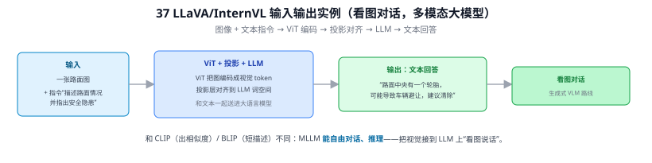
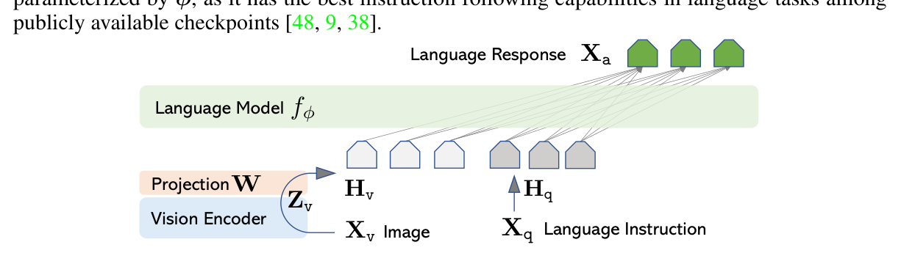
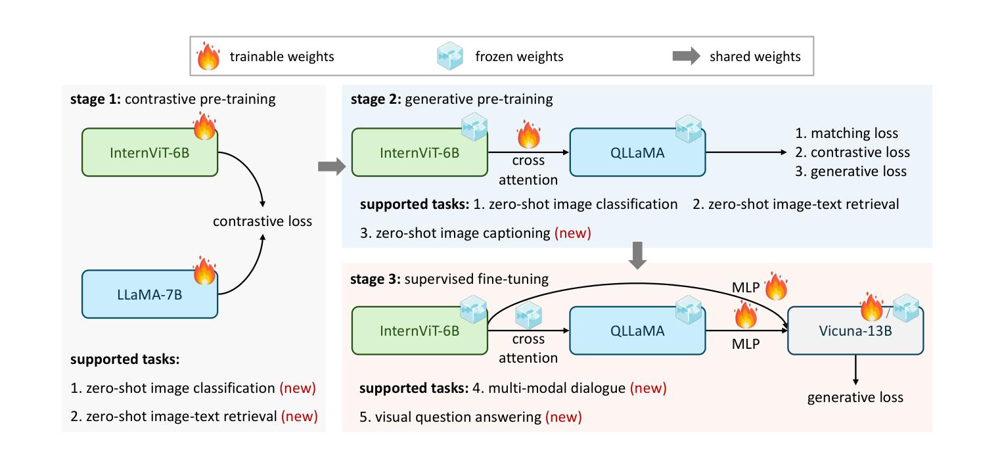
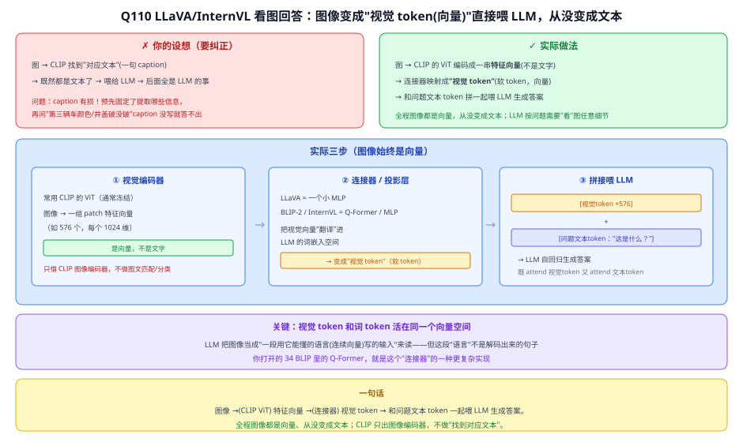

# 37 LLaVA / InternVL 等多模态大模型（MLLM）

> 定位：把视觉编码器接到大语言模型上，实现"看图对话/问答"的多模态大模型。代表 VLM 的"大模型生成式"路线。
> 代表作：LLaVA（2023，Liu 等）、InternVL（2024，上海 AI Lab）、Qwen-VL、MiniGPT-4 等。
> **输入 / 输出**：图像 + 文本指令 → 文本回答

---


> 📥📤 **输入/输出实例（看一组具体数值）**：输入一张路面图 + **文本指令**"描述路面情况并指出安全隐患"→ ViT 把图编码成视觉 token、投影层对齐到 LLM 词空间、和文本一起送进大语言模型 → 输出**文本回答**"路面中央有一个轮胎，可能导致车辆避让，建议清除"。和 CLIP（出相似度）/ BLIP（短描述）不同：MLLM **能自由对话、推理**——把视觉接到 LLM 上"看图说话"，代表 VLM 的生成式路线。



> 📄 **论文原图对照**（图源：Liu et al., [arXiv:2304.08485](https://arxiv.org/abs/2304.08485) Figure 1（[PDF](../papers/37_LLaVA_2304.08485.pdf)）；Chen et al., [arXiv:2312.14238](https://arxiv.org/abs/2312.14238) Figure 3（[PDF](../papers/37_InternVL_2312.14238.pdf)）；仅笔记内学习引用，论文写作须自绘）：





> 上=LLaVA：视觉编码器→投影 W→视觉 token 拼进 LLM（Q110 的"向量直接喂"）；下=InternVL 三阶段渐进对齐（对比→生成→SFT）。

## 一、提出背景

CLIP（33）会匹配、BLIP-2（34）会简单描述，但都不能像人一样**就一张图进行多轮、复杂的自然语言对话和推理**。随着 GPT（30）类大语言模型的成熟，一个自然想法是：**把图像"翻译"成 LLM 能懂的输入，借用 LLM 强大的语言推理能力来理解图像**。这就是多模态大模型（MLLM / LMM）。

---

## 二、核心架构（以 LLaVA 为例）

```
图像 ──► 视觉编码器（CLIP ViT，冻结）──► 图像特征
                                          │
                          投影层（Projector，MLP/线性）
                          把图像特征对齐到 LLM 词嵌入空间
                                          │
图像 token + 文本指令 ──► 大语言模型（LLaMA/Vicuna）──► 文本回答
```

**三个组件**：
1. **视觉编码器**：通常是 CLIP 的 ViT（直接复用 CLIP 的视觉对齐能力）
2. **连接器（Projector）**：把图像特征映射到 LLM 的输入空间——LLaVA 用简单 MLP，BLIP-2 用 Q-Former
3. **大语言模型**：LLaMA、Vicuna、InternLM 等，负责语言理解和生成

**训练**：通常两阶段——先训连接器对齐（冻结视觉和 LLM），再做指令微调（visual instruction tuning），用 GPT-4 生成的图文对话数据教模型"看图说话"。

### InternVL 的进展
InternVL 把视觉编码器也放大（数十亿参数 ViT），并精细对齐到 LLM，刷新多模态理解 SOTA，参数量 7B—70B+。

---

## 三、能力与局限

**能力**：图像问答、复杂推理、OCR、多轮对话、看图写作，接近通用视觉理解。

**局限**（对本项目是硬伤）：
- **参数量巨大**（7B—70B），需要大显存（数十 GB），推理慢
- 部署成本极高，远不满足边缘/实时需求
- 针对专业场景（路面抛洒物）需要大量领域数据微调才准
- 输出是自由文本，不直接给结构化检测框

---

## 四、与本项目的关系

- **明确不采用**（CLAUDE.md 已记录）：本项目目标是**轻量可部署**的检测系统（YOLOv8s + CLIP ViT-B/32，推理 < 100ms）。LLaVA/InternVL 这类大模型与"轻量、实时、边缘部署"的目标根本冲突。
- **相关工作/展望价值**：
  - 代表 VLM 发展的"大模型生成式理解"方向，写绪论/展望时提及，体现对领域全貌的认识。
  - 对比凸显本项目定位：不是追求"最强理解"，而是"在资源受限下用 VLM（CLIP）解决开放类识别的实用方案"。
  - **未来工作**：若不计算力成本，可用 MLLM 对抛洒物生成详细描述/风险评估，但这超出本项目范围。
- **技术同源**：LLaVA 的视觉编码器就是 CLIP ViT——本项目用的 CLIP 正是这些大模型的视觉基座，说明本项目选型站在主流技术线上。

---

## ✏️ 具体实例（走一遍）

**例：LLaVA 怎么"看图回答问题"**
```
图 → CLIP 视觉编码器 → 图像特征
       │ 一个投影层(MLP) 把图像特征映射成 LLM 的"词向量"空间
       ▼
  图像 token  +  文本问题"这张路面图里有什么异常？"
       │ 一起喂给 LLM
       ▼
  LLM 自回归生成："图中央有一块疑似塑料抛洒物，建议清理。"
```
**核心就一句话**：用一个投影层把图像变成 LLM 能"读"的 token，让通用 LLM 获得看图能力。训练分两步：先对齐投影层（图文配对），再指令微调（视觉问答数据）。

**例：与本项目的关系**
LLaVA/InternVL 这类 MLLM 可作"异常识别/描述"的高层补充——对检测到的抛洒物生成自然语言描述或风险判断。但模型重、延迟高，不满足实时；本项目主线仍是 YOLOv8 + CLIP，MLLM 作为"未来工作/增强"探讨。

---

## 五、参考文献

- Liu H, et al. *Visual Instruction Tuning (LLaVA).* NeurIPS 2023.
- Chen Z, et al. *InternVL: Scaling up Vision Foundation Models and Aligning for Generic Visual-Linguistic Tasks.* CVPR 2024.
- Bai J, et al. *Qwen-VL.* 2023.

## 📋 模型答疑

> 本小节收录 LLaVA/InternVL（MLLM）专属的问答。跨模型/通用问题见答疑总目录。

## Q110. LLaVA/InternVL 看图回答，是先用 CLIP 找到图像对应的文本再喂给 LLM 吗？

**简答**：LLaVA/InternVL 用 CLIP 的 ViT 把图像编码成一组特征向量（不是文字），再用一个连接器（LLaVA=MLP，BLIP-2/InternVL=Q-Former/MLP）把这些向量映射进 LLM 的词嵌入空间，变成"视觉 token"，与用户问题的文本 token 拼在一起送进 LLM，由 LLM 自回归生成答案。图像自始至终是**连续向量**，不是被解码成一句话。

**展开**：

**① 你的设想 vs 实际**

| | 你的设想（要纠正） | 实际 |
|---|---|---|
| 图像变成什么 | 一句**文本**（caption） | 一串**视觉 token 向量**（不是文字） |
| 喂给 LLM 的 | 文本字符串 | 视觉向量 + 问题文本向量，拼接 |
| CLIP 的角色 | "找到对应文本" | 只当**图像特征提取器**（用它的 ViT），**不做**图文匹配/分类 |

**② 实际三步（图像始终是向量）**
```
① 视觉编码器（常用 CLIP 的 ViT，通常冻结）
   图像 → 一组 patch 特征向量（如 576 个，每个 1024 维）  ← 是向量，不是文字
② 连接器/投影层（LLaVA=MLP；BLIP-2/InternVL=Q-Former/MLP）
   把视觉向量"翻译"进 LLM 的词嵌入空间 → 变成"视觉 token"（软 token）
③ 拼接喂 LLM
   [视觉token ×576] + [问题文本token："这是什么？"] → LLM 自回归生成答案
   （既 attend 视觉token 又 attend 文本token）
```
关键：视觉 token 和词 token 活在**同一个向量空间**，LLM 把图像当成"一段用它能懂的语言（连续向量）写的输入"来读——但这段"语言"不是解码出来的句子。

**③ 为什么不能"先转成文本再喂"（你设想的硬伤）**
**caption 是有损的**——它预先固定了"从图里提取哪些信息"。若先把图变成一句"路面上有一辆车"，再问"**第三辆车的颜色**""**井盖有没有破损**"，caption 里没写就永远答不出。直接喂视觉特征，LLM 能**按问题需要去 attend 图像的任意细节**——问什么就看哪块。这就是"给 LLM 真正的图像（用它的向量语言）"和"给它一句别人写好的摘要"的本质区别。

**④ CLIP 到底在哪（纠正"CLIP 找到对应文本"）**
- LLaVA/InternVL 借用了 CLIP，但只用它的**图像编码器（ViT）**当现成的好特征提取器（通常冻结）；
- **没有用** CLIP 的"图文相似度匹配/零样本分类"那套（Q108 讲的）；
- 所以不是"CLIP 找到图像对应的文本"，而是"CLIP 的 ViT 把图像编码成向量，交给连接器和 LLM"。你打开的 34 BLIP 里的 **Q-Former** 就是这个"连接器"的一种更复杂实现。



**⑤ 与本项目**：本项目**不采用** MLLM（重、慢、不满足 <100ms 实时，CLAUDE.md 已记）。但理解这套机制能看清：本项目用的 CLIP 正是这些大模型的**视觉基座**，选型站在主流技术线上；MLLM 仅作"未来工作/风险描述增强"提及。

---
