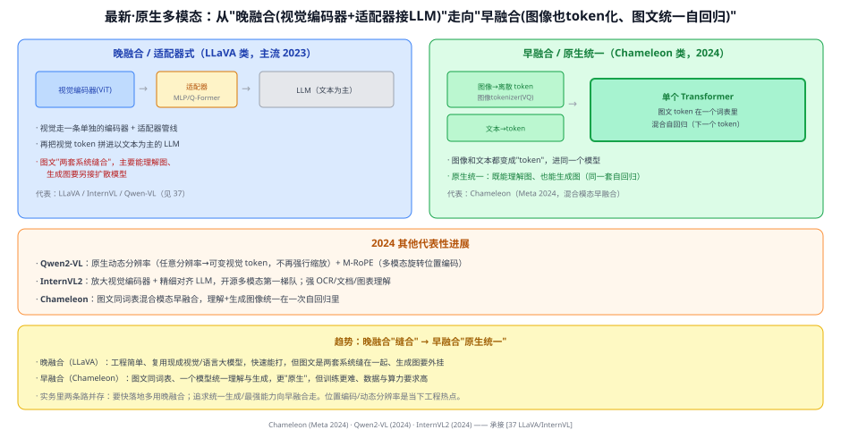
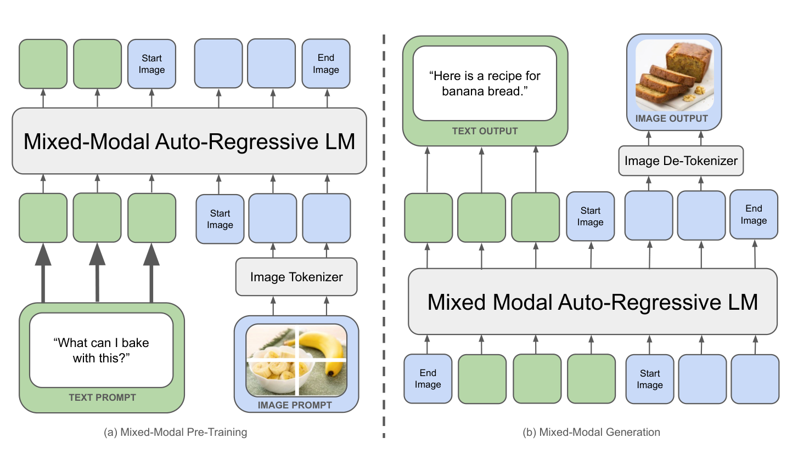
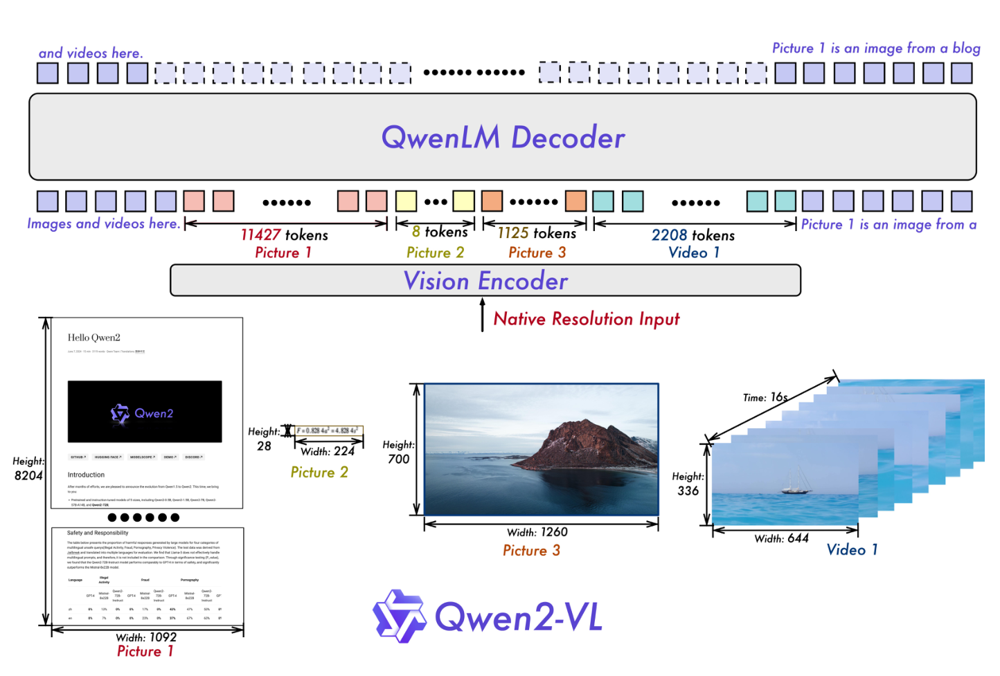

# 37a 原生多模态大模型（Chameleon / Qwen2-VL / InternVL2）

> 定位：**多模态脉络的最新一站（2024–）**。从 LLaVA 那种"视觉编码器 + 适配器接 LLM"的**晚融合**，走向"图像也 token 化、图文在一个模型里统一自回归"的**早融合/原生多模态**。
> 代表作：Chameleon（Meta 2024）、Qwen2-VL（2024）、InternVL2（2024）。
> 前置：37 LLaVA/InternVL（晚融合基线）、Q110 视觉 token、30 GPT（自回归）。
> 阅读路线见 多模态脉络地图（阶段 8）。
> **输入 / 输出**：交错图文 → 文本（理解）/ 甚至图像（原生生成）

---



> 📥📤 **输入/输出实例**：晚融合（LLaVA 类）——图过视觉编码器 + 适配器变成视觉 token，拼进以文本为主的 LLM，主要**理解图**；早融合（Chameleon 类）——**图像也被 tokenizer 变成离散 token**，和文本 token 在**同一个词表**里，进单个 Transformer**混合自回归**，既能**理解**图也能**生成**图。

> 📄 **论文原图对照**（图源：Chameleon Team, [arXiv:2405.09818](https://arxiv.org/abs/2405.09818) Figure 1（[PDF](../papers/37a_Chameleon_2405.09818.pdf)）；Wang et al., [arXiv:2409.12191](https://arxiv.org/abs/2409.12191) Figure 2（[PDF](../papers/37a_Qwen2VL_2409.12191.pdf)）；仅笔记内学习引用，论文写作须自绘）：





> 上=Chameleon：图文统一 token 化、一个自回归 LM 通吃理解与生成（早期融合）；下=Qwen2-VL：动态分辨率+M-RoPE。

## 一、提出背景

到 2023 年，LLaVA/InternVL 这类"视觉编码器 + 适配器 + LLM"的多模态大模型已经很能打，但它是**晚融合**：视觉走一条单独管线，再把视觉 token 缝进以文本为主的 LLM——图文本质是**两套系统缝在一起**，而且**生成图像**还得外挂扩散模型。

2024 年的方向是**原生多模态（native multimodal）**：让图像和文本从一开始就是**同一种东西（token）**，在一个模型里统一处理，理解与生成一体。

## 二、核心方法（三个代表）

### 2.1 Chameleon（Meta 2024）——早融合、混合模态
- **图像 tokenizer**：用一个图像量化器（VQ 式）把图像编码成**离散 token**，和文本 token 放进**同一个词表**；
- **单个 Transformer 混合自回归**：图、文 token 混在一条序列里，做"预测下一个 token"——token 可能是文字、也可能是图像块；
- **一体理解 + 生成**：因为图像也是 token，模型能在**一次自回归**里既读图又生成图（无需外挂扩散）。
- 代价：训练更难（混合模态稳定性、图像 token 化损失），数据与算力要求高。

### 2.2 Qwen2-VL（2024）——原生动态分辨率
- **动态分辨率**：不再把图强行缩放到固定尺寸，而是按原始分辨率产生**可变数量**的视觉 token（大图多 token、小图少 token）；
- **M-RoPE**（多模态旋转位置编码）：把位置编码扩展到"时间/高/宽"多维，更好地表达图像/视频的空间与时序位置。

### 2.3 InternVL2（2024）——放大视觉端 + 精细对齐
- 沿"晚融合"路线但**放大视觉编码器**、精细对齐 LLM，成为开源多模态第一梯队；
- 强在 **OCR、文档、图表**理解等精细视觉任务。

## 三、关键趋势：晚融合 → 早融合

| | 晚融合（LLaVA 类，2023） | 早融合/原生（Chameleon 类，2024） |
|---|---|---|
| 图像怎么进 | 视觉编码器 + 适配器 → 视觉 token | 图像 tokenizer → 离散 token（同词表） |
| 模型 | 视觉管线 + 以文本为主的 LLM（缝合） | 单个 Transformer 统一处理图文 token |
| 能力 | 主要理解图；生成图需外挂扩散 | 理解 + 生成图一体（一次自回归） |
| 优点 | 简单、复用现成大模型、快落地 | 更"原生"、统一 |
| 代价 | 图文两套系统缝合 | 训练难、数据/算力要求高 |

> 实务里两条路并存：**要快落地**多用晚融合（复用成熟视觉/语言大模型）；**追求统一生成/最强能力**向早融合走。**动态分辨率、多模态位置编码**是当下的工程热点。

## 四、技术谱系

```
[37 LLaVA/InternVL] 晚融合：视觉编码器+适配器→LLM ──┐
                                                    ├─→ 原生多模态（2024）
[30 GPT] 自回归 + [图像tokenizer/VQ] ───────────────┘
   ├─ Chameleon：图文同词表、混合模态早融合（理解+生成一体）
   ├─ Qwen2-VL：原生动态分辨率 + M-RoPE
   └─ InternVL2：放大视觉端 + 精细对齐（晚融合继续做强）
```

## 五、具体实例（对比走一遍）

**例：同一句"这张图里有什么并画一张类似的"**
```
晚融合(LLaVA)：读图→答"有只猫"；要画图→得再调一个扩散模型
早融合(Chameleon)：图=token，模型在一次自回归里既答"有只猫"、又生成新图的图像token→解码成图
```
**关键**：早融合把"图像"也纳入 token 词表，于是"理解"和"生成"不再是两套系统。

## 六、参考文献

- Chameleon Team (Meta). *Chameleon: Mixed-Modal Early-Fusion Foundation Models.* 2024.
- Wang P, et al. *Qwen2-VL: Enhancing Vision-Language Model's Perception of the World at Any Resolution.* 2024.
- Chen Z, et al. *InternVL / InternVL2.* 2024.（承接 37）
