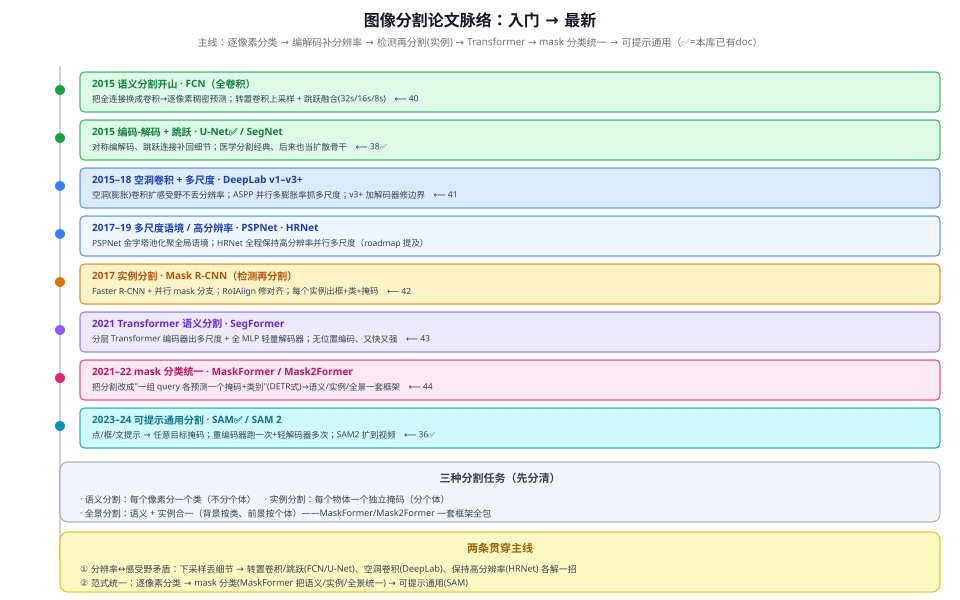

# 图像分割论文脉络地图

> 本文是图像分割方向的**阅读路线图**：把代表作按"入门 → 最新"串成一条线，标出本库**已有 doc**（✅）和**待补**。
> 配合各单篇阅读；单篇是"站点深读"，本文是"线路总览"。
> 约定：与本课题（路面抛洒物检测）关系不大，各单篇按"纯模型学习"写，不强写项目关系。

---

## 一、两条贯穿主线

1. **分辨率 ↔ 感受野的矛盾**：想要大感受野就得下采样，但下采样丢了像素级细节。各家解法：转置卷积 + 跳跃融合（FCN/U-Net）、**空洞卷积**（DeepLab，扩感受野不丢分辨率）、全程保持高分辨率（HRNet）。
2. **范式的统一**：逐像素分类（FCN/DeepLab）→ **mask 分类**（MaskFormer 把语义/实例/全景统一）→ **可提示通用**（SAM）。

## 二、先分清三种分割任务

| 任务 | 要回答 | 例子 |
|---|---|---|
| **语义分割** | 每个像素属于**哪一类**（不分个体） | 所有"车"像素都标成车，不管几辆 |
| **实例分割** | 每个**物体**一个独立掩码（分个体） | 车1、车2、车3 各一个掩码 |
| **全景分割** | 语义 + 实例合一 | 背景（路/天）按类、前景（车/人）按个体 |

## 三、分阶段脉络（代表作 + 状态）

| 阶段 | 时期 | 代表作 | 一句话 | 本库 |
|---|---|---|---|---|
| **语义分割开山** | 2015 | FCN | 全卷积、逐像素稠密预测、跳跃融合 | 40 |
| **编码-解码 + 跳跃** | 2015 | U-Net、SegNet | 对称编解码 + 跳跃补细节 | 38 ✅ |
| **空洞卷积 + 多尺度** | 2015–18 | DeepLab v1–v3+ | 空洞卷积扩感受野、ASPP 多尺度 | 41 |
| **多尺度语境/高分辨率** | 2017–19 | PSPNet、HRNet | 金字塔池化 / 保持高分辨率 | 本文提及 |
| **实例分割** | 2017 | Mask R-CNN | 检测再分割、RoIAlign | 42 |
| **Transformer 语义分割** | 2021 | SegFormer | 分层 Transformer + 全 MLP 轻解码器 | 43 |
| **mask 分类统一** | 2021–22 | MaskFormer / Mask2Former | query 各出一个掩码，语义/实例/全景一套 | 44 |
| **可提示通用分割** | 2023–24 | SAM、SAM 2 | 点/框/文提示出掩码；SAM2 扩视频 | 36 ✅ |

## 四、一句话记住每一步"解决了什么"

- **FCN**：让 CNN 能逐像素输出（分割的起点）。
- **U-Net**：编解码 + 跳跃，把下采样丢掉的细节补回来。
- **DeepLab**：空洞卷积——不下采样也能有大感受野；ASPP 抓多尺度。
- **Mask R-CNN**：在检测框内再加个 mask 分支 → 实例分割；RoIAlign 修对齐。
- **SegFormer**：用分层 Transformer + 极简 MLP 解码器，又快又准。
- **MaskFormer/Mask2Former**：把分割从"逐像素分类"改成"mask 分类"，一套框架统一语义/实例/全景。
- **SAM**：给个提示（点/框）就能分割任意目标，分割的"基础模型"。

## 五、推荐阅读顺序

**入门线**：FCN（懂"全卷积逐像素预测"）→ U-Net（编解码+跳跃）→ DeepLab（空洞卷积+ASPP）→ Mask R-CNN（实例分割）。

**进阶线**：SegFormer（Transformer 化）→ MaskFormer/Mask2Former（范式统一）→ SAM（通用可提示）。
