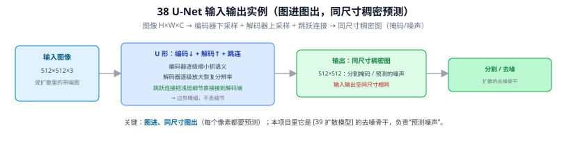
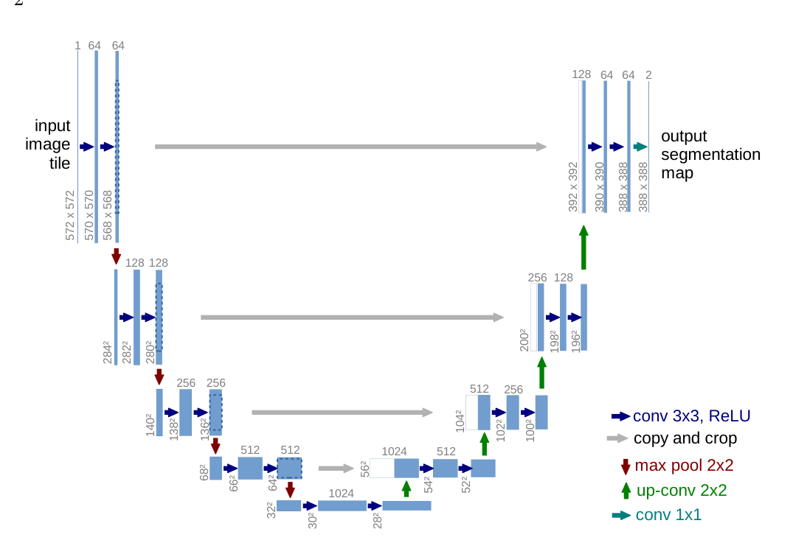
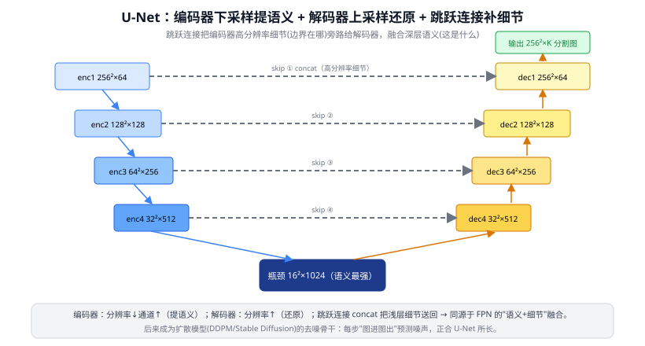

# 38 U-Net：编码-解码与跳跃连接

> 生成模型 · 之一（也是分割经典 / 扩散骨干）　|　⬅ 返回目录
> 关键词：编码器-解码器 / 跳跃连接 skip connection / 上采样 / 像素级预测 / 扩散去噪骨干
> **输入 / 输出**：图像 H×W×C → 同尺寸稠密图（分割掩码 / 噪声图）

---

> 📥📤 **输入/输出实例（看一组具体数值）**：输入图像 **512×512×3**（或扩散里的带噪图）→ U 形结构：编码器逐级**下采样**抓语义、解码器逐级**上采样**恢复分辨率、**跳跃连接**把浅层细节直接接到解码端（边界精细、不丢细节）→ 输出**同尺寸稠密图** 512×512（分割掩码 / 预测的噪声）。关键：**图进、同尺寸图出**（每个像素都要预测）。本项目里它是 39 扩散模型 的去噪骨干，负责"预测噪声"。



> 📄 **论文原图对照**（图源：Ronneberger et al., *U-Net*, [arXiv:1505.04597](https://arxiv.org/abs/1505.04597) Figure 1，原文 [PDF](../papers/38_UNet_1505.04597.pdf)；仅笔记内学习引用，论文写作须自绘）：



> 对称的编码-解码 U 形 + 跳跃连接：浅层高分辨率细节直接拼到解码端同层——分割与扩散模型骨干的共同底座。

## 一、提出背景：从"图像级"到"像素级"预测

分类网络（09 ResNet 等）一路下采样、最后输出一个类别向量——它丢掉了空间细节，因为它只需回答"这是什么"。但**语义分割 / 医学图像分割**要回答"**每个像素**属于哪类"，需要输出一张和输入同样大小的稠密预测图。

Ronneberger 等（MICCAI 2015）为细胞分割提出 U-Net：在"逐步下采样提取语义"之后，再"逐步上采样恢复分辨率"，并用**跳跃连接**把编码器的高分辨率细节直接送到解码器对应层。形状像字母 U，故名。它用极少的标注数据（医学场景标注稀缺）就能训出色，迅速成为分割与稠密预测的通用骨架。

---

## 二、核心原理：U 型结构 + 跳跃连接

```
        编码器(收缩路径)                解码器(扩张路径)
输入 ──►[Conv×2]─┐ 572²                        ┌─►[Conv×2]──► 输出分割图
                 │ skip ───────────────────────┤
        下采样↓  └►[Conv×2]─┐ 284²       ┌─[Conv×2]◄┘ 上采样↑
                            │ skip ───────┤
                 下采样↓    └►[Conv×2]─┐  ┌[Conv×2]◄┘
                                       │ skip
                            下采样↓    └►[ 瓶颈 Conv×2 ]  最深、语义最强
```

- **编码器（收缩路径）**：重复"卷积 + 下采样（池化/步长卷积）"，空间逐步减半、通道翻倍——和 CNN 金字塔一样，越深语义越强但分辨率越低。
- **解码器（扩张路径）**：重复"上采样（转置卷积/插值）+ 卷积"，把分辨率一步步还原回原图大小。
- **跳跃连接（灵魂）**：把编码器每一级的特征图，**沿通道拼接（concat）**到解码器对应的同分辨率层。

### 为什么必须有跳跃连接
单纯"下采样到底再上采样回来"会丢失大量空间细节——下采样把"边界、纹理"位置信息抹掉了，光靠上采样补不回来。跳跃连接把编码器**未被压缩的高分辨率细节**直接旁路送给解码器：

> 解码器 = "深层的强语义（这块是什么）" + "浅层的高分辨率细节（边界在哪）" 的融合。

这个思想和 21 FPN 的多尺度融合**同源**——都是"深层语义 + 浅层细节"的结合，只是 FPN 用相加、U-Net 用拼接（concat，与 DenseNet 同类）。



---

## 三、关键创新与历史地位

| 创新 | 意义 |
|------|------|
| 对称编码-解码 | 既提语义又还原分辨率，做像素级预测 |
| 跳跃连接 | 把浅层细节旁路给解码器，恢复边界精度 |
| 全卷积、无全连接 | 输入尺寸灵活，参数少、省数据 |

历史地位：U-Net 是**稠密预测任务的奠基骨架**，至今仍是医学影像分割的默认基线。更重要的是——它后来成为**扩散模型的去噪网络骨干**（39 扩散模型）：扩散每一步要预测"和输入图同样大小的噪声图"，正是 U-Net 最擅长的"图进图出"稠密映射。所以理解 U-Net 是理解 Stable Diffusion / ControlNet 的前置。

---

## 四、局限
- 纯 CNN U-Net 感受野有限、缺全局建模 → 衍生 TransUNet、Swin-UNet（32 Swin Transformer）等把 Transformer 塞进 U 型结构。
- 跳跃连接是简单 concat，语义鸿沟可能导致融合不充分 → UNet++ 等用更密的连接改进。

---

## ✏️ 具体实例（动手算一遍）

设输入 $256\times256\times3$，编码器 4 次下采样、每次空间减半通道翻倍（基准通道 64）：

```
输入      256×256×3
enc1      256×256×64   → skip①(256²×64) → 池化 →128²
enc2      128×128×128  → skip②(128²×128)→ 池化 →64²
enc3       64×64×256   → skip③(64²×256) → 池化 →32²
enc4       32×32×512   → skip④(32²×512) → 池化 →16²
瓶颈       16×16×1024                        最深、语义最强
dec4       32×32×512   ← 上采样 + concat skip④(→32²×1024) → Conv
dec3       64×64×256   ← 上采样 + concat skip③
dec2      128×128×128  ← 上采样 + concat skip②
dec1      256×256×64   ← 上采样 + concat skip①
输出      256×256×K    1×1 卷积 → K 类逐像素得分
```

关键看 dec4 那一步：上采样得到 $32\times32\times512$，**拼接** skip④ 的 $32\times32\times512$ → $32\times32\times1024$（通道相加，08 答疑 Q7 的 concat），再卷积融合。最后 1×1 卷积把通道压到类别数 $K$（Q39 的逐像素线性组合）。

---

## 五、与本项目的关系
- **理解扩散数据增强的引擎**：本项目用 ControlNet 合成稀缺类样本（39 扩散模型），其去噪骨干就是 U-Net；明白 U-Net 才懂合成图是怎么"图进图出"生成的。
- **与 FPN/检测的呼应**：U-Net 的"深层语义 + 浅层细节"跳跃融合，和第三章加 P2（21 FPN）捞小目标是同一思想——都是把高分辨率浅层信息找回来。
- **可提示分割的近邻**：SAM（36 SAM）的 mask 解码同样是"编码-解码 + 上采样"思路，U-Net 是其概念源头之一。

---

## 参考文献
1. Ronneberger O, Fischer P, Brox T. **U-Net: Convolutional Networks for Biomedical Image Segmentation.** MICCAI 2015.
2. Zhou Z, et al. **UNet++: A Nested U-Net Architecture for Medical Image Segmentation.** DLMIA 2018.
3. Cao H, et al. **Swin-Unet: Unet-like Pure Transformer for Medical Image Segmentation.** ECCVW 2022.
