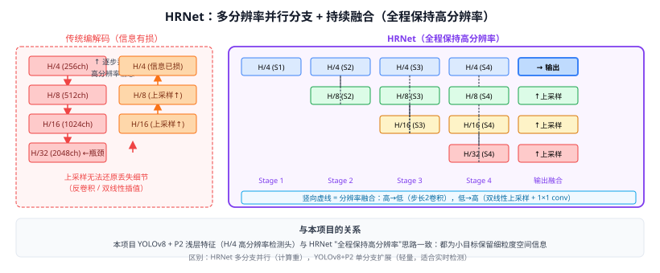

# 38a HRNet（高分辨率表示网络）

> 定位：**在整个计算过程中始终保持高分辨率表示**，通过多分辨率并行分支与反复融合，避免传统编解码架构中上采样带来的信息损失，在姿态估计、语义分割、目标检测上均表现优异。
> 作者：Wang et al.，CVPR 2019，中科大 + Microsoft Research Asia。
> 效果：COCO 关键点检测 76.3 AP（优于 SimpleBaseline 1.2 AP）；语义分割 Cityscapes mIoU 81.6%；成为姿态/分割类任务的主流骨干。
> **输入 / 输出**：图像 $H \times W \times 3$ → 高分辨率语义丰富特征图（多尺度输出或高分辨率单输出）

---



## 一、提出背景

### 1.1 传统主流方案的问题

- **编解码（Encoder-Decoder）**：ResNet + FPN 先下采样到 1/32，再上采样恢复；上采样过程存在**不可逆信息损失**（反卷积 / 双线性插值都不能完全还原细节）。
- **Dilated/Atrous 卷积**（如 DeepLab）：通过空洞卷积保持分辨率但感受野有限，计算量大。

### 1.2 HRNet 的核心思想

> 不降分辨率再恢复，而是**从一开始就维护多分辨率并行分支**，高分辨率分支全程存在，并与低分辨率分支持续融合。

---

## 二、网络结构

### 2.1 分支渐进生成

```
Stage 1:  1个分支（高分辨率 H/4）
           ↓
Stage 2:  2个分支（H/4, H/8）
           ↓
Stage 3:  3个分支（H/4, H/8, H/16）
           ↓
Stage 4:  4个分支（H/4, H/8, H/16, H/32）
```

每进入新 Stage，通过步长为 2 的卷积**从最低分辨率分支再分叉出更低分辨率分支**。

### 2.2 每个分支内部

每个分支是若干个**基础块（Basic Block 或 Bottleneck Block）**的堆叠（与 ResNet 残差块相同），保持分支内分辨率不变。

HRNet 配置（小/中/大）：
| 模型 | C（第1分支通道数）| 参数量 | 说明 |
|------|----------------|-------|------|
| HRNet-W18 | 18 | 9.5M | 轻量版 |
| HRNet-W32 | 32 | 28.5M | 姿态估计常用 |
| HRNet-W48 | 48 | 65.7M | 大型版，分割用 |

### 2.3 多分辨率融合（Multi-resolution Fusion）

每个 Stage 末尾进行一次**全融合**（every branch fuses information from all other branches）：

$$y_s^r = \sum_{r'=1}^{S}\text{fuse}(x_{s}^{r'} \rightarrow x_s^r)$$

融合方式：
- **从高分辨率到低分辨率**：步长为 2 的 3×3 卷积下采样（1×1 conv + 步长2 repeated）；
- **从低分辨率到高分辨率**：双线性插值上采样 + 1×1 卷积对齐通道数；
- **相同分辨率**：直接相加（identity）。

```python
# 伪代码：2分支 → 2分支 融合
out_high = high + upsample(low, scale=2)        # 低分辨率上采样加到高分辨率
out_low  = low  + conv_stride2(high)            # 高分辨率下采样加到低分辨率
```

---

## 三、输出方式

### 3.1 姿态估计（Pose Estimation）

只取**最高分辨率（H/4）分支**的输出，接 1×1 卷积预测 K 个关键点热力图（K 通道）。高分辨率输出使关键点定位精度高（小错误敏感，差 1 像素即算失败）。

### 3.2 语义分割

将全部 4 个分支输出上采样到相同分辨率（H/4），**拼接（concat）后接分割头**；或只用最高分辨率分支。

### 3.3 目标检测（HRNet as Backbone）

用 4 个分支输出 {H/4, H/8, H/16, H/32} 构成 FPN-like 多尺度特征，直接接 Faster RCNN 检测头。

---

## 四、与经典骨干对比

| 骨干 | 核心结构 | 高分辨率 | 语义强度 | 适合任务 |
|------|---------|---------|---------|---------|
| ResNet-50 | 顺序下采样 | × (1/32) | 强 | 分类 |
| FPN | 上采样 + 横向连接 | 部分恢复 | 中 | 检测 |
| U-Net | 编解码对称 | 部分恢复 | 中 | 医疗分割 |
| **HRNet** | **多分辨率并行** | **全程保持** | **强+精细** | 姿态/分割/检测 |

HRNet 的特点是**高分辨率表示始终带有高层语义**（因为每次都与低分辨率分支融合），而不是仅靠上采样逼近。

---

## 五、历史地位与后续

```
Stacked Hourglass (2016，关键点热力图)
  ↓
SimpleBaseline (2018，ResNet + 反卷积上采样)
  ↓
HRNet (2019，多分辨率并行) ← 当时 SOTA
  ↓
HigherHRNet (2020，bottom-up 姿态)
HRFormer (2021，Transformer 分支替换卷积)
  ↓
ViTPose (2022，纯 ViT 骨干做姿态)
```

HRNet 目前仍是**姿态估计和密集预测任务**的强 baseline，许多比赛选手仍以 HRNet-W48 为基础改进。

---

## 六、与本项目的关系

- **创新点 1 的改进背景**：本项目在 YOLOv8 加入 P2 浅层特征（高分辨率）检测头，与 HRNet "全程保持高分辨率"的思路一脉相承——都是为了保留小目标的细粒度特征。
- **第二章写作**：在"特征金字塔与多尺度表示"小节，以 HRNet 说明高分辨率表示对密集预测任务的重要性，对比本项目的 P2 融合方案。
- **实验对比**：本项目不复现 HRNet（计算量大、非检测主流），但可在相关工作表格中列为"并行多尺度方法"的代表。

---

## 参考文献

- Wang J, et al. *Deep High-Resolution Representation Learning for Visual Recognition.* CVPR 2019 / TPAMI 2020.
- Sun K, et al. *Deep High-Resolution Representation Learning for Human Pose Estimation (HRNet-Pose).* CVPR 2019.
