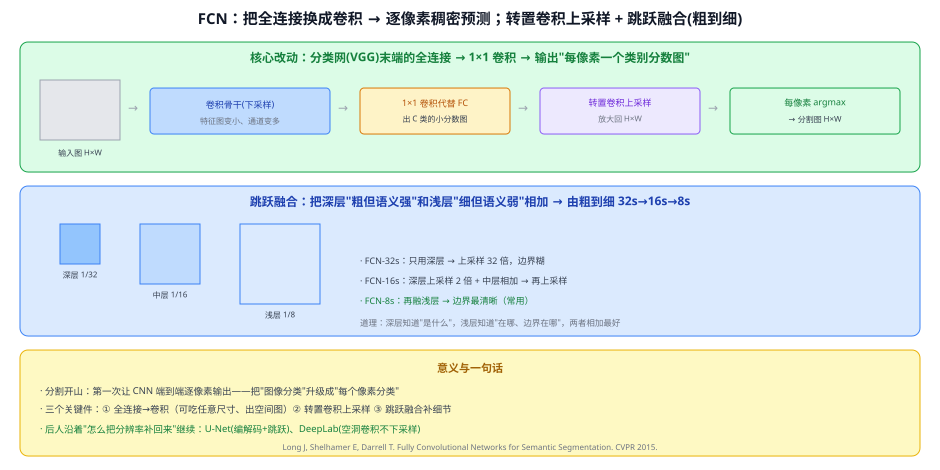
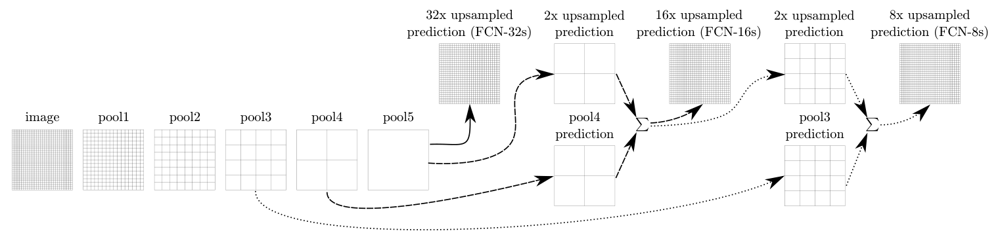

# 40 FCN（Fully Convolutional Networks）

> 定位：**语义分割的开山之作**。第一次让 CNN 端到端地"逐像素分类"——把图像分类升级成分割。分割脉络的起点。
> 作者：Long、Shelhamer、Darrell（UC Berkeley），*Fully Convolutional Networks for Semantic Segmentation*，CVPR 2015。
> 前置：04 CNN 原理、07 VGGNet（骨干）、Q44 定长输入（FC vs 全卷积）。
> 阅读路线见 图像分割脉络地图。
> **输入 / 输出**：图像 H×W → 每像素类别图 H×W（语义分割）

---



> 📥📤 **输入/输出实例**：一张 H×W 的图 → 卷积骨干下采样成小特征图 → 用 **1×1 卷积代替全连接**得到"每像素 C 类分数图" → **转置卷积上采样**放大回 H×W → 每像素 argmax → 分割图（每个像素一个类别）。

> 📄 **论文原图对照**（图源：Long et al., *Fully Convolutional Networks for Semantic Segmentation*, [arXiv:1411.4038](https://arxiv.org/abs/1411.4038) Figure 3，原文 [PDF](../papers/40_FCN_1411.4038.pdf)；仅笔记内学习引用，论文写作须自绘）：



> 跳跃融合：pool5 直接 32× 上采样太粗，逐级融合 pool4/pool3 得 FCN-16s/8s 更细的预测（Q49 的由粗到细）。

## 一、提出背景

传统分类 CNN（VGG/AlexNet）末端是**全连接层**，只能输出"整张图一个标签"，且要求**定长输入**（Q44）。但分割要的是"**每个像素一个标签**"。FCN 的洞见：**把全连接换成卷积**，网络就能吃任意尺寸、输出一张**空间分数图**——分割问题迎刃而解。

## 二、核心方法 ⭐

### 2.1 三个关键件

**① 全连接 → 卷积（fully convolutional）**
把分类网末端的 FC 层改写成 **1×1 卷积**。好处：
- 不再要求定长输入，任意尺寸都能算；
- 输出不是一个向量，而是一张**空间图**（每个位置一组类别分数）。

**② 转置卷积上采样（deconvolution）**
骨干下采样后特征图变小（如 1/32），要恢复到原图分辨率。FCN 用**转置卷积**（可学习的上采样）把小分数图放大回 H×W。

**③ 跳跃融合（skip connection，粗到细）**
只用最深层上采样 32 倍 → 边界很糊（FCN-32s）。于是**融合浅层**：
- **FCN-16s**：深层上采样 2 倍 + 中层（1/16）相加 → 再上采样；
- **FCN-8s**：再融浅层（1/8）→ 边界最清晰（最常用）。

> 道理：**深层知道"是什么"（语义强、分辨率低），浅层知道"在哪、边界在哪"（语义弱、分辨率高）**，两者相加，既分对类又对齐边界。这条"深浅融合"思想和 FPN 一脉相承。

## 三、关键结论

- **分割范式确立**：端到端、逐像素、可训练，取代了之前"滑窗逐块分类"的笨办法。
- **深浅融合有效**：FCN-8s 明显好于 32s，证明"补分辨率/边界"是分割的核心矛盾。
- **启后**：分割界后续都在回答"**怎么把下采样丢掉的分辨率补回来**"——U-Net（对称编解码 + 密集跳跃）、DeepLab（空洞卷积干脆不下采样那么多）都是不同答案。

## 四、技术谱系

```
[07 VGG] 分类骨干 ──(把FC换成1×1卷积)──→ FCN（逐像素预测）
                                          │ 核心矛盾：下采样丢分辨率
                                          ├─→ [38 U-Net]  对称编解码+跳跃补细节
                                          └─→ [41 DeepLab] 空洞卷积扩感受野不丢分辨率
        深浅融合思想 ↔ [21 FPN]（检测里的多尺度融合）
```

## 五、具体实例（走一遍）

**例：FCN-8s 分割一张街景**
```
① 图 512×512 → VGG 骨干 → 深层特征 16×16（1/32）
② 1×1 卷积 → 16×16×C（C=类别数）分数图
③ 上采样×2 → 32×32，与中层(1/16)的分数相加
④ 再上采样×2 → 64×64，与浅层(1/8)相加
⑤ 上采样×8 → 512×512 → 每像素 argmax → 分割图
```
**关键**：③④的"相加"就是跳跃融合——把浅层的细节喂给深层的语义。

## 六、参考文献

- Long J, Shelhamer E, Darrell T. *Fully Convolutional Networks for Semantic Segmentation.* CVPR 2015.
- Ronneberger O, et al. *U-Net.* MICCAI 2015.（编解码路线，见 38）
