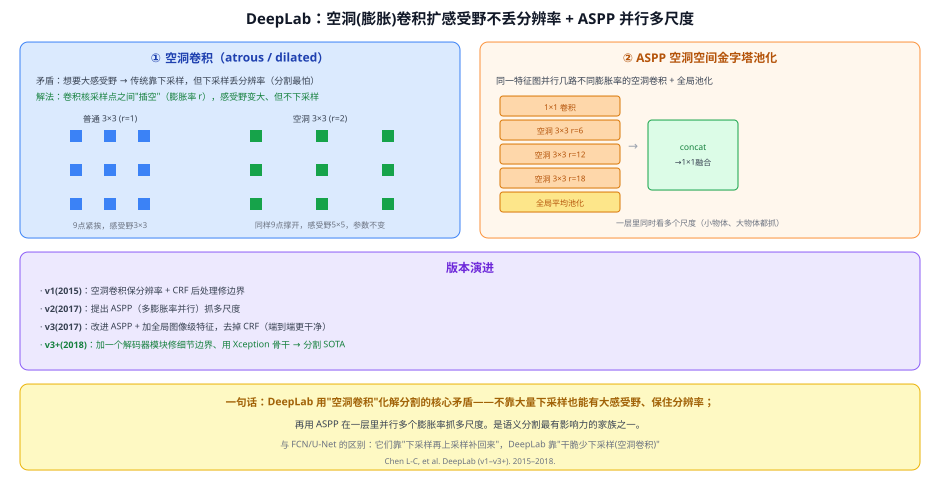
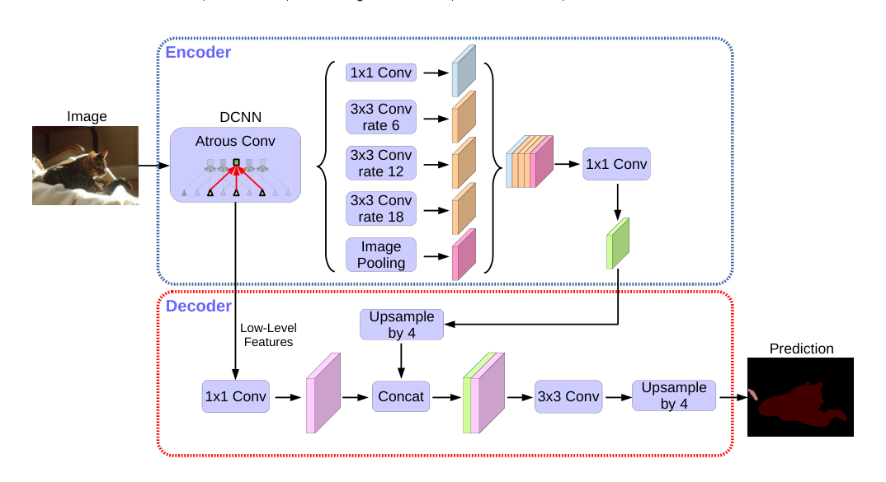

# 41 DeepLab 系列（v1 / v2 / v3 / v3+）

> 定位：语义分割最有影响力的家族之一。核心武器是**空洞卷积（atrous/dilated convolution）**——不靠大量下采样也能有大感受野、保住分辨率；再用 **ASPP** 并行多膨胀率抓多尺度。
> 作者：Chen 等（Google），DeepLab v1（2015）→ v2（2017, ASPP）→ v3（2017）→ v3+（2018）。
> 前置：40 FCN、04 CNN 原理（感受野）、08 GoogLeNet（多尺度并行思想）。
> 阅读路线见 图像分割脉络地图。
> **输入 / 输出**：图像 → 每像素类别图（语义分割）

---



> 📥📤 **输入/输出实例**：图过带**空洞卷积**的骨干（少下采样、保住较高分辨率）→ **ASPP**（并行几路不同膨胀率的空洞卷积 + 全局池化）抓多尺度 → concat 融合 → 上采样 → 每像素类别图。

> 📄 **论文原图对照**（图源：Chen et al., *DeepLabv3+*, [arXiv:1802.02611](https://arxiv.org/abs/1802.02611) Figure 2，原文 [PDF](../papers/41_DeepLabV3plus_1802.02611.pdf)（v2 原文 [PDF](../papers/41_DeepLabV2_1606.00915.pdf)）；仅笔记内学习引用，论文写作须自绘）：



> 编码器 ASPP 多膨胀率并行抓多尺度上下文，解码器融低层特征修边界——DeepLab 系列的收官形态。

## 一、提出背景

分割的核心矛盾：**想要大感受野（看清"这是什么"）就得下采样，但下采样丢像素级分辨率（分割最怕边界糊）**。FCN/U-Net 的答案是"下采样后再上采样 + 跳跃融合把细节补回来"。DeepLab 换了个思路：**干脆少下采样——用空洞卷积在不降分辨率的前提下扩大感受野**。

## 二、核心方法 ⭐

### 2.1 空洞卷积（atrous / dilated convolution）
在卷积核的采样点之间"插空"（**膨胀率 r**）：
- 普通 3×3（r=1）：9 个采样点紧挨，感受野 3×3；
- 空洞 3×3（r=2）：同样 9 个点撑开，感受野 5×5，**参数量不变、也不下采样**。

于是可以在保持高分辨率的特征图上，用空洞卷积拿到大感受野——**鱼与熊掌兼得**。

### 2.2 ASPP（Atrous Spatial Pyramid Pooling，空洞空间金字塔池化）
在同一张特征图上**并行**几路：1×1 卷积 + 多个不同膨胀率的空洞 3×3（如 r=6/12/18）+ 全局平均池化 → 各路结果 concat → 1×1 融合。作用：**一层里同时看多个尺度**（小物体靠小 r、大物体靠大 r），思想和 Inception 多分支、SPP 一脉相承。

### 2.3 版本演进
| 版本 | 关键改动 |
|---|---|
| **v1**（2015） | 空洞卷积保分辨率 + CRF 后处理修边界 |
| **v2**（2017） | 提出 **ASPP**（多膨胀率并行）抓多尺度 |
| **v3**（2017） | 改进 ASPP + 加全局图像级特征，**去掉 CRF**（端到端更干净） |
| **v3+**（2018） | 加一个**解码器模块**修细节边界、用 Xception 骨干 → 分割 SOTA |

## 三、关键结论

- **空洞卷积**成为分割/检测里的常用件（不下采样也扩感受野）。
- **ASPP** 是"单层多尺度"的经典设计，影响深远。
- **和 FCN/U-Net 的分工**：它们靠"下采样再上采样补回来"，DeepLab 靠"少下采样（空洞卷积）"——两条互补路线。v3+ 又把两者结合（空洞主干 + 轻解码器）。

## 四、技术谱系

```
[40 FCN] 逐像素预测（下采样→上采样补分辨率）
   │  换思路：少下采样
   ▼
DeepLab：空洞卷积（保分辨率扩感受野）+ ASPP（多尺度）
   ├─ v3+ 又融入编解码器（吸收 U-Net 式补细节）
   └─ 多尺度思想 ↔ [08 Inception]、[21 FPN]、[Q50 SPP]
```

## 五、具体实例（走一遍）

**例：空洞卷积怎么"不下采样也看得远"**
```
一张 64×64 特征图，要看 5×5 范围的语境：
· 传统：先池化到 32×32 再 3×3 卷积（丢了一半分辨率）
· DeepLab：直接在 64×64 上用 r=2 的空洞 3×3（感受野=5×5，分辨率不变）
```
**关键**：膨胀率 r 越大、看得越远，而参数量和分辨率都不变——这就是它化解"感受野 vs 分辨率"矛盾的办法。

## 六、参考文献

- Chen L-C, Papandreou G, et al. *DeepLab: Semantic Image Segmentation with Deep Convolutional Nets, Atrous Convolution, and Fully Connected CRFs.* TPAMI 2017.（v1/v2）
- Chen L-C, et al. *Rethinking Atrous Convolution for Semantic Image Segmentation.* 2017.（v3）
- Chen L-C, et al. *Encoder-Decoder with Atrous Separable Convolution (DeepLabv3+).* ECCV 2018.
