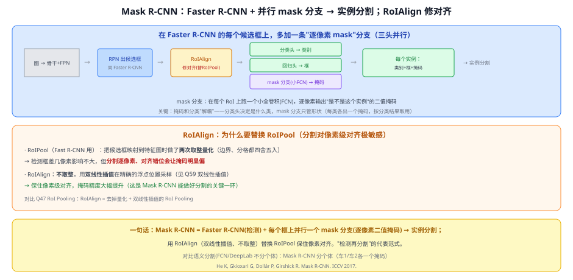
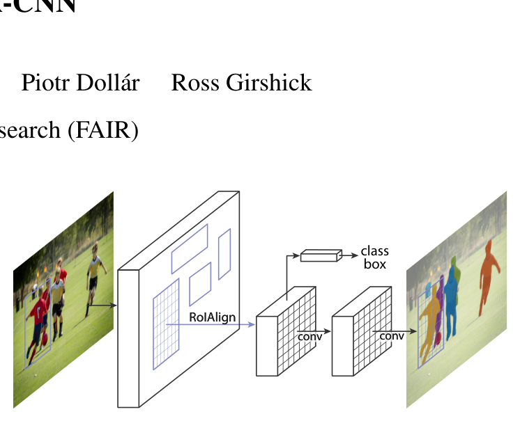

# 42 Mask R-CNN（实例分割）

> 定位：**实例分割的代表范式**——在 Faster R-CNN 检测的每个框上，并行加一条"逐像素 mask"分支，得到每个物体一个独立掩码。并提出 **RoIAlign** 修正对齐。
> 作者：He、Gkioxari、Dollár、Girshick（FAIR），*Mask R-CNN*，ICCV 2017（最佳论文）。
> 前置：20 Faster R-CNN、Q47 RoI Pooling、Q59 双线性插值、40 FCN（mask 分支就是小 FCN）。
> 阅读路线见 图像分割脉络地图。
> **输入 / 输出**：图像 → 每个实例的（类别 + 框 + 二值掩码）

---



> 📥📤 **输入/输出实例**：图过骨干+FPN → RPN 出候选框 → **RoIAlign**（双线性插值、不取整）对齐特征 → 每个 RoI 上**三头并行**：分类头（类别）、回归头（框）、**mask 分支（小 FCN 逐像素输出二值掩码）** → 每个实例得到"类别 + 框 + 掩码"。

> 📄 **论文原图对照**（图源：He et al., *Mask R-CNN*, [arXiv:1703.06870](https://arxiv.org/abs/1703.06870) Figure 1，原文 [PDF](../papers/42_Mask_RCNN_1703.06870.pdf)；仅笔记内学习引用，论文写作须自绘）：



> Faster R-CNN 加第三支掩码分支：每个 RoI 经 RoIAlign（Q47 的精确对齐）后并行出 类别+框+二值掩码。

## 一、提出背景

语义分割（FCN/DeepLab）只回答"每个像素是哪类"，**不分个体**——一堆车全标成"车"。**实例分割**要分个体：车1、车2 各一个掩码。Mask R-CNN 的思路很直接：**已经有强检测器（Faster R-CNN）能框出每个物体了，那就在每个框里再加一个分支预测这个物体的掩码**——"检测再分割"。

## 二、核心方法 ⭐

### 2.1 在 Faster R-CNN 上加第三个头
Faster R-CNN 每个 RoI 有两头：分类 + 框回归。Mask R-CNN 并行加**第三头——mask 分支**：在每个 RoI 特征上跑一个**小全卷积网络（FCN）**，逐像素输出"是不是这个实例"的**二值掩码**。

**关键：掩码与分类解耦**。mask 分支为**每个类各输出一个掩码**（不做类间竞争），最终按**分类头**的结果取用对应类的掩码。好处：mask 分支只需专注"形状/哪些像素属于前景"，不必兼管"是什么类"，训练更简单、效果更好。

### 2.2 RoIAlign（本文另一大贡献）⭐
RoI Pooling（Fast R-CNN 用）把候选框映射到特征图时做了**两次取整量化**（框边界、分格都四舍五入）。对检测，差几像素影响不大；但**分割逐像素，对齐错位会让掩码明显偏**。

**RoIAlign**：**不取整**，用**双线性插值**在精确的浮点位置采样 → 保住像素级对齐。这一改动让掩码精度大幅提升，是 Mask R-CNN 能做好分割的关键一环。

> 一句话：**RoIAlign = 去掉量化 + 双线性插值的 RoI Pooling**。

## 三、关键结论

- **实例分割 SOTA**（2017），且**多任务共享**：一个网络同时出检测框 + 掩码，几乎不增开销。
- **RoIAlign 的价值**：证明"像素级对齐"对分割至关重要，此后被广泛沿用。
- **可扩展**：加个关键点分支还能做人体姿态估计——"检测 + 逐 RoI 任务头"是很通用的框架。
- **范式定位**：属"**检测再分割（detect-then-segment）**"路线；后来 MaskFormer/Mask2Former 用"mask 分类"把语义/实例/全景统一，是另一条路。

## 四、技术谱系

```
[20 Faster R-CNN] 检测（分类+框）──(加第三头 mask 分支=小FCN)──→ Mask R-CNN 实例分割
   [Q47 RoIPool] ──(去量化+双线性插值)──→ RoIAlign（保像素对齐）
        另一条路：[44 MaskFormer/Mask2Former] 用 query mask 分类统一三种分割
```

## 五、具体实例（走一遍）

**例：分割一张街景里的 3 辆车**
```
① 图 → 骨干+FPN → RPN 出候选框（含 3 个车框）
② 每个框 RoIAlign 对齐 → 三头：
   分类头 → "car"(0.98)
   回归头 → 精修框
   mask 分支 → 28×28 二值掩码（这辆车占哪些像素）→ 贴回原图
③ 3 辆车 → 3 个独立掩码（车1/车2/车3 分得开）
```
**关键**：③里"分得开"就是实例分割 vs 语义分割的区别；RoIAlign 保证②里掩码贴得准。

## 六、参考文献

- He K, Gkioxari G, Dollár P, Girshick R. *Mask R-CNN.* ICCV 2017.
- Ren S, et al. *Faster R-CNN.* NeurIPS 2015.（基础，见 20）
