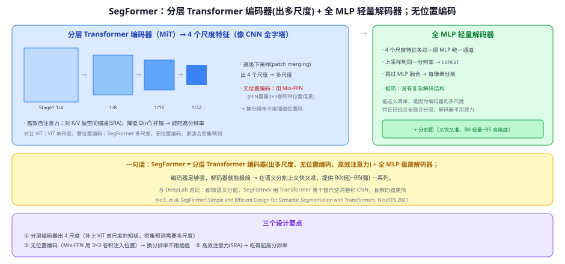
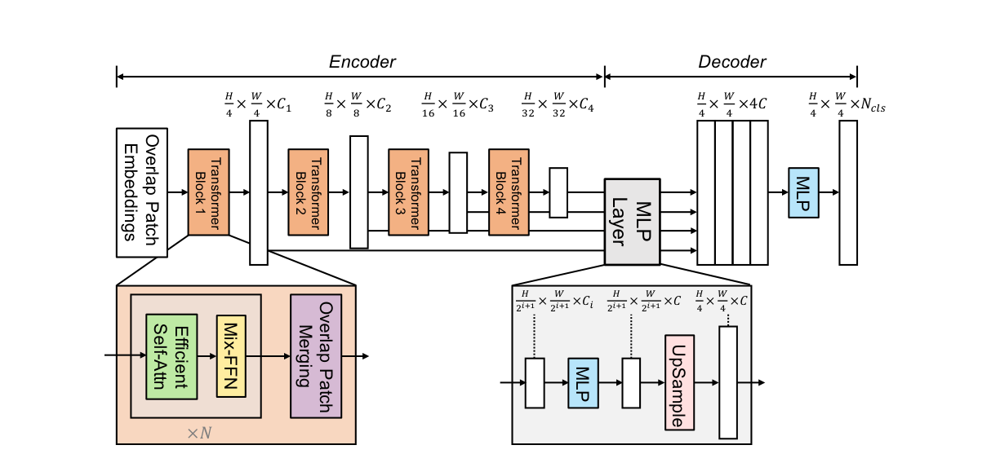

# 43 SegFormer

> 定位：**Transformer 语义分割的高效代表**。分层 Transformer 编码器出多尺度特征 + 全 MLP 极简解码器——编码器足够强，解码器就能极简，做到又快又准。
> 作者：Xie 等（HKU / NVIDIA），*SegFormer: Simple and Efficient Design for Semantic Segmentation with Transformers*，NeurIPS 2021。
> 前置：31 ViT、32 Swin（分层视觉 Transformer）、40 FCN。
> 阅读路线见 图像分割脉络地图。
> **输入 / 输出**：图像 → 每像素类别图（语义分割）

---



> 📥📤 **输入/输出实例**：图过**分层 Transformer 编码器（MiT）**产出 4 个尺度特征（1/4、1/8、1/16、1/32，像 CNN 金字塔）→ **全 MLP 解码器**把 4 个尺度统一通道、上采样对齐、concat 再 MLP 融合 → 每像素分类。

> 📄 **论文原图对照**（图源：Xie et al., *SegFormer*, [arXiv:2105.15203](https://arxiv.org/abs/2105.15203) Figure 2，原文 [PDF](../papers/43_SegFormer_2105.15203.pdf)；仅笔记内学习引用，论文写作须自绘）：



> 无位置编码的分层 Transformer 编码器（四阶段金字塔）+ 超轻 All-MLP 解码器——把"重编码轻解码"做到极致。

## 一、提出背景

ViT 证明 Transformer 能做视觉，但它**单一分辨率、需要位置编码**，直接拿来做分割有短板：分割是**密集预测**、需要**多尺度**特征，且输入分辨率多变（位置编码要插值，麻烦）。SegFormer 针对分割**重新设计** Transformer：**分层出多尺度 + 去掉位置编码 + 高效注意力 + 极简解码器**。

## 二、核心方法 ⭐

### 2.1 分层 Transformer 编码器（MiT，Mix Transformer）
像 Swin/CNN 那样**逐级下采样**（patch merging），产出 **4 个尺度**的特征 → 补上 ViT"单尺度"的短板，密集预测需要的多尺度有了。

### 2.2 三个关键设计
- **无位置编码**：用 **Mix-FFN**（在 FFN 里塞一个 3×3 卷积）来注入位置信息 → **换分辨率时不用插值位置编码**，对分割这种多分辨率场景很友好；
- **高效自注意力（SRA，空间缩减注意力）**：对 K/V 先做空间下采样，降低自注意力的 $O(n^2)$ 开销 → **吃得起高分辨率**输入；
- **全 MLP 解码器**：4 个尺度特征各过一层 MLP 统一通道、上采样到同一分辨率、concat、再 MLP 融合 → 每像素分类。**极简，没有复杂解码结构**。

### 2.3 为什么解码器能这么简单
因为**编码器的多尺度特征已经又全局（自注意力）又分层**，语义和上下文都足够，解码器不必再费力聚合——**把复杂度放在编码器、让解码器极简**，这是 SegFormer 的设计哲学。

## 三、关键结论

- **又快又准**：在多个语义分割基准上，用更少的参数/算力取得比 DeepLab 等更好的精度-效率权衡。
- **一系列规格**：MiT-B0（轻量、实时）到 B5（高精度），按需选。
- **鲁棒**：无位置编码 + 多尺度设计，对分辨率变化、噪声更稳。
- **和 DeepLab 的对比**：都做语义分割，DeepLab 用**空洞卷积 CNN**，SegFormer 用**分层 Transformer** 替代，且解码器更简。

## 四、技术谱系

```
[31 ViT] 单尺度、要位置编码 ──┐
[32 Swin] 分层多尺度 ─────────┼─→ SegFormer：分层Transformer(MiT) + Mix-FFN(无位置码) + SRA + 全MLP解码器
[40 FCN] 密集预测 ────────────┘
        对照：[41 DeepLab]（空洞卷积 CNN 做语义分割）；[44 MaskFormer]（mask 分类范式）
```

## 五、具体实例（走一遍）

**例：SegFormer 分割一张街景**
```
① 图 512×512 → MiT 编码器 → 4 尺度特征 128²/64²/32²/16²
② 每个尺度过 MLP 统一到 C 通道 → 都上采样到 128×128 → concat（4C）
③ 一层 MLP 融合 → 128×128×类别 → 上采样到 512×512 → 每像素 argmax
```
**关键**：②③的解码器只有几层 MLP——简单到"不像分割头"，靠的是①编码器的多尺度全局特征够强。

## 六、参考文献

- Xie E, Wang W, et al. *SegFormer: Simple and Efficient Design for Semantic Segmentation with Transformers.* NeurIPS 2021.
- Dosovitskiy A, et al. *ViT.* ICLR 2021.（对照，见 31）
