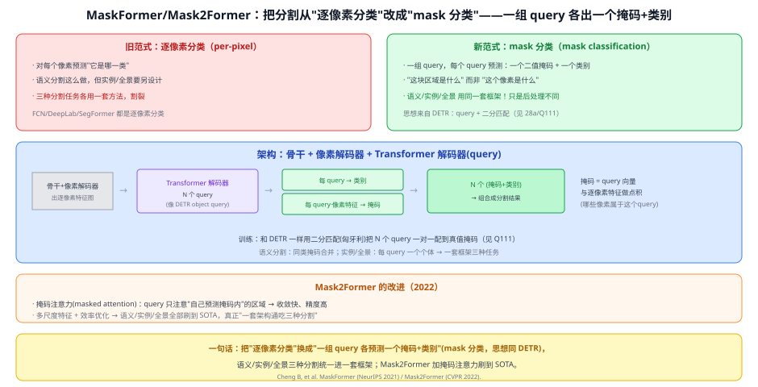
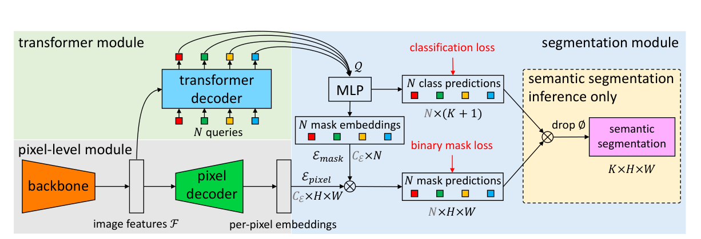
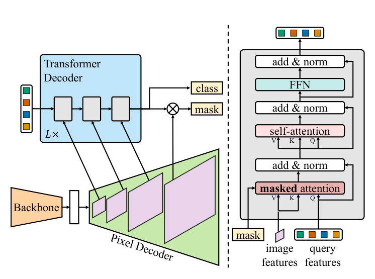

# 44 MaskFormer / Mask2Former（mask 分类统一）

> 定位：**把分割范式统一**——从"逐像素分类"改成"**mask 分类**"（一组 query 各预测一个掩码 + 类别），让语义/实例/全景三种分割用**同一套框架**。思想直接来自 DETR。
> 作者：Cheng 等（FAIR / UIUC），MaskFormer（NeurIPS 2021）、Mask2Former（CVPR 2022）。
> 前置：28a DETR（query + 二分匹配）、Q111 一对一匹配、40 FCN（逐像素分类的对照）。
> 阅读路线见 图像分割脉络地图。
> **输入 / 输出**：图像 → N 个（掩码 + 类别）→ 组合成语义/实例/全景分割

---



> 📥📤 **输入/输出实例**：图过骨干 + 像素解码器得逐像素特征；一组 **N 个 query** 过 Transformer 解码器，每个 query 输出**一个类别** + **一个二值掩码**（query 向量与逐像素特征**点积**得到"哪些像素属于我"）→ N 个"掩码+类别"组合成分割结果。语义/实例/全景只是**后处理不同**。

> 📄 **论文原图对照**（图源：Cheng et al., [arXiv:2107.06278](https://arxiv.org/abs/2107.06278) Figure 2（[PDF](../papers/44_MaskFormer_2107.06278.pdf)）；[arXiv:2112.01527](https://arxiv.org/abs/2112.01527) Figure 2（[PDF](../papers/44_Mask2Former_2112.01527.pdf)）；仅笔记内学习引用，论文写作须自绘）：





> 上=MaskFormer：逐像素分类改成"N 个掩码+各配一个类"的集合预测（DETR 思想进分割）；下=Mask2Former 的掩码注意力只看前景区域。

## 一、提出背景

在此之前，分割是"**逐像素分类**"（per-pixel）：对每个像素预测它属于哪一类。问题：
- 语义分割这么做没问题，但**实例分割、全景分割要另设计**（Mask R-CNN 那套检测再分割）；
- 三种分割任务**各用一套方法，割裂**。

MaskFormer 的洞见：借用 DETR 的"**集合预测**"思想——不逐像素分类，而是让**一组 query 每个预测"一块掩码 + 一个类别"**（回答"这块区域是什么"，而非"这个像素是什么"）。这样**三种分割能统一**。

## 二、核心方法 ⭐

### 2.1 mask 分类（mask classification）
- **一组 N 个 query**（像 DETR object query），每个 query 输出：
  - **一个类别**（含"无物体"∅）；
  - **一个二值掩码**：用 query 向量与**逐像素特征图做点积** → 每个像素的分数 → "哪些像素属于这个 query"。
- **组合**：N 个"掩码 + 类别"叠起来就是分割结果。

### 2.2 三种分割一套框架
- **语义分割**：把同类别的 query 掩码合并；
- **实例分割**：每个 query 对应一个个体；
- **全景分割**：前景 query 按个体、背景 query 按类别。
→ **只改后处理，不改架构**。这就是"统一"。

### 2.3 训练：二分匹配（同 DETR）
和 DETR 一样，用**匈牙利二分匹配**把 N 个 query 预测**一对一**配到真值掩码，再算分类损失 + 掩码损失（Q111 的"一对一"在这里同样是核心）。

### 2.4 Mask2Former 的改进（2022）
- **掩码注意力（masked attention）**：query 在交叉注意力时**只注意"自己当前预测掩码内"的区域**，而非全图 → 收敛更快、精度更高；
- 加多尺度特征 + 效率优化 → 语义/实例/全景**全部刷到 SOTA**，真正"一套架构通吃三种分割"。

## 三、关键结论

- **范式统一**：mask 分类把长期割裂的语义/实例/全景分割收进一个框架，是分割领域的重要范式转变。
- **DETR 思想的迁移**：query + 二分匹配从检测搬到分割，效果拔群——说明"集合预测"是通用的。
- **Mask2Former** 成为通用分割强基线；也为后续"可提示通用分割"（SAM）铺路。

## 四、技术谱系

```
[28a DETR] query + 二分匹配（集合预测）──┐
[40 FCN] 逐像素分类（对照）─────────────┼─→ MaskFormer：mask 分类，统一三种分割
                                        │        └─→ Mask2Former：+掩码注意力 → SOTA
逐像素特征(像素解码器) ──(与query点积)──┘        后续：[36 SAM] 可提示通用分割
```

## 五、具体实例（走一遍）

**例：一张图同时做全景分割**
```
① 图 → 骨干+像素解码器 → 逐像素特征 F
② N=100 个 query → Transformer 解码器 → 每个 query 出：类别 + 掩码(= query·F 点积)
   query1 → "road" + 路面掩码
   query2 → "car" + 车1掩码
   query3 → "car" + 车2掩码
   ... 其余 → ∅
③ 组合：背景(road/sky)按类、前景(car1/car2)按个体 → 全景分割图
```
**关键**：②里"每个 query 一块掩码 + 类别"就是 mask 分类；换个后处理（合并同类 or 保留个体）就切换语义/实例/全景。

## 六、参考文献

- Cheng B, Schwing A, Kirillov A. *Per-Pixel Classification is Not All You Need for Semantic Segmentation (MaskFormer).* NeurIPS 2021.
- Cheng B, et al. *Masked-attention Mask Transformer for Universal Image Segmentation (Mask2Former).* CVPR 2022.
- Carion N, et al. *DETR.* ECCV 2020.（query + 二分匹配来源，见 28a）
