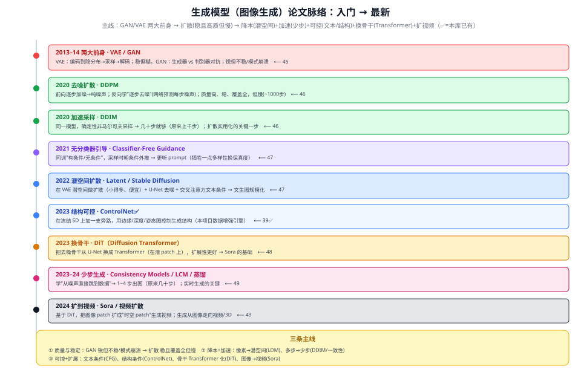

# 图像生成模型论文脉络地图

> 本文是图像生成方向的**阅读路线图**：把代表作按"入门 → 最新"串成一条线，标出本库**已有 doc**（✅）和**待补**。
> 配合各单篇阅读；单篇是"站点深读"，本文是"线路总览"。
> 说明：本项目的 39 扩散模型 是"面向项目的概览 + ControlNet 数据增强"；本线的单篇是"纯机制深读"，互补。

---

## 一、三条贯穿主线

1. **质量与稳定**：GAN 样本锐利但训练不稳、易模式崩溃 → **扩散**又稳、覆盖全、质量高，但慢。
2. **降本 + 加速**：像素空间 → **潜空间**（LDM，便宜）；多步（~1000）→ 少步（DDIM 几十步、**一致性模型** 1~4 步）。
3. **可控 + 扩展**：文本条件（**CFG**）、结构条件（**ControlNet**）、去噪骨干 U-Net → **Transformer（DiT）**、图像 → **视频（Sora）**。

## 二、分阶段脉络（代表作 + 状态）

| 阶段 | 时期 | 代表作 | 一句话 | 本库 |
|---|---|---|---|---|
| **两大前身** | 2013–14 | VAE、GAN | VAE 稳但糊；GAN 锐但不稳 | 45 |
| **去噪扩散** | 2020 | DDPM | 加噪→学去噪，质量高、稳、但慢 | 46 |
| **加速采样** | 2020 | DDIM | 确定性采样，几十步替代上千步 | 46 |
| **文本条件** | 2021 | Classifier-Free Guidance | 朝条件外推，更听 prompt | 47 |
| **潜空间扩散** | 2022 | Latent / Stable Diffusion | 潜空间做扩散 + 交叉注意力文本条件 | 47 |
| **结构可控** | 2023 | ControlNet | 旁路控制生成结构 | 39 ✅ |
| **换骨干** | 2023 | DiT | 去噪骨干 U-Net → Transformer | 48 |
| **少步生成** | 2023–24 | Consistency / LCM | 1~4 步出图，实时生成 | 49 |
| **扩到视频** | 2024 | Sora / 视频扩散 | DiT + 时空 patch 生成视频 | 49 |

## 三、推荐阅读顺序

**入门线**：VAE/GAN（懂两大前身的优缺点）→ DDPM 与 DDIM（扩散的核心机制 + 加速）→ Latent/Stable Diffusion（潜空间 + 文本条件，文生图落地）。

**进阶线**：ControlNet（结构可控）→ DiT（Transformer 骨干）→ 一致性模型与加速（少步 + 视频）。

## 四、一句话记住每一步"解决了什么"

- **VAE**：给生成一个规整的隐空间（稳，但样本糊）。
- **GAN**：对抗训练出锐利样本（但训练不稳、易崩溃）。
- **DDPM**：把生成拆成"逐步去噪"，稳定又高质——但要上千步，慢。
- **DDIM**：同一模型，几十步就能采样——扩散实用化。
- **CFG**：让生成更听 prompt（保真度换多样性）。
- **Latent/Stable Diffusion**：在小的潜空间做扩散，文生图规模化落地。
- **ControlNet**：用边缘/深度/姿态图精确控制生成结构。
- **DiT**：把去噪骨干换成 Transformer，扩展性更好（Sora 的基础）。
- **一致性模型**：1~4 步出图，逼近实时。
