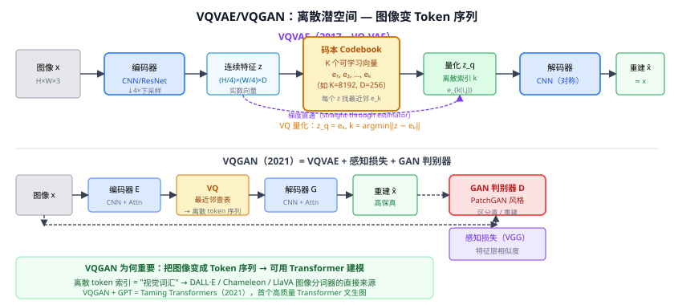

# 44b VQVAE / VQGAN（向量量化图像分词器）

> 定位：将连续图像特征**量化为离散 token**（通过码本最近邻），使图像能像文本一样用整数索引序列表示——DiT、DALL·E、LLaVA 等现代多模态模型的"图像分词器"直接基于此。
> VQVAE — van den Oord et al.，DeepMind，NeurIPS 2017；VQGAN — Esser et al.，Heidelberg，CVPR 2021（Taming Transformers）。
> 效果：VQGAN + GPT-2 在 ImageNet 256×256 上生成 IS=314，FID=15.78，质量显著超过 VQVAE。
> **输入 / 输出**：图像 → 离散 token 序列（整数索引）；解码器从 token 重建图像

---



## 一、提出背景

45 VAE/GAN 的连续潜空间（$z \in \mathbb{R}^D$）难以与**自回归语言模型**（GPT）直接结合——GPT 预测的是离散 token。

VQVAE 的想法：把 VAE 的连续潜变量**量化为码本索引**，每个空间位置的特征向量被替换为码本里最相似的条目——图像变成"视觉词汇的序列"，从而可以用 Transformer 自回归建模。

---

## 二、VQVAE：向量量化变分自编码器

### 2.1 编码器 → 量化 → 解码器

```
输入图像 x (H×W×3)
  ↓ 编码器 E（CNN）
连续特征 z ∈ R^{(H/f)×(W/f)×D}  （f=下采样倍率）
  ↓ 向量量化 VQ
量化特征 z_q：每个位置 z(i,j) 替换为码本中最近邻 e_k
  z_q(i,j) = e_k,  k = argmin_j ‖z(i,j) − e_j‖₂
  ↓ 解码器 G（CNN 对称）
重建图像 x̂ (H×W×3)
```

输出结果是一个 $(H/f) \times (W/f)$ 的整数矩阵，每个整数是码本索引 $k \in \{0, \dots, K-1\}$。

### 2.2 量化的梯度问题（Straight-Through Estimator）

量化操作（argmin）不可微。VQVAE 用**直通估计器**：

- 前向：$z_q = \text{quantize}(z)$（离散）
- 反向：梯度直接从 $z_q$ 传到 $z$，跳过量化步骤（$\partial z_q / \partial z \approx 1$）

码本向量用 EMA 或承诺损失（commitment loss）更新：

$$\mathcal{L} = \underbrace{\|x - \hat{x}\|_2^2}_{\text{重建}} + \underbrace{\|\text{sg}[z] - e\|_2^2}_{\text{码本更新}} + \underbrace{\beta\|z - \text{sg}[e]\|_2^2}_{\text{承诺损失}}$$

### 2.3 VQVAE 的局限

- 解码质量有限（像素损失 → 模糊）；
- 码本利用率低（许多码本向量从未被用到）。

---

## 三、VQGAN：VQVAE + GAN + 感知损失

### 3.1 改进：引入判别器 + 感知损失

VQGAN（论文名"Taming Transformers"）将 VQVAE 的损失替换为：

$$\mathcal{L}_{VQGAN} = \mathcal{L}_{VQ}(E, G, Z) + \lambda \cdot \mathcal{L}_{GAN}(E, G, D)$$

- $\mathcal{L}_{VQ}$：重建 + 承诺损失（同 VQVAE）+ VGG **感知损失**（特征层相似度，而非像素 L2）
- $\mathcal{L}_{GAN}$：PatchGAN 判别器（判断局部 patch 真假）
- $\lambda$ 自适应平衡重建质量和 GAN 对抗强度

结果：重建图像锐利、细节丰富，极大超过 VQVAE。

### 3.2 VQGAN → GPT（Taming Transformers）

离散 token 序列展平为一维：$N = (H/f)^2$ 个整数（对 256×256 图像，$f=16$，$N = 256$）。

用 **GPT 自回归**在 token 序列上建模先验 $p(s_1, \dots, s_N) = \prod_i p(s_i | s_{<i})$：可以无条件生成（采样序列 → VQGAN 解码 → 图像），也可以类条件/文本条件生成。

---

## 四、历史地位与影响

| 模型 | 与 VQ 的关系 |
|------|-------------|
| **DALL·E**（2021，OpenAI）| dVAE（近似 VQVAE）编码图像 → Transformer 联合建模文本+图像 token |
| **MaskGIT**（2022，Google）| VQVAE + masked Transformer（非自回归） |
| **LLaVA / InternVL**（37） | 图像分词：ViT patch features 或 VQGAN token → LLM |
| **Chameleon**（37a）| 图像 → VQGAN tokens → 与文字混排做因果 LM |
| **DiT**（48）| 在 VQGAN 潜空间里做扩散（latent diffusion） |
| **Stable Diffusion**（47）| 同 DiT，VAE 编码的连续潜空间（SD）或 VQ 离散潜（SD-XL） |

**一句话**：VQGAN 发明了"把图像变成 token 序列"这件事，这是现代多模态大模型的基础设施之一。

---

## 五、与本项目的关系

- **数据增强辅助**：本项目用 ControlNet（39 扩散模型）生成合成路面图像；ControlNet 的底层 SD 使用 VAE 潜空间，与 VQGAN 同源（连续 vs 离散潜空间的区别）。
- **论文写作**：第二章生成模型一节，生成脉络"VAE/GAN → VQVAE → DDPM → LDM → ControlNet"，VQVAE 是其中不可跳过的节点（图像离散化的起点）。
- **大模型背景**：理解 VQGAN 才能理解 LLaVA/InternVL 等把图像"变成 token"的设计动机——这与本项目 CLIP 零样本识别模块的理解有间接关联（都在讨论"图像如何被语言模型处理"）。
- 不在实验中使用；作相关工作引用。

---

## 参考文献

- van den Oord A, Vinyals O, Kavukcuoglu K. *Neural Discrete Representation Learning (VQVAE).* NeurIPS 2017.
- Esser P, Rombach R, Ommer B. *Taming Transformers for High-Resolution Image Synthesis (VQGAN).* CVPR 2021.
- Ramesh A, et al. *Zero-Shot Text-to-Image Generation (DALL·E).* ICML 2021.
