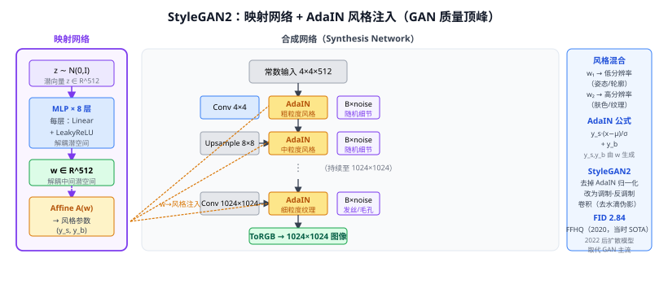

# 44c StyleGAN / StyleGAN2（风格生成对抗网络）

> 定位：基于 **Progressive Growing GAN** 的重大改进，引入**映射网络（Mapping Network）+ 自适应实例归一化（AdaIN）+ 风格注入**，使生成器在不同尺度上解耦风格（粗粒度到细粒度），实现对人脸等复杂分布的高质量生成，GAN 质量的顶峰代表。
> 作者：Karras et al.，CVPR 2019（StyleGAN）/ CVPR 2020（StyleGAN2），NVIDIA。
> 效果：StyleGAN2 FFHQ FID 2.84（当时 SOTA）；StyleGAN-XL 2022 在 ImageNet FID 2.30。
> **输入 / 输出**：潜空间噪声 $z \sim \mathcal{N}(0,I)$ → 高质量合成图像（1024×1024）

---



## 一、提出背景

传统 GAN（DCGAN、ProGAN）将随机噪声 $z$ 直接输入生成器，存在：
1. 潜空间**纠缠（entangled）**：$z$ 的单个维度同时影响多个高层属性（如改变发色同时影响性别）；
2. 生成器**特征控制权**弱：无法独立控制高频细节 vs 低频全局结构；
3. **插值不平滑**：$z$ 空间的线性插值往往产生不自然的图像变化。

StyleGAN 的目标是**解耦潜空间**，让每个维度只控制一种独立属性。

---

## 二、映射网络（Mapping Network）

原始噪声 $z \in \mathbb{R}^{512}$ 不直接用，而是先过 **8 层 MLP**（映射网络）变换为中间潜空间 $w \in \mathbb{R}^{512}$：

$$w = f(z) = \text{MLP}_8(z)$$

**$w$ 空间的好处**：映射网络可以学习一种"展平"变换，使 $w$ 空间更解耦（实验上验证 $w$ 的不同维度对应更独立的视觉属性）。

---

## 三、风格注入（Style Injection via AdaIN）

### 3.1 合成网络（Synthesis Network）

生成器不再从 $z$ 生成，而是**从固定的常数（learned constant）$4 \times 4 \times 512$ 开始**，逐步上采样到目标分辨率，每个分辨率级别通过 **AdaIN** 注入风格：

```
Const 4×4
  → Conv → AdaIN(w)                      # 风格注入（控制粗粒度结构）
  → Upsample → Conv → AdaIN(w)          # 8×8
  → ...（逐渐上采样）
  → Conv → AdaIN(w) + Noise              # 1024×1024（细粒度纹理）
  → ToRGB
```

### 3.2 AdaIN（自适应实例归一化）

$$\text{AdaIN}(x_i, y) = y_{s,i} \cdot \frac{x_i - \mu(x_i)}{\sigma(x_i)} + y_{b,i}$$

- $x_i$：第 $i$ 个特征图通道（先 InstanceNorm 归一化）
- $y_{s,i}, y_{b,i}$：由 $w$ 通过仿射变换（Affine）生成的缩放/偏移系数
- 每一层的 AdaIN 接受独立的 $w$ 来的仿射变换

**含义**：风格 $w$ 控制每个分辨率层特征图的统计量（均值和方差），不同层的风格控制不同粒度：
- 粗粒度（4-8px 层）：姿态、面部轮廓、发型
- 中粒度（16-32px 层）：五官形状、眼睛颜色
- 细粒度（64-1024px 层）：皮肤纹理、发丝细节

### 3.3 随机噪声（Stochastic Variation）

在每层卷积后加一个**可学习缩放的随机高斯噪声**（B 系数 × 随机 noise），控制不影响风格的随机细节（如发丝的随机分布、皮肤毛孔的位置），不影响潜空间解耦。

---

## 四、StyleGAN2 的改进

StyleGAN 存在**水滴伪影（blob artifacts）**，来自 InstanceNorm 计算均值时引入的位置信息泄漏。StyleGAN2 的主要修正：

1. **去掉 AdaIN 中的 InstanceNorm**：改为**调制-反调制（Modulation-Demodulation）卷积**：
   $$w'_{ijk} = s_i \cdot w_{ijk} / \sqrt{\sum_{i,k}(s_i w_{ijk})^2 + \epsilon}$$
   调制（按 $s$ 缩放滤波器权重）+ 反调制（归一化消除尺度影响），既保留风格注入又避免归一化引入的统计伪影。

2. **重新参数化路径长度正则化（Path Length Regularization）**：鼓励 $w$ 到像素空间的映射在各处等长，使潜空间线性插值对应平滑的图像变化。

3. **去掉渐进式生长（Progressive Growing）**：改用 skip 连接（类似 ResNet，特征直接加到 ToRGB 分支），训练更稳定。

---

## 五、风格混合（Style Mixing）

训练时随机选择两个 $w$，在某一层切换：

```
w₁ 控制第 1-8 层（粗粒度，决定脸型）
w₂ 控制第 9-18 层（细粒度，决定肤色纹理）
```

生成的图像将 A 的整体结构与 B 的细节纹理混合。这是 StyleGAN **解耦能力**的直观验证，也让它天然适合图像编辑任务（发色换颜色、皮肤纹理替换等）。

---

## 六、GAN 的局限与扩散模型的替代

| 维度 | StyleGAN2 | 扩散模型（DDPM/SD）|
|------|-----------|------------------|
| FID（图像质量） | 2.84（FFHQ） | 更低（条件下）|
| 训练稳定性 | 需要精细调参 | 相对稳定 |
| 模式多样性 | 存在 mode dropping | 更好 |
| 图像编辑能力 | 潜空间线性操作 | DDIM inversion + 文本引导 |
| 文字条件 | 弱（需后处理） | 强（文生图直接支持）|
| 训练数据需求 | 相对少 | 需要大量（SD 用 5B 对）|

2022 年后，扩散模型（44a DDPM）的兴起使 GAN 退出了主流文生图赛道，但 StyleGAN 的解耦思想仍影响 ControlNet、LCM 等条件生成工作。

---

## 七、与本项目的关系

- **数据增强**（辅助实验）：当前数据中稀缺类为 GL/RU/ST；但 GL/RU 是零样本留出类，若把其合成样本用于 YOLO 训练会破坏零样本协议。因此主检测器增强优先研究 ST，GL/RU 合成数据只能用于独立实验或训练集外的定性展示。
- **相关工作背景**：第二章"图像生成模型"小节，介绍 GAN → StyleGAN → 扩散模型的演进，说明本项目选扩散模型（ControlNet）而非 GAN 生成合成数据的原因（多样性更好、无训练稳定性问题）。
- **不直接使用 StyleGAN**：本项目选 ControlNet（可控制边缘图 + 文字描述），StyleGAN 较难控制语义类别。

---

## 参考文献

- Karras T, Laine S, Aila T. *A Style-Based Generator Architecture for Generative Adversarial Networks.* CVPR 2019.
- Karras T, et al. *Analyzing and Improving the Image Quality of StyleGAN.* CVPR 2020.（StyleGAN2）
- Shen Y, et al. *Interpreting the Latent Space of GANs for Semantic Face Editing.* CVPR 2020.（StyleGAN 潜空间编辑）
