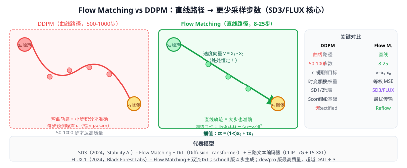

# 44d Flow Matching / Rectified Flow（流匹配 / 整流流）

> 定位：扩散模型的**理论简化与训练加速**范式，直接学习从噪声到图像的**直线传输路径**，比 DDPM 的曲折采样路径更高效，是 **Stable Diffusion 3（SD3）**、**FLUX.1**、**Imagen 3** 的核心技术。
> 作者：Flow Matching — Lipman et al.，ICLR 2023（Meta AI）；Rectified Flow — Liu et al.，ICLR 2023（Peking University / UT Austin）。
> 效果：SD3 用 Flow Matching 取代 DDPM，同样生成质量下步数减少 4-10×；FLUX.1 系列成为 2024 年最强开源文生图模型。
> **输入 / 输出**：高斯噪声 $z_0 \sim \mathcal{N}(0,I)$ → 通过 ODE 流迭代 → 图像 $z_1$

---



## 一、背景：DDPM 的哪里慢？

DDPM（44a）将图像生成定义为**逆向去噪过程**，需要 500-1000 步采样（DDIM 优化后仍需 50-100 步）。慢的根本原因：

- 正向过程（加噪）路径是**曲线**（每步只加一点点噪声，SDE 轨迹弯曲）；
- 网络需要学习弯曲路径在每一点的切线方向（score function）；
- 弯曲路径 → 需要更多小步才能准确积分。

**Flow Matching 的洞察**：如果正向路径是**直线**（高斯噪声和数据样本之间直接线性插值），网络只需学习一个常数方向向量场，理论上**1 步就能生成**（实践中 8-25 步已达高质量）。

---

## 二、Flow Matching 基础

### 2.1 概率流 ODE（Probability Flow ODE）

扩散模型和 Flow Matching 都可以用一个 ODE 描述生成过程：

$$\frac{dz}{dt} = v_\theta(z, t), \quad t: 0 \to 1$$

- $z_0 \sim \mathcal{N}(0, I)$（噪声端）
- $z_1 \sim p_{\text{data}}$（数据端）
- $v_\theta(z, t)$：网络预测的"速度场"（velocity field）

DDPM 的 score 函数实际上也对应一个 ODE（DDIM），区别在于如何设计路径。

### 2.2 目标：直线路径（Straight Paths）

给定真实数据样本 $x_1$ 和噪声 $x_0 \sim \mathcal{N}(0, I)$，定义**线性插值路径**：

$$z_t = (1-t) x_0 + t x_1, \quad t \in [0, 1]$$

这条路径上的速度向量处处为常数：

$$\frac{dz_t}{dt} = x_1 - x_0$$

因此**Flow Matching 的训练目标**（最小化条件流匹配损失 CFML）：

$$\mathcal{L}_{FM} = \mathbb{E}_{t, x_0, x_1} \left\|v_\theta(z_t, t) - (x_1 - x_0)\right\|^2$$

网络学习"从当前位置 $z_t$ 直接指向目标 $x_1$"的速度向量。

---

## 三、Rectified Flow（整流流）

Liu et al. 的 **Rectified Flow** 是 Flow Matching 的一个特例，有独特的**二次整流（Reflow）**机制：

### 3.1 基本训练

与 Flow Matching 相同：在 $z_t = (1-t)x_0 + tx_1$ 上训练，使速度场尽量平直。

### 3.2 Reflow（二次整流）

训练后的模型生成的轨迹已经接近直线，但仍有小弯曲。**Reflow** 步骤：

1. 用训练好的模型，从大量 $x_0$ 生成对应的 $x_1'$（不一定是原始数据对，但已经是配对的）；
2. 用新的 $(x_0, x_1')$ 配对重新训练一个 Flow Matching 模型；
3. 重复此过程（Reflow $k$ 次）→ 轨迹越来越直。

极限情况：1-Rectified Flow 就能 **1 步生成**高质量图像（类似 Consistency Models 的目标）。

---

## 四、Flow Matching vs DDPM 对比

| 维度 | DDPM | Flow Matching |
|------|------|--------------|
| 路径形状 | 曲线（SDE/ODE 轨迹） | **直线（线性插值）** |
| 每步预测目标 | 噪声 $\epsilon$ 或 $v$-参数化 | **速度向量** $x_1 - x_0$ |
| 采样步数（高质量） | 50-1000 步 | **8-25 步** |
| 训练损失 | 各时间步加权 MSE | **简单 MSE（各 t 等权）** |
| 理论解释 | Score matching | **最优传输** |
| 代表模型 | DALL·E 2, SD 1.x/2.x | **SD3, FLUX.1, Imagen3** |

---

## 五、在 Stable Diffusion 3 中的应用

SD3（2024，Stability AI + Stochastic Parrots）完全从 DDPM 切换到 Flow Matching：

```
SD1/2 架构：
  U-Net + DDPM 噪声预测 + CLIP 文本编码

SD3 架构：
  多模态 DiT (Diffusion Transformer)
  + Flow Matching 速度场预测
  + 三路文本编码（CLIP-L, CLIP-G, T5-XXL）
  + 潜空间 16-channel VAE
```

关键改进：
- 用 **DiT（Diffusion Transformer）** 替换 U-Net（全 Transformer 骨干）；
- 文字和图像 token 对称处理（双流 Transformer），使文字理解显著提升；
- Flow Matching 让 SD3 在 7-12 步采样时即达到 SD2.1 的 50 步质量。

---

## 六、FLUX.1（2024，Black Forest Labs）

前 Stability AI 团队出走成立 Black Forest Labs，发布 FLUX.1：

| 版本 | 描述 | 用途 |
|------|------|------|
| FLUX.1-pro | 最强版，API 付费 | 商用 |
| FLUX.1-dev | 中等，开放权重 | 研究 |
| FLUX.1-schnell | 最快，4 步生成 | 实时预览 |

FLUX.1 基于 Flow Matching + 改进 DiT，在人像/文字渲染上超越 DALL·E 3 和 Midjourney v6。

---

## 七、与本项目的关系

- **ControlNet 数据增强**（辅助实验）：当前稀缺类为 GL/RU/ST，但 GL/RU 需保持零样本留出，主检测器不能使用其合成训练样本；可优先研究 ST，或把 GL/RU 合成仅作为独立扩展实验。未来迁移到基于 Flow Matching 的模型能否提高质量，仍需实证，不能预设一定提升。
- **相关工作背景**：第二章"生成模型"小节的演进：GAN → DDPM → Flow Matching（更快采样，更直的轨迹），说明选 ControlNet/SDXL 而非自研生成模型的合理性。
- **不在当前实验中使用**：本项目直接用预训练 ControlNet，不涉及训练扩散模型本身。

---

## 参考文献

- Lipman Y, et al. *Flow Matching for Generative Modeling.* ICLR 2023.
- Liu X, et al. *Flow Straight and Fast: Learning to Generate and Transfer Data with Rectified Flow.* ICLR 2023.
- Esser P, et al. *Scaling Rectified Flow Transformers for High-Resolution Image Synthesis (SD3).* ICML 2024.
- Black Forest Labs. *FLUX.1 Technical Report.* 2024.
