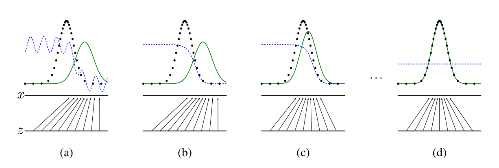

# 45 VAE / GAN（生成模型的两大前身）

> 定位：**扩散之前**的两条主流生成路线。VAE（稳、隐空间规整、但样本糊）与 GAN（锐、逼真、但训练不稳/模式崩溃）。理解它俩的优缺点，才懂扩散为何后来居上，以及 VAE 的隐空间为何被 Latent Diffusion 复用。
> 作者：VAE（Kingma & Welling, 2013）、GAN（Goodfellow 等, 2014）。
> 前置：01 感知机与反向传播、04 CNN 原理。
> 阅读路线见 图像生成脉络地图。
> **输入 / 输出**：随机噪声 / 隐向量 → 生成图像

---


> 📥📤 **输入/输出实例**：VAE——图过编码器得隐分布 (μ,σ)，采样隐向量→解码器重建；生成时从先验 N(0,I) 采样→解码。GAN——生成器把噪声变假图，判别器判"真/假"，两者对抗；生成时喂噪声给生成器出图。

> 📄 **论文原图对照**（图源：Goodfellow et al., *Generative Adversarial Nets*, [arXiv:1406.2661](https://arxiv.org/abs/1406.2661) Figure 1，原文 [PDF](../papers/45_GAN_1406.2661.pdf)（VAE 原文 [PDF](../papers/45_VAE_1312.6114.pdf) 以公式为主无架构图）；仅笔记内学习引用，论文写作须自绘）：



> GAN 训练动态 (a)→(d)：判别器 D（蓝虚线）与生成器 G（绿实线）对抗，直到 G 的分布盖住真实分布（黑点）、D 处处输出 1/2。

## 一、提出背景

深度生成模型要回答："怎么让网络**造出**逼真的新样本"？2013–14 年出现两条经典路线，各有哲学：
- **VAE**：给数据学一个规整的**隐空间**，从隐空间采样再解码；
- **GAN**：让两个网络**对抗**，逼着生成器造出以假乱真的样本。

## 二、VAE（变分自编码器）

### 2.1 机制
- **编码器**：图 → 隐**分布**的参数 (μ, σ)（不是一个点，是一个高斯）；
- **采样（重参数化技巧）**：从 (μ, σ) 采一个隐向量 z（用 z = μ + σ·ε 让梯度可回传）；
- **解码器**：z → 重建图。
- **损失** = **重建误差**（重建得像不像）+ **KL 散度**（让隐分布靠近先验 N(0,I)，隐空间才规整）。
- **生成**：直接从 N(0,I) 采 z → 解码 → 新图。

### 2.2 优缺点
- ✅ **训练稳、隐空间规整**（能平滑插值、有结构）；
- ❌ **样本偏糊**：重建 + KL 的目标倾向"求平均"，细节不够锐。
- 影响：**隐空间思想被 Latent Diffusion 复用**（在 VAE 潜空间里做扩散）。

## 三、GAN（生成对抗网络）

### 3.1 机制
- **生成器 G**：噪声 → 假图；
- **判别器 D**：判断输入是真图还是 G 造的假图；
- **对抗（minimax 博弈）**：G 想骗过 D，D 想识破 G → G 越练越像真、D 越练越会挑刺，**共同进步**。

### 3.2 优缺点
- ✅ **样本锐利、逼真**（StyleGAN 等一度是人脸生成天花板）；
- ❌ **训练不稳**（G/D 容易失衡）、**模式崩溃**（G 只生成少数几种样子、丢多样性）。
- 变体：DCGAN（卷积化）、StyleGAN（风格控制）、CycleGAN（无配对翻译）等。

## 四、对比 + 为什么扩散后来居上

| | VAE | GAN | 扩散（46） |
|---|---|---|---|
| 训练稳定性 | 稳 | 不稳、易崩溃 | **稳** |
| 样本质量 | 糊 | 锐 | **锐** |
| 多样性/覆盖 | 全 | 易漏（模式崩溃） | **全** |
| 采样速度 | 快 | 快 | 慢（要多步，靠 DDIM/一致性加速） |

**扩散兼得"稳 + 高质 + 覆盖全"**，只在"慢"上吃亏——而这被 DDIM、一致性模型逐步解决。于是 2020 年后扩散取代 GAN 成为图像生成主流。

## 五、技术谱系

```
VAE（隐空间、稳、糊）──┐
                      ├─→ 扩散（DDPM,2020）兼得稳+高质+覆盖 → 取代 GAN 成主流
GAN（对抗、锐、不稳）──┘
   VAE 的隐空间 ──→ [47 Latent/Stable Diffusion]（在潜空间做扩散）
```

## 六、具体实例（对比走一遍）

**例：同样"生成一张人脸"**
```
VAE：N(0,I) 采 z → 解码器 → 人脸（结构对但偏糊）
GAN：噪声 → 生成器 → 人脸（很锐，但可能反复生成相似的几张=模式崩溃）
扩散：噪声 → 逐步去噪 → 人脸（又锐又多样，但要很多步，见 46）
```

## 七、参考文献

- Kingma D P, Welling M. *Auto-Encoding Variational Bayes (VAE).* ICLR 2014.
- Goodfellow I, et al. *Generative Adversarial Networks.* NeurIPS 2014.
- Ho J, et al. *Denoising Diffusion Probabilistic Models.* NeurIPS 2020.（后继主流，见 46）
