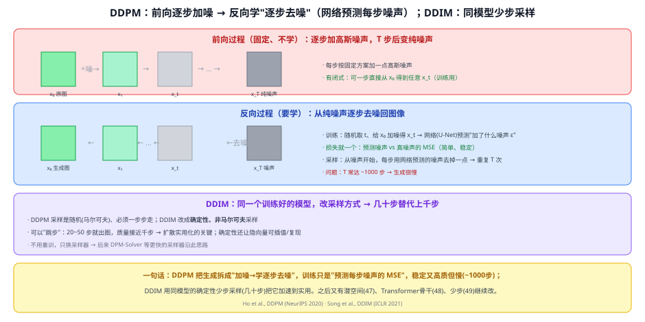
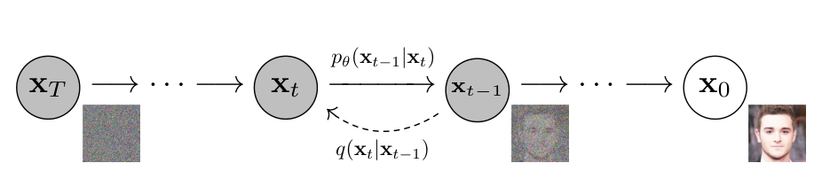
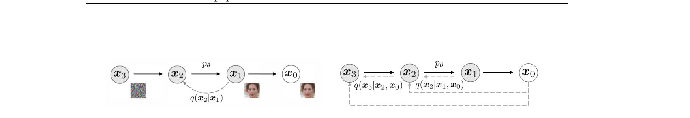

# 46 DDPM 与 DDIM（去噪扩散基础 + 加速采样）

> 定位：**扩散模型的核心机制**。DDPM 把生成拆成"加噪 → 学逐步去噪"，训练只是"预测每步噪声的 MSE"，稳定又高质但慢；DDIM 用同一模型的确定性少步采样把它加速到实用。
> 作者：DDPM（Ho 等, NeurIPS 2020）、DDIM（Song 等, ICLR 2021）。
> 前置：45 VAE/GAN（前身对照）、38 U-Net（去噪骨干）。
> 补充：39 扩散模型 是"面向项目的概览 + ControlNet"，本篇是机制深读。
> 阅读路线见 图像生成脉络地图。
> **输入 / 输出**：随机噪声 → 逐步去噪 → 生成图像

---



> 📥📤 **输入/输出实例**：训练时——给原图 x₀ 加噪得 x_t，网络（U-Net）预测"加了什么噪声 ε"，MSE 损失。生成时——从纯噪声 x_T 开始，每步用网络预测的噪声去掉一点，重复 → 出图。DDIM 则用更少的步（几十步）走完。

> 📄 **论文原图对照**（图源：Ho et al., [arXiv:2006.11239](https://arxiv.org/abs/2006.11239) Figure 2（[PDF](../papers/46_DDPM_2006.11239.pdf)）；Song et al., [arXiv:2010.02502](https://arxiv.org/abs/2010.02502) Figure 1（[PDF](../papers/46_DDIM_2010.02502.pdf)）；仅笔记内学习引用，论文写作须自绘）：





> 上=DDPM 扩散图模型：前向 q 逐步加噪、反向 p_θ 学去噪；下=DDIM 非马尔可夫化——同一训练目标下跳步采样加速。

## 一、核心思想：把"生成"拆成"逐步去噪"

直接从噪声一步造出清晰图很难。DDPM 的巧思：**分解成很多小步**。
- **前向过程（固定、不用学）**：给一张真图**逐步加高斯噪声**，T 步之后变成纯噪声。这一步有闭式解——**可以一步直接从 x₀ 得到任意 x_t**（训练时很方便）。
- **反向过程（要学）**：训练一个网络**逐步去噪**，从纯噪声一点点还原成图。

## 二、DDPM 怎么训练与采样

### 2.1 训练（简单到只有一个 MSE）
1. 取一张图 x₀、随机取一个步数 t、采一份噪声 ε；
2. 用闭式一步得到加噪图 x_t；
3. 网络（U-Net，输入 x_t 和 t）**预测这份噪声 ε**；
4. 损失 = **预测噪声 vs 真噪声的 MSE**。

> 关键：目标不是"直接预测图"，而是"预测被加的噪声"——这个目标简单、稳定，是 DDPM 又稳又好训的原因。

### 2.2 采样（生成）
从纯噪声 x_T 开始，**每步**用网络预测的噪声**去掉一点点**、得到 x_{t-1}，重复 T 次 → x₀ 生成图。

### 2.3 优缺点
- ✅ **质量高、训练稳、覆盖全**（不像 GAN 模式崩溃）；
- ❌ **慢**：T 常达 **~1000 步**，每步一次网络前向 → 生成一张图要上千次前向。

## 三、DDIM：同模型，少步采样

DDPM 的采样是**随机的（马尔可夫）**、必须一步步走。**DDIM** 把采样改成**确定性、非马尔可夫**：
- **可以"跳步"**：用 **20~50 步**就出图，质量接近千步 → **扩散实用化的关键一步**；
- **确定性**还带来好处：同一噪声→同一张图（可复现），隐向量可插值；
- **不用重训**，只换采样器 → 后续 **DPM-Solver** 等更快采样器沿此思路。

## 四、关键结论

- **"预测噪声 + 逐步去噪"**成为图像生成的主流范式，质量与稳定性超过 GAN。
- **DDIM 解决"慢"**：从上千步降到几十步，让扩散能落地。
- **后续在此之上继续改**：潜空间降本（Latent/Stable Diffusion）、换 Transformer 骨干（DiT）、少步生成（一致性模型）。

## 五、技术谱系

```
[45 VAE/GAN] 前身 ──→ DDPM（加噪→学逐步去噪，预测噪声MSE）
                         │ 慢(~1000步)
                         ├─→ DDIM（确定性少步采样，几十步）→ DPM-Solver…
                         ├─→ [47 Latent/Stable Diffusion]（潜空间降本+文本条件）
                         ├─→ [48 DiT]（U-Net→Transformer骨干）
                         └─→ [49 一致性模型]（1~4步）
   去噪骨干：[38 U-Net]
```

## 六、具体实例（走一遍）

**例：DDPM 训练一步**
```
① 取图 x₀，随机 t=300，采噪声 ε
② 闭式一步得 x_300（x₀ 加了 300 步等效的噪声）
③ U-Net(x_300, t=300) → 预测 ε̂
④ 损失 = MSE(ε̂, ε) → 反向传播
```
**例：DDIM 采样**
```
从 x_T 噪声开始，只在 t=1000,980,...,20,0 这 50 个点上去噪（跳步）→ 出图
（DDPM 要走满 1000 步，DDIM 走 50 步质量相近）
```

## 七、参考文献

- Ho J, Jain A, Abbeel P. *Denoising Diffusion Probabilistic Models (DDPM).* NeurIPS 2020.
- Song J, Meng C, Ermon S. *Denoising Diffusion Implicit Models (DDIM).* ICLR 2021.
