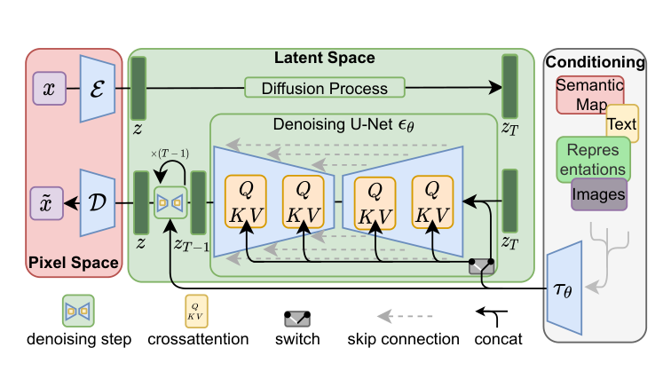

# 47 Latent / Stable Diffusion（潜空间扩散 + 文本条件）

> 定位：让**文生图落地**的关键。三件套——在 VAE 潜空间做扩散（便宜、可规模化）+ 交叉注意力把文本 prompt 注入去噪 + 无分类器引导（更听 prompt）。
> 作者：Latent Diffusion / Stable Diffusion（Rombach 等, CVPR 2022）；Classifier-Free Guidance（Ho & Salimans, 2021）。
> 前置：46 DDPM 与 DDIM、45 VAE（潜空间来源）、38 U-Net、33 CLIP（文本编码器）、28 Transformer（交叉注意力）。
> 阅读路线见 图像生成脉络地图。
> **输入 / 输出**：文本 prompt（+可选图）→ 生成图像

---


> 📥📤 **输入/输出实例**：prompt "a cat on the road" → 文本编码器出文本特征 → 在 **VAE 潜空间**（64×64，比 512×512 像素小几十倍）里用 U-Net 逐步去噪，去噪时用**交叉注意力**注入文本 → 去噪后的潜向量过 VAE 解码器 → 512×512 图。

> 📄 **论文原图对照**（图源：Rombach et al., *High-Resolution Image Synthesis with Latent Diffusion Models*, [arXiv:2112.10752](https://arxiv.org/abs/2112.10752) Figure 3，原文 [PDF](../papers/47_LatentDiffusion_SD_2112.10752.pdf)；仅笔记内学习引用，论文写作须自绘）：



> 两段式：VAE 把图压到潜空间（左红）做扩散（中绿），U-Net 里交叉注意力注入文本等条件（右灰 τ_θ）——Stable Diffusion 的底图。

## 一、提出背景

DDPM 质量高，但直接在**像素空间**做扩散**太贵**（512×512 每步都要在全分辨率上跑 U-Net）。而且早期扩散多是"无条件生成"，没法按文字生成。Stable Diffusion 一次解决两件事：**降本**（潜空间）+ **可控**（文本条件），让"文生图"真正规模化落地。

## 二、核心方法（三件套）⭐

### 2.1 潜空间扩散（降本）
先用一个 **VAE** 把图压到**小的潜空间**（如 512×512 → 64×64），**在潜空间里做扩散**（DDPM/DDIM），最后 VAE 解码器把潜向量还原成图。
- 潜空间比像素**小几十倍** → 扩散计算量骤降 → 能在消费级 GPU 上跑、能规模化训练；
- 复用了 VAE 的**隐空间思想**（VAE 负责"压缩/还原"，扩散负责"在潜空间生成"，分工明确）。

### 2.2 文本条件（交叉注意力）
- 文本 prompt 过**文本编码器**（如 CLIP 文本塔）得文本特征；
- U-Net 去噪时，**图像特征做 query、文本特征做 K/V** 的**交叉注意力** → 让每一步去噪都被 prompt 引导。
- 换 prompt 就换生成内容——这就是文生图。

### 2.3 无分类器引导（CFG，更听 prompt）
- **训练**：随机丢掉条件，让**同一模型**既会"有条件预测"又会"无条件预测"；
- **采样**：朝"更符合条件"的方向**外推**
$$\varepsilon = \varepsilon_{无条件} + w\cdot(\varepsilon_{有条件} - \varepsilon_{无条件})$$
- **w（引导强度）**越大越听 prompt（保真度↑），但太大牺牲多样性、可能出画质问题；
- 不需要额外训练一个分类器 → 故名"**无分类器**"。

## 三、关键结论

- **文生图规模化落地**：Stable Diffusion 开源后引爆了 AIGC，成为图像生成的事实标准底座。
- **"压缩 + 生成"解耦**：VAE 管压缩/还原、扩散管潜空间生成——这个分工被后续广泛沿用。
- **可控生成的起点**：文本条件之上，ControlNet（39）再加结构条件（边缘/深度/姿态）——本项目的数据增强正是用它。

## 四、技术谱系

```
[45 VAE] 隐空间 ──┐
[46 DDPM/DDIM] 扩散 ─┼─→ Latent/Stable Diffusion（潜空间扩散 + 文本交叉注意力 + CFG）
[33 CLIP] 文本编码 ──┘        └─→ [39 ControlNet]（+结构条件）；[48 DiT]（U-Net→Transformer）
```

## 五、具体实例（走一遍）

**例：SD 文生图 "a cat on the road"**
```
① prompt → CLIP 文本塔 → 文本特征
② 潜空间取一份噪声（64×64）
③ U-Net 逐步去噪(DDIM 30 步)，每步交叉注意力看文本特征 + CFG(w=7.5) 外推
④ 去噪后潜向量 → VAE 解码器 → 512×512 猫图
```
**关键**：②③在 64×64 潜空间跑（便宜）；③里"交叉注意力 + CFG"决定了图听不听 prompt。

## 六、参考文献

- Rombach R, et al. *High-Resolution Image Synthesis with Latent Diffusion Models (Stable Diffusion).* CVPR 2022.
- Ho J, Salimans T. *Classifier-Free Diffusion Guidance.* 2021.
- Kingma & Welling. *VAE.* 2013.（潜空间，见 45）
