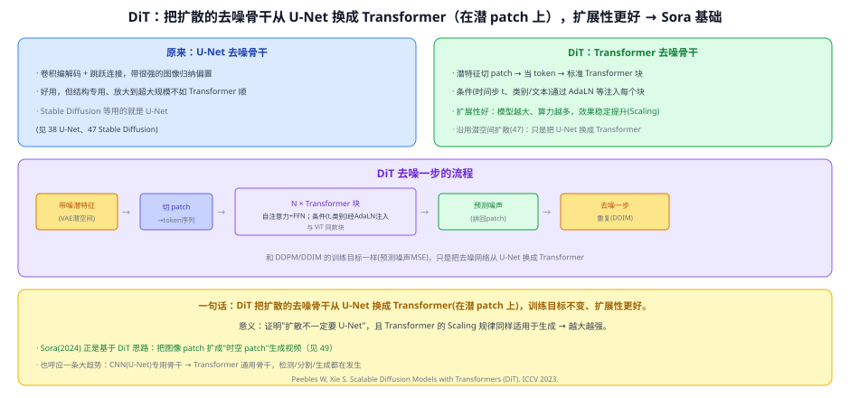
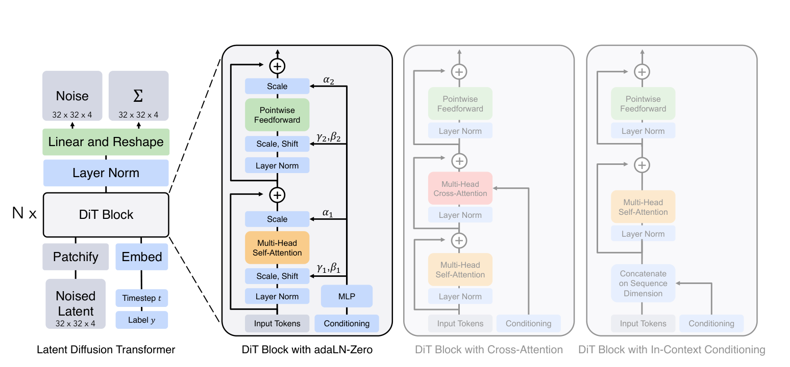

# 48 DiT（Diffusion Transformer）

> 定位：把扩散的**去噪骨干从 U-Net 换成 Transformer**（在潜 patch 上），训练目标不变、扩展性更好。证明"扩散不一定要 U-Net"，是 **Sora** 的基础。
> 作者：Peebles、Xie（UC Berkeley / NYU），*Scalable Diffusion Models with Transformers*，ICCV 2023。
> 前置：46 DDPM 与 DDIM、47 Latent/Stable Diffusion（潜空间）、31 ViT（patch + Transformer 块）、14 LayerNorm（AdaLN）。
> 阅读路线见 图像生成脉络地图。
> **输入 / 输出**：带噪潜特征（+条件）→ 预测噪声（用于逐步去噪生成）

---



> 📥📤 **输入/输出实例**：VAE 潜空间的**带噪潜特征** → 切 patch 成 token 序列 → 过 N 个标准 Transformer 块（条件如时间步 t、类别/文本经 **AdaLN** 注入）→ 预测噪声（拼回 patch）→ 去噪一步；重复（DDIM）→ 生成图。训练目标和 DDPM 一样（预测噪声 MSE），只是**去噪网络换成了 Transformer**。

> 📄 **论文原图对照**（图源：Peebles & Xie, *Scalable Diffusion Models with Transformers*, [arXiv:2212.09748](https://arxiv.org/abs/2212.09748) Figure 3，原文 [PDF](../papers/48_DiT_2212.09748.pdf)；仅笔记内学习引用，论文写作须自绘）：



> 把扩散骨干从 U-Net 换成 Transformer：潜空间 patch 化当 token，时间步/类别条件经 adaLN-Zero 注入——Sora 一系的架构基础。

## 一、提出背景

扩散的去噪骨干长期是 **U-Net**（卷积编解码 + 跳跃，带很强的图像归纳偏置）。但 ViT 已证明 Transformer 在视觉上又通用、Scaling 又好。**扩散能不能也用 Transformer 当骨干？** DiT 给出肯定答案，并证明它**扩展性更好**（越大越强）。

## 二、核心方法 ⭐

### 2.1 用 Transformer 替换 U-Net
- 在 潜空间（VAE 压缩后的小特征）上操作：**潜特征切 patch → 当 token**（和 ViT 一样）；
- 过 **N 个标准 Transformer 块**（自注意力 + FFN）；
- **条件注入**：时间步 t、类别/文本条件通过 **AdaLN**（自适应 LayerNorm，用条件预测 LN 的缩放/偏移）注入每个块——比在 U-Net 里塞条件更简洁。

### 2.2 训练目标不变
和 DDPM/DDIM 完全一样——**预测每步噪声的 MSE**、DDIM 采样。**只换了去噪网络的架构**，扩散的数学框架原封不动。

## 三、关键结论

- **扩散不一定要 U-Net**：Transformer 骨干同样能做（甚至更好）。
- **Scaling 规律成立**：模型越大、算力越多，生成质量稳定提升——把 Transformer 在 NLP/视觉里的"越大越强"带到了生成。
- **Sora 的基础**：Sora（2024） 正是基于 DiT 思路，把图像 patch 扩成"**时空 patch**"生成视频。
- **呼应大趋势**：CNN（U-Net）专用骨干 → Transformer 通用骨干——检测（DETR）、分割（SegFormer/Mask2Former）、生成（DiT）都在发生同一件事。

## 四、技术谱系

```
[46 DDPM/DDIM] 扩散数学框架（预测噪声）
[47 潜空间扩散] 在潜空间做 ────┐
[31 ViT] patch + Transformer 块 ─┼─→ DiT：Transformer 去噪骨干（AdaLN 注入条件）
[14 AdaLN] 条件注入 ────────────┘        └─→ Sora（时空 patch → 视频，见 49）
   对照：U-Net 骨干（[38]/[47]）
```

## 五、具体实例（对比走一遍）

**例：同样在潜空间去噪一步**
```
U-Net 版(SD)：带噪潜特征 → 卷积编解码+跳跃 → 预测噪声
DiT 版      ：带噪潜特征 → 切patch成token → N×Transformer块(AdaLN注入t/类别) → 预测噪声
```
**关键**：两者训练目标、采样流程一样（都是 DDPM/DDIM），差别只在"去噪网络是卷积 U-Net 还是 Transformer"。DiT 的好处是 Scaling 更顺、更通用。

## 六、参考文献

- Peebles W, Xie S. *Scalable Diffusion Models with Transformers (DiT).* ICCV 2023.
- Ho J, et al. *DDPM.* NeurIPS 2020.（框架，见 46）
- Dosovitskiy A, et al. *ViT.* ICLR 2021.（patch/Transformer 块，见 31）
