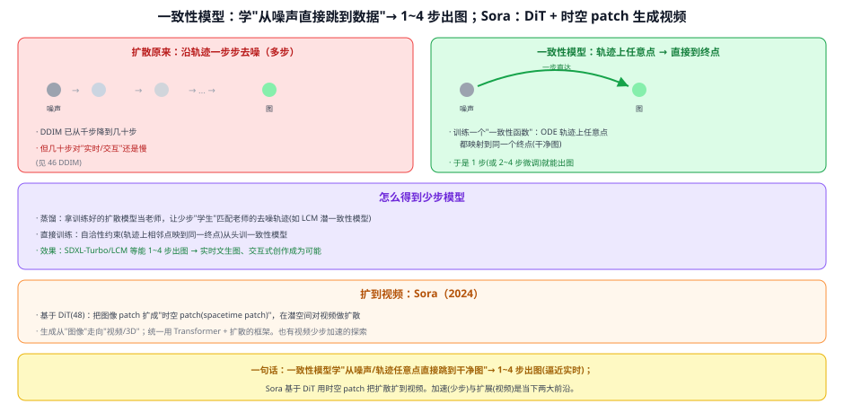
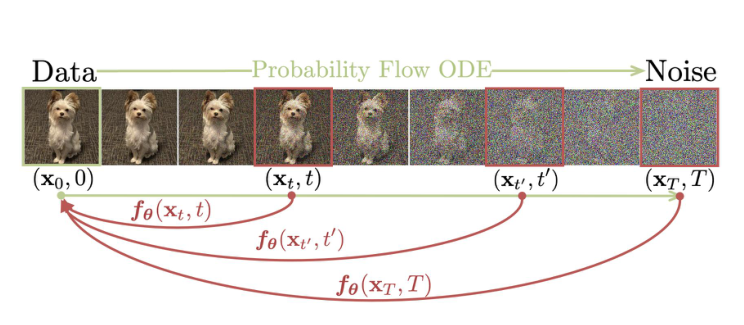

# 49 一致性模型与加速（少步生成 + 视频）

> 定位：生成脉络的**最新前沿**——加速（少步）与扩展（视频）。一致性模型学"从噪声直接跳到数据"→ 1~4 步出图（逼近实时）；Sora 基于 DiT 用时空 patch 把扩散扩到视频。
> 代表作：Consistency Models（Song 等, 2023）、LCM（潜一致性模型, 2023）、SDXL-Turbo（2023）；Sora（OpenAI, 2024）。
> 前置：46 DDPM 与 DDIM（多步采样）、47 Latent Diffusion、48 DiT（Sora 基础）。
> 阅读路线见 图像生成脉络地图。
> **输入 / 输出**：噪声（+条件）→ 1~4 步生成图；或 → 视频

---



> 📥📤 **输入/输出实例**：一致性模型——噪声 → **一步（或 2~4 步）**直接出图（不用几十步）。Sora——文本 → 在潜空间对"时空 patch"用 DiT 扩散 → 视频。

> 📄 **论文原图对照**（图源：Song et al., *Consistency Models*, [arXiv:2303.01469](https://arxiv.org/abs/2303.01469) Figure 1，原文 [PDF](../papers/49_ConsistencyModels_2303.01469.pdf)（LCM 原文 [PDF](../papers/49_LCM_2310.04378.pdf)）；仅笔记内学习引用，论文写作须自绘）：



> 一致性映射：把概率流 ODE 轨迹上任意时刻的点都映射回起点 x₀——"一步生成"的数学根据。

## 一、背景：扩散还是不够快

DDIM 已把采样从上千步降到几十步，但**几十步对"实时/交互"仍然慢**（每步一次网络前向）。前沿有两个方向：
1. **加速**：把步数降到 **1~4 步**（一致性模型）；
2. **扩展**：从图像扩到**视频**（Sora）。

## 二、一致性模型（少步生成）⭐

### 2.1 核心思想
扩散采样本质是沿一条**ODE 轨迹**从噪声走到干净图。一致性模型训练一个"**一致性函数**"：**轨迹上任意点都映射到同一个终点（干净图）**。于是——
- 从噪声**一步**就能跳到图（single-step）；
- 也可 **2~4 步**迭代微调，质量更好。

### 2.2 怎么得到
- **蒸馏**：拿训练好的扩散模型当**老师**，让少步"**学生**"匹配老师的去噪轨迹（如 **LCM 潜一致性模型**，在 潜空间 蒸馏 Stable Diffusion）；
- **直接训练**：用"自洽性约束"（轨迹相邻点映到同一终点）从头训。

### 2.3 效果
- **SDXL-Turbo / LCM** 等能 **1~4 步出图** → **实时文生图、交互式创作**成为可能（原来几十步、几秒 → 现在亚秒）。

## 三、扩到视频：Sora（2024）

- 基于 DiT：把图像 patch 扩成"**时空 patch（spacetime patch）**"，在潜空间对**视频**做扩散；
- 生成从"图像"走向"**视频/3D**"，统一在"Transformer + 扩散"的框架下；
- 也有视频生成的少步加速探索（把一致性思想用到视频）。

## 四、关键结论

- **少步生成**把扩散从"慢"的短板中解放出来，逼近实时——这是扩散能进入交互式产品的关键。
- **加速（少步）+ 扩展（视频/3D）** 是当下生成模型的两大前沿。
- **框架统一**：一致性/LCM 建立在扩散之上（蒸馏或改训练），Sora 建立在 DiT 之上——都不是推倒重来，而是在既有框架上加速/扩展。

## 五、技术谱系

```
[46 DDPM] 多步 →[46 DDIM] 几十步 ──→ 一致性模型/LCM/SDXL-Turbo：1~4 步（蒸馏 or 自洽训练）
[48 DiT] Transformer 骨干 ──→ Sora：时空 patch → 视频
[47 潜空间] 贯穿其中（LCM 在潜空间蒸馏、Sora 在潜空间做视频扩散）
```

## 六、具体实例（对比走一遍）

**例：同样文生图，步数天差地别**
```
Stable Diffusion(DDIM)：噪声 → 30 步去噪 → 图（几秒）
LCM / SDXL-Turbo      ：噪声 → 1~4 步 → 图（亚秒，实时预览/交互）
```
**例：Sora 生成视频**
```
文本 → 潜空间时空 patch → DiT 扩散去噪 → 解码 → 一段视频
（把 47/48 的图像扩散，patch 从"空间"扩到"时空"）
```

## 七、参考文献

- Song Y, et al. *Consistency Models.* ICML 2023.
- Luo S, et al. *Latent Consistency Models (LCM).* 2023.
- OpenAI. *Video generation models as world simulators (Sora technical report).* 2024.
- Peebles W, Xie S. *DiT.* ICCV 2023.（Sora 基础，见 48）
