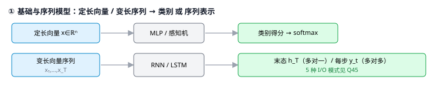
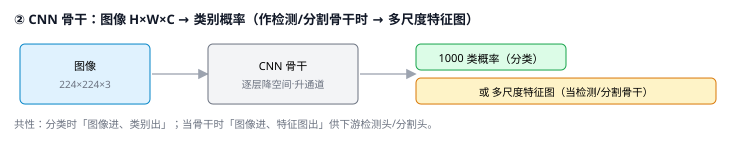
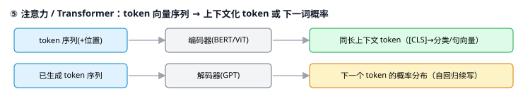
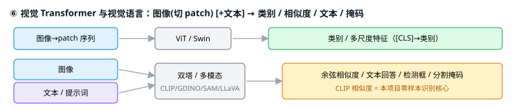
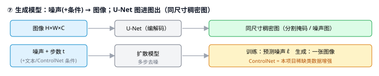
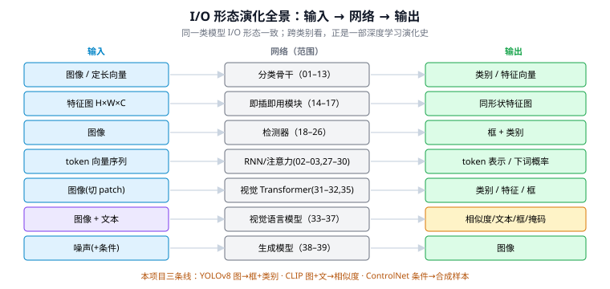

# 模型输入 / 输出速查表

> 一张表看全本目录 39 个模型"吃什么、吐什么"。
> **看点**：I/O 形态本身就是一部演化史——图→类别（分类骨干）→ 图→框（检测）→ token→token（Transformer）→ 图+文→相似度（CLIP）→ 噪声→图（扩散）。
> **通用约定**：① 网络只吃**数值张量**，文字要先 embedding、图像是 `H×W×C` 张量（见 [Q44](答疑_01_基础与序列.md#q44-mlpcnn-的输入为什么都是定长)、[Q45](00_必读/02_RNN.md#q45-rnn-的输入和输出到底是什么)）。② 分类**骨干**单独用时输出"类别"，当**检测/分割骨干**时则输出"多尺度特征图"供下游用。

---

## 一、基础与序列模型

| 模型 | 输入 | 输出 | 备注 |
|------|------|------|------|
| [01 感知机/MLP](00_必读/01_感知机与反向传播.md) | 定长特征向量 $x\in\mathbb R^n$ | 类别得分 / 回归值（分类经 softmax 得概率） | 输入维度被权重矩阵焊死，必须定长 |
| [02 RNN](00_必读/02_RNN.md) | 变长向量序列 $x_1,\dots,x_T$ | 按任务：取末态 $h_T$（多对一）或每步 $y_t$（多对多） | 5 种 I/O 模式见 [Q45](00_必读/02_RNN.md#q45-rnn-的输入和输出到底是什么) |
| [03 LSTM](00_必读/03_LSTM.md) | 同 RNN（变长向量序列） | 同 RNN（$h_T$ / $y_t$） | 门控 + 细胞状态，缓解长程依赖 |



## 二、CNN 骨干网络（默认 ImageNet 分类设定）

| 模型 | 输入 | 输出 | 备注 |
|------|------|------|------|
| [04 CNN 原理](00_必读/04_CNN卷积神经网络原理.md) | 图像张量 $H\times W\times C$ | 特征图 → 类别 / 检测框等 | 总纲；卷积层本身不挑尺寸（[Q44](答疑_01_基础与序列.md#q44-mlpcnn-的输入为什么都是定长)） |
| [05 LeNet](01_基础与其他骨干/03_LeNet.md) | 32×32×1 灰度图 | 10 类（手写数字）概率 | — |
| [06 AlexNet](01_基础与其他骨干/04_AlexNet.md) | 224×224×3 | 1000 类概率 | — |
| [07 VGGNet](01_基础与其他骨干/05_VGGNet.md) | 224×224×3 | 1000 类概率 | — |
| [08 GoogLeNet](01_基础与其他骨干/06_GoogLeNet_Inception.md) | 224×224×3 | 1000 类概率 | 末端用 GAP 替代 FC |
| [09 ResNet](00_必读/05_ResNet.md) | 224×224×3 | 1000 类 / 特征向量 | 最常用骨干，输出特征供下游 |
| [10 DenseNet](01_基础与其他骨干/08_DenseNet.md) | 224×224×3 | 1000 类 | — |
| [11 MobileNet](00_必读/06_MobileNet系列.md) | 224×224×3 | 1000 类 / 特征 | 轻量骨干 |
| [12 EfficientNet](01_基础与其他骨干/09_EfficientNet.md) | 可变分辨率×3 | 1000 类 | 复合缩放 |
| [13 ConvNeXt](01_基础与其他骨干/10_ConvNeXt.md) | 224×224×3 | 1000 类 / 特征 | 现代化 CNN |

> 共性：分类时**图像进、类别概率出**；当检测/分割骨干时**图像进、多尺度特征图出**。



## 三、即插即用模块与组件（输入输出**同形状**，插在网络中间）

| 模型 | 输入 | 输出 | 备注 |
|------|------|------|------|
| [14 BatchNorm/LayerNorm](00_必读/07_BatchNorm与LayerNorm.md) | 某层激活张量 | **同形状**的归一化张量 | 不改形状，只调分布（+γβ） |
| [15 SE-Net](00_必读/09_SENet.md) | 特征图 $H\times W\times C$ | **同形状**，通道被重标定 | 通道注意力 |
| [16 CBAM](00_必读/10_CBAM.md) | 特征图 | **同形状**，通道+空间被加权 | 通道+空间注意力 |
| [17 Deformable Conv](00_必读/11_DeformableConv.md) | 特征图 | 特征图（采样位置可学习） | 卷积的增强版 |


## 四、目标检测（默认：图像进，"框+类别"出）

| 模型 | 输入 | 输出 | 备注 |
|------|------|------|------|
| [18 R-CNN](00_必读/13_RCNN.md) | 图像 + Selective Search ~2000 候选框 | 每框：类别 + 修正框 | 候选框外部生成，逐框过 CNN |
| [19 Fast R-CNN](00_必读/14_Fast_RCNN.md) | 整图 + 候选框 | 类别 + 回归框 | RoI Pooling 共享整图特征 |
| [20 Faster R-CNN](00_必读/15_Faster_RCNN.md) | 图像 | 框 + 类别 | RPN 自产候选框，端到端 |
| [21 FPN](00_必读/16_FPN.md) | 骨干多尺度特征 | 多尺度特征金字塔 P2–P5 | 不直接出框，是"颈部"给检测头供料 |
| [22 YOLOv1](00_必读/17_YOLOv1.md) | 448×448 图 | 7×7×30 张量 → 框 + 类别 | 单阶段，网格直接回归 |
| [23 SSD](00_必读/18_SSD.md) | 300²/512² 图 | 多尺度 8732 个框 + 类别 | 多特征图分支预测 |
| [24 RetinaNet](00_必读/19_RetinaNet.md) | 图像 | 密集框 + 类别 | Focal Loss 解决正负不平衡 |
| [25 YOLO 演进](00_必读/20_YOLO演进_v2到v11.md)（[v8](00_必读/24_YOLOv8.md) ⭐） | 640×640 图 | 框 + 类别（8400 预测 → NMS） | 本项目基线 v8，anchor-free；分篇 25a–25e |


## 五、注意力与 Transformer（默认：token 向量序列进出）

| 模型 | 输入 | 输出 | 备注 |
|------|------|------|------|
| [27 注意力机制](00_必读/30_注意力机制.md) | Query + 一组 Key/Value 向量 | 按相关性加权求和的上下文向量 | 见 [Q31](00_必读/31_Transformer.md#q31-transformer-用点积注意力为何既能解决注意力又能并行运算) |
| [28 Transformer](00_必读/31_Transformer.md) | token 向量序列（+位置编码） | 同长的上下文化 token 序列；翻译则输出译文序列 | seq2seq 训练用 teacher forcing（[Q46](00_必读/02_RNN.md#q46-做翻译时解码端的i-love-road也是样本标签吗)） |
| [28a DETR](00_必读/32_DETR.md) | 图像 | 固定 N 个 (框+类别) 集合 | 检测 Transformer，集合预测、**无 NMS**（需 28 作前置） |
| [29 BERT](00_必读/33_BERT.md) | 文本 token 序列（`[CLS]`+句子） | 每 token 的上下文向量；`[CLS]`→分类/句向量 | 双向编码器，多对多取表示 |
| [30 GPT 系列](00_必读/34_GPT系列.md) | 文本 token 序列 | 下一个 token 的概率分布（自回归续写） | 解码器，逐词生成 |



## 六、视觉 Transformer 与视觉语言模型

| 模型 | 输入 | 输出 | 备注 |
|------|------|------|------|
| [31 ViT](00_必读/35_ViT.md) | 图像切成 patch 序列（+`[CLS]`） | `[CLS]` 向量 → 类别；或各 patch 特征 | 图像当 token 序列 |
| [32 Swin Transformer](00_必读/36_Swin_Transformer.md) | 图像 | 多尺度特征金字塔（当骨干）/ 类别 | 窗口注意力 + 层级下采样 |
| [33 CLIP](00_必读/37_CLIP.md) | **图像 + 文本**（两个塔） | 各自的嵌入向量（同一空间）→ 余弦相似度 | 本项目零样本识别核心 |
| [34 BLIP / BLIP-2](03_视觉语言VLM/10_BLIP系列.md) | 图像（+文本问题） | 文本（描述/答案）/ 图文匹配分 | Q-Former 桥接 |
| [35 Grounding DINO](00_必读/38_GroundingDINO.md) | 图像 + **文本提示词** | 文本所指类别的检测框 | 开放词汇检测 |
| [36 SAM](03_视觉语言VLM/13_SAM.md) | 图像 + 提示（点/框/文本） | 分割掩码 mask | 可提示通用分割 |
| [37 LLaVA / InternVL](03_视觉语言VLM/14_LLaVA_InternVL.md) | 图像 + 文本指令 | 文本回答 | ViT+LLM 图像问答 |



## 七、生成模型

| 模型 | 输入 | 输出 | 备注 |
|------|------|------|------|
| [38 U-Net](04_图像分割/02_U-Net.md) | 图像 $H\times W\times C$ | **同尺寸**稠密图（分割掩码 / 噪声图） | 图进图出，扩散的去噪骨干 |
| [39 扩散模型](00_必读/39_扩散模型_DDPM与ControlNet.md) | 训练：带噪图 + 步数 $t$；生成：噪声（+文本/ControlNet 条件） | 训练：预测的噪声 $\hat\epsilon$；生成：一张图像 | 学去噪 = 学生成 |



---

## 一眼看懂 I/O 的演化



```
分类骨干    图像          → 类别/特征      （02-13）
检测        图像          → 框 + 类别      （18-26）
模块        特征图        → 同形状特征图    （14-17，即插即用）
序列/注意力 token 向量序列 → token 表示/概率 （02-03, 27-30）
视觉Transf  图像(切patch)  → 类别/特征/框    （31-32, 35）
视觉语言    图像 + 文本     → 相似度/文本/框/掩码（33-37）
生成        噪声(+条件)    → 图像           （38-39）
```

> 与本项目：YOLOv8（[25](00_必读/20_YOLO演进_v2到v11.md)）= 图像→框+类别；CLIP（[33](00_必读/37_CLIP.md)）= 图像块+文本模板→相似度做开放类识别；ControlNet（[39](00_必读/39_扩散模型_DDPM与ControlNet.md)）= 条件图→合成带标注样本。三者的 I/O 正好对应本项目"检测 + 零样本识别 + 数据增强"三条线。
