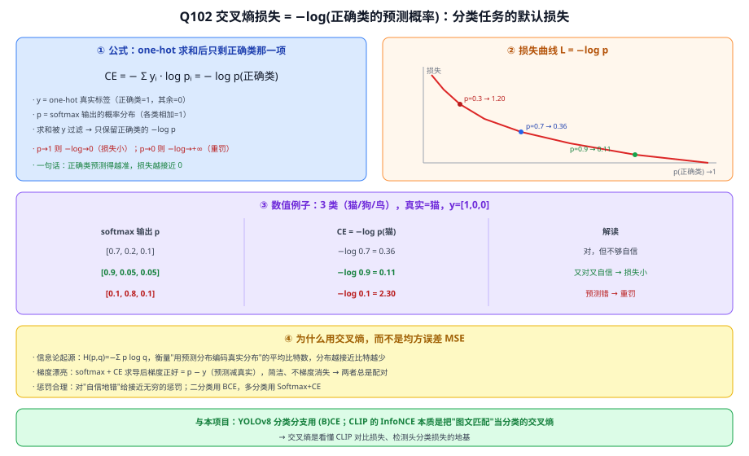
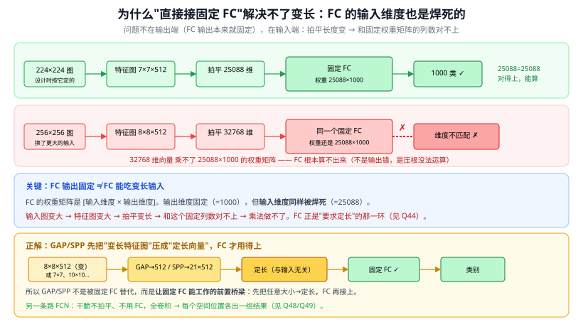

# 答疑 · 基础与序列模型

> 模型详解系列答疑 · 分册之一　|　⬅ 返回答疑总目录
> 本篇留存**跨模型/通用**的基础问答（Q1、Q2、Q44、Q51、Q102）；**专属某模型**的（Q3→LSTM、Q32/Q45/Q46→RNN）已并入对应模型文章，下方目录链接直达其当前位置。
> 标题约定：把口语化提问润色成书面小标题（保留原意）。

## 本篇目录
- 梯度基础：Q1 反向传播是不是复合函数求导 · Q2 为什么激活函数导数小于 1 会梯度消失 · Q102 交叉熵损失是什么
- 序列模型：Q3 LSTM 变种治标不治本、只适用轻量任务 · Q32 Seq2Seq 定长 C / 编码器 / 解码器 · Q45 RNN 的输入和输出到底是什么 · Q46 翻译时解码端的目标句也是样本（标签）吗 · Q51 直接接固定 FC 不就能"不同输入→相同输出"了吗
- 架构本质：Q44 MLP/CNN 的输入为什么都是定长

---

# 一、梯度与训练基础

---

## Q1. 反向传播的本质：是不是复合函数求导（链式法则）？

> 关联文章：01 感知机与反向传播　提问日期：2026-06-16

**简答**：是的，本质就是复合函数求导（链式法则）；但"反向传播"这个名字强调的是**链式法则的高效实现**——链式法则 + 动态规划（复用中间结果）。

**展开**：

**① 神经网络是一个大的复合函数**
前向计算层层嵌套：

$$
L = \text{loss}\big(f_L(\,f_{L-1}(\,\cdots f_1(x)\,)\,)\big),\qquad f_l(z)=\sigma(W_l z + b_l)
$$

要更新参数 $W_l$ 就要求 $\partial L/\partial W_l$，即对这个复合函数求偏导。

**② 链式法则是数学内核**
对复合函数求导用链式法则，把从损失传到某层的导数连乘：

$$
\frac{\partial L}{\partial W_1}=\frac{\partial L}{\partial f_L}\cdot\frac{\partial f_L}{\partial f_{L-1}}\cdots\frac{\partial f_2}{\partial f_1}\cdot\frac{\partial f_1}{\partial W_1}
$$

这一串连乘**就是链式法则**。所以"反向传播本质是复合函数求导"这个理解正确。

**③ 关键区别：反向传播 = 链式法则 + 复用中间结果**
- 上面连乘中，很多项被不同参数的梯度**共享**（如 $\partial L/\partial f_L$ 那段，每层梯度都要用）。
- 若对每个参数从头连乘，计算量指数爆炸。
- 反向传播：**从输出层往输入层走一遍，把"误差信号 $\delta$"逐层回传，每个中间导数只算一次**。一次前向 + 一次反向，就拿到所有参数的梯度。

> 一句话：**链式法则告诉你"该怎么求"，反向传播告诉你"怎么求最省"——它是链式法则在计算图上的高效实现。**

类比：链式法则像"楼梯每级的高度公式"；反向传播像"从顶楼往下走，每经一级记下累计高度，不必每次从一楼重算"。

**延伸要点**（与本项目相关）：
- 反向传播中梯度是**连乘**的，所以激活函数导数 < 1 时会指数衰减 → **梯度消失**。这正是 ReLU（06 AlexNet）、残差连接（09 ResNet）、C2f 多分支梯度流（YOLOv8）存在的意义——给梯度修"高速路"，让它能顺畅回传到底层。
- 今天 YOLOv8、CLIP 的训练，底层引擎仍是反向传播 + 梯度下降变体（SGD、Adam）。

---

## Q2. 为什么饱和激活函数导数小于 1，连乘后会梯度消失？

> 关联文章：01 感知机与反向传播、06 AlexNet、09 ResNet　提问日期：2026-06-16

**简答**：前提需纠正——**不是所有激活函数导数都小于 1**。只有 **Sigmoid/Tanh 这类"饱和型"激活函数**导数 ≤ 1（Sigmoid 最大 0.25），它们连乘才导致梯度消失；**ReLU 正区间导数恒为 1**，正是为解决这个问题而生。

**展开**：

**① 为什么 Sigmoid/Tanh 导数小于 1——根源是"挤压"**
这类函数把无界输入 $(-\infty,+\infty)$ 挤压到有界区间（Sigmoid→$(0,1)$，Tanh→$(-1,1)$）。一个函数把无限输入压进有限输出，两端**必然变平**（否则输出冲出边界），变平 = 斜率趋 0。

- **Sigmoid** $\sigma(x)=\frac{1}{1+e^{-x}}$，导数 $\sigma'(x)=\sigma(x)(1-\sigma(x))$。因 $\sigma\in(0,1)$，$p(1-p)$ 在 $p=0.5$ 取最大值 **0.25**，其余更小；输入偏离 0 即饱和，导数趋 0。
- **Tanh** 导数 $1-\tanh^2(x)$，$x=0$ 处最大为 1，稍偏离即 < 1，两端饱和到 0。

**② 连乘导致梯度消失**
反向传播是连乘（见 Q1）。每层乘一个 ≤ 0.25 的因子，10 层 $0.25^{10}\approx10^{-6}$，梯度传到底层近乎归零，底层学不动。

**③ ReLU 为何能解决——导数不小于 1**
$$\text{ReLU}'(x)=\begin{cases}1 & x>0\\ 0 & x<0\end{cases}$$
正区间导数恒为 1，连乘不衰减。这是 06 AlexNet 用 ReLU 替代 Sigmoid 的根本原因。代价：负区间导数 0（神经元可能"死亡"）→ 后续有 LeakyReLU、SiLU（YOLOv8 用 SiLU）等改进。

**准确表述**：饱和型激活函数因"挤压"输出而导数 ≤ 1，连乘才梯度消失；ReLU 系导数为 1 故能缓解。另一条解法是**残差连接**（09 ResNet）——给梯度修一条不过激活函数的 +1 直连高速路。

---

## Q102. 交叉熵损失是什么？

> 关联文章：01 感知机与反向传播、25d YOLOv8、33 CLIP　提问日期：2026-07-03
> 关键结论：交叉熵损失 = **正确类别预测概率的负对数** $-\log p_{\text{正确类}}$，是**分类任务的默认损失**。预测越准（正确类概率越接近 1）损失越接近 0，越离谱越趋于 +∞。它与 **softmax 天生一对**（求导后梯度正好是 $p-y$），比 MSE 更适合分类。

**简答**：交叉熵衡量"模型预测的概率分布 $p$"和"真实标签分布 $y$"差多远。真实标签是 one-hot（正确类为 1、其余为 0），代入公式后**求和只剩正确类那一项**，所以它本质就是"正确类被预测到的概率取负对数"。预测得越自信且正确，损失越小；自信地预测错，损失极大。

**展开**：

**① 公式**
单样本、真实标签 one-hot $y$、模型 softmax 输出概率 $p$：

$$\text{CE} = -\sum_i y_i \log p_i = -\log p_{\text{正确类}}$$

因为 $y$ 只有正确类为 1，求和被"过滤"得只剩一项。所以交叉熵 = $-\log(\text{正确类的预测概率})$。

**② 为什么是 $-\log$——惩罚"自信地错"**
- 正确类概率 $p\to1$：$-\log p\to0$，损失小（奖励又对又自信）。
- 正确类概率 $p\to0$：$-\log p\to+\infty$，损失爆炸（重罚"把正确类判得很低"）。

**③ 数值例子**（3 类：猫/狗/鸟，真实是"猫"，$y=[1,0,0]$）

| 预测 softmax 输出 $p$ | 交叉熵 $-\log p_{猫}$ | 说明 |
|---|---|---|
| [0.7, 0.2, 0.1] | $-\log 0.7 = 0.36$ | 对但不够自信 |
| [0.9, 0.05, 0.05] | $-\log 0.9 = 0.11$ | 又对又自信 → 损失小 |
| [0.1, 0.8, 0.1] | $-\log 0.1 = 2.30$ | 预测错 → 重罚 |

**④ 为什么用交叉熵，而不是均方误差 MSE**
1. **信息论起源**：交叉熵 $H(p,q)=-\sum p\log q$ 衡量"用预测分布 $q$ 去编码真实分布 $p$ 需要的平均比特数"，分布越接近比特越少。
2. **梯度漂亮**：softmax + 交叉熵求导后，梯度正好是 $p-y$（预测减真实），形式极简、不会像"sigmoid+MSE"那样梯度消失——这就是两者总**配对使用**的原因（对照 Q2 的梯度消失）。
3. **惩罚合理**：$-\log$ 对"自信地错"给出接近无穷的惩罚，逼模型别乱给高置信度。

**⑤ 变体**
- **二分类**用 BCE（Binary Cross-Entropy）：$-[y\log p+(1-y)\log(1-p)]$。
- **多分类**就是上面的 Softmax + CE。

> 图解：① one-hot 求和后只剩正确类的 $-\log p$；② $-\log$ 曲线（$p\to1$ 损失趋 0）；③ 猫/狗/鸟数值例子；④ 相比 MSE 的三条优势（信息论/梯度 $p-y$/惩罚）；⑤ 与本项目 YOLOv8、CLIP 的关系。

**⑥ 与本项目**
- YOLOv8 **分类分支**用的就是 (B)CE（框回归另配 DFL，见 Q43）；
- **CLIP 对比学习**的 InfoNCE 损失，本质是把"图文匹配"当成一个分类问题的交叉熵（33 CLIP）；
- 所以交叉熵是看懂 CLIP 对比损失、检测头分类损失的地基。

---

## Q183. BCE 是什么？

> 关联文章：[Q102 交叉熵损失](#q102-交叉熵损失是什么)（总纲）、Q182 YOLOv3 独立逻辑回归、Q57 sigmoid 门控、[Q2 梯度消失](#q2-为什么饱和激活函数导数小于-1连乘后会梯度消失)　提问日期：2026-07-24
> 关键结论：**BCE = Binary Cross-Entropy = 二元（二分类）交叉熵**，是[交叉熵（Q102）](#q102-交叉熵损失是什么)在"只有两个结果（是/不是）"这种情形下的具体形式。公式 $\mathcal{L}=-[y\log p+(1-y)\log(1-p)]$ 有**两项**：一项管"该是 1（y=1 时逼 p→1）"、一项管"该是 0（y=0 时逼 p→0）"，每次总有一项因系数为 0 而消失。它和 **sigmoid 天生一对**（sigmoid 出概率 p、BCE 量它离 y 多远，梯度正好 p−y、不梯度消失）——"逻辑回归"就是 sigmoid+BCE。**多标签**时对 C 个类各算一个 BCE 再相加，这正是 Q182 YOLOv3 独立逻辑回归的损失。它和多分类 softmax-CE 是两套：softmax = C 选 1，BCE = 每类独立的是非题。

**简答**：名字拆开看——**Binary（两个结果）+ Cross-Entropy（交叉熵）**，就是"针对一个是/不是判断"的交叉熵损失。它衡量"模型预测'是'的概率 p"离"真实答案 y（是=1/不是=0）"有多远，配 sigmoid 用，重罚"自信地判错"、奖励"自信地判对"。当你有很多个独立的是非判断（多标签分类、检测里每类各判各的）时，就对每个判断各算一个 BCE 再加起来。

**展开**：

**① 公式与"两项"的含义**
$$\mathcal{L}_{BCE} = -\big[\,y\log p + (1-y)\log(1-p)\,\big]$$
- p = 模型预测"是"的概率（由 sigmoid 给出，∈(0,1)）；y = 真实标签（是=1 / 不是=0）。
- **当 y=1**：第二项系数 (1−y)=0 → 只剩 $-\log p$ → 逼 p 往 1 走；
- **当 y=0**：第一项系数 y=0 → 只剩 $-\log(1-p)$ → 逼 p 往 0 走。

所以 BCE **同时监督"该是 1"和"该是 0"两个方向**（对比 [Q102](#q102-交叉熵损失是什么) 的 softmax-CE 只写"正确类那一项"——因为多分类里 one-hot 求和后只剩一项，而二分类要把"是/不是"两头都写出来）。

**② 为什么配 sigmoid**
sigmoid 把网络原始分数 z 压成概率 $p=\sigma(z)\in(0,1)$，BCE 负责量这个 p 离 y 多远。两者配对求导后，梯度正好是 **p−y**（预测减真实），形式极简，**不会像"sigmoid+MSE"那样梯度消失**（对照 [Q2](#q2-为什么饱和激活函数导数小于-1连乘后会梯度消失)）。所以 sigmoid 配 BCE、softmax 配多分类 CE，各是天生一对。"逻辑回归（logistic regression）"= sigmoid + BCE，就是最基础的二分类器——这也是 Q182"独立逻辑回归"这个名字的由来。

**③ 数值例子（问题：这个框是不是"车"？）**

| 真实 y | 预测 p | BCE 损失 | 解读 |
|---|---|---|---|
| 是车 y=1 | 0.9 | $-\log 0.9\approx0.11$ | 又对又自信 → 小 |
| 是车 y=1 | 0.1 | $-\log 0.1\approx2.30$ | 自信地错 → 重罚 |
| 不是车 y=0 | 0.1 | $-\log(1-0.1)\approx0.11$ | 对 → 小 |
| 不是车 y=0 | 0.8 | $-\log(1-0.8)\approx1.61$ | 把非车判成车 → 罚 |

可见 BCE 对"自信地错"给出很大损失、对"自信地对"给出接近 0 的损失——和 [Q102](#q102-交叉熵损失是什么) 的 $-\log$ 惩罚逻辑一致，只是这里把"是"和"不是"两个方向都管上了。

**④ 多标签：C 个类各算一个 BCE 再相加**
$$\mathcal{L}_{cls} = \sum_{i=1}^{C} \text{BCE}(p_i, y_i) = \sum_{i=1}^{C}-\big[y_i\log p_i + (1-y_i)\log(1-p_i)\big]$$
每个类别独立做一次"是/不是"的 BCE、彼此不干扰 → **一个框可同时属于多个类（多标签）**。softmax 做不到（它逼类间抢一份概率）。这正是 Q182 YOLOv3 把 softmax 换成"独立逻辑回归"后用的损失。

**⑤ 和 softmax-CE 的分工**

| | BCE | 多分类 softmax-CE |
|---|---|---|
| 配的激活 | sigmoid（每类独立） | softmax（类间归一化） |
| 处理的问题 | 是/不是（二分类）；多个独立是非题（多标签） | C 选 1（互斥单分类） |
| 输出约束 | 各 p 独立，和不必=1 | 一个分布，$\sum p=1$ |

> **与本项目**：YOLOv8 分类分支用的就是 BCE（每类独立判），[Q102](#q102-交叉熵损失是什么) 是交叉熵总纲、本问是它的二分类形式。理解 BCE 才能看懂：为什么检测里加类别/加 P2 时各类损失互不干扰（Q182），以及为什么外观相近的抛洒物可以被同时给两个类的高分、交给 CLIP 再细分（创新点 2）。

> 图解：定义=BCE是交叉熵(Q102)在"是/不是两个结果"的特例；公式两项一项管该是1一项管该是0总有一项消失；配sigmoid=出概率p、BCE量离y多远、梯度p−y不消失、逻辑回归=sigmoid+BCE；数值例子重罚自信地错奖励自信地对；多标签=C个类各算一个BCE相加(Q182 YOLOv3独立逻辑回归损失)；vs softmax-CE=BCE每类独立是非题/softmax是C选1。

---

# 二、序列模型

---

## Q44. MLP/CNN 的输入为什么都是定长？

> 关联文章：01 感知机与反向传播、04 CNN 原理、28 Transformer　提问日期：2026-06-23
> 关键结论：根因是**权重共享与否**。MLP 的全连接层给每个输入位置分配**独立权重**，输入维度被焊进参数里，所以必须定长；CNN 的**卷积层其实不挑尺寸**（权重共享、核滑动），真正要求定长的是**末端的全连接分类头**——去掉它（GAP/全卷积/SPP）就能吃变长输入。

**简答**：全连接层 $y=Wx$ 的权重矩阵 $W$ 形状是 $[\text{输入维度}\times\text{输出维度}]$，训练时就定死，$x$ 必须正好那么多个数，多一个少一个都乘不了——这就是 MLP 定长的根源（每个输入位置一套专属权重，**不共享**）。CNN 的卷积靠核滑动、**权重共享**，任意 $H\times W$ 都能算，大图出大特征图、小图出小特征图；可一旦把特征图**拍平喂给 FC 分类头**，不同输入尺寸→特征图大小不同→拍平长度不同→和固定 FC 权重对不上，所以 LeNet/VGG 才要求固定 224×224。把 FC 头换成**全局平均池化(GAP)/全卷积(FCN)/空间金字塔池化(SPP)**，CNN 就能处理任意尺寸。

**展开**：

**① MLP：定长是"不共享权重"的必然**
全连接层每个输出都连接全部输入（Q39 的 $y=Wx$）。$W$ 的列数 = 输入维度，是个**写死的常数**。输入位置 1、2、3… 各自对应 $W$ 里不同的一列权重（**没有任何共享**），所以"有几个输入位置"被硬编码进了参数量。换一个长度，$W$ 就对不上，整个层失效。→ MLP 天生只能吃定长。

**② CNN：卷积层并不要求定长（关键澄清）**
卷积是"同一个核在整张图上滑动"（权重共享，Q41）。核多大、有几个，与输入 $H\times W$ 无关——大图就多滑几下、输出大特征图，小图输出小特征图。所以**纯卷积/池化部分对输入尺寸是不敏感的**。这点常被误解。

**③ 那"CNN 要 224×224"是哪来的？——末端 FC 头**
传统 CNN（LeNet/AlexNet/VGG）最后要把特征图**拍平成一个向量**喂全连接分类头。不同输入尺寸 → 卷积输出的特征图尺寸不同 → 拍平后的向量长度不同 → 又撞上"②全连接要求定长"。所以定长约束**不来自卷积，来自那个 FC 头**。

**④ 怎么解除：把"定长的 FC"换掉**
| 方法 | 做法 | 效果 |
|------|------|------|
| 全局平均池化 GAP | 每个通道整张图求平均 → 固定得 $C$ 维 | 任意 $H\times W$ → 固定长度（ResNet/GoogLeNet 用） |
| 全卷积网络 FCN | 通篇只用卷积、不用 FC | 输入任意大小（分割/检测用，见 38 U-Net） |
| 空间金字塔池化 SPP | 多尺度池化拼成固定长度 | 任意输入 → 固定向量 |

> GAP/FCN/SPP 三者的详细讲解、例子与出处见 04 CNN 原理 · 第五节。

**⑤ 一条总原理（把序列模型也串起来）**
**一层是否需要定长，取决于它是否给每个输入位置分配独立参数：**
- **不共享**（全连接）：位置数固定 → 必须定长。
- **共享**（卷积沿空间共享、RNN 沿时间共享、Transformer 沿 token 共享）→ 同一套权重滑过任意长度 → 可变长。

这正是 **RNN/Transformer 能吃变长序列**的原因：RNN 一个时间步一套共享权重，来多少 token 循环多少步（02 RNN）；Transformer 对 $n$ 个 token 用同一套 $W_Q/W_K/W_V$，$n$ 任意（再用位置编码补顺序，见 Q34）。

> 图解：左 MLP 因 FC 权重不共享而被钉死尺寸；右 CNN 卷积本身不挑尺寸、是末端 FC 头要求定长，换 GAP/FCN/SPP 即可变长；底部给出"共享与否决定能否变长"的总原理与 RNN/Transformer 对比。

**⑥ 与本项目**
- **YOLOv8 输入 640×640** 是工程选择（便于**批处理**和检测头设计），并非卷积的硬性要求——它的骨干是全卷积式的，实际可处理其它尺寸。理解这点，才知道改输入分辨率、加 P2 层（21 FPN）时哪些会受 FC/检测头约束、哪些不会。
- **CLIP 的 ViT** 把图像切成固定数量 patch（31 ViT），又回到"固定 token 数"的设定——与这里"定长 vs 变长"的取舍一脉相承。

---

## Q51. 最后接一个固定 FC，不就能"不同输入→相同输出"了吗？

> 关联文章：01 感知机/MLP、04 CNN 原理 §五　提问日期：2026-06-23
> 关键结论：**不行**。固定 FC **恰恰是"要求定长输入"的那一环**，它解决不了变长，反而是制造这个约束的根源。问题不在输出端（FC 输出本就固定），在**输入端**：输入图变大 → 特征图变大 → 拍平变长 → 和 FC 固定的权重矩阵列数对不上 → **FC 根本算不了**。GAP/SPP/FCN 的作用正是"在 FC 之前先把变长特征图变成定长"，让固定 FC 能用上。

**简答**：FC 的权重矩阵是 $[\text{输入维度}\times\text{输出维度}]$（Q44）。它的**输出维度固定（=1000）没错，但输入维度同样被焊死（=25088）**。换个更大的输入图，特征图变大、拍平后的向量变长（如 32768），就**乘不了**那个 $25088\times1000$ 的矩阵——不是输出错了，是这步乘法压根做不了。所以"接固定 FC"非但不能让不同输入得到相同输出，反而是变长输入卡住的地方。

**展开**：

**① 用维度算一遍就清楚了**
| 输入图 | 特征图 | 拍平长度 | 固定 FC（25088×1000） |
|--------|--------|----------|------------------------|
| 224×224（设计基准） | 7×7×512 | 25088 | 25088 = 25088 ✓ 能算 |
| 256×256（换更大） | 8×8×512 | 32768 | 32768 ≠ 25088 ✗ **乘法做不了** |

矩阵乘法要求"向量长度 = 权重矩阵列数"。一旦输入尺寸变，拍平长度就变，和写死列数的 FC 对不上。

> 图解：224 输入拍平 25088 正好喂进固定 FC；256 输入拍平 32768 与 25088×1000 的权重对不上、算不了；下方给出正解——GAP/SPP 先把变长特征图压成定长，FC 才接得上。

**② 为什么会有这个误解**
容易把"FC 输出固定"当成"FC 能处理任意输入"。但**输出固定 ≠ 输入随意**：FC 两端的维度都由权重矩阵写死。输出端固定（=单元数）从来不是问题；真正的瓶颈在**输入端必须等于矩阵列数**。

**③ 正解：先定长，再 FC（这正是 GAP/SPP 的意义）**
要让"不同输入→可喂同一个 FC"，必须在 FC **之前**把变长特征图转成**定长向量**：
- **GAP**：每通道求平均 → 固定 $C$ 维（Q48）。
- **SPP**：多档自适应池化 → 固定 21×C（Q50）。
- 然后再接固定 FC，就名正言顺了。

所以 **GAP/SPP 不是被固定 FC 替代，而是让固定 FC 能工作的前置桥梁**。

**④ 另一条路：干脆不要 FC（FCN）**
若把所有 FC 都换成卷积（FCN），就没有"拍平定长"的要求了——卷积本身不挑尺寸，输出一张随输入大小变化的空间图，每个位置各出一组结果（Q48、Q49）。检测/分割头就是这么做的。

**⑤ 与本项目**
YOLOv8 检测头是**全卷积（FCN 式）**、不含拍平 FC，所以对输入尺寸不敏感（Q44）；它固定 640×640 是为批处理方便，而非 FC 所迫。理解"FC 焊死输入维度"，才知道哪些结构能灵活变尺寸、哪些不能。

---
