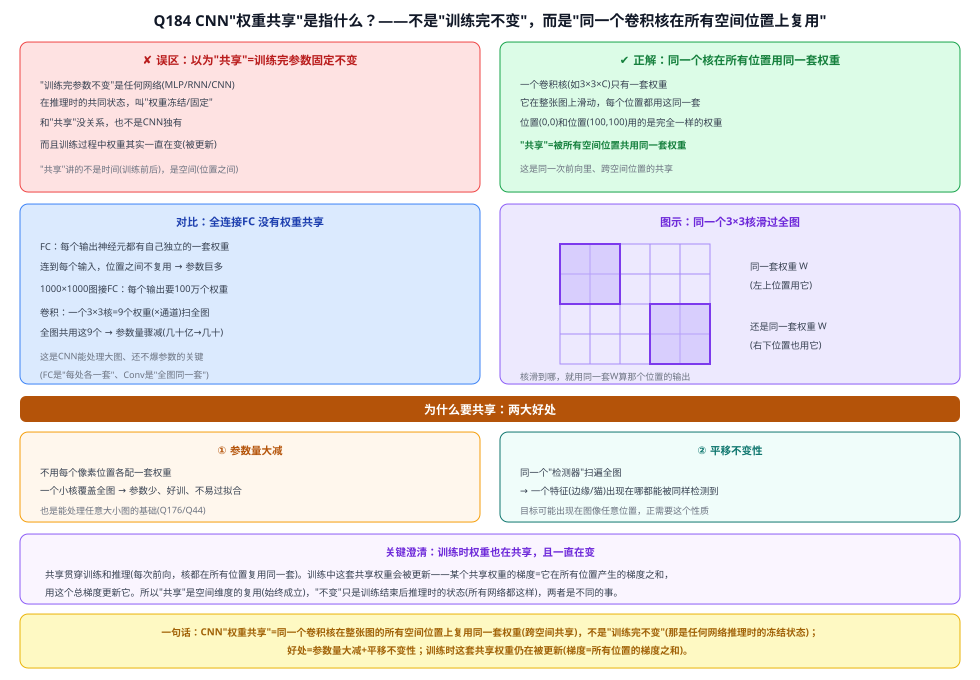
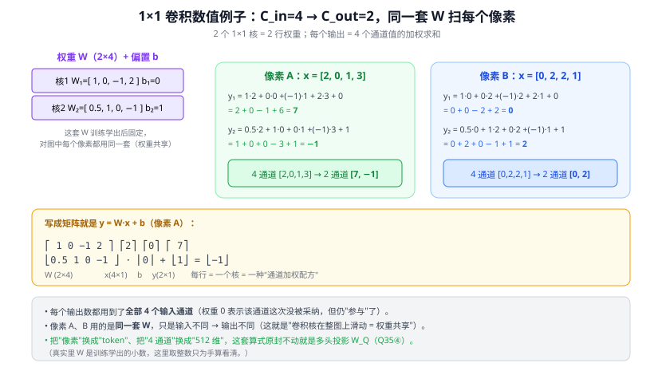
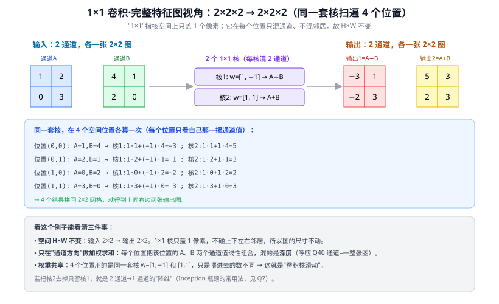
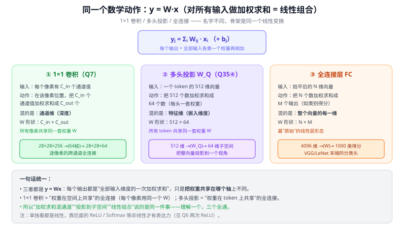
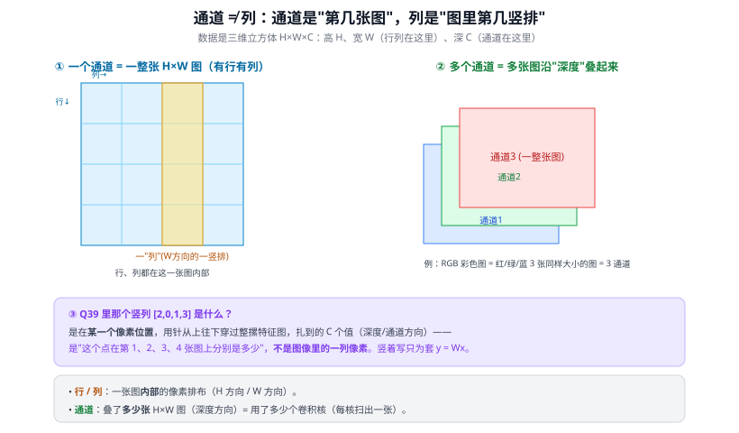
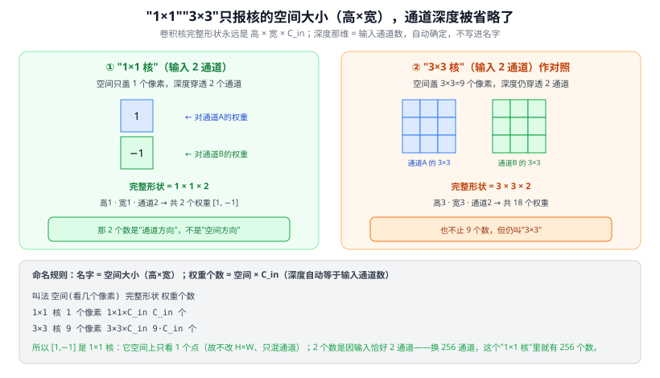
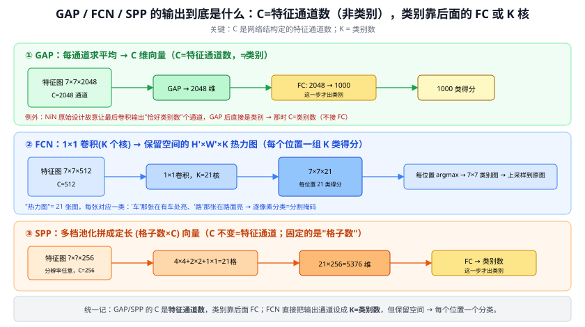
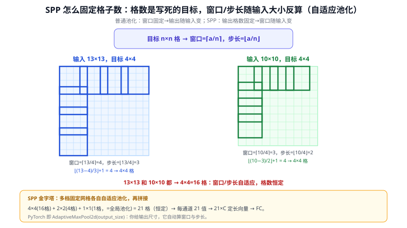
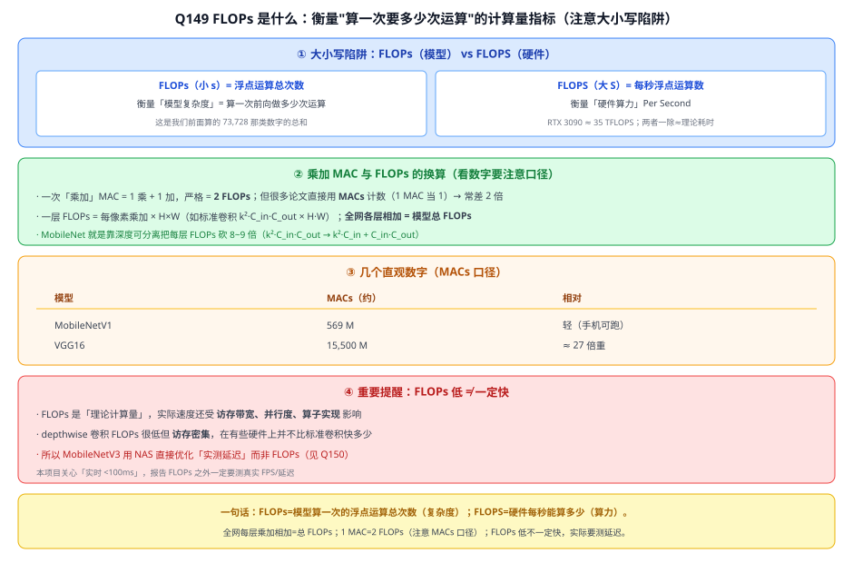
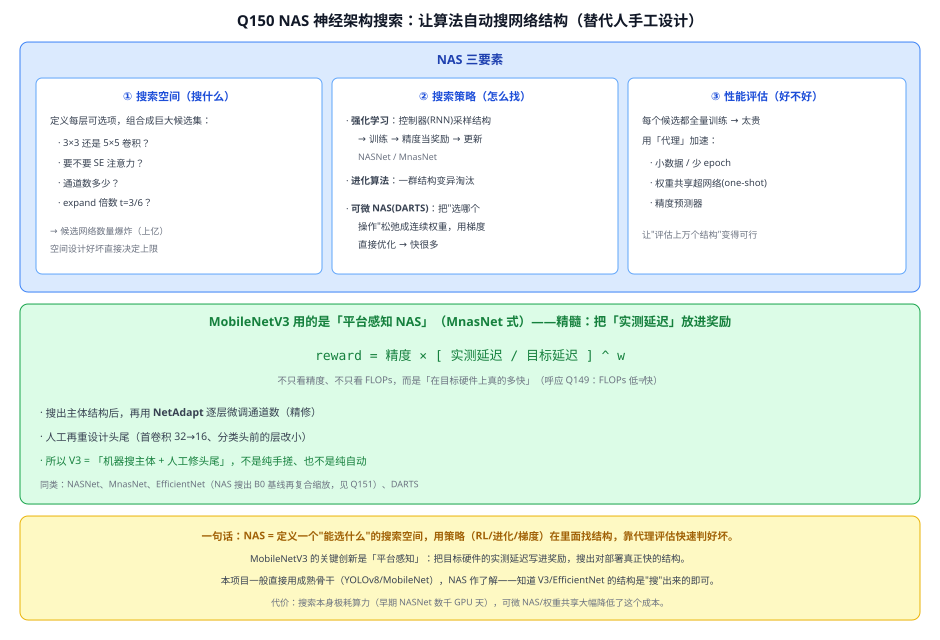

# 答疑 · CNN 骨干

> 模型详解系列答疑 · 分册之二　|　⬅ 返回答疑总目录
> 本篇留存 **CNN 通用概念**问答（Q5 卷积核学习、Q39–Q41 1×1/通道/核命名、Q48–Q50 GAP·FCN·SPP）；**专属某模型**的（Q4→LeNet、Q6→VGG、Q7/Q8/Q52/Q53→GoogLeNet、Q9→ResNet、Q54→SE-Net、Q55→CBAM）已并入对应模型文章。
> 标题约定：把口语化提问润色成书面小标题（保留原意）。

## 本篇目录
- Q5 卷积核是学出来的，不是设计的
- Q39 1×1 卷积本质就是对所有输入通道做线性组合吗
- Q40 通道是什么，能简单理解成"列数"吗
- [Q41 w=[1,−1] 有两个数，为什么还叫"1×1"卷积核](答疑_02_CNN骨干.md#q41-w11-有两个数为什么还叫11卷积核)
- Q48 GAP/FCN/SPP 里的 C 是类别数吗、输出到底是什么
- Q49 FCN 是如何上采样的
- Q50 SPP 是如何做到固定的空间格子数的
- Q59 什么是双线性插值（bilinear interpolation）

---

# 三、CNN 骨干

## Q5. 卷积核是人设计的，还是训练学出来的？

> 关联文章：05 LeNet、06 AlexNet、18 R-CNN　提问日期：2026-06-16
> 配套：与 Q4 成对——核的"规格"是人定的经验超参，核的"内容"是机器学的。

**简答**：卷积核**不是人设计的，是训练学出来的**。人只决定核的"外形规格"（大小、数量，超参数），核里的每个权重值都是**随机初始化 + 反向传播自动学习**得到的。各核各不相同的特征分工，是梯度下降为降低损失自发涌现的，不是人安排的。

**展开**：

**① 人决定什么 vs 机器学什么**

| | 谁定 | 例子 |
|---|------|------|
| 核**大小** | 人（超参） | 5×5、3×3 |
| 核**数量** | 人（超参） | 6 个、96 个 |
| 核里**具体权重** | **机器学** | 那 5×5=25 个数字 |

一个 5×5 核 = 25 个待定数字 + 1 偏置，训练前是**随机**的（高斯初始化），输出一片噪声。

**② "各不相同的特征"靠训练涌现**
流程：随机初始化 → 前向 → 算损失 → 反向传播算梯度（Q1）→ 微调每个权重 → 重复几万次。
6 个核初始都随机，为何最后分工不同？**随机初始化的微小差异 + 梯度下降的"分工压力"**：若两核学得太像则信息冗余、无助降损失，梯度推它们朝不同方向走、各管一种特征，整体损失才最低。分工是"为把任务做好"自动涌现的，非人安排。
> 类比：6 个新员工同样随机起点做复杂任务，为效率最高会自发分工，没人指派但分工自然出现。

**③ 学出来的核长什么样（实证）**
可视化训练好的 CNN，核自动学成层次化探测器：
```
浅层：边缘、颜色、方向线条   ← 像人眼初级视觉
中层：纹理、角点、简单形状
深层：物体部件 → 整个物体
```
没有一行代码"设计"它，全从数据学出——这正是深度学习"端到端自动学特征"相对传统"人工设计特征(HOG/SIFT)"的革命性（对比 18 R-CNN 前的手工特征时代）。

**④ 与本项目的关系**
- **预训练权重**：别人在 ImageNet 上训好的核（已会检测通用特征），直接下载用。本项目的 **YOLOv8 预训练权重、CLIP 的 ViT 权重**，本质就是"一大堆学好的核/注意力权重"。
- **迁移学习/微调**：拿学好的核，在路面抛洒物数据上再训几轮，从"识别通用物体"微调到"识别抛洒物"。
- 所以不会去"设计"卷积核，而是：**选架构（定规格和数量）→ 加载预训练核 → 自己数据上微调**。

---

## Q184. CNN 的"权重共享"，是指某个 CNN 训练完参数固定不变、所以叫"共享"吗？（附：FC 就是乘法所以参数量大吗？）

> 关联文章：[Q5 卷积核是学出来的](#q5-卷积核是人设计的还是训练学出来的)、04 CNN 原理、Q70 滑窗=一层卷积、Q176 全卷积尺寸自由、Q44 定长约束卡在 FC、Q179 1×1 卷积权重共享　提问日期：2026-07-24
> 关键结论：**不是**。你说的"训练完参数固定不变"是**另一回事**——那叫"权重冻结/固定"，是**任何网络（MLP/RNN/CNN）推理时的共同状态**，不是 CNN 独有、也不叫"共享"。CNN 的"**权重共享（weight sharing）**"指的是：**同一个卷积核（同一套权重）在整张图的所有空间位置上被反复复用**——核滑到哪，就用这同一套权重算那个位置的输出，位置 (0,0) 和位置 (100,100) 用的是**完全一样**的权重。所以"共享"讲的是**空间维度**（位置之间共用一套权重），不是**时间维度**（训练前后变不变）。而且训练过程中这套共享权重**一直在被更新**（它的梯度 = 它在所有位置产生的梯度之和），并不是"不变"。附带回答 FC 的问题：FC 参数量大**不是"因为它是乘法"**（卷积也是乘加），而是**因为它"全连接、无权重共享"**——每个输入-输出对都有自己独立的一个权重。

**简答**：先纠正误区——"训练完参数不变"是所有训练好的模型在推理时的共同状态（叫权重冻结），跟"共享"无关。CNN 的权重共享是说：一个卷积核只有一小套权重，但它在整张图上**滑动**，**每个位置都复用这同一套权重**。就像用同一个印章在纸上不同地方盖章，章（权重）只有一个，盖遍全图。好处是参数量骤减 + 平移不变性。至于 FC 为什么参数多：它是"每个输出神经元对每个输入都有一个独立权重"，没有共享，所以参数 = 输入维 × 输出维，随维度爆炸——**是"全连接无共享"导致的，不是"是乘法"导致的**（卷积也是乘法，参数却很少）。

**展开**：

**① 先纠正误区："不变" ≠ "共享"**
- **"训练完参数不变"**：这是**任何**网络（MLP、RNN、CNN、Transformer）训练结束后、推理时的共同状态，叫**权重冻结/固定**。不是 CNN 独有，也不是"共享"的意思。而且训练**过程中**权重一直在变（被梯度更新）。
- **"权重共享"**：讲的是**空间**——同一套权重被图上所有位置共用，和"时间上变不变"是两个维度的事。

**② 权重共享到底指什么**
一个卷积核（如 3×3×C_in）只有**一套**权重。它在整张特征图上**滑动**，在每一个位置都用**这同一套权重**做卷积计算：
```
核滑到左上角 (0,0)   → 用权重 W 算输出
核滑到中间 (50,50)   → 还是用同一套 W
核滑到右下 (100,100) → 依然是同一套 W
```
所有空间位置**共用**这一套 W——这就是"权重共享"。（同理 Q179 的 1×1 卷积、Q70 的滑窗，本质都是这个。）

**③ 对比 FC：为什么 FC 没有共享、参数还多（回答你的第二问）**
- **FC（全连接）**：每个输出神经元都有**自己独立的一套权重**连到**每个**输入，位置之间**不复用**。所以参数量 = **输入维 × 输出维**（+偏置）。一张 1000×1000 的图接 FC，每个输出神经元就要 100 万个权重 → 参数爆炸。
- **卷积**：一个 3×3 核 = 9 个权重（×通道），**全图共用这 9 个** → 参数量骤减。

> ⚠️ 所以你说"FC 是乘法所以参数量大"——**因果不对**。卷积**也是**乘加运算（[Q39](#q39-1×1-卷积把-cin-通道加权求和成-cout本质就是对所有输入通道做线性组合吗)），但参数很少。FC 参数多的真正原因是"**全连接 + 无权重共享**"：每个输入-输出对都单独配一个权重，参数随维度相乘而爆炸。"是乘法"是 FC 和卷积的共同点，不是 FC 参数多的原因；"无共享、全连接"才是。

**④ 权重共享的两大好处**
1. **参数量大减**：不用每个像素位置各配一套权重，一个小核覆盖全图 → 参数少、好训、不易过拟合，也是 CNN 能吃任意大小图的基础（Q176/Q44）。
2. **平移不变性**：同一个"检测器"（核）扫遍全图 → 一个特征（边缘、猫脸）无论出现在图像哪个位置，都能被**同样**检测到。目标可能出现在任意位置，正需要这个性质。

**⑤ 澄清：训练时权重也在共享、且在变**
共享**贯穿训练和推理**——每次前向，核都在所有位置复用同一套。训练中这套共享权重会被**更新**：某个共享权重的梯度 = 它在**所有位置**产生的梯度**之和**，用这个总梯度更新它。所以"共享"是空间维度的复用（始终成立），"不变"只是训练结束后推理时的冻结状态（所有网络都这样）——两者是不同的事。



> 图解：误区=以为"共享"是训练完参数固定(其实那是任何网络推理时的权重冻结，且训练中权重一直变)；正解=同一个核在全图所有位置复用同一套权重(跨空间共享，非跨时间)；对比FC=每个输出对每个输入各一套权重、无共享、参数=输入×输出爆炸；FC参数多因"全连接无共享"非"是乘法"(卷积也是乘加但参数少)；两好处=参数大减+平移不变；训练时权重仍共享且被更新(梯度=所有位置之和)。

> **与本项目**：权重共享是 CNN（含 YOLOv8 骨干）参数高效的根本原因，也是它能处理任意尺寸输入、且对目标位置鲁棒的基础。理解它才懂：为什么加一个卷积检测头/P2 层参数增加很有限（Q179 只多一套共享的 1×1 核），以及为什么现代检测器都尽量避开 FC（参数爆炸 + 焊死尺寸，Q176）。

---

## Q39. 1×1 卷积"把 Cin 通道加权求和成 Cout"，本质就是对所有输入通道做线性组合吗？

> 关联文章：08 GoogLeNet/Inception、28 Transformer　提问日期：2026-06-23
> 关键结论：**完全正确**。1×1 卷积、多头投影（W_Q/W_K/W_V）、全连接层，骨架都是同一个 $y=Wx$——"每个输出 = 全部输入维度的一次加权求和（线性组合）"，区别只在**权重共享在哪个轴上**。理解一个，三个全通。

**简答**：对。1×1 卷积在每个像素位置，把 $C_{in}$ 个通道值各乘一个权重再相加，得到一个输出通道值；用 $C_{out}$ 个核就得到 $C_{out}$ 个——这正是"对所有输入通道做线性组合"，等价于一个 $C_{in}\to C_{out}$ 的**全连接**，只不过这套权重**被所有像素共享**。它和 Transformer 的投影矩阵（Q35④）、普通全连接层是**同一个数学动作**。

**展开**：

**① 为什么"1×1 卷积 = 跨通道线性组合"**
1×1 核空间上只盖 1 个像素，但深度方向**贯穿全部 $C_{in}$ 通道**。在某个像素位置 $(h,w)$，一个核输出：
$$y_k=\sum_{i=1}^{C_{in}} W_{i,k}\cdot x_i + b_k\qquad(k=1,\dots,C_{out})$$
$x_i$ 是该像素第 $i$ 个通道的值，$W_{i,k}$ 是第 $k$ 个核对第 $i$ 通道的权重。这就是把 $C_{in}$ 个数加权求和成 1 个数——标准的**线性组合**。$C_{out}$ 个核 → $C_{out}$ 个不同配方 → $C_{out}$ 个输出通道（与 Q7 的"逐像素跨通道全连接"是一句话）。

**② 和"全连接 / 投影矩阵"是同一件事**

| | 输入 | 混的是哪个轴 | 权重共享在 | W 形状 |
|---|------|------------|-----------|--------|
| **1×1 卷积** | 每像素 $C_{in}$ 通道 | 通道维 | **所有像素**共享 | $C_{in}\times C_{out}$ |
| **多头投影 W_Q** | 每 token 512 维 | 特征维 | **所有 token**共享 | $512\times64$ |
| **全连接 FC** | 拍平 N 维向量 | 整向量每一维 | 不共享（最一般） | $N\times M$ |

三者都是 $y=Wx$。换句话说：**1×1 卷积 = "权重在空间上共享"的全连接**；**多头投影 = "权重在 token 上共享"的全连接**。所谓"加权求和混通道""投影到子空间""线性组合"，说的是同一回事。

**③ 带真实数值的例子（$C_{in}=4\to C_{out}=2$，手算一遍）**
设这层有 **2 个 1×1 核**（即 $C_{out}=2$），训练学出的权重和偏置为：
- 核1：$W_1=[\,1,\ 0,\ -1,\ 2\,]$，$b_1=0$
- 核2：$W_2=[\,0.5,\ 1,\ 0,\ -1\,]$，$b_2=1$

取特征图上**像素 A**，它的 4 个通道值为 $x=[2,\ 0,\ 1,\ 3]$：
$$y_1 = 1{\cdot}2 + 0{\cdot}0 + (-1){\cdot}1 + 2{\cdot}3 + 0 = \mathbf{7}$$
$$y_2 = 0.5{\cdot}2 + 1{\cdot}0 + 0{\cdot}1 + (-1){\cdot}3 + 1 = \mathbf{-1}$$
→ 该像素 **4 通道 $[2,0,1,3]$ 变成 2 通道 $[7,-1]$**。

换**像素 B**，通道值 $x=[0,\ 2,\ 2,\ 1]$，**用同一套 $W$**（权重共享，卷积核在整图滑动）：
$$y_1 = 1{\cdot}0+0{\cdot}2+(-1){\cdot}2+2{\cdot}1+0=\mathbf{0},\quad y_2=0.5{\cdot}0+1{\cdot}2+0{\cdot}2+(-1){\cdot}1+1=\mathbf{2}$$
→ $[0,2,2,1]$ 变成 $[0,2]$。写成矩阵：
$$\begin{bmatrix}1&0&-1&2\\0.5&1&0&-1\end{bmatrix}\begin{bmatrix}2\\0\\1\\3\end{bmatrix}+\begin{bmatrix}0\\1\end{bmatrix}=\begin{bmatrix}7\\-1\end{bmatrix}$$
$W$ 是 $2\times4$（$C_{out}\times C_{in}$），**每一行就是一个核 = 一种"通道加权配方"**。三点观察：① 每个输出都用到了**全部 4 个输入通道**（权重为 0 只表示这次没采纳，仍算"参与"）；② A、B 用的是**同一套 $W$**，输入不同才输出不同；③ 把"像素"换成"token"、"4 通道"换成"512 维"，这套算式原封不动就是 Q35④ 的多头投影 $W_Q$。



> 图解：左侧固定权重 $W$（2 行 = 2 个核），中右两块分别手算像素 A、B；底部给出矩阵形式 $y=Wx+b$ 与三点结论（每输出用全部通道 / 两像素共享 W / 同式即多头投影）。

**③b 摆成完整特征图看（$2\times2\times2 \to 2\times2\times2$，"1×1"的空间含义）**
上面是盯一个像素算。把它放回**整张特征图**就更能看清"1×1"三个字的意思。设输入是 **2 通道、每张 $2\times2$** 的特征图（通道 = 一整张图，见 Q40）：

```
通道A        通道B
[1  2]       [4  1]
[0  3]       [2  0]
```
用 **2 个 1×1 核**：核1 $w=[1,-1]$（算 A−B）、核2 $w=[1,1]$（算 A+B）。把核**在 4 个空间位置各滑一次**，每个位置只看"该位置那一摞通道值"：

```
位置(0,0): A=1,B=4 → 核1: 1·1+(−1)·4=−3 ; 核2: 1+4=5
位置(0,1): A=2,B=1 → 核1: 1·2+(−1)·1= 1 ; 核2: 2+1=3
位置(1,0): A=0,B=2 → 核1: 0+(−1)·2 =−2 ; 核2: 0+2=2
位置(1,1): A=3,B=0 → 核1: 3+0     = 3 ; 核2: 3+0=3
```
4 个结果各自拼回 $2\times2$，得到 **2 张输出图**：
```
输出1 = A−B    输出2 = A+B
[−3  1]        [5  3]
[−2  3]        [2  3]
```
即 $2\times2\times2 \to 2\times2\times2$。这个视角能看清"1×1"的三层含义：
- **空间 $H\times W$ 不变**（2×2→2×2）：核只盖 1 像素、不碰邻居，所以不改图的尺寸（这正是 1×1 和 3×3 的区别——3×3 会混上下左右邻居）。
- **只在通道方向加权求和**：每个位置把 A、B 两个通道值线性组合，混的是**深度**。
- **权重共享**：4 个位置用的是同一套核，只是喂进去的数不同——这就是"卷积核滑动"。



> 图解：左输入两张 $2\times2$ 图（通道 A/B），中间两个 1×1 核，右输出两张图（A−B、A+B）；下方逐位置手算 4 次，并点出"空间不变 / 只混通道 / 权重共享"。若只留核1，就是 2 通道→1 通道的"降维"（Q7 瓶颈常用法）。



> 图解：中心是统一公式 $y_j=\sum_i W_{ij}x_i$；三列分别展示 1×1 卷积（混通道维）、多头投影（混特征维）、全连接（混整向量），形状不同但骨架一致；底部点出"区别只在权重共享在哪个轴上"。

**④ 一个要点：线性本身不够，靠后面的非线性**
单独一个 $y=Wx$ 是线性的，多个线性层直接叠等于一个线性层（表达力不增）。真正的威力来自夹在中间的 **ReLU/Softmax 等非线性**——所以 1×1 卷积后通常跟 BN+ReLU，投影后有 Softmax 注意力，FC 之间有激活（呼应 Q6 强调的"两次 ReLU 比一次非线性更强"）。

**⑤ 与本项目**
- 看懂"线性组合"这层统一，YOLOv8 里的 1×1 卷积（通道调整/瓶颈）、CLIP 的 ViT 投影、检测头的全连接就都是同一套积木，不必分别死记。
- 第三章的 CBAM 通道注意力，本质也是"对通道做加权"（只是权重由输入动态算出，不再是固定 $W$）——理解固定线性组合，才好理解"动态加权"的注意力是它的升级版。

---

## Q40. 通道是什么？能简单理解成"列数"吗？

> 关联文章：04 CNN 原理、05 LeNet　提问日期：2026-06-23
> 关键结论：**不能**。通道**不是列**。一个通道 = 一整张 $H\times W$ 的二维特征图（里面才有行和列）；通道是把多张这样的图沿**深度**叠起来。数据是三维立方体 $H\times W\times C$：行/列在 $H$、$W$ 两个方向，通道在第三个方向 $C$。

**简答**：通道（channel）= 一整张二维特征图（$H\times W$ 矩阵）。彩色图 RGB = $H\times W\times 3$，那个 **3 是通道**：红/绿/蓝三张同样大小的网格叠在深度方向，不是"3 列"。"列"是某一张图**内部**宽度方向的一竖排像素；通道是"第几张图"。Q39 里那个竖列 $[2,0,1,3]$ 不是图像的一列，而是**一个像素穿过 4 张特征图得到的 4 个深度值**，竖着写只为套 $y=Wx$。

**展开**：

**① 三维立方体：行、列、通道是三个不同方向**
一个特征图是 $H\times W\times C$ 的立方体：
- $H$（高）方向 = **行**
- $W$（宽）方向 = **列**
- $C$（深）方向 = **通道**

行和列描述"一张图内部像素怎么排"，通道描述"叠了多少张图"。三者互不相同——**通道既不是行也不是列，是垂直于这张图的第三个方向**。

**② 最直观的例子：彩色图 RGB**
一张 $224\times224$ 彩色照片 = $224\times224\times3$。这里 3 = 通道数 = 红、绿、蓝**三张** $224\times224$ 的灰度网格叠起来。说"3 列"是错的——每张图自己就有 224 列；3 指的是叠了 3 张。灰度图则是 $224\times224\times1$（单通道）。

**③ 类比：一摞透明胶片**
- 每张胶片 = 一个通道 = 一整张 $H\times W$ 图
- $C$ 张胶片叠成一摞 = $H\times W\times C$ 特征图
- 在某位置 $(h,w)$ 用针**从上往下穿透整摞**，扎到的 $C$ 个数 = 该像素的"通道向量"

这根"针"扎出的竖列，正是 Q39 里的 $[2,0,1,3]$——同一像素在第 1/2/3/4 张图上的值，是**深度方向**，不是图像的一列像素。



> 图解：左边一张特征图内部高亮"一列"（W 方向竖排）；右边三张图沿深度叠成 RGB 三通道；中间点明 Q39 竖列 = 一个像素穿过整摞的通道向量；底部对照"行/列 vs 通道"。

**④ 通道数从哪来、随网络怎么变**

| 概念 | 是什么 | 方向 |
|------|--------|------|
| 行 / 列 | 一张特征图**内部**的像素排布 | $H$ / $W$ |
| **通道** | **一整张** $H\times W$ 特征图 | $C$（深度） |

- 输入：灰度 1 通道，彩色 3 通道。
- 卷积后：**通道数 = 这一层用了多少个卷积核**（每个核扫全图产出一张特征图 = 一个输出通道，见 Q4、Q5）。
- 全程规律：越深 **空间 $H\times W$ 递减、通道 $C$ 递增**（"用通道换分辨率"金字塔，Q6）。

**⑤ 与本项目**
- 读 YOLOv8 结构图时，每个方块标的 `H×W×C`，$C$ 就是通道数，别和宽度 $W$ 搞混。
- 第三章加 P2 是在**浅层、高分辨率（大 $H\times W$）但通道较少**处接出一支检测小目标；CBAM 的"通道注意力"就是给这 $C$ 张特征图各打一个重要性权重——理解"通道 = 一张图"，才看得懂它在给"哪些图"加权。

---

## Q41. w=[1,−1] 有两个数，为什么还叫"1×1"卷积核？

> 关联文章：04 CNN 原理、08 GoogLeNet/Inception　提问日期：2026-06-23
> 关键结论：**"1×1"只报核的空间大小（高×宽），通道深度被省略了**。卷积核的完整形状永远是 $k_h\times k_w\times C_{in}$，深度那一维自动等于输入通道数、不写进名字。$w=[1,-1]$ 空间是 $1\times1$（只盖 1 个像素），那 2 个数是**通道方向**的（因为输入有 2 通道），完整形状其实是 $1\times1\times2$。

**简答**：核的名字（1×1、3×3、5×5）只说它**在空间上盖几个像素**，不说它有几个通道权重。任何卷积核都必须**穿透全部输入通道**，所以深度维永远 $=C_{in}$，这一维大家默认省略。$w=[1,-1]$ 在图上只盖 1 个像素 → 空间 $1\times1$ → 叫"1×1 核"；它有 2 个权重，是因为本例输入恰好 2 通道（A、B），每个通道配一个权重。

**展开**：

**① 卷积核的完整形状是三维：高 × 宽 × $C_{in}$**
平时说"3×3 核""1×1 核"是简称，完整写法是 $k_h\times k_w\times C_{in}$：
- $k_h\times k_w$：**空间尺寸**——核在图上一次盖住几行几列像素（决定看不看邻居）。
- $C_{in}$：**深度**——核必须同时贯穿输入的全部通道，所以这一维强制 $=C_{in}$。

因为深度永远等于 $C_{in}$、没有选择余地，命名时就把它省了，只留下能自由选的空间尺寸。所以"1×1""3×3"是**空间大小的标签**，与通道数无关。

**② 回到 $w=[1,-1]$**
本例输入 2 通道（通道 A、通道 B，见 Q40）。这个核：
- 空间上**只盖 1 个像素**（不碰上下左右邻居）→ $k_h\times k_w=1\times1$ → 叫"1×1 核"
- 深度方向有 **2 个权重** $[1,-1]$，分别乘通道 A、通道 B → 深度 $=C_{in}=2$

$$\text{完整形状}=\underbrace{1}_{高}\times\underbrace{1}_{宽}\times\underbrace{2}_{C_{in}}$$
那 2 个数是"**对不同通道的权重**"（深度方向），**不是**"在空间上排了 2 格"。空间永远只有 1 格——这才是"1×1"的含义。

**③ 用 3×3 对照就清楚了**
同样输入 2 通道，一个"3×3 核"的完整形状是 $3\times3\times2=18$ 个权重，它也远不止 9 个数，但我们照样叫它"3×3"：

| 叫法 | 空间（看几个像素） | 完整形状 | 权重个数 |
|------|------------------|---------|---------|
| **1×1 核** | 1 个像素 | $1\times1\times C_{in}$ | $C_{in}$ 个 |
| 3×3 核 | 9 个像素 | $3\times3\times C_{in}$ | $9\,C_{in}$ 个 |
| 5×5 核 | 25 个像素 | $5\times5\times C_{in}$ | $25\,C_{in}$ 个 |

可见**权重个数 = 空间格数 × $C_{in}$**；名字只取"空间格数"那部分。



> 图解：左 1×1 核（输入 2 通道）完整形状 $1\times1\times2$，2 个权重是深度方向；右 3×3 核完整形状 $3\times3\times2$=18 权重，仍叫"3×3"；底部表格点出"名字=空间大小，权重数=空间×C_in"。

**④ 为什么这个区分重要**
- **1×1 的本质就藏在这里**：空间 1×1 = 只看一个点 = 不混邻居 → 所以它**不改 $H\times W$、只在通道方向做线性组合**（Q39）。3×3 空间更大 = 会混邻居 → 能改变/提取空间结构。这正是两者分工的根源。
- **权重个数随 $C_{in}$ 变**：本例 $C_{in}=2$ 故核里 2 个数；Q7 里 $28\times28\times256$ 上的 1×1 核，每个核就有 256 个权重。"1×1"不变，深度随输入通道走。
- **算参数量别忘乘 $C_{in}$**：一层参数量 $=k_h\times k_w\times C_{in}\times C_{out}$（Q6 用过此式），那个 $C_{in}$ 就是被名字省略的深度维。

---

## Q48. GAP/FCN/SPP 里的 C 是类别数吗？输出到底是什么？

> 关联文章：04 CNN 原理 §五、08 GoogLeNet、38 U-Net　提问日期：2026-06-23
> 关键结论：**GAP/SPP 里的 C 是"特征图通道数"（网络结构定的），不是类别数**——类别靠它们后面接的那个 FC 才得到。**只有 FCN 直接把输出通道设成 K=类别数**，但保留空间维（每个位置一组类别得分）。

**简答**：① **GAP**：输出 $C$ 维，$C$ 是输入特征图的**通道数**（如 ResNet 的 2048），不是类别；GAP 后**再接一个 FC（2048→类别数）**才出分类。（例外：NiN 原始设计故意让最后卷积输出"恰好类别数"个通道，那时 $C$=类别数、不接 FC。）② **FCN**：输出 $H'\times W'\times K$ 的空间热力图，$K$=类别数，**每个空间位置都有一组 $K$ 类得分**，逐位置 argmax → 分割掩码。③ **SPP**：输出**定长向量**，长度 = 固定格子数 × $C$，$C$ 仍是特征通道数（不变）；固定的是"空间格子数"（与分辨率无关），这个向量再接 FC → 类别。

**展开**：

**① GAP：$C$ 是特征通道数，不是类别**
GAP 把 $H\times W\times C$ 每个通道求一个平均 → $C$ 维向量。这个 $C$ 是**网络高层的特征通道数**（架构决定），与类别无关：
```
ResNet：7×7×2048 ──GAP──► 2048 维 ──FC(2048→1000)──► 1000 类得分
                          C=2048(特征通道)   ↑ 这一步才把"特征"映射成"类别"
```
所以你说的"$C$ 提前设计好"对（架构定的），但"$C$ 就是类别数"**通常不成立**。
> 唯一例外：**NiN（GAP 的提出者）**故意把最后一层卷积的输出通道设成"恰好类别数"（如 10），GAP 后直接得 10 维 = 类别得分，省掉 FC。这种特定设计下 $C$=类别数。现代网络（ResNet 等）则是 $C$=特征通道、后接 FC。

**② FCN：空间热力图 = $K$ 张图，每张一类**
FCN 把末端 FC 换成卷积，输出**保留空间**的 $H'\times W'\times K$（$K$=类别数）。**每个空间位置都有一组 $K$ 个类别得分**——可看成 $K$ 张热力图叠在一起，每张对应一个类别，图上每点的值=该位置"有多像这个类"。

**举例（语义分割）**：输入 $224\times224\times3$ 的路面图：
```
输入 224×224×3
骨干下采样 ──► 7×7×512            （C=512 特征通道）
1×1 卷积，K=21 个核 ──► 7×7×21    （VOC 20 类 + 背景；每个位置 21 类得分）
每个位置 argmax(21) ──► 7×7 类别图
上采样 ×32 ──► 224×224 每像素一个类别 = 分割掩码
```
- "汽车"那张热力图在有车处亮、"路面"那张在路面亮；
- 对比分类：分类整图只给**一个** $K$ 维向量（一个答案）；FCN 给 $H'\times W'$ 个 $K$ 维向量（**每个位置一个答案**）→ 这就是"稠密/像素级预测"（38 U-Net 同理，输出同尺寸掩码）。

**③ SPP：定长 = 格子数 × $C$，$C$ 不是类别**
SPP 对特征图分多档网格池化再拼接。设输入 $?\times?\times256$（分辨率任意）、档位 4×4+2×2+1×1=21 格：
```
每通道 21 个值 × 256 通道 = 21×256 = 5376 维定长向量 ──FC──► 类别数
```
- **通道数 $C$=256 不变**（SPP 不改通道）；
- **固定的是"空间格子数 21"**（与输入分辨率无关，这才是 SPP 的目的）；
- 这个 5376 维向量**再接 FC → 类别数**。所以 $C$ 是特征通道、**不是分类**。

> 你的说法"固定的通道数和 C"要更正一下：SPP **不固定也不改通道数**（$C$ 本来就不随分辨率变）；它固定的是**空间格子总数**。最终向量长度 = 格子数 × $C$。

**④ 一句话统一**
| 技术 | 输出 | 里面的 $C$/$K$ 是什么 | 谁出类别 |
|------|------|----------------------|---------|
| GAP | $C$ 维向量 | $C$=特征通道数 | 后接 FC（NiN 式除外） |
| FCN | $H'\times W'\times K$ 空间图 | $K$=类别数（保留空间） | 每位置 argmax |
| SPP | 格子数×$C$ 定长向量 | $C$=特征通道数 | 后接 FC |



> 图解：三行分别画 GAP（→C 维→FC→类别）、FCN（→H'×W'×K 热力图→逐位置 argmax→分割）、SPP（→格子数×C 定长→FC→类别），标清 C=特征通道、K=类别数。

**⑤ 与本项目**
- YOLOv8 骨干末端用 **GAP 思路/SPPF** 提特征，检测头是**全卷积（FCN 式）**——每个网格位置输出一组"框+类别"得分（25 YOLO演进），正是"保留空间、每位置一个预测"的稠密预测（Q21）。
- 想清"特征通道 $C$ vs 类别数 $K$"，看 YOLOv8 输出张量 `H×W×(框参数+类别数)` 时就不会把通道和类别混为一谈。

---

## Q49. FCN 是如何上采样的？

> 关联文章：04 CNN 原理 §五、38 U-Net、21 FPN　提问日期：2026-06-23
> 关键结论：主要靠**转置卷积（反卷积，可学习的上采样）**把粗特征图放大；权重常用**双线性插值初始化**；再用**由粗到细的跳跃融合（FCN-32s→16s→8s）**把深层粗预测与浅层细节相加，得到边界清晰的分割图。

**简答**：FCN 骨干一路下采样，最后只剩很粗的预测图（如 $7\times7\times K$，Q48），要还原到原图分辨率做逐像素预测，就得**上采样**。核心手段是**转置卷积（transposed conv）**——一种**可学习**的放大：每个输入值乘上一个核"盖"到输出、按步长错开、重叠处相加，从而把 $H\times W$ 变大。它常被初始化成**双线性插值**（开局即平滑放大，再学）。但只放大一次太糊，FCN 还用**跳跃融合**：把放大的深层预测与更浅层（pool4、pool3）的预测逐级相加细化（FCN-32s→16s→8s）。

**展开**：

**① 核心：转置卷积（反卷积）怎么放大**
普通卷积 stride 2 会**缩小**（4→2）；转置卷积反过来把形状放**大**（2→4）。机制：**每个输入值乘整个核、按步长错位"盖"到输出，重叠处相加**。

1D 例：输入 $[2,3]$、核 $[1,2,1]$、步长 2：
- $2$ 盖核 → $[2,4,2]$ 放在位置 0–2
- $3$ 盖核 → $[3,6,3]$ 放在位置 2–4（错开步长 2）
- 位置 2 重叠相加 $2+3=5$
- 输出 $[2,4,5,6,3]$ —— **2 个值 → 5 个值，放大了**

> 等价视角："输入之间插零 → 再做一次普通卷积"。2D 同理，stride-2 转置卷积把 $H\times W$ 放大约 2 倍。核里的权重是**训练学出来的**（Q5），所以叫"可学习的上采样"。

**② 初始化 = 双线性插值**
转置卷积权重常**初始化成双线性插值核**：开局就是平滑放大（等价普通插值），训练再让它从数据里继续学得更好。

**③ 其它上采样法（对比）**
- **双线性/最近邻插值**：固定、不可学习（最简单）。
- **反池化 unpooling**：记住下采样时 max 的位置，上采样时把值填回原位、其余补零（SegNet/DeconvNet 用），与 RoI Align 思路不同。

**④ 由粗到细：跳跃融合（FCN-32s → 16s → 8s）**
只把 $7\times7$ 一步放大 ×32 太糊（块状）。FCN 用"**深层语义 + 浅层细节**"逐级融合：

| 版本 | 做法 | 效果 |
|------|------|------|
| FCN-32s | $7\times7$ 预测直接转置卷积 ×32 | 粗、块状 |
| FCN-16s | 先 ×2，**加上 pool4 的预测**（$14\times14$），再 ×16 | 较细 |
| FCN-8s | 再 ×2，**加上 pool3 的预测**（$28\times28$），再 ×8 | 最清晰 |

思路：深层"语义强但分辨率低"，浅层"分辨率高、有边界细节"，逐级相加把细节找回来——这和 38 U-Net 的跳跃连接、21 FPN 的多尺度融合**同源**（都是"语义 + 细节"，只是 FCN/FPN 用相加、U-Net 用拼接）。


> 图解：上部转置卷积 1D 例（[2,3] 经核 [1,2,1] 步长2 → [2,4,5,6,3]，重叠位相加）；中部双线性初始化与其它上采样法；下部 FCN-32s/16s/8s 逐级融合浅层预测的由粗到细过程。

**⑤ 与本项目**
- 本项目做检测不做分割，但理解上采样很关键：**第三章加 P2**（21 FPN）的特征金字塔自顶向下融合，就要把深层小特征图**上采样**后与浅层相加——用的正是这套（FPN 多用最近邻/双线性插值，YOLOv8 颈部亦然）。
- 扩散模型的 U-Net 解码器（38 U-Net、39 扩散模型）同样靠转置卷积/插值上采样还原分辨率。

---

## Q50. SPP 是如何做到固定的空间格子数的？

> 关联文章：04 CNN 原理 §五、19 Fast R-CNN、25 YOLO 演进　提问日期：2026-06-23
> 关键结论：**格子数是写死的目标（超参数），SPP 反过来根据输入大小自适应算出"窗口多大、步长多少"，从而兜住输出格数**。普通池化"窗口固定→输出随输入变"；SPP/自适应池化"输出格数固定→窗口随输入变"。

**简答**：你先规定输出要分成 $n\times n$ 格（如 4×4）。对一张 $a\times a$ 的特征图，SPP 反算 **窗口 $=\lceil a/n\rceil$、步长 $=\lfloor a/n\rfloor$**，滑动池化后输出恰好 $n\times n$ 格——**输入大则每格窗口大、输入小则窗口小，但格数恒定**。这就是"自适应池化"。多档网格（4×4、2×2、1×1）各自这么做再拼接，得 16+4+1=21 格的定长表示。

**展开**：

**① 机制：把"输出几格"当目标，反算窗口/步长**
普通 max/avg 池化是"给定窗口和步长 → 输出尺寸被动算出（随输入变）"。SPP 反过来：
$$\text{给定输出 } n\times n \Rightarrow \text{窗口}=\lceil a/n\rceil,\ \text{步长}=\lfloor a/n\rfloor$$
于是无论输入 $a$ 多大，输出都被钉在 $n\times n$。

**② 两个输入 → 同样 4×4（验证）**
| 输入 | 目标 | 窗口 ⌈a/n⌉ | 步长 ⌊a/n⌋ | 输出 ⌊(a−win)/stride⌋+1 |
|------|------|-----------|-----------|--------------------------|
| 13×13 | 4×4 | ⌈13/4⌉=4 | ⌊13/4⌋=3 | ⌊(13−4)/3⌋+1 = **4** |
| 10×10 | 4×4 | ⌈10/4⌉=3 | ⌊10/4⌋=2 | ⌊(10−3)/2⌋+1 = **4** |

两个不同分辨率，都得到 **4×4=16 格**。窗口和步长自适应变化，格数恒定。



> 图解：左 13×13、右 10×10，各按公式算出不同的窗口/步长（4/3 与 3/2），但都划成 4×4 格；底部金字塔 4×4+2×2+1×1=21 格拼成定长向量。

**③ 金字塔拼接 → 定长向量**
SPP 同时用多档固定网格，各自自适应池化再拼接：
- 4×4 → 16 格、2×2 → 4 格、1×1 → 1 格（即全局池化，Q48 的 GAP）；
- 合计 **16+4+1=21 格**（恒定）；每通道 21 个值 → $21\times C$ 定长向量（$C$=特征通道，不变，见 Q48）。

> 工程上就是 PyTorch 的 `AdaptiveMaxPool2d(output_size)`：你给输出尺寸，它自动算窗口与步长。

**④ 与 GAP/RoI Pooling 的关系**
- **GAP** = SPP 的 1×1 档（整图池一个值，Q48）。
- **RoI Pooling**（Q47）= 单档 SPP，把任意大小 RoI 自适应池成固定 7×7——同一个"输出格数固定、窗口自适应"思想。

**⑤ 与本项目**
YOLOv8 的 **SPPF** 是 SPP 的快速版（串联几个相同 MaxPool 等效多尺度池化），放在骨干末端融合多尺度感受野（25 YOLO 演进）；理解"固定格数靠自适应窗口"才明白它为何能稳定输出、不挑输入尺寸。

---

## Q59. 什么是双线性插值（bilinear interpolation）？

> 关联文章：[Q49 FCN 上采样](#q49-fcn-是如何上采样的)、Q47 RoI Align、21 FPN、04 CNN 原理　提问日期：2026-06-25
> 关键结论：双线性插值 = 用离目标位置**最近的 4 个像素**，**先沿 x 方向插一次、再沿 y 方向插一次**（两次一维线性插值），估出一个**小数坐标**处的值。等价于"4 个角按离得远近加权求和，权重之和=1"。它平滑、连续，比最近邻不锯齿，是图像放大、上采样、RoI Align 取值的基础。

**简答**：放大图像或在特征图上按小数坐标采样时，目标位置 $(x,y)$ 往往落在像素之间、那里没有现成的值，要靠周围像素"插"出来。双线性插值就是取包住它的 4 个整数像素，先在 $x$ 方向做两次线性插值（上边一条、下边一条），再把这两个结果在 $y$ 方向线性插值一次——所以叫"双（两个方向）线性"。

**展开**：

**① 先看一维线性插值（打底）**
两个已知点 $A,B$ 之间求中间某点：按距离加权。点离 A 占比 $a$（$0\le a\le1$）：
$$\text{值}=A+a\,(B-A)=(1-a)A+aB$$
离谁近就更像谁。

**② 二维双线性 = 做三次一维插值**
设目标点 $P$ 落在 4 个整数像素围成的小方格里，横向占比 $a$、纵向占比 $b$，四角值为 $Q_{00}$(左上)、$Q_{10}$(右上)、$Q_{01}$(左下)、$Q_{11}$(右下)：
1. **沿 x 插上边**：$R_{top}=(1-a)Q_{00}+aQ_{10}$
2. **沿 x 插下边**：$R_{bot}=(1-a)Q_{01}+aQ_{11}$
3. **沿 y 插一次**：$P=(1-b)R_{top}+bR_{bot}$

合并成一个式子（4 角加权）：
$$P=(1-a)(1-b)Q_{00}+a(1-b)Q_{10}+(1-a)b\,Q_{01}+ab\,Q_{11}$$
每个角的权重 = 它**对角那块小矩形的面积**；4 个权重加起来正好是 1。

**③ 数值例子（$a=0.25,\ b=0.75$）**
四角 $Q_{00}=10,\ Q_{10}=20,\ Q_{01}=30,\ Q_{11}=40$，求 $P=(0.25,0.75)$：
```
先 x：上边 R_top = 10 + 0.25·(20−10) = 12.5
      下边 R_bot = 30 + 0.25·(40−30) = 32.5
再 y：P = 12.5 + 0.75·(32.5−12.5) = 12.5 + 15 = 27.5
```
用 4 角加权核对：
```
(1−.25)(1−.75)·10 = 0.1875·10 = 1.875
 .25 (1−.75) ·20 = 0.0625·20 = 1.25
(1−.25) .75 ·30 = 0.5625·30 = 16.875
 .25  .75  ·40 = 0.1875·40 = 7.5
合计 = 27.5  ✓
```


> 图解：左边单位方格里 P=(0.25,0.75)、四角已知；右边①沿 x 插上下两边→②沿 y 插一次=27.5、③等价的 4 角面积加权；底部对比最近邻（抄最近像素=30、有锯齿）与双线性（27.5、平滑）。

**④ 对比最近邻插值**
| | 最近邻 | 双线性 |
|---|--------|--------|
| 取值 | 直接抄**最近**那个像素 | 4 邻居**按距离加权** |
| 效果 | 块状、有锯齿 | 平滑、连续 |
| 成本 | 最低 | 略高（仍很便宜） |
| 可导 | 否 | **对位置可导**（故能用于可学习采样） |

**⑤ 用在哪（本项目相关）**
- **图像 / 特征图上采样**：FPN、YOLOv8 颈部把深层小特征图放大去和浅层相加，常用最近邻或双线性（[Q49](#q49-fcn-是如何上采样的)）。
- **FCN 转置卷积初始化**：转置卷积权重常用双线性核初始化（[Q49](#q49-fcn-是如何上采样的)）。
- **RoI Align**：在浮点 RoI 坐标处用双线性**精确采样**、不取整，修正 RoI Pooling 的量化错位（Q47）——对小目标尤其重要。
- 本项目把 YOLOv8 检测框裁剪后送 CLIP，做 resize 到 CLIP 输入尺寸时也走这类插值。

---

## Q149. FLOPs 是什么？

> 关联文章：11 MobileNet 系列、Q145 深度可分离怎么省算力、[Q150 NAS](#q150-nas-神经架构搜索是如何搜索的)　提问日期：2026-07-14
> 关键结论：**FLOPs = Floating Point Operations = 浮点运算次数**，衡量"算一次前向要做多少次运算"的**计算量/模型复杂度**。有大小写陷阱：**FLOPs（小 s）= 运算总次数（模型复杂度）**；**FLOPS（大 S）= 每秒浮点运算数 Per Second（硬件算力，如 RTX 3090≈35 TFLOPS）**，两者一除≈理论耗时。换算：一次**乘加 MAC**=1乘+1加=**2 FLOPs**，但很多论文直接用 **MACs** 计数（1 MAC 当 1）→ 常差 2 倍，看数字要注意口径。一层 FLOPs = 每像素乘加（如标准卷积 k²·C_in·C_out）× H×W；**全网各层相加 = 模型总 FLOPs**——MobileNet 靠深度可分离把每层砍 8~9 倍。例：MobileNetV1≈569M MACs、VGG16≈15,500M MACs（≈27 倍）。**关键提醒：FLOPs 低 ≠ 一定快**——实际速度还受访存带宽、并行度、算子实现影响，depthwise FLOPs 低但访存密集，未必更快；所以 MobileNetV3 用 NAS 直接优化"实测延迟"（[Q150](#q150-nas-神经架构搜索是如何搜索的)）。本项目关心"实时<100ms"，报告 FLOPs 之外**一定要测真实 FPS/延迟**。

**简答**：FLOPs 是模型跑一次前向的浮点运算总次数（复杂度指标）。注意 FLOPs（小 s，模型算多少）≠ FLOPS（大 S，硬件每秒算多少）。1 次乘加 MAC 严格算 2 FLOPs，但常按 MACs 计数。全网每层的乘加加起来就是总 FLOPs。它是理论计算量，低不等于实际快。

**展开**：

**① 怎么算**：一层的 FLOPs = 每个输出像素的乘加次数 × 输出像素数（H×W×C_out）。卷积层每像素乘加 = k²·C_in·C_out（Q145）。把所有层加起来 = 模型总 FLOPs。

**② MAC 与 FLOPs 的口径**：MAC = multiply-accumulate（一次乘加）。严格 1 MAC = 2 FLOPs（乘 1 次 + 加 1 次）。但论文里常直接报 **MACs**（或叫 "FLOPs" 但其实是 MACs），差 2 倍。比较两个模型时确认口径一致。

**③ FLOPs 低 ≠ 快**：FLOPs 只是理论计算量。真实延迟还看：访存带宽（depthwise 计算少但读写多）、并行度、底层算子是否优化（1×1 走 GEMM 快，见 Q147 ⑥）。**评估轻量模型要同时看 FLOPs、参数量、和实测 FPS/延迟**。这也是 MobileNetV3 用平台感知 NAS 优化实测延迟的原因（[Q150](#q150-nas-神经架构搜索是如何搜索的)）。



> 图解：① FLOPs(小s,模型) vs FLOPS(大S,硬件)；② 1 MAC=2 FLOPs（注意 MACs 口径）、全网各层相加=总 FLOPs；③ MobileNetV1 569M vs VGG16 15,500M MACs；④ FLOPs 低≠快（访存/并行/实现），要测实测延迟。

---

## Q150. NAS（神经架构搜索）是如何搜索的？

> 关联文章：11 MobileNet 系列 §3.3、12 EfficientNet、[Q149 FLOPs](#q149-flops-是什么)、Q151 EfficientNet 复合缩放　提问日期：2026-07-14
> 关键结论：**NAS = Neural Architecture Search，让算法自动搜网络结构、替代人手工设计**，有三要素：**① 搜索空间（搜什么）**——定义每层可选项（3×3 还是 5×5、要不要 SE、通道数、expand 倍数 t）组合成巨大候选集；**② 搜索策略（怎么找）**——强化学习（控制器 RNN 采样结构→训练→精度当奖励→更新，NASNet/MnasNet）、进化算法（变异淘汰）、或可微 NAS（DARTS：把"选哪个操作"松弛成连续权重用梯度直接优化，快很多）；**③ 性能评估（好不好）**——全量训练每个候选太贵，用代理加速（小数据/少 epoch、权重共享超网络 one-shot、精度预测器）。**MobileNetV3 用平台感知 NAS（MnasNet 式）**，精髓是把**目标硬件的实测延迟**放进奖励 `reward=精度×[实测延迟/目标延迟]^w`（不只看精度、不只看 FLOPs，呼应 [Q149](#q149-flops-是什么)），搜出主体后再用 NetAdapt 逐层微调通道数、人工重设计头尾 → **"机器搜主体 + 人工修头尾"**。代价：搜索本身极耗算力（早期 NASNet 数千 GPU 天），可微 NAS/权重共享大幅降本。

**简答**：NAS 让算法自动搜结构。三步：定义搜索空间（有哪些可选积木）→ 用搜索策略（强化学习/进化/梯度）在里面挑组合 → 用代理快速评估每个候选好不好。MobileNetV3 的关键是"平台感知"：把目标硬件的实测延迟写进奖励，搜出对部署真快的结构。

**展开**：

**① 搜索空间**：把网络拆成可选积木——卷积核 3×3/5×5、要不要 SE 注意力、通道数、倒残差的 expand 倍数等，组合出上亿候选网络。空间设计的好坏直接决定能搜到多好。

**② 搜索策略**：
- **强化学习**：一个控制器（RNN）采样一个结构 → 训练它 → 拿验证精度当奖励 → 反过来更新控制器，让它更会采样好结构（NASNet、MnasNet）。
- **进化算法**：维护一群结构，互相变异、优胜劣汰。
- **可微 NAS（DARTS）**：把"这一层选哪个操作"松弛成一组连续权重（softmax），整个搜索变成可用**梯度**优化的问题，比 RL 快几个数量级。

**③ 性能评估**：全量训练每个候选太贵（上万个），用代理：小数据/少 epoch 训练、**权重共享超网络（one-shot，所有子结构共用一套权重只训一次）**、或训一个精度预测器。

**④ MobileNetV3 的平台感知 NAS**：奖励里加入**目标硬件实测延迟** `reward=精度×[延迟/目标]^w`，直接优化"在手机/边缘上真的多快"，而非理论 FLOPs（因为 FLOPs 低≠快，[Q149](#q149-flops-是什么)）。搜出主体后用 NetAdapt 精修各层通道数，再人工把头尾改小 → V3 是"半自动"。EfficientNet 也是先用 NAS 搜出 B0 基线，再复合缩放放大（Q151）。

> 与本项目：一般直接用成熟骨干（YOLOv8/MobileNet），NAS 作了解——知道 V3/EfficientNet 的结构是"搜"出来的即可，不必自己跑 NAS（极耗算力）。



> 图解：三要素=搜索空间(搜什么)/搜索策略(RL·进化·梯度)/性能评估(代理加速)；MobileNetV3 平台感知=把实测延迟写进奖励 reward=精度×[延迟/目标]^w；V3="机器搜主体+人工修头尾"。

---
