# 答疑 · 目标检测

> 模型详解系列答疑 · 分册之三　|　⬅ 返回答疑总目录
> 本篇留存**检测范式/通用**问答（Q16 一二阶段、Q21 稠密预测、Q22 流程校验、Q23 NMS与anchor、Q25/Q26 正负不平衡、Q20 NMS、Q30 标签分配）；**专属某模型**的（R-CNN/Fast/Faster/FPN/YOLOv1/SSD/YOLOv8 等）已并入对应模型文章，下方目录链接直达其当前位置。
> 标题约定：把口语化提问润色成书面小标题（保留原意）。

## 本篇目录
- R-CNN：Q10 2000 候选框各过一遍 · Q11 SVM 与边框回归器：训练与对 CNN 依赖
- Fast R-CNN：Q12 为什么能在特征图上选框 · Q13 CNN 微调如何理解 · Q47 什么是 RoI Pooling
- Faster R-CNN：Q14 RPN 总论（结构/来历/替代 SS/anchor 超参，合并原 Q29/Q60/Q61，含 ⑦2+4、⑧anchor） · Q62 检测头 · Q63 ~300 proposals 漏斗
- FPN：Q15 自顶向下注入方向、为何没有 P1
- 范式对比：Q16 一阶段 vs 二阶段，就是有没有候选框吗 · Q21 检测器为什么会稠密预测 · Q25 极端正负不平衡导致什么结果 · Q26 为什么要硬采样
- YOLOv1：Q17 置信度 / 正负平衡 / NMS / 张量解码到原图 · Q23 一二阶段均有NMS / YOLOv1无anchor · Q24 置信度目标值是动态IoU · Q27 λ_coord=5、λ_noobj=0.5 为什么 · Q28 输出张量 C=20 由数据集决定，非架构固定值
- SSD：Q18 是不是一个输入多个输出 · Q19 多尺度为何对小目标友好（原理）
- 后处理：Q20 NMS 产生的原因是什么 · Q105 没分类怎么还能 NMS（只要分数+IoU、objectness即可=类无关NMS；YOLOv8分类和框同一次前向同时出） · Q106 objectness 具体如何 NMS（贪心：按分排序→最高分称王→压IoU超阈值的重复框→循环；含5框手算IoU=0.82；YOLOv8用最高类分替代objectness） · Q107 NMS 核心思想校验（选代表→删重复→反复对✓；两处收紧："不重叠"→"重叠不超阈值"最终框可轻微重叠避免误删近邻物体、"挑一个"→"挑当前最高分"）
- 流程综合：Q22 网格+anchor+真值学习+NMS 整体理解校验 · Q30 标签分配是什么，解决哪个核心问题
- YOLOv8 模块：Q43 C2f 模块是什么、相比 C3 改进在哪
- 通用框架：Q170 何为骨干、颈部、检测头（骨干看懂图像、颈部多尺度融合、检测头分类+回归；YOLOv8具体实现+本项目P2/CBAM改在颈部层面）

---

# 四、目标检测


---

## Q16. 一阶段与二阶段检测器的本质区别：是否有候选框生成？

> 关联文章：18 R-CNN、20 Faster R-CNN、22 YOLOv1、25 YOLO 演进　提问日期：2026-06-17

**简答**：作为入门定义✅成立——二阶段有独立的候选框生成（+ 第二阶段精修），一阶段一次前向直接出框。但要精确：**误区是"一阶段没候选框"**，其实一阶段也有 anchor（参考框）。真正的区别是**有没有"稀疏候选 + 第二阶段对每个候选重采样特征再精细分类回归"这一环节**，即 **稀疏两轮（two-stage） vs 稠密一轮（one-stage）**。由此带来精度/速度权衡与类别不平衡差异。

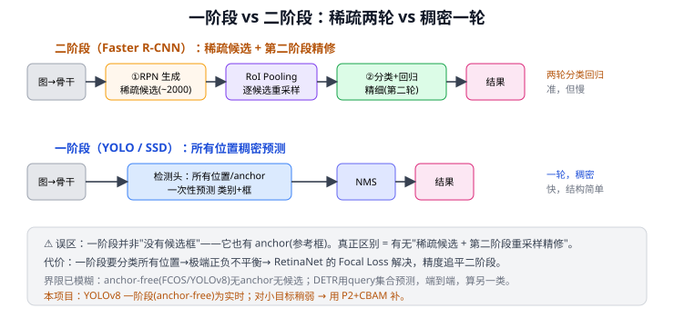

**展开**：

**① 经典定义（你的理解，成立）**
二阶段：①RPN/SS 生成候选 → ②对候选分类+精修；一阶段：一次前向直接出框+类别，无独立候选阶段。

**② 更精确：稀疏两轮 vs 稠密一轮**

| | 二阶段 | 一阶段 |
|---|--------|--------|
| 候选 | 第一阶段产生**稀疏**候选（~2000→筛到几百） | 直接在所有 anchor/位置预测 |
| 分类回归 | **两轮**（粗筛前景背景 + 精细多类） | **一轮** |
| 特征重采样 | 有（RoI Pooling 逐候选） | 无 |
| 密度 | 稀疏 | **稠密**（所有位置） |

> 一阶段也有 anchor（SSD/YOLOv2~v5），anchor 就是参考/候选框 → 不能说"没候选框"。

**③ 带来什么**
- **精度 vs 速度**：二阶段准（先滤背景、RoI 对齐特征）但慢（两遍、逐 RoI）；一阶段快、简单，早期精度略低。
- **类别不平衡**：一阶段分类所有位置，绝大多数背景 → 极端不平衡 → RetinaNet 的 **Focal Loss** 解决，精度追平二阶段。

**④ 界限已模糊**
anchor-free 一阶段（FCOS/YOLOv8）无 anchor 无候选，纯稠密预测；DETR 用 query 集合预测，端到端，算另一类。"候选框生成"已非绝对二分，但作为主线理解足够。

**⑤ 与本项目**
YOLOv8 = 一阶段（anchor-free），为实时（<100ms）；对密集/小目标历史上稍弱 → 用 P2（高分辨率）+ CBAM（注意力）补（见 21 FPN、16 CBAM）。二阶段更准但慢，不满足实时部署。

---

## Q21. 检测器为什么会稠密预测？

> 关联文章：22 YOLOv1、23 SSD、20 Faster R-CNN、28a DETR、25 YOLO 演进　提问日期：2026-06-18
> 接 Q16（稠密 vs 稀疏）与 Q20（稠密的副产物 NMS）：本问回答"为什么非稠密不可"。

**简答**：根本原因是**目标的数量、位置、大小事先全未知**——图里可能有 0 个也可能有几十个物体，可能出现在任何位置、任何尺度。你没法预设"只检测 N 个目标"去逐个查询。最稳妥的办法就是：**在所有位置、所有尺度密集铺设预测器，每个都判断"我这里有没有目标、是什么、框多大"**。这又恰好与卷积的特性天然契合（卷积在所有位置共享权重滑过，特征图本就是密集网格）+ 召回优先原则（宁可多报后用 NMS 去重，也不能漏检）。代价是极端正负不平衡（Q17）和重复框（Q20）。

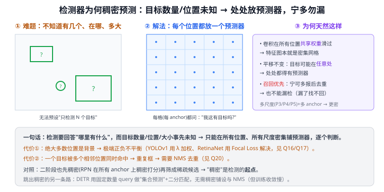

**展开**：

**① 根因：检测是"开放数量"的定位问题**
分类只需输出一个标签；但检测要回答"**哪里有什么**"，而：
- **数量未知**：一张图可能没有目标、也可能有几十个 → 不能像填空一样预设固定槽位；
- **位置未知**：目标可能在画面任何角落；
- **尺度未知**：可能很大也可能几像素小。

面对"未知数量 + 未知位置 + 未知尺度"，最直接可靠的策略就是**穷举式覆盖**：把图切成密集网格 / 在每个位置预设多个 anchor，让每个预测器只回答一个局部的"有没有、是什么、框多大"。这就是稠密预测。

**② 与卷积天然契合**
卷积**在所有空间位置共享同一组权重**滑过整图（平移不变，见 Q12），输出的特征图本身就是一张**密集网格**，每个格子对应原图一块区域。所以"在每个格子上接一个检测头做预测"是顺理成章、且计算高效（一次前向覆盖全图）的——稠密预测不是刻意设计，而是卷积结构的自然产物。多尺度（P3/P4/P5）再叠多个 anchor，密度进一步提高。

**③ 召回优先：宁多勿漏**
检测里**漏检比误检更难补救**——漏掉的目标后续无从找回，而多报的框可以靠置信度阈值 + NMS（Q20）滤掉。所以宁可在每个位置都猜一下、宁可重复，也要保证目标不被漏掉。稀疏地只在少数位置预测，风险是恰好没覆盖到某个目标。

**④ 二阶段也是先稠密**
别以为只有一阶段才稠密：二阶段的 **RPN 也是在所有 anchor 上稠密打分**（Q14），只是它把稠密结果**筛成稀疏候选**（~2000）再精修（Q16）。所以"稠密"是几乎所有检测器的**共同起点**，区别只在之后稀疏化与否。

**⑤ 稠密预测的两个代价**
| 代价 | 说明 | 解法 |
|------|------|------|
| 极端正负不平衡 | 绝大多数位置是背景，正样本极少 | YOLOv1 的 λ 加权（Q17）、RetinaNet 的 Focal Loss |
| 重复框 | 一个目标被多个相邻位置同时命中 | NMS 去重（Q20） |

**⑥ 跳出稠密的另一条路：DETR 集合预测**
28a DETR 用固定数量的 **object query**（如 100 个）做"**集合预测**"——不在所有位置铺预测器，而是让每个 query 直接"认领"一个目标，配**二分匹配**训练保证一个目标只被一个 query 负责。于是**既不需要稠密铺设、也不需要 anchor 和 NMS**，真正端到端。代价是收敛慢、小目标弱（早期）。这反衬出：稠密预测之所以长期是主流，是因为它简单、高召回、与卷积契合；而 DETR 用"可学习的稀疏查询"换掉了这套穷举逻辑。

**⑦ 与本项目**：YOLOv8（25 YOLO 演进）是稠密预测（anchor-free，但仍在每个网格点稠密预测）。本项目加 **P2 层**会让浅层网格更密（分辨率更高 → 预测器更多）→ 利于小目标，但也加大计算与正负不平衡，需在 FPS 实验（EXP-002）中权衡（呼应 Q8 的实测延迟）。

---

## Q25. 极端正负不平衡会导致什么结果？

> 关联文章：22 YOLOv1、23 SSD、25 YOLO 演进、28a DETR　提问日期：2026-06-18
> 接 Q21 ⑤提到的"代价①"：这里展开它的后果与解法。

**简答**：核心后果是——**海量背景负样本的损失累加起来，淹没了少数正样本的损失，梯度被背景主导**，于是模型"偷懒"倾向于把所有位置都判成背景（因为这样总损失也很低）。直接结果：**漏检多、召回低、正样本的框回归也学不准、训练难收敛，整体精度下降**。这正是早期一阶段检测器精度不如二阶段的主因。解法是别让易分背景主导损失：硬采样（OHEM、SSD 难负挖掘，固定正负比）、损失加权（YOLOv1 的 $\lambda_{noobj}=0.5$）、以及最优雅的 **Focal Loss（RetinaNet）**——降低易样本权重、聚焦难例，使一阶段精度追平二阶段。

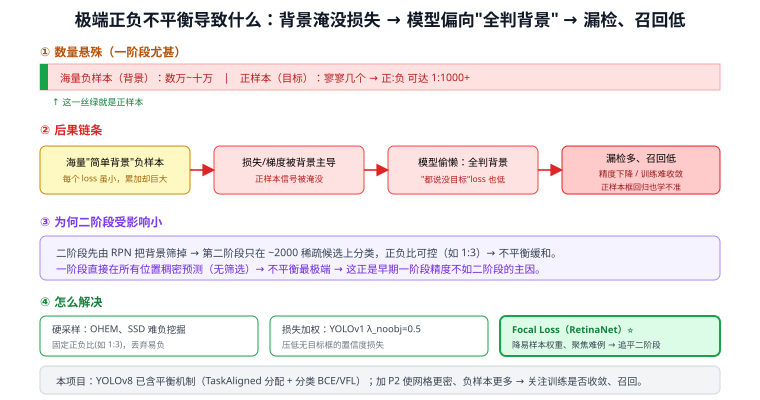

**展开**：

**① 不平衡有多极端**
一阶段检测器在所有网格点/anchor 上稠密预测（Q21），一张图有几万~十万个预测位置，而真实目标往往只有几个。于是**正样本（目标）∶负样本（背景）可达 1∶1000 甚至更悬殊**。

**② 后果链条（关键）**
```
海量"简单背景"负样本
   │（每个 loss 很小，但数量巨大，累加起来压倒一切）
   ▼
总损失 / 梯度被背景主导
   │（少数正样本的信号被淹没）
   ▼
模型"偷懒"：倾向于把所有位置都判成背景
   │（反正"全说没目标"总损失也低）
   ▼
漏检多、召回低、正样本框回归也学不准、训练难收敛 → 精度下降
```
要点：问题不在"单个背景样本难"，恰恰相反——**绝大多数背景是"易分负样本"（一眼就是背景），它们单个损失很小、几乎没有有用的学习信号，但架不住数量太多，累加后稀释、压倒了正样本的梯度**。模型被这片"虽小但海量"的损失推着走向保守。

**③ 为什么二阶段受影响小**
二阶段（Faster R-CNN）先用 **RPN 把绝大部分背景筛掉**，第二阶段只在 ~2000 个稀疏候选上分类，还能控制正负比（如 1∶3）→ 不平衡被大幅缓和（Q16）。一阶段直接在所有位置预测、无筛选环节 → 不平衡最极端。**这就是早期一阶段（YOLOv1/SSD）精度不如二阶段的核心原因之一。**

**④ 三类解法**

| 思路 | 代表 | 做法 |
|------|------|------|
| 硬采样 | OHEM、SSD 难负挖掘 | 按损失排序，只留最难的负样本，固定正负比（如 1∶3），丢弃海量易负 |
| 损失加权 | YOLOv1 | $\lambda_{noobj}=0.5$ 压低无目标框的置信度损失、$\lambda_{coord}=5$ 放大定位损失（Q17） |
| **降权聚焦** ⭐ | **Focal Loss（RetinaNet）** | 给易分样本（已分对、置信高）的损失乘一个很小的因子 $(1-p)^\gamma$，让训练**自动聚焦在难样本**上 → 不用采样也能平衡 → 一阶段精度首次追平二阶段 |

> Focal Loss 是这条线最重要的成果：它不靠"扔掉"负样本，而是**动态降低易样本权重**，优雅地解决了"易负淹没梯度"的根本问题。

**⑤ 另一种绕过方式：集合预测**
28a DETR 用固定数量 query + 二分匹配，一个目标只配一个预测（一对一），根本不产生海量负样本 → 天生没有这种极端不平衡（也无需 NMS，见 Q20）。

**⑥ 与本项目**：YOLOv8（25 YOLO 演进）已内置平衡机制（TaskAligned 标签分配 + 分类用 BCE/VFL + DFL 回归），不必手动处理。但第三章**加 P2 层**会让浅层网格更密、负样本进一步增多 → 训练时要留意召回与收敛是否受影响（呼应 Q21 提的"加 P2 加大正负不平衡"）。

---

## Q26. 为什么要"硬"采样（难负挖掘）？

> 关联文章：24 RetinaNet、23 SSD、18 R-CNN　提问日期：2026-06-22
> 接 Q25 ④的"硬采样"解法，这里展开它的道理。

**简答**：核心是"**硬**"字——只挑**难负样本**训练，丢掉海量易负样本。原因有二：① 易负样本（一眼就是背景）已经分对了，**损失和梯度都≈0，对学习毫无贡献，还靠数量碾压、稀释正样本的梯度**（Q25）；② 难负样本（长得像目标的背景，在决策边界附近）才是模型**真正需要学会拒绝**的、信息量最大的样本。做法：按分类损失给负样本排序，只留损失最高的 top-k，固定正负比（如 SSD 的 1:3）。这样既缓解不平衡，又把算力花在有用样本上。

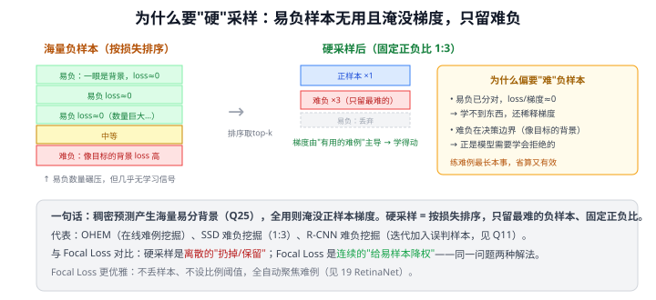

**展开**：

**① "采样"是为了解决不平衡，"硬"是为了高效**
稠密预测产生海量背景负样本（Q21、Q25）。若把所有负样本都拿来训练 → 背景项淹没正样本。最朴素的办法是随机采样一部分负样本，但随机采到的大多还是**易负**（因为易负占绝大多数）——没解决"采到的样本没用"的问题。所以要"**硬**"采样：专挑难的。

**② 为什么易负样本没用甚至有害**
- **没用**：易负已被正确分类（预测背景概率很高），损失≈0、反传梯度≈0 → 对参数更新几乎无贡献。
- **有害**：单个梯度虽≈0，但架不住数量极多，累加后仍会在总损失里占大头，**把少数正样本和难负样本的梯度信号稀释/淹没**。

**③ 为什么难负样本最该练**
难负样本 = 模型当前判错或拿不准的背景（如路面上像抛洒物的水渍、阴影）。它们位于**决策边界附近**，损失大、梯度强，是模型**最需要学会区分**的。盯着难例练，最能提升判别力——和人学习"专攻易错题"一个道理。

**④ 三种代表方法**
| 方法 | 出处 | 做法 |
|------|------|------|
| 难负挖掘 | 18 R-CNN（见 Q11） | 迭代地把"被错判为目标的背景"加入训练集重训 SVM |
| Hard Negative Mining | 23 SSD | 按置信度损失排序，取最高的负样本，固定正负比 1:3 |
| OHEM | Fast R-CNN 改进 | 在线（每个 batch）自动挑损失最高的 RoI 训练 |

**⑤ 与 Focal Loss 的关系（重要对照）**
硬采样和 Focal Loss（24 RetinaNet）解决**同一个问题**（易负淹没梯度），但风格不同：
- **硬采样**：**离散**——硬性"扔掉"易负、"保留"难负，还要设正负比阈值。
- **Focal Loss**：**连续**——不丢任何样本，而是给易样本乘 $(1-p_t)^\gamma$ **平滑降权**，自动聚焦难例。

Focal Loss 更优雅（无需采样、无需调比例），所以 RetinaNet 用它取代了硬采样，让一阶段精度追平二阶段。

**⑥ 与本项目**：YOLOv8 不用显式硬采样，靠 TaskAligned 标签分配 + VFL/Focal 思想的损失自动平衡。理解硬采样有助于看懂"为什么现代检测器不再需要手动挑负样本"。

---

## Q23. 一阶段与二阶段均有 NMS；YOLOv1 无 anchor 靠网格回归实现一阶段

> 关联文章：22 YOLOv1、20 Faster R-CNN、25 YOLO 演进　提问日期：2026-06-17

**简答**：① **二阶段也有 NMS，且用了两次**——Faster R-CNN 在 RPN 后做一次 NMS（2 万→300），在检测头输出后再做一次，并非"二阶段没有 NMS"。区别只是 NMS 前候选框数量级不同，一阶段稠密压缩比大；二阶段先稀疏化，最终 NMS 输入少显得不显眼。② **YOLOv1 完全没有 anchor**——anchor 是 YOLOv2 才引入的。YOLOv1 直接回归绝对坐标，$w,h$ 是相对整图比例，不依赖任何预设模板。一阶段的实现原理是**网格化稠密回归**：一次前向出 $7\times7\times30$ 张量，同时输出位置+置信度+类别，无候选框生成阶段。

**展开**：

**① NMS：一阶段与二阶段都有，次数和规模不同**

| | 一阶段（YOLOv1） | 一阶段（SSD/YOLOv3+） | 二阶段（Faster R-CNN） |
|---|---------|---------|---------|
| NMS 前候选数 | 98（7×7×2） | 数万（密集 anchor） | **两次**：~2万→NMS→300 → 最终NMS |
| NMS 次数 | 1 | 1 | **2** |
| 每次 NMS 输入 | 98 | 数万 | 第一次 2 万，第二次 300 |

Faster R-CNN 两次 NMS：
- **RPN 后**：~20,000 anchor → objectness 分数 + NMS → top 2,000 → 再取 top 300 送第二阶段
- **检测头后**：300 个预测 → 按类别 NMS → 最终输出

"二阶段没有 NMS"的错觉来源：RPN 的 NMS 常作为实现细节一笔带过，最终 NMS 输入只有 300 个也很少提及。

**② YOLOv1 无 anchor：直接回归绝对坐标**

YOLOv1 每格输出 B=2 个框，每框 5 个数 $(x,y,w,h,\text{conf})$：
- $x,y$：框中心相对**所在格子左上角**的偏移 $[0,1]$
- $w,h$：框宽高相对**整图宽高**的比例 $[0,1]$，**不依赖任何模板**
- 没有"先对齐到 anchor 再预测偏移"这一步

anchor 机制（YOLOv2 引入）：k-means 聚类训练集真值框得 5 种常见尺寸，预测量变为相对 anchor 的偏移，让网络学更小的量→训练更稳定。这是 YOLOv1→YOLOv2 的关键改进之一。

**③ YOLOv1 一阶段的本质：网格化回归**

```
输入图像 (448×448)
    ↓ 24层卷积(Darknet) + 2个FC
输出张量 (7×7×30)
    每格：2框×(x,y,w,h,conf) + 20类概率（共享）
    ↓ 置信度阈值过滤
    ↓ NMS（逐类别）
最终检测结果
```

**把"找框"定义成一次前向中同时完成的回归任务**，无候选框生成阶段。代价是每格只能检测一个类、密集目标召回低，这正是 YOLOv2 引入 anchor+多尺度逐步解决的动机（见 Q22）。

**总结对照**

| 你的说法 | 校正 |
|---------|------|
| 二阶段没有 NMS | ❌ 有，且用了两次（RPN后+最终） |
| YOLOv1 靠 anchor 实现一阶段 | ❌ 无 anchor，anchor 是 YOLOv2 引入；一阶段靠网格回归实现 |
| 回归让框逼近真值 | ✅ YOLOv1 里是直接回归，YOLOv2+ 里是相对 anchor 的偏移回归 |

---

## Q20. NMS 产生的原因是什么？为何检测器会冒出重复框？

> 关联文章：22 YOLOv1、23 SSD、20 Faster R-CNN、25 YOLO 演进　提问日期：2026-06-18
> 接 Q17：Q17 讲 NMS"怎么做"，本问讲 NMS"为什么需要存在"。

**简答**：NMS 不是网络出错，而是为了收拾检测器**设计上必然产生的重复框**。根因有二：① **稠密预测**——检测器在大量位置/anchor 上同时出框，一个目标周围有许多"够格"的格子/anchor 都各报一个框；② **训练时一对多标签分配**——为保证召回、让正样本够多，一个真值会匹配**多个**正样本（多个 anchor/网格点都被教着去框同一个目标），推理时这些正样本全开火 → 同一目标输出一堆高度重叠的框。NMS 就是推理后处理：逐类按分数排序、保留最高分、删掉与它高度重叠的框。**它是补丁，不是网络的一部分**。YOLOv10 改"一对一分配"让网络自己只出一个框，才釜底抽薪免去 NMS。

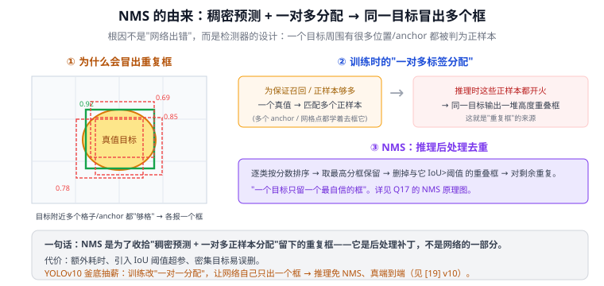

**展开**：

**① 重复框从哪来——稠密预测**
一阶段检测器在每个网格点 / 每个 anchor 上都预测框（Q16 的"稠密一轮"）。一个目标往往横跨好几个格子、附近多个 anchor 与它的 IoU 都不低 → 这些位置都判定"这里有目标"并各自回归出一个框。结果：**一个真实目标 → 多个高度重叠的预测框**，分数有高有低。二阶段（RPN 出 ~2000 候选）同样重叠严重，照样要 NMS。

**② 更深的根因——训练时"一对多"标签分配**
为什么不让每个目标只有一个位置负责？因为训练时若**一个真值只配一个正样本**，正样本太稀少 → 梯度信号弱、召回低、难收敛。所以主流做法是**一对多**：一个 GT 匹配多个正样本（如 anchor IoU>阈值的都算正、YOLOv8 的 TaskAligned 选 top-k）。代价就是**推理时这些被教过的正样本都会预测同一目标** → 必然重复。即：**重复框是"为了好训练"主动选择一对多分配的副产物**。

**③ NMS 怎么收拾（回顾 Q17）**
逐类别：按分数降序 → 取最高分框保留 → 删掉与它 IoU>阈值（如 0.5）的重叠框 → 对剩余重复。即"一个目标只留最自信的那个框"。原理图见 Q17。

**④ NMS 的代价（为什么后来想去掉它）**
- **额外耗时**：推理后处理，框多时拖慢（影响实时/端侧延迟）。
- **超参敏感**：IoU 阈值要手调——太大删不干净（重复框残留）、太小误删（密集目标被当重复删掉）。
- **密集场景易误删**：两个真目标本身高度重叠时，NMS 可能把其中一个当重复删掉 → 漏检。
- **非端到端**：网络输出后还要接一段独立的 CPU/后处理逻辑，不能整体微分优化。

**⑤ 釜底抽薪——YOLOv10 去 NMS**
YOLOv10 用**一致双分配**：训练时同时挂"一对多"头（保证训练信号）和"一对一"头（每个目标只配一个正样本），推理只用一对一头 → 网络**自己只输出一个框**，无需 NMS（见 25 YOLO 演进 v10）。DETR 更早用 query 集合预测 + 二分匹配，天生一对一、无 NMS。**思路都是把"去重"从推理后处理提前到训练标签分配里解决。**

**⑥ 与本项目**：本项目用 YOLOv8（仍需 NMS），推理流程是"输出→解码→置信度过滤→NMS→画框"（Q17）。NMS 的 IoU 阈值是部署时要调的超参之一；做 FPS/延迟测试（EXP-002）时，NMS 的后处理耗时也要算进端到端延迟（呼应 Q8 的"实测延迟"）。CLIP 模块接在 NMS 之后的检测框上做开放类识别。

---

## Q22. 整体理解校验：网格 + 预设框 + 与真值对比学习 + NMS 去重，是这样吗？

> 关联文章：23 SSD、20 Faster R-CNN、19 Fast R-CNN、25 YOLO 演进　提问日期：2026-06-18
> 综合 Q14、Q20、Q21 的一次完整复述校验。

**简答**：你的理解**基本完全正确**——"多个网格 + 每格预设若干不同尺寸的 anchor + 用真值对比学习 + 多个 anchor 命中同一目标 + NMS 消除重复"，正是 **anchor-based 稠密检测器**（SSD、YOLOv2~v5、Faster R-CNN 的 RPN）的标准流程。只需在三处精确一下：① **训练与推理要分开**——"与真值对比学习"只在**训练**发生，"NMS 去重"只在**推理**发生（推理时根本没有真值可对比，只能靠框的重叠来去重）；② 学的不是绝对坐标，而是**相对 anchor 的偏移量**（anchor 是起跑线）；③ 这描述的是 anchor-based 版本，现代 **YOLOv8 是 anchor-free**——去掉预设框、每个网格点直接预测中心+宽高，但"网格稠密预测 + 标签分配 + NMS"的大框架不变。

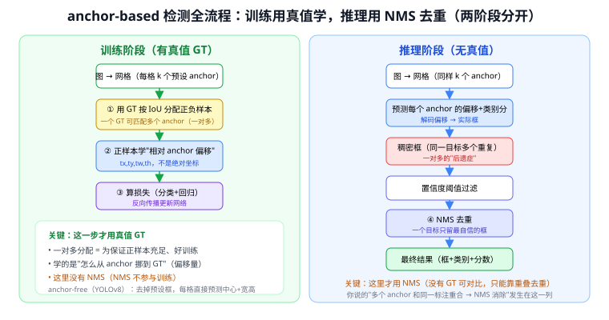

**展开**：

**① 你的五步，逐条核对**

| 你的表述 | 对不对 | 精确化 |
|---------|-------|-------|
| 搞多个网格 | ✅ | 特征图就是密集网格（Q21）；多尺度还有 P3/P4/P5 多套网格 |
| 每格放多个不同尺寸预设框 | ✅ | 这是 **anchor**；不同尺度/长宽比覆盖各种目标形状（Q14） |
| 与真实标注对比来学习 | ✅ 但仅训练时 | 训练时用 GT 按 IoU 给 anchor 分**正负样本**，正样本去学 |
| 多个 anchor 与同一标注重合 | ✅ | 这是**一对多分配**，故意的——为让正样本充足、好训练 |
| NMS 消除重复 | ✅ 但仅推理时 | 推理时一对多训练过的 anchor 都开火 → 重复框 → NMS 去重（Q20） |

**② 精确化一：训练 / 推理是两个不同阶段（最易混的点）**
你的描述把"与真值学习"和"NMS 去重"串在一条线上，但它们其实分属两个阶段：

- **训练阶段**（有 GT）：网格 → 每格 anchor → **用 GT 按 IoU 分配正负样本**（一对多）→ 正样本学偏移 → 算损失反传。**这里没有 NMS**。
- **推理阶段**（无 GT）：网格 → 每格 anchor → 预测偏移+类别 → 解码成框（**稠密、大量重复**）→ 置信度过滤 → **NMS 去重** → 输出。**这里没有 GT 可对比**。

换句话说：**NMS 不是"拿真值去重"，而是在没有真值的推理时，靠"框之间的重叠（IoU）"判断哪些是同一目标的重复框**。你说的"多个 anchor 和同一标注重合"在训练时是好事（多正样本），在推理时表现为重复框（要 NMS 收拾）。

**③ 精确化二：学的是"相对 anchor 的偏移"，不是绝对坐标**
anchor 是**起跑线/参考框**，网络不直接吐出框的绝对坐标，而是学"从这个 anchor 怎么挪到真值"——即 $t_x,t_y,t_w,t_h$ 这套相对偏移（中心平移 + 宽高缩放，见 Q14、Q11）。好处：让回归量是小数值、好学、尺度无关。推理时把预测偏移**解码**回实际框（Q17 的解码步骤）。

**④ 精确化三：你描述的是 anchor-based；YOLOv8 是 anchor-free**
你这套"预设框 + 学偏移"是 anchor-based（SSD/YOLOv2~v5）。本项目基线 **YOLOv8 走 anchor-free**（25 YOLO 演进）：**没有预设框**，每个网格点直接预测目标中心偏移和宽高（配 DFL）。但大框架一样——仍是"网格稠密预测 + 训练时标签分配 + 推理时 NMS"。所以你的理解迁移过去只需把"每格 k 个 anchor"换成"每格 1 个直接预测"。（YOLOv10 更进一步，训练用一对一分配，推理连 NMS 都免了，见 Q20 ⑤。）

**⑤ 修正后的一句话总览**
> **训练**：图切成多尺度网格、每格预设若干 anchor → 用真值按 IoU 把 anchor 分成正/负样本（一个真值配多个正样本）→ 正样本学"相对 anchor 的偏移"→ 损失反传。
> **推理**：同样网格+anchor → 预测偏移并解码成大量稠密框 → 置信度过滤 → **NMS 按框间重叠去重** → 输出最终结果。

**⑥ 与本项目**：本项目用 YOLOv8（anchor-free），但训练（标签分配）+ 推理（解码→NMS）这套流程一致。第三章加 **P2** = 多一套更密的浅层网格（利小目标）；NMS 的 IoU 阈值是部署超参，其耗时计入端到端延迟（EXP-002）。

---

## Q30. 标签分配是什么，它在训练中解决哪个核心问题？

> 关联文章：20 Faster R-CNN、22 YOLOv1、25 YOLO 演进　提问日期：2026-06-22
> 关联 Q21（为什么会有大量候选）、Q25（分配结果决定正负比例）。

**简答**：标签分配就是训练时**给每个预测位置贴"正/负"标签**的过程：决定哪些 anchor/网格点是**正样本**（负责学某个 GT 框），哪些是**负样本**（学"背景"）。它是连接"稠密预测"与"稀疏 GT 标注"的桥梁——一张图有上万个预测位置，GT 只有几个框，不分配就不知道"谁该逼近谁"。分配策略不同，直接影响正负比例（→ Q25）、收敛速度和最终 mAP。

**展开**：

**① 为什么需要标签分配**

检测器在特征图上稠密预测，一张图约有 8400（YOLOv8）~20000（RPN）个预测位置，而 GT 框只有几个。训练必须回答：**哪个预测位置应该去学哪个 GT 框？**

```
GT 框（5 个）         预测位置（8400 个）
  ┌──┐                ┌──┬──┬──┬ … ┬──┐
  │  │        ←───    │  │  │  │   │  │
  └──┘     标签分配    └──┴──┴──┴ … ┴──┘
           决定哪些位置是正样本（≈ 几十个）
           哪些是负样本（≈ 8000 多个）
```

**② 三种输出标签**

| 标签 | 含义 | 参与损失 |
|------|------|---------|
| 正样本 | 该位置负责预测某个 GT 框 | 参与定位损失 + 分类损失 |
| 负样本 | 背景，无目标 | 只参与置信度/分类损失（目标=背景） |
| 忽略样本 | 介于正负之间（如 IoU∈[0.3,0.7]） | 不参与任何损失计算 |

**③ 四种典型分配策略演进**

```
YOLOv1（网格负责制）
  规则：GT 中心落在哪个 cell，该 cell 是正样本；
        cell 内 B=2 个框中 IoU 最高的那个"负责"。
  问题：每个 GT 只有 1 个正样本，训练信号极少。

Faster R-CNN RPN（IoU 阈值）
  规则：IoU > 0.7 → 正；IoU < 0.3 → 负；中间 → 忽略。
  结果：每个 GT 通常对应多个正样本（一对多）。
  问题：阈值手动设定，对不同尺度目标效果不一。

ATSS（Adaptive Training Sample Selection，2019）
  规则：每个 GT 选最近的 k 个 anchor，
        计算它们 IoU 的均值+标准差作为自适应阈值。
  进步：不同尺度的 GT 自动得到合适的阈值，无需手调。

TaskAlignedAssigner（YOLOv8）
  规则：对齐分数 = cls_score^α × iou^β，
        每个 GT 选对齐分数最高的 top-k 个预测位置。
  进步：同时考虑分类质量和定位质量，
        训练越好的预测位置越容易被选为正样本，形成正向循环。
```

**④ 一对多 vs 一对一——与 NMS 的直接关联**

| | 一对多分配 | 一对一分配 |
|--|-----------|-----------|
| 原理 | 每个 GT 配多个正样本 | 每个 GT 只配 1 个正样本 |
| 代表 | Faster R-CNN、YOLOv1~v9 | DETR（匈牙利匹配）、YOLOv10 |
| 优点 | 正样本多，训练信号充足 | 推理无需 NMS，真端到端 |
| 缺点 | 推理时多个预测命中同一目标 → 需 NMS | 正样本少，训练难度高 |

一对多分配 → 推理时多框 → NMS 去重（见 Q20）。  
一对一分配 → 推理时每目标只有一框 → NMS 可省。

**⑤ 标签分配决定正负比例 → 直接影响 Q25**

分配的正样本数量越少、负样本越多，正负不平衡越严重（Q25）。这正是 OHEM、Focal Loss、难负挖掘（Q26）的动机——它们本质上都是在"调整有效参与训练的样本分布"，是标签分配的补充手段。

**⑥ 与本项目**

YOLOv8 使用 **TaskAlignedAssigner**（对齐分数 top-k 选正样本），不再依赖固定 IoU 阈值。本项目加 P2 后浅层网格点激增，总预测位置从 8400 → ~33600，负样本随之大幅增加，正负比例更悬殊——这是 EXP-002 未见提升的重要原因之一（Q25）。

---

## Q75. 框损失已经有 L1 了，为什么还要 GIoU？会不会重复？

> 关联文章：28a DETR、25d YOLOv8　提问日期：2026-06-30（源自 DETR 损失 L1+GIoU 的追问；属通用检测概念，YOLO/Faster R-CNN 同样适用）
> 关键结论：**不重复，是互补**。L1 量"**每个坐标差多少**"（逐分量绝对差），GIoU 量"**整框重不重叠**"（IoU 系、整体几何）。**L1 的硬伤**：尺度敏感（同样差 10px，大框无所谓、小框全错位，惩罚却一样 → 大框主导损失）、不对齐 IoU/mAP 评测、四坐标各管各不懂重叠。**纯 IoU 的硬伤**：不重叠时 IoU=0 没梯度（GIoU 加最小外接框项来补、不重叠也有方向），但 IoU 系对**精细微调**梯度偏弱。所以二者线性相加：**GIoU 保整体重叠好（尺度不变、对齐评测），L1 保坐标数值准（梯度稳、定位精细）**，缺一不可。DETR 论文原话：L1 对大小框尺度不同，故加"尺度不变的 GIoU"弥补。

**它俩量的根本不是一回事**
- **L1**：四个坐标 $(x,y,w,h)$ 的**逐个绝对差之和**——"每个数字差多少"。
- **GIoU**：基于 **IoU（交并比）** 的**整框重叠度**——"两个框作为整体重不重合"。

**L1 的硬伤（所以要 GIoU）**
1. **尺度敏感**：同样差 10 像素，大框无所谓（IoU 还高）、小框可能全错位，但 **L1 惩罚一样大** → 大框主导损失、小框被淹没。DETR 论文原话：*"L1 对大小框即使相对误差相同、绝对尺度也不同"*——这正是它加 GIoU 的直接动机。
2. **不对齐评测指标**：检测按 **IoU/mAP** 评。两预测 L1 相同、IoU 可天差地别；压 L1 ≠ 最大化 IoU。
3. **四坐标各管各**：L1 把四个数独立相加，**不知道"框是一个整体"**，捕捉不到重叠、长宽比。

**纯 IoU/GIoU 的硬伤（所以还要留 L1）**
1. **不重叠时纯 IoU 梯度为 0**：两框没交集 → IoU=0 → 没方向。GIoU 加"最小外接框"项补这个洞、不重叠也有梯度——但 IoU 系对**精细微调**的梯度仍偏弱、偏噪。
2. **精确定位不如 L1 直接**：L1 对每个坐标给**干净稳定的逐分量梯度**，把数字一点点拉准；GIoU 接近对齐时易"平"，不够利落。

**所以是分工互补**

| | 管什么 | 强 | 弱 |
|---|---|---|---|
| **L1** | 每个坐标的数值差 | 梯度稳、定位精细、不重叠也拉得动 | 尺度敏感、不懂整框重叠 |
| **GIoU** | 整框重叠质量 | 尺度不变、对齐 IoU 评测、懂长宽比 | 微调梯度弱、单用收敛慢 |

**合起来**：GIoU 保证框**作为整体重叠好**（尺度不变、跟评测一致），L1 保证**每个坐标数值精准**（梯度稳）。一个管"框对不对得上"，一个管"坐标准不准"。

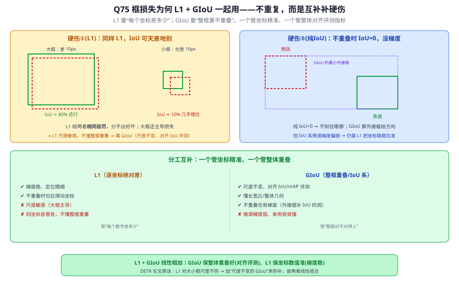

> 例：两预测都 L1=0.1，大框 IoU 仍 80%、小框才 10%——L1 分不出，GIoU 一眼看穿；反过来两框完全不重叠时 IoU=0 没梯度，L1 还在把坐标往真值拉。**这也解释了 IoU 系损失的演进**：IoU→GIoU（补不重叠）→DIoU/CIoU（再补中心距、长宽比，YOLOv8 用 CIoU+DFL），都是在"整框重叠"这条线上加料，但**逐坐标的 L1（或 DFL）那条线一直留着**管精修。

---

## Q105. 没分类怎么还能 NMS？YOLO 第一次 NMS 时还没分类却已剩很少框，如何做到？

> 关联文章：Q20 NMS 产生的原因、25d YOLOv8、Q103 CLIP 裁剪、Q104 CLIP 效率　提问日期：2026-07-03
> 关键结论：NMS的抽象机制只需要排序分数和框间IoU；类无关NMS不按类别分组。具体到YOLOv8，它没有独立objectness输出，候选框使用类别置信度，分类和框回归在同一次前向中产生；“还没分类”只能指尚未取得CLIP开放词汇标签。

**简答**：① NMS把框按分数排序，从高到低保留，并抑制与已保留框IoU过大的重复框；类无关NMS是不按预测类别分组，而不是要求模型必须有独立objectness。② YOLOv8是anchor-free检测器，没有独立objectness分支，检测头同时产生框回归和训练类分数，后处理使用类别置信度。③ Q103/Q104中的“还没分类”指尚未取得CLIP开放词汇标签，不是YOLO没有闭集分类。

**展开**：

**① 先纠偏："还没分类"要分两层**
- **YOLO 有自己的闭集分类**：YOLOv8是anchor-free模型，检测头同一次前向产生框回归和6个训练类分数，没有独立objectness输出；分类和定位一起产生。
- **"还没分类"实指**：还没拿到 CLIP 的开放词汇语义标签（尤其未参与 YOLO 训练的 GL/RU）。
- 所以"YOLO 定位 / CLIP 分类"是就**开集命名**那层讲的，不代表 YOLO 内部没有任何分类。

**② NMS 到底需要什么——只要两样**
1. **一个排序分数**：给框排先后，谁强谁留。不同检测器可使用objectness、类别置信度或二者组合；YOLOv8使用类别置信度。
2. **框之间的 IoU**：量重叠，压掉与高分框重叠太多的。

**注意**：NMS算法可以不按类别分组，但仍需要一个可靠的框分数。类无关NMS的含义是不同预测类别之间也相互抑制；它不等于“YOLOv8只凭objectness运行”。

**③ 两种 NMS 口味**

| | 排序分数用什么 | 怎么压 |
|---|---|---|
| **类无关 NMS**（class-agnostic） | objectness 或"最高类分" | 不管类别，全局按分数压重叠框 |
| **类内 NMS**（class-aware / per-class） | 每个类各自的分数 | **逐类**分别做 NMS，异类框互不压制 |

你担心的"没分类怎么 NMS"——**类无关 NMS** 正是答案（只用 objectness）；而 YOLOv8 因分类已和框一起出，默认多用带类别信息的 NMS（或用"最高类置信度"当分数的类无关变体）。两种都行，取决于实现。

**④ 重新对齐到本项目 pipeline（NMS 不依赖 CLIP）**
```
YOLOv8一次前向 → anchor-free位置输出：框回归 + 6个训练类分数
      ↓  NMS（按分数排序压重叠）  ← 这里已有分数可用，不需等 CLIP
少数 survivors（几个~几十个框，各带 YOLO 闭集类猜测）
      ├ 高置信已知类 → 直接采信
      └ 未知/低置信/OT → 裁剪送 CLIP → 开放词汇语义标签（NMS 之后才发生）
```
**关键**：NMS 发生在 YOLO 内部、用的是 YOLO 自己的分数，**根本不依赖 CLIP**；CLIP 是 NMS **之后**才对少数 survivors 做开集命名。时序上不矛盾。

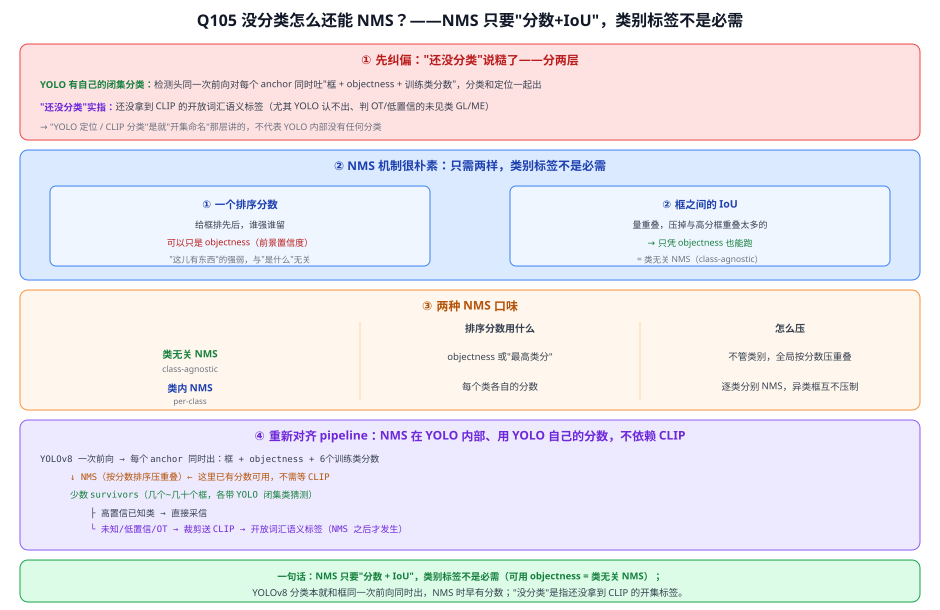

> 图解：① 纠偏"还没分类"分两层（YOLO 有闭集分类 / 缺的是 CLIP 开集标签）；② NMS 只要"分数+IoU"、objectness 即可；③ 类无关 vs 类内两种口味；④ pipeline 时序——NMS 在 YOLO 内部用自己分数、CLIP 在其后做开集命名。

**⑤ 一句话**
NMS 只要"分数 + IoU"两样，类别标签不是必需（可用 objectness → 类无关 NMS）；YOLOv8 分类本就和框同一次前向同时出，NMS 时早有分数。"没分类"是指还没拿到 CLIP 的开集标签，而非 YOLO 没有任何分类。

---

## Q106. objectness 具体是如何 NMS 的？

> 关联文章：Q105 没分类怎么还能 NMS、Q20 NMS 产生的原因、25d YOLOv8　提问日期：2026-07-03
> 关键结论：NMS = **按分数排序 → 最高分框"称王" → 把与它 IoU 超阈值的框当"重复"删掉 → 在剩下的框里再选王，循环到空**。分数负责"谁是代表"、IoU 负责"谁是它的重复"，全程**不看类别**（用 objectness 即可 = 类无关 NMS）。落到 YOLOv8：它 anchor-free、已去掉独立 objectness 分支，排序分数改用**最高类别置信度**，但**算法一模一样**。

**简答**：贪心 NMS 只做一件事——把框按分数从高到低排，每次取出还没被处理的最高分框保留，再把与它重叠（IoU）超过阈值的框全部删掉（认定是同一物体的重复框），如此往复直到没框可取。这里的"分数"用 objectness（前景置信度）就够，不需要类别；YOLOv8 则用"最高类分"当分数，流程不变。

**展开**：

**① 算法本身（贪心 NMS，IoU 阈值如 0.5）**
```
1. 所有框按 objectness 从高到低排序
2. 取当前分最高的框 M → 放进"保留列表"
3. 算 M 与剩下每个框的 IoU：凡 IoU > 0.5 的框全删掉（= M 的重复框）
4. 回到 2，在剩下的框里再取分最高，重复
5. 直到没框可取 → 保留列表 = 最终输出
```
直觉：分最高的框称王，把周围重叠太多的复制品清掉；再在剩下框里选次高的王，往复。

**② 手算例子（5 个框，IoU 阈值 0.5）**

| 框 | objectness | 坐标 (x1,y1,x2,y2) |
|---|---|---|
| B1 | **0.95** | (100,100,200,200) |
| B2 | 0.90 | (105,108,205,198) |
| B3 | 0.75 | (110,102,210,205) |
| B4 | **0.88** | (300,300,400,400) |
| B5 | 0.70 | (305,310,395,405) |

排序：B1 0.95 > B2 0.90 > B4 0.88 > B3 0.75 > B5 0.70

**第 1 轮** 取 **B1** 保留，算它与其余的 IoU：
- IoU(B1,B2)：B1 面积 100×100=10000，B2 面积 100×90=9000；交集 x 重叠 = min(200,205)−max(100,105)=95，y 重叠 = min(200,198)−max(100,108)=90 → 交=95×90=**8550**；并=10000+9000−8550=10450 → **IoU≈0.82 > 0.5 → 删 B2** ✂️
- IoU(B1,B3)≈0.75 > 0.5 → **删 B3** ✂️；　IoU(B1,B4)=0 保留；　IoU(B1,B5)=0 保留

**第 2 轮** 取 **B4**（次高 0.88）保留：
- IoU(B4,B5)≈0.85 > 0.5 → **删 B5** ✂️；剩下：无 → 结束。

→ **最终保留 B1、B4**（两物体各留一个最强框，重复框全清）。

**③ 两个关键点**
1. **objectness 只是"排序分数"，全程不看"是什么类"**——这正是它能在无类别时工作的原因（类无关 NMS）。
2. **IoU 阈值是权衡超参**：调太低（0.3）压得狠、挨近的两个真物体可能被误删；调太高（0.7）压不净、重复框残留。默认常用 0.5~0.7。

**④ 落到 YOLOv8 的一处细节（要准确）**
严格讲 **YOLOv8 anchor-free、已去掉独立 objectness 分支**（经典 YOLOv1–v5 才有显式 objectness = P(有物体)×IoU）。YOLOv8 排序用的分数是**各框的最高类别置信度**（max class score）。但**算法与上面一模一样**，只是把 "objectness" 换成 "最高类分"。所以：讲原理/类无关时说"用 objectness 排序"没错；具体到 YOLOv8，排序分数是"最高类置信度"。两者都是"给框打个总分再压重叠"，NMS 流程不变。

> 变体 **Soft-NMS**：不硬删重叠框，而是按 IoU 把它的分数打折，用于密集场景减少误删；主流 YOLO 默认仍是上面的贪心硬 NMS。

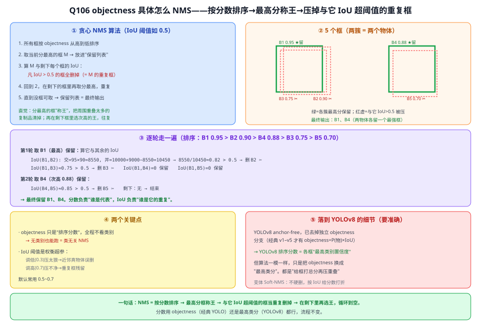

> 图解：① 贪心算法五步；② 5 框两簇布局（绿留/红压）；③ 逐轮走一遍含 IoU(B1,B2)=0.82 的手算；④ 两关键点（分数不看类别 / IoU 阈值权衡）+ YOLOv8 用最高类分替代 objectness、Soft-NMS 变体。

---

## Q107. NMS 的核心思想就是"删除与自己重叠的、保留不重叠的，反复到互不重叠"，对吗？

> 关联文章：Q106 objectness 具体如何 NMS、Q20 NMS 产生的原因、Q21 稠密预测　提问日期：2026-07-03
> 关键结论：核心循环理解**正确** ✅（选代表 → 删重复 → 在剩下里再选代表 → 反复到空 → 每个框代表一个独立个体）。但两处要**收紧**：① "不重叠" → "**重叠不超过阈值**"——最终保留的框之间**可以有轻微重叠**（IoU < 阈值），阈值用来区分"同物体的重复框"和"挨得近的两个不同物体"，否则会误删近邻物体（漏检）；② "挑一个" → "挑**当前最高分**那个"，顺序由分数定，留最可信、删低分重复。

**简答**：你的心智模型对——NMS 就是不断"选一个代表、删掉它的重复、在剩下的里再选代表"，直到框互相独立。但"重叠"要理解成**IoU 超过阈值**（不是二值的有/无重叠），所以最终框之间允许轻微重叠；而每轮选的"代表"必须是**剩下框里分数最高**的那个。

**展开**：

**① "重叠"不是二值，是"IoU 超过阈值"才算重复**
"保留不重叠的"应改成"**保留重叠不超过阈值的**"。最终保留的框之间**可以有轻微重叠**（IoU < 阈值），不是绝对互不重叠。
- **对挨得近的两个真物体尤其关键**：路上两块紧挨的抛洒物，框天然有点重叠。若按"只要重叠就删"，会误删一个（漏检）；正因用了阈值（如 0.5），轻微重叠的它俩（IoU 可能才 0.2）**都能保留**。
- 阈值的作用就是判定："这是同一物体的重复框"（IoU 高、删）还是"两个挨近的不同物体"（IoU 低、都留）。

**② "挑一个"是挑当前最高分，不是随便挑**
顺序由分数决定：每轮拿**剩下框里分数最高**的当代表，保证留下的是最可信的框、删掉的是它周围的低分重复品。随便挑可能留下歪框、删掉更准的框。

**③ 结果**
理想情况下**最终框数 = 物体数**，每个物体从"多个重复框"塌缩成"一个框"——这正是 NMS 要解决的、稠密预测带来的重复框问题（Q20/Q21）。

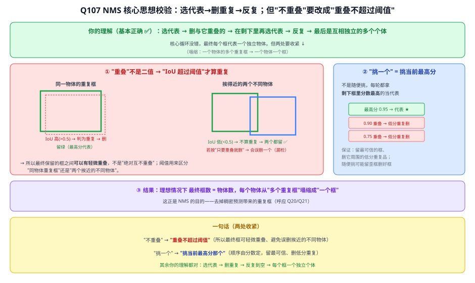

> 图解：绿=保留的代表、红虚=被判为重复删掉；左展示"同物体重复框(IoU高删) vs 挨近两物体(IoU低都留)"，右展示"按最高分挑代表"；底部两处收紧总结。

**④ 一句话**
你的理解对，两处收紧："不重叠"→"**重叠不超过阈值**"（最终框可轻微重叠、避免误删挨近的不同物体）；"挑一个"→"挑**当前最高分**那个"。其余（选代表→删重复→反复到空→每框一个独立个体）都对。

---

## Q170. 何为骨干、颈部、检测头？

> 关联文章：21 FPN（颈部经典代表）、25d YOLOv8（本项目基线的骨干/颈部/头具体实现）　提问日期：2026-07-21
> 关键结论：这是现代目标检测器的**通用三段式框架**——骨干（Backbone）、颈部（Neck）、检测头（Head）——各自解决不同的子问题，不是某一个模型专属的概念，几乎所有一阶段检测器（SSD/RetinaNet/YOLO 系列）都是这个结构，二阶段检测器（Faster R-CNN）本质也有对应角色（骨干+RPN/检测头，早期没有专门颈部）。**骨干**：负责从原始图像里提取通用的多层次视觉特征——通常直接拿一个分类网络（ResNet、CSPDarknet、MobileNet 等）去掉最后的分类层，只留卷积部分；输出不是一张特征图，而是一串不同深度的特征图（浅层分辨率高但语义弱，深层分辨率低但语义强），解决的是"看懂图像里大致有什么"。**颈部**：负责把骨干输出的这些"各有偏科"的多尺度特征图**融合打通**——代表是 FPN（自顶向下把深层语义注入浅层）、后来的 PANet（再加一条自底向上路径）、YOLO 的 SPPF+PAN。融合之后，每一个尺度的输出都同时具备"够强的语义"和"够高的分辨率"，这对检测不同大小的物体（尤其小目标）至关重要。**颈部不是必须的**——早期检测器（YOLOv1/v2、原始 Faster R-CNN）没有专门的颈部，直接从骨干最后一层出头，是后来发现多尺度融合对小目标检测帮助很大之后才加进来的模块。**检测头**：负责把（颈部处理后的）特征图转换成最终具体的预测结果——每个位置/anchor/query 输出"这里有没有物体、是什么类别、框的位置在哪"，本质是分类分支+回归分支（有的还有 objectness/centerness 辅助分支）。早期头是**耦合头**（分类和回归共享同一组卷积，只在最后一层分叉）；YOLOX 之后流行**解耦头**（分类、回归各自独立卷积分支），原因是两个任务真正关注的特征不一样——分类要的是"这是什么类"的语义特征，回归要的是"边界具体在哪"的空间/边缘特征，混在一起互相干扰，拆开后各自更专注、精度更高，YOLOv8 也采用解耦头。三者可以类比人看东西做判断：骨干=眼睛看懂画面（提取通用视觉特征）→ 颈部=大脑综合远近景信息（多尺度融合，不丢细节也不丢全局）→ 检测头=开口说出具体结论（分类+定位）。

**简答**：骨干=提特征的分类网络去掉分类层，负责"看懂图像里大致有什么"，输出浅→深多个尺度的特征图；颈部=把这些各有偏科的多尺度特征图融合打通（代表FPN/PANet/YOLO的SPPF+PAN），让每层都兼具强语义和高分辨率，对小目标检测尤其关键，但不是所有检测器都有（早期检测器没有）；检测头=把融合后的特征转成具体预测（分类+框回归+objectness），早期是耦合头（共享卷积），YOLOX起流行解耦头（分类回归分支独立，因两任务关注的特征本质不同）。三段各司其职：骨干看懂、颈部融合、头部回答。

**展开**：

**① 以本项目基线 YOLOv8 为例，具体数字过一遍**（640×640×3 输入）
- 骨干（CSPDarknet 风格 + C2f 模块）：输出 P3（80×80×256，stride 8）/ P4（40×40×512，stride 16）/ P5（20×20×1024，stride 32）三个尺度的特征图；
- 颈部（SPPF + PAN，含 C2f）：自顶向下+自底向上双向融合，三个尺度的输出都注入了跨层的语义/细节信息，得到 P3'/P4'/P5'；
- 检测头（解耦头 + DFL）：每个尺度各自出分类分支（每个网格位置预测每个类别的概率）+ 回归分支（DFL 精修边框坐标）。

**② 本项目"创新点1"（P2+CBAM）具体改在哪一段**
- **P2**：是在颈部新增的一个**更高分辨率**输出层（stride 4，比 P3 分辨率更高），专门给路面抛洒物这类小目标提供更细粒度的特征，属于"颈部"层面的改动（多尺度融合再往浅层多加一档）；
- **CBAM**：作为即插即用的注意力模块，通常插在颈部特征融合之后、送入检测头之前，用来增强特征的通道/空间权重，本质是在颈部输出到检测头之间加了一道"特征精炼"工序。

**③ 为什么颈部不是"锦上添花"而是关键一环**
骨干深层的特征语义强（知道"这是个物体"）但分辨率低（丢了小目标的精细位置信息）；浅层分辨率高但语义弱（容易把噪声/背景误判成物体）。如果没有颈部，直接从骨干某一层出头，就只能在"语义强但看不清小目标"和"看得清但不确定是什么"之间二选一。颈部把多层信息打通之后，检测头才能同时拿到"看得清+知道是什么"的特征，这也是本项目 P2 层能提升小目标（路面抛洒物）检出率的理论基础（呼应 21 FPN）。

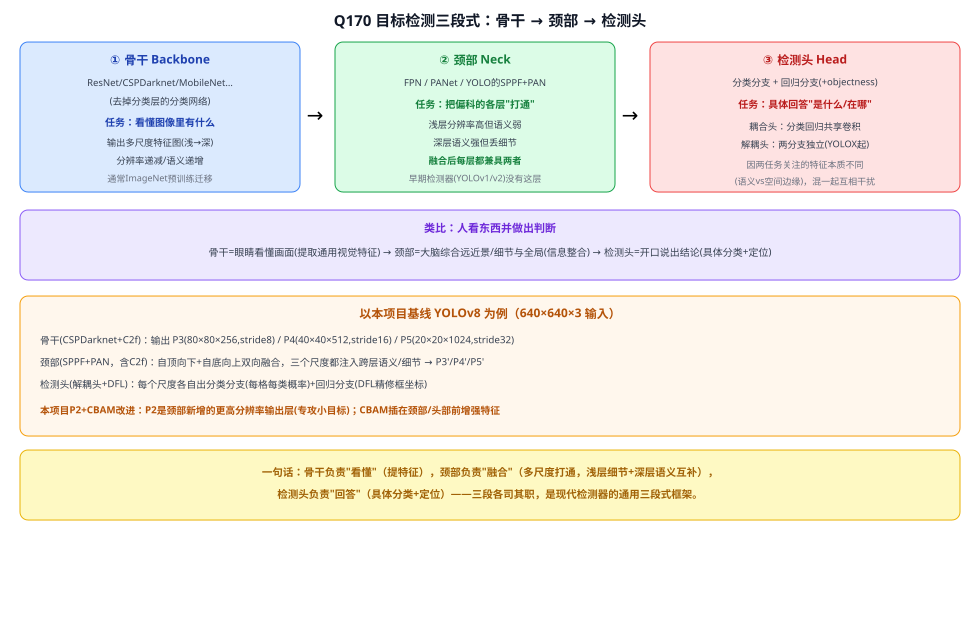

> 图解：①三段式主流程(骨干看懂/颈部融合/检测头回答)；②人看东西类比；③YOLOv8具体尺寸(P3/P4/P5+SPPF/PAN+解耦头/DFL)；④本项目P2/CBAM改动定位在颈部层面。

---
