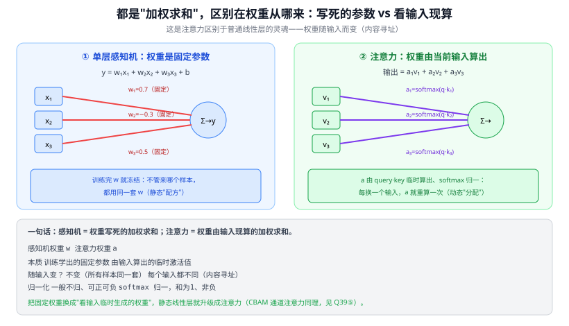
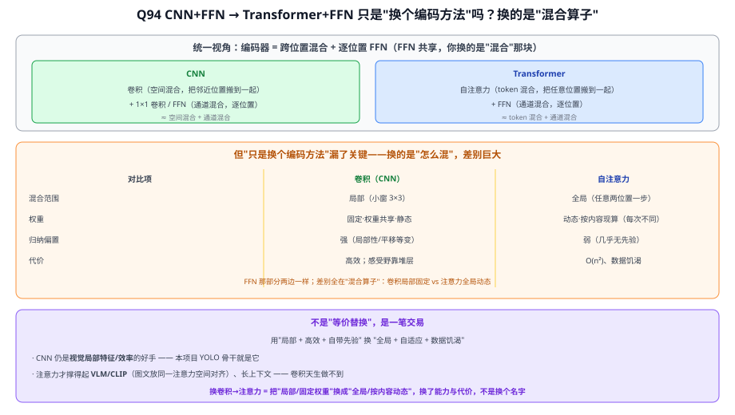
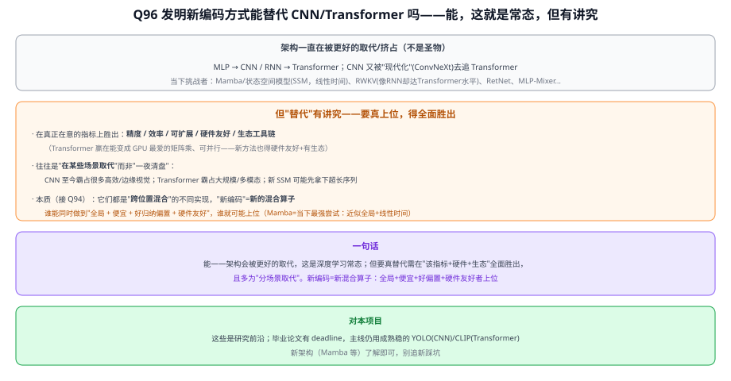

# 答疑 · 注意力 / Transformer / 视觉语言模型

> 模型详解系列答疑 · 分册之四　|　⬅ 返回答疑总目录
> 本篇留存**跨模型**问答（Q42 感知机权重 vs 注意力）；**专属 Transformer** 的（Q31、Q33–Q35、Q78、Q79；原 Q36/37/38 已并入 Q35 作四小节、编号退役不复用）已并入 28 Transformer，下方目录链接直达其当前位置。
> 标题约定：把口语化提问润色成书面小标题（保留原意）。

## 本篇目录
- 注意力/Transformer：Q31 为什么点积注意力既算对相关性又能并行 · Q33 10 个 token 时 Q/K/V 是什么 · Q34 既然算出注意力为何还要位置信息 · Q35 多头注意力总论（机制/缩维/投影混维/头分工，并原 Q36/37/38） · Q42 感知机权重能理解成注意力吗

---

# 五、注意力 / Transformer / 视觉语言模型

---

## Q42. 单层感知机的权重，可以理解成"注意力"吗？

> 关联文章：01 感知机与反向传播、27 注意力机制、28 Transformer　提问日期：2026-06-23
> 关键结论：**不能直接等同**。两者数学骨架都是"加权求和"，但**权重的来源根本不同**：感知机权重是训练学出后**冻结的固定参数**（对所有输入同一套）；注意力权重是**由当前输入即时算出、随输入而变**的激活值（内容寻址）。这正是注意力区别于普通线性层的灵魂。

**简答**：感知机 $y=\sum_i w_i x_i+b$ 的 $w_i$ 是训练完就固定的参数，不管来什么样本都用同一套。注意力 $\text{输出}=\sum_i a_i v_i$ 的权重 $a_i=\text{softmax}(q\cdot k_i)$ **不是参数，而是拿当前输入的 query 和各 key 现算出来的**（Q31），每换一个输入就重算一次。所以：**感知机是"写死的配方"，注意力是"看输入临时分配"。** 共同点是都为"加权求和"（和 Q39 的线性组合同源），但"权重随输入变"才是注意力的本质。

**展开**：

**① 核心差异：权重是"参数"还是"算出来的"**

| | 感知机权重 $w$ | 注意力权重 $a$ |
|---|----------------|----------------|
| **本质** | 训练学出的**固定参数** | 由输入算出的**临时激活值** |
| **随输入变？** | 不变（所有样本同一套 $w$） | **每个输入都不同**（内容寻址） |
| **个数** | 固定（= 输入维度） | 随序列长度变（$n\times n$ 分数矩阵） |
| **归一化** | 一般不归一、可正可负 | softmax 归一，和为 1、非负 |
| **比喻** | 固定的"配方" | 临场的"看情况分配注意力" |

感知机权重像"**静态配方**"——不管来什么菜，都按这个比例放盐；注意力像"**动态分配**"——先看这盘菜是什么（query·key 算相关性），临时决定每样放多少。

> 图解：左感知机用固定红色权重 $w$ 连接（训练后冻结、所有样本通用）；右注意力的紫色权重 $a=\text{softmax}(q\cdot k)$ 由输入现算、随输入变；底部对照表点出"本质/随输入变/归一化"三处不同。

**② 你的直觉对的一半：都是加权求和**
两者数学骨架确实相同——把若干输入各乘一个权重再相加（Q39 的线性组合）。差别只在"权重哪来"。可以这样统一记：

> **感知机 = 权重写死的加权求和；注意力 = 权重由输入现算的加权求和。**
> 把固定权重换成"看输入临时生成的权重"，静态线性层就升级成了注意力。

**③ 一个折中视角：注意力里也有"固定参数"，只是藏在更里层**
注意力并非没有可学参数——生成 query/key/value 的投影矩阵 $W_Q,W_K,W_V$（Q35④）就是训练学出的固定参数（这部分像感知机）。但**最终对 value 加权的那组权重 $a$ 是动态算出的**。所以更准确的说法：注意力 = "用固定参数 $W$ 把输入投影成 Q/K/V" + "再用 Q/K 动态算出加权系数 $a$"——固定参数负责"怎么看"，动态权重负责"这次看哪里"。

**④ 与本项目**
- 第三章的 **CBAM 通道/空间注意力**正是这个"升级"：给每个通道的权重不再是固定的，而是从特征图本身算出来（Q39 ⑤）——所以它叫"注意力"，普通 1×1 卷积（固定权重）则不叫。
- 理解"动态权重"才看得懂 CLIP/ViT：自注意力让每个 patch 根据**当前图像内容**决定关注哪些其它 patch，而不是用一套写死的权重——这是它强于固定卷积核的地方。

---

## Q94. CNN+FFN 换成 Transformer+FFN，就是"换个编码方法"而已吗？

> 关联文章：28 Transformer、04 CNN、13 ConvNeXt、33 CLIP　提问日期：2026-07-02
> 关键结论：**方向对，但"只是换个编码方法"低估了差别。** 对的部分：CNN 和 Transformer(自注意力)都是**编码器/特征提取器**，且都遵循"**跨位置混合 + 逐位置 FFN**"的套路——CNN=空间混合(卷积)+通道混合(1×1/FFN)，Transformer=token 混合(自注意力)+通道混合(FFN)；**FFN 那部分两边共享，你真正换掉的是"混合"那一块**（卷积→自注意力），这个抽象很到位（ConvNeXt/MLP-Mixer 就是这么看的）。**但漏了关键：换的是"怎么混"，而怎么混差别巨大**——卷积是**局部+固定权重+静态**、自注意力是**全局+按内容动态**。所以不是等价替换，而是一笔交易：用"局部+高效+自带先验"换"全局+自适应+数据饥渴"。

**一、统一视角：都是"跨位置混合 + 逐位置 FFN"**

| | 跨位置混合 | 逐位置变换 |
|---|---|---|
| **CNN** | 卷积（空间混合，搬邻近位置） | 1×1 卷积 / FFN（通道混合） |
| **Transformer** | 自注意力（token 混合，搬任意位置） | FFN（通道混合） |

你说的对：**FFN 部分共享，换的是"混合算子"**（卷积 ↔ 自注意力）。

**二、但"怎么混"差别巨大（这才是重点）**

| | 卷积（CNN） | 自注意力 |
|---|---|---|
| 混合范围 | **局部**（小窗 3×3） | **全局**（任意两位置一步直连） |
| 权重 | **固定·权重共享·静态** | **动态·按内容现算**（每次不同，[Q42](#q42-单层感知机的权重可以理解成注意力吗)） |
| 归纳偏置 | **强**（局部性/平移等变） | **弱**（几乎无先验） |
| 代价 | 高效；感受野靠堆层 | **O(n²)、数据饥渴** |

**三、所以不是"等价替换"，是一笔交易**
用"**局部 + 高效 + 自带先验**"换"**全局 + 自适应 + 数据饥渴**"。这也是两者各有地盘：
- **CNN 仍是视觉局部特征/效率的好手**——本项目 YOLO 骨干就是它；
- **注意力才撑得起 VLM/CLIP**（把图、文放进**同一个注意力空间**对齐，33 CLIP）、长上下文——卷积天生做不到。

> **一句话**：对——都是"跨位置混合 + 逐位置 FFN"，你换的是**混合算子**；但把卷积换成自注意力 = 把"**局部、固定权重**"换成"**全局、按内容动态**"，换了**能力与代价**（及对数据量的胃口），不是换个名字。

> 图解：上＝统一视角（CNN=空间混合+通道混合 / Transformer=token混合+FFN，FFN 共享）；中＝混合算子差别表（局部固定静态 vs 全局动态自适应、偏置强vs弱、高效vs O(n²)数据饥渴）；下＝一笔交易（局部高效自带先验 ↔ 全局自适应数据饥渴），CNN 管视觉局部/效率、注意力撑 VLM/长上下文。

---

## Q96. 如果发明了新的编码方式，是不是就能替代 CNN / Transformer？

> 关联文章：28 Transformer、13 ConvNeXt、[Q94 CNN vs Transformer](#q94-cnnffn-换成-transformerffn就是换个编码方法而已吗)　提问日期：2026-07-02
> 关键结论：**能，而且这正是深度学习的常态**——架构不是圣物，更好的一来就会被取代/挤占地盘（MLP→CNN/RNN→Transformer；CNN 又被 ConvNeXt 现代化去追 Transformer）。**当下就有挑战者**：Mamba/状态空间模型(SSM，线性时间)、RWKV、RetNet、MLP-Mixer…**但"替代"有讲究**：① 要在**真正在意的指标**上全面胜出——精度/效率/可扩展/**硬件友好**(Transformer 赢在能变成 GPU 最爱的矩阵乘、可并行)/**生态工具链**；② 往往是"**分场景取代**"而非"一夜清盘"（CNN 仍霸占高效/边缘视觉，Transformer 霸占大规模/多模态）；③ **本质**（接 [Q94](#q94-cnnffn-换成-transformerffn就是换个编码方法而已吗)）它们都是"跨位置混合"的不同实现，"新编码方式"=**新的混合算子**——谁能同时做到"**全局 + 便宜 + 好归纳偏置 + 硬件友好**"，谁就可能上位（Mamba 是当下最强尝试：近似全局 + 线性时间）。

**一、替代是常态**
MLP → CNN / RNN → Transformer，一路更替；CNN 自己也被"现代化"（ConvNeXt）去追 Transformer。现在的挑战者：**Mamba/SSM**（想用线性复杂度替掉注意力的 O(n²)，长序列能打）、**RWKV**（像 RNN 却达 Transformer 水平）、RetNet、MLP-Mixer。

**二、但"替代"有讲究**
- **要全面胜出**：精度 / 效率 / 可扩展 / **硬件友好**（Transformer 赢在可并行的矩阵乘）/ **生态成熟度**；
- **多为"分场景取代"**：CNN 至今霸占高效/边缘视觉，Transformer 霸占大规模/多模态，新 SSM 可能先拿下超长序列；
- **本质是换"混合算子"**（[Q94](#q94-cnnffn-换成-transformerffn就是换个编码方法而已吗)）：新编码 = 新的跨位置混合方式；同时做到"全局+便宜+好偏置+硬件友好"者上位。

> **一句话**：能——架构会被更好的取代（深度学习常态）；但要真替代需在"该指标+硬件+生态"全面胜出，且多为分场景取代。**对本项目**：这些是研究前沿，毕业论文有 deadline，主线仍用成熟稳的 **YOLO(CNN)/CLIP(Transformer)**，新架构（Mamba 等）了解即可、别追新踩坑。

> 图解：上＝架构更替史 + 当下挑战者(Mamba/SSM/RWKV…)；中＝替代的讲究(全面胜出指标+硬件+生态、分场景取代、本质换混合算子)；下＝结论 + 对本项目(主线仍用成熟 YOLO/CLIP、新架构了解即可)。

---

<!-- 新问答按此格式追加（注意放到对应主题小节下，保持同模型问题相邻；若插入中间需顺延后续编号）:
## Qxx. 标题
> 关联文章：xx　提问日期：YYYY-MM-DD
**简答**：...
**展开**：...
-->

---
